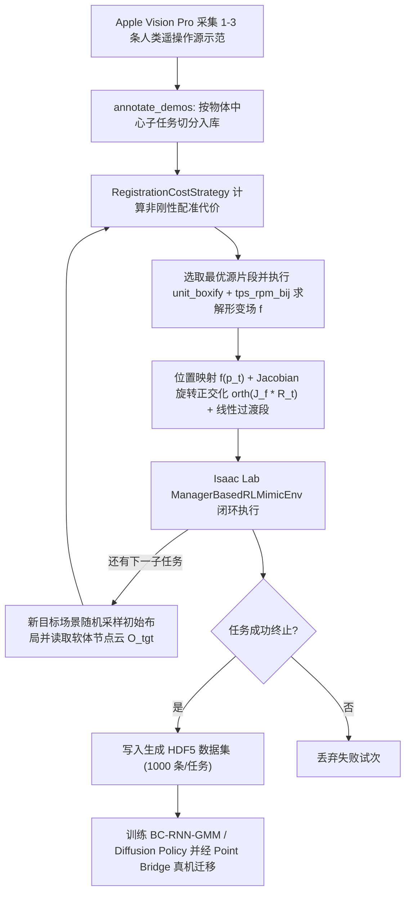
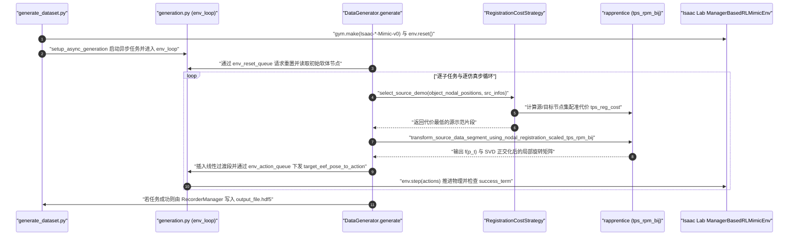

# SoftMimicGen：可变形物体操作自动化示范生成

**SoftMimicGen**（*A Data Generation System for Scalable Robot Learning in Deformable Object Manipulation*，[arXiv:2603.25725](https://arxiv.org/abs/2603.25725)，ICRA 2026，**NVIDIA / 多伦多大学 / 佐治亚理工**）是一套面向 **可变形物体操作** 的仿真数据自动扩增系统与基准套件。它用仿真器提供的 **三维软体节点位置云** 与 **非刚性配准（TPS-RPM-BIJ）** 取代 [MimicGen](./mimicgen.md) 依赖单一刚体 $SE(3)$ 局部参考系的假设，仅凭 **1–3 条** 人类遥操作示范即可在 [Isaac Lab](./isaac-lab.md) 中大规模合成新形变状态与新布局下的成功轨迹，用于训练无需在线配准的视觉运动模仿学习策略。

## 一句话定义

**用基于仿真软体节点点云的非刚性配准（`TPS-RPM`）将极少数人类示范逐子任务平滑弯曲到全新物体形变构型上，批量合成可直接用于模仿学习与真机迁移的机器人操作数据集。**

## 英文缩写速查

| 缩写 | 英文全称 | 简要说明 |
|------|----------|----------|
| TPS-RPM | Thin Plate Spline Robust Point Matching | 薄板样条鲁棒点匹配，源码核心非刚性配准算法 |
| BC | Behavioral Cloning | 行为克隆，用生成数据集训练 BC-RNN-GMM 与 Diffusion Policy |
| PSM | Patient Side Manipulator | dVRK 手术机器人从端操作臂 |
| IL | Imitation Learning | 模仿学习，论文下游策略训练主范式 |
| DOF | Degrees of Freedom | 自由度 |

## 为什么重要

在绳索整理、折叠衣物、袋装物体、微创手术牵拉等真实世界高价值操作场景中，自动化合成数据长期卡在两个瓶颈：
- **缺乏统一刚体坐标系：** 以 [MimicGen](./mimicgen.md) 为代表的刚体轨迹扩增器假设物体可用唯一 $SE(3)$ 位姿描述，一旦布料褶皱改变或绳索一端随机偏转，刚体对齐便会失效（论文实测绳索任务仅 4/50 成功）；
- **软体遥操作极耗人力且真机难规模化：** 双手协同抖平毛巾或穿针引线对人类操作员极其繁琐，而直接用深度相机点云在线配准当作控制器（如早期 Rapprentice 式回放）又容易受传感器噪声与遮挡干扰。

SoftMimicGen 借助仿真器内部**无噪声真值软体节点**完成高精度配准并生成千条级高质量示范，随后再用纯视觉/点云观测训练 **端到端策略**，把「非刚性几何推理成本」彻底留在离线数据合成阶段，推理期无需任何配准。

## 核心原理

### 核心信息

| 维度 | 内容 |
|------|------|
| **论文 / 会议** | *SoftMimicGen: A Data Generation System for Scalable Robot Learning in Deformable Object Manipulation*（ICRA 2026） |
| **机构** | NVIDIA、University of Toronto、Georgia Institute of Technology |
| **覆盖具身（4 类）** | GR1T2 人形机器人、Franka Panda 单臂、dVRK 手术机器人 PSM、双臂 YAM |
| **覆盖对象与动作** | 毛绒泰迪熊、毛巾（展开/折叠）、绳索（摆 U 形）、鞭打积木、软组织、外科缝线、购物袋装物（共 10 项任务） |
| **实现位置** | 已开源 <https://github.com/NVlabs/SoftMimicGen>（Isaac Sim 5.1.0 + Isaac Lab 2.2.1） |

### 核心方法拆解

1. **软体节点表征（Assumption A0）：** 每个可变形物体（以及兼容处理的刚体）状态由其仿真软体网格或粒子求解器输出的 3D 节点集合 $O = \{n_i \in \mathbb{R}^3\}_{i=1}^{N_O}$ 描述，彻底摆脱局部刚体坐标系定义不清的问题。
2. **基于配准代价的子任务源片段选择（`RegistrationCostStrategy`）：** 先借助人工或启发式信号把 1–3 条人类 Apple Vision Pro 遥操作源示范切成物体中心的子任务片段 $\{\tau_i\}_{i=1}^M$。生成新样本时，针对当前场景观测到的节点云 $O'_i$，在源片段池上运行非刚性配准并计算平滑正则与匹配代价，挑出几何构型最接近当前物体状态的源片段。
3. **非刚性形变场与 Jacobian 位姿映射（`TPS-RPM-BIJ`）：** 对选中源片段的起始节点集 $O_i$ 与新场景节点集 $O'_i$ 拟合连续空间形变场 $f: \mathbb{R}^3 \to \mathbb{R}^3$（源码实现采用归一化单位盒 `unit_boxify` + `rapprentice.registration.tps_rpm_bij` 双向薄板样条匹配，再经 `unscale_tps` 还原物理尺度）。源轨迹中每一步末端控制位姿 $T_t = (p_t, R_t)$ 按如下公式局部保形变换：
   $$p_t \to f(p_t), \qquad R_t \to \mathrm{orth}\big(J_f(p_t)\,R_t\big)$$
   其中 $J_f(p_t)$ 为形变场在末端位置处的 $3\times 3$ 空间雅可比，$\mathrm{orth}(\cdot)$ 在代码中由 SVD 正交化并校正行列式符号为 $+1$ 的合法旋转矩阵完成，从而保证夹爪相对可变形局部表面（如布角法向或绳段切向）的抓取姿态不变。
4. **平滑过渡与闭环筛查：** 在变换后子任务首部插入与当前机械臂位姿之间的线性插值过渡段，依次执行所有子任务并在环境终止条件判定成功时存入生成数据集。
5. **Sim–Real 策略学习与 Point Bridge：** 下游不在线运行非刚性配准，而是利用生成数据训练图像输入的 `BC-RNN-GMM` 与 [Diffusion Policy](./paper-diffusion-policy.md)；在真机部署中结合 Point Bridge，将仿真真实掩码提取的物体点云与真机 RGB-D 经 VLM 提取的点云统一对齐，实现零样本及少量真机协同微调。

### 流程总览

## 实验与评测

原文 §V 在 **10 项 Isaac Lab 仿真任务**与 **3 项真机平台任务**上评测了数据合成效率、下游策略收益与跨领域对照：

### 1. 仿真 10 任务策略成功率（Table I：每任务 1–3 条源示范生成 1,000 条数据，3 随机种子最高成功率 %）

| 任务（具身） | 数据生成成功率 | 仅用源示范 BC-RNN-GMM | 生成数据 BC-RNN-GMM | 生成数据 Diffusion Policy |
|------|------|------|------|------|
| **Humanoid - Teddy（GR1）** | 70%–100% 区间 | `0.0 ± 0.0` | `32.0 ± 3.3` | **`42.0 ± 2.0`** |
| **Humanoid - Towel（GR1）** | 70%–100% 区间 | `1.3 ± 1.9` | `50.7 ± 1.9` | **`56.0 ± 5.7`** |
| **Franka - Rope（单臂）** | 70%–100% 区间 | `2.0 ± 2.0` | `99.3 ± 0.9` | **`100.0 ± 0.0`** |
| **Franka - Jenga（动态鞭打）** | 70%–100% 区间 | `4.0 ± 3.3` | **`89.3 ± 15.1`** | `80.0 ± 3.3` |
| **Franka - Towel（折叠）** | 70%–100% 区间 | `0.0 ± 0.0` | **`78.7 ± 6.8`** | `70.7 ± 6.8` |
| **Franka - Rigid Cube（刚体兼容）** | 70%–100% 区间 | `24.0 ± 4.0` | **`90.7 ± 5.0`** | `50.7 ± 6.8` |
| **Surgical - Tissue（PSM 牵拉）** | 70%–100% 区间 | `56.0 ± 5.7` | `81.3 ± 12.4` | **`94.7 ± 1.9`** |
| **Surgical - Threading（PSM 穿环）** | 70%–100% 区间 | `5.3 ± 1.9` | **`98.7 ± 1.9`** | `58.7 ± 1.9` |
| **YAM - Towel（双臂折叠）** | 70%–100% 区间 | `4.0 ± 3.3` | `13.3 ± 3.8` | **`52.0 ± 18.2`** |
| **YAM - Bag Loading（双臂撑袋装物）** | 70%–100% 区间 | `12.0 ± 6.5` | `14.7 ± 5.0` | **`29.3 ± 5.0`** |

- **整体提升：** 仅从 1–3 条人类遥操作出发，生成管线自身跨任务成功率达 **70%–100%**；下游模仿学习策略相比仅在源示范上训练提升 **25%–97%**。
- **对比刚体 MimicGen（§V-D）：** 在半段固定、另半段随机弯折的 `Franka - Rope` 单示范扩增对比中，刚体 [MimicGen](./mimicgen.md) 仅能生成 **4/50** 成功轨迹（局限于极少数近似直线布局），而 SoftMimicGen 达到 **49/50**。
- **数据规模消融（Table II）：** 对生成集做 50 / 250 / 500 / 750 条子采样训练，随着数据规模扩增成功率普遍单调上升（如 `Surgical - Threading` 从 50 条的 `56.0%` 升至 500 条的 `98.7%`，`Franka - Rigid Cube` 从 `42.0%` 升至 `84.0%`）。

### 2. 真机零样本与 Sim–Real 协同训练结果（Table III，基于 Point Bridge 点云策略，成功率 %）

| 真机任务 | 仅真机（30 条示范） | 零样本纯仿真（1 条合成 1,000 条） | Sim–Real 协同训练（1,000 仿真 + 30 真机） |
|------|------|------|------|
| **Franka - Towel** | **76.6** | 70.0 | **76.6** |
| **Franka - Rope** | 46.7 | 33.3 | **76.6** |
| **YAM - Bag Loading** | 33.3 | 63.3 | **93.3** |

## 结论

**总判：SoftMimicGen 用「仿真软体节点真值 + `TPS-RPM` 非刚性配准 + Jacobian 旋转映射」打通了可变形物体模仿学习的数据扩展瓶颈，证明少量人类遥操作即可离线合成覆盖高维形变构型的千条级训练集，并经点云桥接实现真机零样本与显著的 Sim–Real 协同增益。**

1. **利用仿真内部节点避开深度点云配准噪声：** 把 `TPS-RPM` 放在无遮挡、无噪点的离线仿真合成环中，而让下游视觉策略直接学 RGB/点云输入，是比真机在线配准回放更稳健的分层方式。
2. **Sim–Real 协同训练收益远高于纯仿真硬扛：** 真机 30 条 + 合成 1,000 条在 `YAM - Bag Loading` 上把成功率从 33.3% 拉升至 93.3%，工业部署推荐默认走「少量真机示范 + 大规模 SoftMimicGen 合成」协同配方。
3. **动态与高精度单臂任务上 BC-RNN-GMM 与 Diffusion Policy 各有所长：** 动态鞭打（Jenga）与精细穿线中 `BC-RNN-GMM` 往往更稳定，而双臂长程协同（YAM Towel / Bag）更依赖 `Diffusion Policy` 的多模态动作块建模。
4. **选 `RegistrationCostStrategy` 作为复杂形变源片段选择器：** 相比只看质心欧氏距离的刚体选择策略，基于薄板样条形变能量代价选出最相似弯折构型可显著减少关节奇异与轨迹冲突。
5. **同时兼容刚体形状变化（Strict Generalization）：** 当刚体物体也发生类间几何缩放或轮廓差异时，使用 `TPS-RPM` 同样有效（`Franka - Rigid Cube` 达 90.7%）。

## 与其他工作对比

| 系统 / 路线 | 核心配准或适应机制 | 处理对象类型 | 与 SoftMimicGen 的主要区别 |
|------|------|------|------|
| **SoftMimicGen（本文）** | 软体节点集 + `TPS-RPM-BIJ` 连续形变场与 $J_f$ 姿态正交化 | 布料、绳索、软组织、毛绒玩具及刚体 | **不依赖刚体参考帧**，离线生成海量数据供端到端视觉策略训练 |
| **[MimicGen](./mimicgen.md)** | 物体局部坐标系常数 $SE(3)$ 刚性变换 | 刚体操作任务 | 无法处理局部弹性弯折与拓扑不变形变（绳索对比 4/50 vs 49/50） |
| **DexMimicGen** | 多臂协调与跨末端时序同步约束的物体中心变换 | 双臂灵巧刚体操作 | 聚焦双手协作时序同步，但仍立足刚体参考系，未解决软体连续形变配准 |
| **[HumanoidMimicGen](./paper-humanoidmimicgen.md)** | 面向双足全身运动约束与地面导航的模仿生成 | 双足人形移动操作（Loco-Manipulation） | 专注全身基座运动与双臂协调；SoftMimicGen 则聚焦桌面级软体非刚性形变（虽含 GR1 上身任务） |
| **Rapprentice 在线非刚性回放** | 测试期实时采集相机点云做 `TPS-RPM` 变形回放 | 绳索/布料单步示教复现 | 对实时视觉遮挡和点云噪声极其敏感，且难以扩展成跨形态通用策略 |

## 源码运行时序图

以下时序图严格对齐 [NVlabs/SoftMimicGen](https://github.com/NVlabs/SoftMimicGen) 的 `generate_dataset.py`、`generation.py`（`env_loop` / `run_data_generator`）、`DataGenerator`（`data_generator.py`）、`RegistrationCostStrategy`（`selection_strategy.py`）与 `Isaac Lab` 环境步进：

## 工程实践

| 实践要点 | 建议做法 |
|------|----------|
| **环境与数据拉取** | 按仓库 `README.md` 执行 `bash softmimicgen.sh` 自动建立 Isaac Sim 5.1.0 + Isaac Lab 2.2.1 Conda 环境并下载 `datasets/annotated_dataset/` 预标注示范；运行人形 GR1 任务时务必追加 `--enable_pinocchio` |
| **预检查工具** | 先跑 `python scripts/environments/zero_agent.py --task Isaac-Jenga-Franka-IK-Rel-v0 --num_envs 4` 确认 GPU 软体/布料物理仿真帧率正常，再启动生成 |
| **生成与重标注命令** | 批量合成调用 `python scripts/imitation_learning/isaaclab_mimic/generate_dataset.py --device cuda --num_envs 1 --generation_num_trials 100 --input_file ... --output_file ... --enable_cameras`；新增遥操作示范后用 `annotate_demos.py --auto` 或按键分割子任务 |
| **双/四自由度控制器匹配** | 代码对 Franka 与手术 PSM 采用相对末端位姿 `IK-Rel`，对 GR1 采用 Pinocchio 绝对腕部姿态 `Abs-v0`，对双臂 YAM 采用关节空间控制 `Joint-v0`；扩展新机器人时需同步实现 `ManagerBasedRLMimicEnv` 逆解接口 |
| **真机部署通道** | 如要复用仿真数据向真机迁移，遵循原文 §V-E 搭配 Point Bridge 抽取前景物体点云观察，而非直接馈入未域随机化的 Isaac 渲染 RGB 图像 |

## 常见误区与局限

- **固定单线子任务图（原文 §VI 显式局限）：** 当前流水线依赖线性固定的物体中心子任务序列，遇到需要**多次重试（re-grasping）或条件分支恢复**的复杂软体失手场景时无法动态重新规划子任务流。
- **依赖仿真真值软体节点（Assumption A0）：** 配准阶段需要从仿真器底层读取干净的网格节点位置（如 `DatagenInfo` 导出），若某种物体物理只能用不可追踪顶点的纯欧拉粒子/流体近似，节点级 `TPS-RPM` 对应关系会退化。
- **非刚性配准 CPU 开销：** `rapprentice` 的 `unit_boxify` + `tps_rpm_bij` + 逐帧 Jacobian SVD 是在 CPU NumPy 上运行的，高节点密度或大并发 `num_envs` 时易成为数据生成线程瓶颈（常需对节点降采样）。
- **勿与 HumanoidMimicGen 混淆：** 两者命名相近且同属 NVIDIA MimicGen 生态，但 `HumanoidMimicGen` 面向双足移动全身协调，而 `SoftMimicGen` 专注非刚性可变形物体的形状变换适配。

## 关联页面

- [模仿学习（Imitation Learning）](../methods/imitation-learning.md) — BC-RNN-GMM 与视觉运动策略学习基础
- [HumanoidMimicGen](./paper-humanoidmimicgen.md) — 同家族双足人形全身移动操作数据生成（避免概念混淆）
- [MimicGen](./mimicgen.md) — SoftMimicGen 直接扩展的刚体物体中心示范生成框架
- [Isaac Lab](./isaac-lab.md) — SoftMimicGen 10 项软体操作仿真任务底座
- [Diffusion Policy](./paper-diffusion-policy.md) — 论文下游评估使用的主要多模态模仿策略
- [Loco-Manipulation](../tasks/loco-manipulation.md) — 含人形操作在内的移动–操作任务域
- [操作任务（Manipulation）](../tasks/manipulation.md) — 可变形物体操作与抓取基准语境
- [Sim2Real](../concepts/sim2real.md) — 仿真生成数据结合 Point Bridge 向真机迁移方法

## 参考来源

- [SoftMimicGen arXiv 2603.25725 论文归档](../../sources/papers/softmimicgen_arxiv_2603_25725.md)
- [NVlabs/SoftMimicGen 源码与脚本归档](../../sources/repos/nvlabs_softmimicgen.md)

## 推荐继续阅读

- [SoftMimicGen 论文原文（arXiv:2603.25725）](https://arxiv.org/abs/2603.25725)
- [SoftMimicGen 官方项目页与真机演示视频](https://softmimicgen.github.io/)
- [SoftMimicGen 官方开源仓库（NVlabs/SoftMimicGen）](https://github.com/NVlabs/SoftMimicGen)
