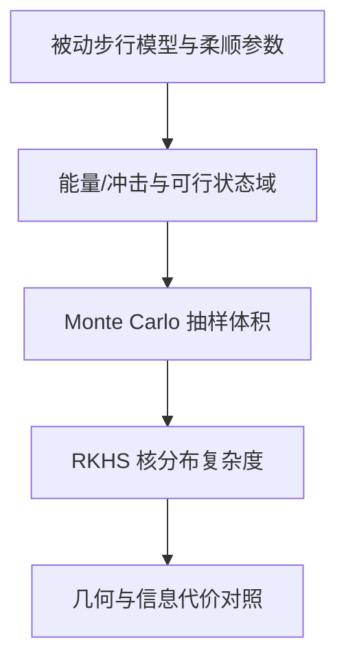

# 被动步行器柔顺踝与信息复杂度度量（Softness is Something You also Need! Why Compliance Helps Control: Information Metrics of a Passive Walker with Compliant Ankle）

**机构：** Fabio Bonsignorio 等；论文列有萨格勒布大学与巴西利卡塔大学等作者单位  
**论文：** [arXiv:2611.13779](https://arxiv.org/abs/2611.13779)

## 一句话定义

**在最简被动步行器、带膝踝柔顺、足底滚动与质量分布模型上，考虑机械能、碰撞与足跟冲击重置，构造可持续步行的相空间。用 Monte Carlo 采样估计可行体积，并以 RKHS 核协方差与 logdet 分析分布复杂度；将几何支持集和动力学诱导概率测度分开。**

## 英文缩写速查

| 缩写 | 英文全称 | 简要说明 |
|---|---|---|
| RKHS | Reproducing Kernel Hilbert Space | 核空间嵌入状态分布 |
| MC | Monte Carlo | 相空间随机采样 |
| CoM | Center of Mass | 机械形态与质量分布 |

## 为什么重要

机械柔顺性除了改变物理可行域大小，也可能改变系统实际经过的状态分布，从而影响控制负担。

## 核心原理

在最简被动步行器、带膝踝柔顺、足底滚动与质量分布模型上，考虑机械能、碰撞与足跟冲击重置，构造可持续步行的相空间。用 Monte Carlo 采样估计可行体积，并以 RKHS 核协方差与 logdet 分析分布复杂度；将几何支持集和动力学诱导概率测度分开。

### 流程总览

以下根据论文方法整理，箭头表示控制/数据流向。

## 实验与评测

以理论推导和数值示意为主；附录使用 MC 接受比例估算可行状态体积，以 Gram 矩阵 regularized logdet 作有限样本 proxy，明确不等同算子级 RKHS 复杂度。原文没有真机策略训练或主动控制器计算量比较。

## 与其他工作对比

在最简被动步行器、带膝踝柔顺、足底滚动与质量分布模型上，考虑机械能、碰撞与足跟冲击重置，构造可持续步行的相空间。用 Monte Carlo 采样估计可行体积，并以 RKHS 核协方差与 logdet 分析分布复杂度；将几何支持集和动力学诱导概率测度分开。 与传统同方向方法的主要区别见以上控制接口及研究动机；跨论文统计结果不具有相同测试协议。

## 结论

**被动步行器柔顺踝与信息复杂度度量 的实际价值在于明确研究对象与实验边界，而非脱离原文场景比较单个成功率。**

1. 可行域的体积和动力学的访问概率是不同量。
2. 冲击的能量收缩与状态空间体积变化不能混同。
3. 理论数值结果不等于实机运控性能验证。

## 工程实践

实际验证时先检查任务接口与坐标系，再按论文试验复现主指标；记录 RKHS / MC / CoM 相关状态、控制采样与异常回退路径，不能以论文中的概念图代替可执行模块证明。

**源码开放状态：** 本次核对的论文未发现可核实的作者算法运行入口，不臆测代码接口。

## 源码运行时序图

**不适用**：尚无可确认的官方完整算法运行入口；以上主干流程是论文方法图，不是虚构源码调用。

## 局限与风险

模型是简化被动动力学而非完整人形/四足；数值受核参数、采样和足跟撞击假设影响。不可把「结构柔顺」等价于已经证实的真机低算力控制。

## 关联页面

- [whole body control](../concepts/whole-body-control.md)
- [classical control](../../roadmap/depth-classical-control.md)
- [humanoid hardware design](../../roadmap/depth-humanoid-hardware-design.md)
- [11.09–11.13 29 篇总览](../overview/humanoid_quadruped_2026_11_09_13_29_papers.md)

## 参考来源

- [arXiv v1 原文核对归档](../../sources/papers/softness-compliant-ankle_arxiv_2611_13779.md)
- [arXiv v1 HTML 全文](https://arxiv.org/html/2611.13779v1)

## 推荐继续阅读

- [论文 PDF](https://arxiv.org/pdf/2611.13779v1)
