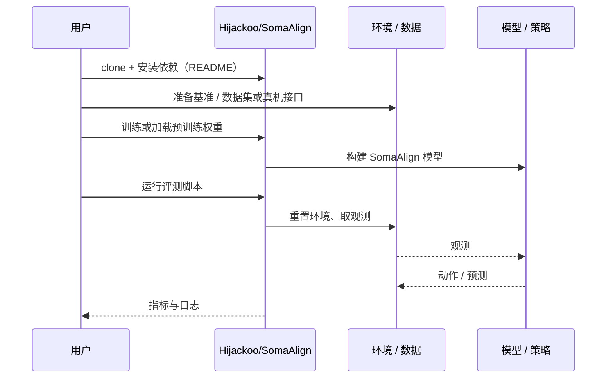

# SomaAlign（arXiv:2611.02794）

**SomaAlign**（*SomaAlign: Reliability-Aware Multimodal Representation Learning for Soft Robotic Grasping*，[arXiv:2611.02794](https://arxiv.org/abs/2611.02794)，[代码](https://github.com/Hijackoo/SomaAlign)）来自 [具身智能小站 2026-11-04 盘点](../../sources/blogs/wechat_embodied_station_57_papers_da_reward_model_failure_2026-11-04.md)，属「触觉与灵巧操作」组。

## 一句话定义

**用重建误差估计模态可靠性，再自适应调整对比学习并处理语义冲突；结合软抓取多模态数据评估检索与结果预测，预测准确率不等于抓取成功率。**

## 英文缩写速查

| 缩写 | 英文全称 | 简要说明 |
|------|----------|----------|
| SomaAlign | SomaAlign: Reliability-Aware Multimodal Representation Learning for Soft Robotic Grasping | 本文方法 / 基准的简称 |

## 为什么重要

- 先判断传感器可靠性，再做模态对齐。
- 开源结论：**已开源**（步骤 2.5，2026-11-04）。仓库可达（git ls-remote）。
- 同期同组工作见 [VLM 奖励评估、动作动力学与开放权重机器人智能体：具身智能小站 11-04 期 57 篇阅读坐标](../overview/embodied-station-2026-11-04-57-papers-technology-map.md)。

## 核心机制

| 项 | 内容 |
|----|------|
| **arXiv** | [2611.02794](https://arxiv.org/abs/2611.02794) |
| **开源** | **已开源** |
| **要点** | 用重建误差估计模态可靠性，再自适应调整对比学习并处理语义冲突；结合软抓取多模态数据评估检索与结果预测，预测准确率不等于抓取成功率。 |
| **文内指标** | 公众号未给具体数字，本页不引用。 |

## 源码运行时序图

以下为按仓库入口（`Hijackoo/SomaAlign`）推断的通用运行链路；入库日仅核实仓库可达，未逐文件阅读，具体脚本名以 README 为准。

## 实验与评测

- 公众号未给具体数字，本页不引用。
- **读法：** 本页为索引级摘要，依据公众号转述的官方摘要与仓库信息整理；逐项数字与 baseline 以原文 PDF 为准。

## 与其他工作对比

- 横向索引见 [VLM 奖励评估、动作动力学与开放权重机器人智能体：具身智能小站 11-04 期 57 篇阅读坐标](../overview/embodied-station-2026-11-04-57-papers-technology-map.md)；同 arXiv 不重复造页。

## 结论

**先判断传感器可靠性，再做模态对齐：用重建误差估计模态可靠性，再自适应调整对比学习并处理语义冲突；结合软抓取多模态数据评估检索与结果预测，预测准确率不等于抓取成功率。**

1. 开源边界：**已开源** — 仓库可达（git ls-remote）。
2. 核心机制：用重建误差估计模态可靠性，再自适应调整对比学习并处理语义冲突；结合软抓取多模态数据评估检索与结果预测，预测准确率不等于抓取成功率。
3. 复现与选型前核对任务协议、硬件与基准口径，勿直接横比公众号摘录数字。

## 关联页面

- [tactile-sensing](../concepts/tactile-sensing.md)
- [contact-rich-manipulation](../concepts/contact-rich-manipulation.md)
- [dexterous-kinematics](../concepts/dexterous-kinematics.md)
- [embodied-station-2026-11-04-57-papers-technology-map](../overview/embodied-station-2026-11-04-57-papers-technology-map.md)

## 参考来源

- [somaalign_arxiv_2611_02794.md](../../sources/papers/somaalign_arxiv_2611_02794.md)
- [wechat_embodied_station_57_papers_da_reward_model_failure_2026-11-04.md](../../sources/blogs/wechat_embodied_station_57_papers_da_reward_model_failure_2026-11-04.md)
- [arXiv:2611.02794](https://arxiv.org/abs/2611.02794)

## 推荐继续阅读

- [arXiv PDF](https://arxiv.org/pdf/2611.02794)
- [https://github.com/Hijackoo/SomaAlign](https://github.com/Hijackoo/SomaAlign)
