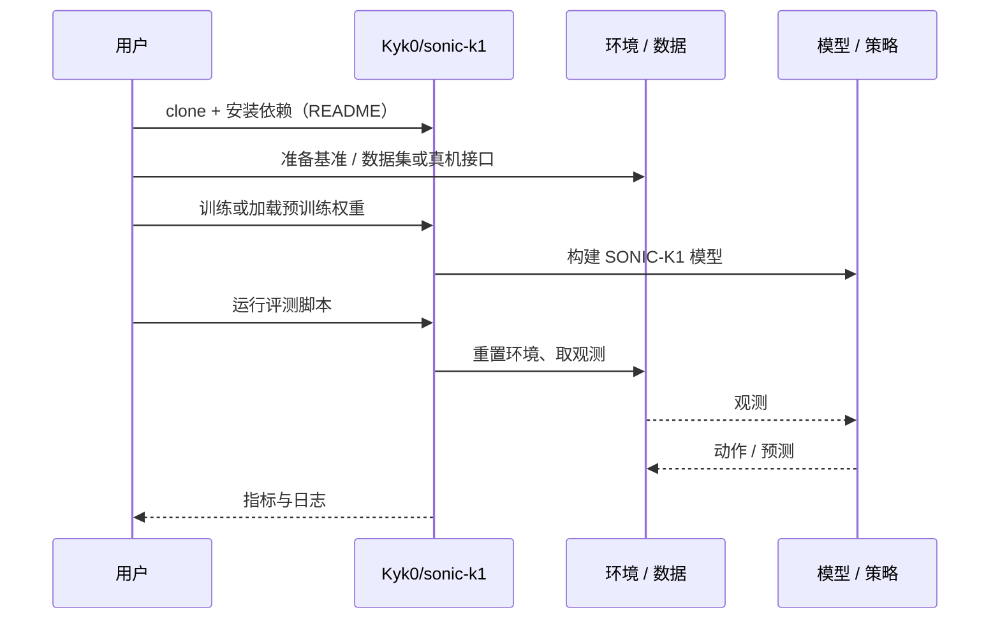

# SONIC-K1（arXiv:2610.39327）

**SONIC-K1**（*SONIC-K1: Porting a Universal Humanoid Motion Tracker to a Small Humanoid on a Single GPU*，[arXiv:2610.39327](https://arxiv.org/abs/2610.39327)，[项目页](https://kyry.me/sonic-k1)，[代码](https://github.com/Kyk0/sonic-k1)）来自 [具身智能小站 2026-10-30 盘点](../../sources/blogs/wechat_embodied_station_28_papers_event2reward_progress_rewards_2026-10-30.md)，属「运动控制与落脚」组。

## 一句话定义

**SONIC-K1 将全身跟踪迁移到 Booster K1，提供策略与评测线索。**

## 英文缩写速查

| 缩写 | 英文全称 | 简要说明 |
|------|----------|----------|
| SONIC-K1 | SONIC-K1: Porting a Universal Humanoid Motion Tracker to a Small Humanoid on a Single GPU | 本文方法 / 基准的简称 |

## 为什么重要

- 单卡训练小型人形机器人的动作跟踪器。仿真覆盖较广，但真机踏步和转身仍不稳定，不能把动作片段通过率等同硬件可靠性。
- 开源结论：**已开源**（步骤 2.5，2026-10-30）。仓库 Kyk0/sonic-k1 经 git ls-remote 可达，项目页同时给出 Hugging Face 权重；页面中的 Coming soon 属于「Next」路线项，不是代码入口。
- 同期同组工作见 [进度奖励、接触监督与规划验证：具身智能小站 10-30 期 28 篇阅读坐标](../overview/embodied-station-2026-10-30-28-papers-technology-map.md)。

## 核心机制

| 项 | 内容 |
|----|------|
| **arXiv** | [2610.39327](https://arxiv.org/abs/2610.39327) |
| **开源** | **已开源** |
| **要点** | SONIC-K1 将全身跟踪迁移到 Booster K1，提供策略与评测线索。 |
| **文内指标** | 公众号转述：仿真覆盖较广，但真机踏步和转身仍不稳定，不能把动作片段通过率等同硬件可靠性。 |

## 源码运行时序图

以下为按仓库入口（`Kyk0/sonic-k1`）推断的通用运行链路；入库日仅核实仓库可达，未逐文件阅读，具体脚本名以 README 为准。

## 实验与评测

- 公众号转述：仿真覆盖较广，但真机踏步和转身仍不稳定，不能把动作片段通过率等同硬件可靠性。
- **读法：** 本页为索引级摘要，依据公众号转述的官方摘要与仓库信息整理；逐项数字与 baseline 以原文 PDF 为准。

## 与其他工作对比

- 横向索引见 [进度奖励、接触监督与规划验证：具身智能小站 10-30 期 28 篇阅读坐标](../overview/embodied-station-2026-10-30-28-papers-technology-map.md)；同 arXiv 不重复造页。

## 结论

**单卡训练小型人形机器人的动作跟踪器：仿真覆盖较广，但真机踏步和转身仍不稳定，不能把动作片段通过率等同硬件可靠性。**

1. 开源边界：**已开源** — 仓库 Kyk0/sonic-k1 经 git ls-remote 可达，项目页同时给出 Hugging Face 权重；页面中的 Coming soon 属于「Next」路线项，不是代码入口。
2. 核心机制：SONIC-K1 将全身跟踪迁移到 Booster K1，提供策略与评测线索。
3. 复现与选型前核对任务协议、硬件与基准口径，勿直接横比公众号摘录数字。

## 关联页面

- [locomotion](../tasks/locomotion.md)
- [reinforcement-learning](../methods/reinforcement-learning.md)
- [sim2real](../concepts/sim2real.md)
- [motion-retargeting](../concepts/motion-retargeting.md)
- [embodied-station-2026-10-30-28-papers-technology-map](../overview/embodied-station-2026-10-30-28-papers-technology-map.md)

## 参考来源

- [sonic_k1_arxiv_2610_39327.md](../../sources/papers/sonic_k1_arxiv_2610_39327.md)
- [wechat_embodied_station_28_papers_event2reward_progress_rewards_2026-10-30.md](../../sources/blogs/wechat_embodied_station_28_papers_event2reward_progress_rewards_2026-10-30.md)
- [arXiv:2610.39327](https://arxiv.org/abs/2610.39327)

## 推荐继续阅读

- [arXiv PDF](https://arxiv.org/pdf/2610.39327)
- [项目页](https://kyry.me/sonic-k1)
- [https://github.com/Kyk0/sonic-k1](https://github.com/Kyk0/sonic-k1)
