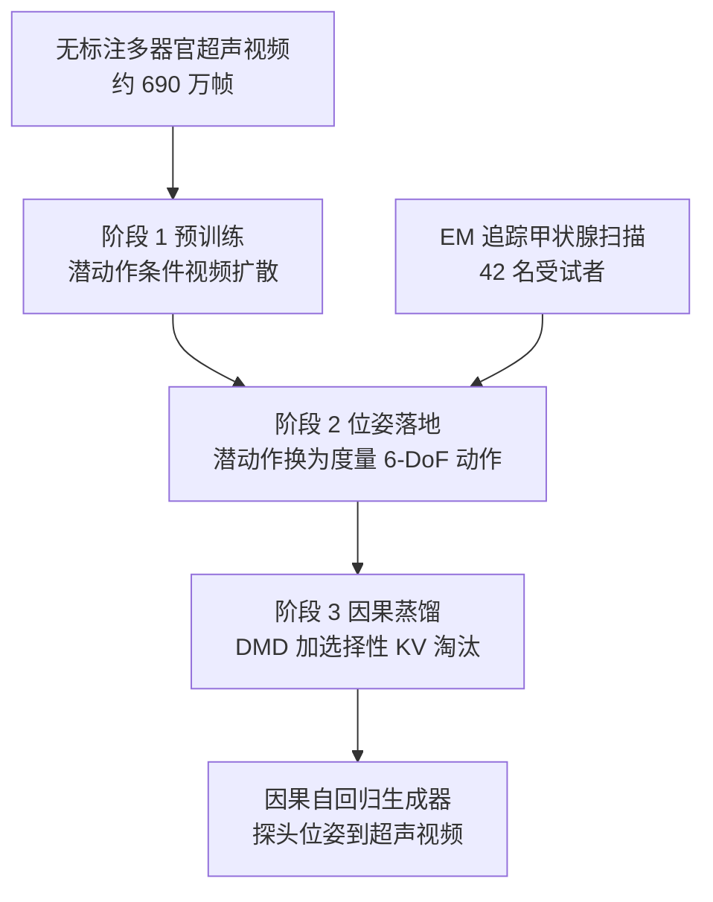

# SonoWorld：可用探头位姿控制的超声世界模型

**SonoWorld 是一个因果的超声视频世界模型：先从大量无位姿标注的临床超声视频里学"画面怎么动"，再用少量带电磁追踪的徒手扫描把动作绑定到 6-DoF 探头位姿，最后蒸馏为可长程自回归生成的因果模型。**

论文 *SonoWorld: Towards Interactive Pose-Controllable Ultrasound World Models*（[arXiv:2610.19327](https://arxiv.org/abs/2610.19327)，[项目页](https://iclr2027anonymous.github.io/SonoWorld/)）。

## 英文缩写速查

| 缩写 | 英文全称 | 简要说明 |
|------|----------|----------|
| EM | Electromagnetic tracking | 电磁传感器追踪探头位姿，用于少量带标签扫描 |
| DMD | Distribution Matching Distillation | 将双向扩散模型蒸馏为少步因果生成器（论文称 self-forcing 式） |
| 6-DoF | Six Degrees of Freedom | 探头平移 + 旋转控制（x, y, z, rx, ry, rz） |
| KV cache | Key-Value cache | 因果推理的缓存；论文用选择性淘汰策略限制长度 |

## 为什么重要

- 机器人超声需要可控、逼真的仿真；体模与声学模拟器和临床图像差距大，在患者身上试错又不安全。
- 小幅探头运动会引起画面大变化（每帧只是三维解剖的二维切片），数据驱动的世界模型是一条替代路线。
- 把"无标注视频学动态"与"少量位姿数据学控制"拆开，降低了对昂贵位姿标注的需求。

## 核心信息

| 项 | 内容 |
|----|------|
| **机构** | United Imaging Intelligence（美国波士顿）、Rensselaer Polytechnic Institute（纽约 Troy），依据论文 HTML；二者未在本库机构注册表，故无机构 tag |
| **骨干** | Wan2.1-T2V-1.3B 潜视频扩散 Transformer；预训练潜动作维度 32，后训练动作块 24 维（每潜帧四个 6-DoF 动作） |
| **数据** | 过滤后 153,892 段 3 秒片段、6,925,140 帧（腹部 / 心脏 / 甲状腺）；EM 追踪甲状腺 42 名受试者（33 训练 / 9 验证，按受试者划分）。项目页写约 6.7M 帧，与论文 6.9M 不一致，以论文为准 |
| **开源** | **未发布**（2026-10-17 核查）：项目页为匿名投稿版（标注 Under Review），论文与 GitHub 链接均为 "Coming Soon"；无权重、无数据 |

## 核心原理

### 流程总览

- 三阶段分工：阶段 1 学动态，阶段 2 学"探头怎么动"，阶段 3 换取长程与速度。
- 因果生成器在单张 H100、256×256、4 步去噪下约 40.6 fps（论文）。

## 源码运行时序图

**不适用**：截至 2026-10-17 无可获取的代码仓库（项目页 GitHub 链接为 Coming Soon），无运行入口可对齐。

## 与其他工作对比

| 维度 | SonoWorld（本文） | [EgoWM](./paper-egowm-egocentric-world-model.md) | [Genie](./paper-sa-2402-15391-genie-generative-interactive-environments.md) | [US-VLA](./paper-us-vla-ultrasound.md) |
|------|------|------|------|------|
| 模型类型 | 动作条件超声视频世界模型 | 动作条件 egocentric 视频世界模型 | 生成式交互环境（通用视频） | 超声探头控制策略（VLA） |
| 动作来源 | 无标注视频学潜动作，再用 EM 位姿落地到 6-DoF | 直接注入电机命令（3-DoF 移动到 25-DoF 人形） | 从无标注视频学潜动作 | 专家扫查轨迹监督 |
| 骨干 / 推理 | Wan2.1-1.3B，DMD 蒸馏为因果自回归（约 40.6 fps） | 改装预训练视频扩散（SVD / Cosmos / Wan） | 见原文 | 真机 UR7e + 超声设备闭环 |
| 开源 | 未发布 | 部分开源 | 见原文 | 已开源 |

- **相对 EgoWM：** 同为"预训练视频扩散 + 轻量动作条件"路线，SonoWorld 多了潜动作预训练阶段以减少对位姿标注的依赖，并蒸馏为因果模型以支持实时长程生成；场景从相机自我视角换成二维超声切片。
- **相对 Genie：** 借用"从无标注视频学潜动作"的思路，但随后用 EM 追踪数据把潜动作替换为度量 6-DoF 探头位姿，以获得可物理解释的控制。
- **相对 US-VLA：** US-VLA 是在真机上直接输出探头动作的策略；SonoWorld 是仿真器原型，可为此类策略提供交互训练或评测环境，但论文未做这种闭环验证。
- 论文自述无共享基准，各文指标不可横比。

## 工程实践

| 项 | 建议 |
|----|------|
| 复现状态 | 无代码、无权重；只能依据论文 HTML 理解训练配方 |
| 数据门槛 | 位姿落地仅有甲状腺 EM 数据，迁移到其它器官需另采 |
| 用法定位 | 视为交互式仿真器原型，不是临床自主扫描系统 |
| 缓存策略 | 论文报告：保留 33 个潜帧中的 12 个，PSNR 与全注意力相差不超过 0.14 dB |

## 实验与评测

- **可控性（EM 扫描，PSNR / SSIM / LPIPS）：** 双向原位姿 16.84 / 0.402 / 0.413；因果原位姿 16.09 / 0.386 / 0.439；因果往返 15.17 / 0.349 / 0.465。因果比双向低 0.75 dB PSNR。
- **潜动作预训练收益：** PSNR 17.78 → 21.38 dB（+3.60），LPIPS 0.266 → 0.199。
- **模型式动作判别：** 阈值 15 平均 74.76%（x 73.91、y 78.26、rx 61.54、ry 86.96、rz 66.67）；阈值 20 平均 66.67%。阈值的具体含义未核实。
- **用户研究（5 位评分者、55 段）：** 探头-解剖对齐得分最高（3.31–4.35），图像质量最低（约 3.11–3.60）。

## 结论

**SonoWorld 说明位姿可控的超声世界模型可由"大量无标注视频 + 少量位姿数据"得到，但目前的证据是像素指标和代理任务，离临床自主扫描还很远。**

1. **别把 74.76% 当作临床指标** — 它是模型式动作判别的代理成功率，且不同轴差别很大（rx 61.54 对 ry 86.96）。
2. **预训练确有贡献** — 潜动作预训练带来 +3.60 dB PSNR。
3. **因果化有代价** — 蒸馏后 PSNR 低 0.75 dB，换取实时与长程。
4. **图像质量是短板** — 用户研究中质量分最低。
5. **等待代码再谈复现** — 当前仅匿名项目页。

## 局限与风险

- 作者自述：位姿落地数据小且仅限甲状腺；探头位姿不能完全决定画面（接触力、组织形变、生理运动、扫描设置未观测）；像素指标只是几何控制的间接证据；无共享基准，无法与最近模型直接比较。
- 项目页帧数（6.7M）与论文（6.9M）不一致。
- 论文 HTML 约 24k 字符（末段）本次未读，可能遗漏附录细节（未核实）。

## 关联页面

- [生成式世界模型](../methods/generative-world-models.md) — 方法族背景
- [扩散模型](../concepts/diffusion-model.md) — 视频扩散与蒸馏基础
- [世界模型功能分类](../concepts/functional-taxonomy-world-models.md) — 本工作属于可交互仿真类
- [World Action Models](../concepts/world-action-models.md) — 动作条件世界模型对照

## 参考来源

- [sonoworld_arxiv_2610_19327.md](../../sources/papers/sonoworld_arxiv_2610_19327.md) — 论文摘录与开源核查
- [sonoworld-project.md](../../sources/sites/sonoworld-project.md) — 项目页归档
- [arXiv:2610.19327](https://arxiv.org/abs/2610.19327)

## 推荐继续阅读

- [SonoWorld 项目页](https://iclr2027anonymous.github.io/SonoWorld/)
- [论文 HTML](https://arxiv.org/html/2610.19327)
