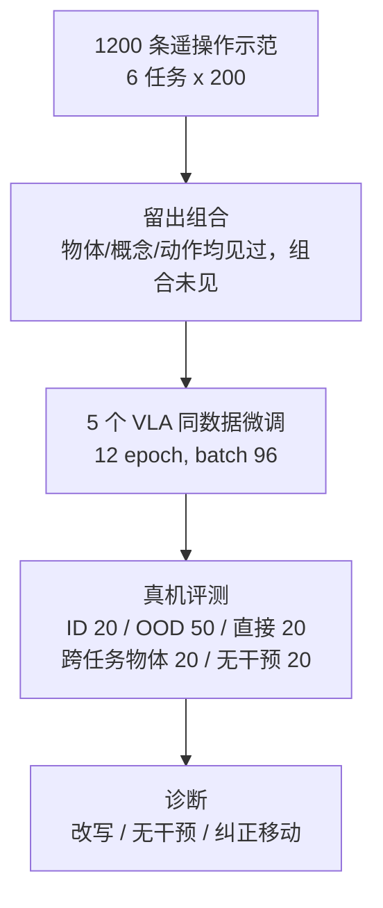

# Spa-Bench：真机上检验 VLA 的空间落地

**Spa-Bench**（[arXiv:2610.12696](https://arxiv.org/abs/2610.12696)，[项目页](https://justintiensmith.github.io/Spa-Bench/)）由 **Imperial College London**（Justin Tien-Smith、Matthew Pidden、Rolandos Alexandros Potamias）提出：在 SO-101 机械臂上设计六类空间落地任务，保留物体与动作的训练支持、只改变空间组合，并加入“直接点名目标”的对照，来判断 VLA 的失败来自目标选择还是动作执行。

## 一句话定义

**一个用配对真机场景与留出组合，把 VLA 的操作能力和空间指令理解拆开测量的基准，而不是新的策略。**

## 英文缩写速查

| 缩写 | 英文全称 | 简要说明 |
|------|----------|----------|
| VLA | Vision-Language-Action | 被评测的策略类型 |
| ID | In-Distribution | 空间组合在训练中出现过的评测 |
| OOD | Out-of-Distribution | 空间组合被留出、但组成部分见过的评测 |
| SO-101 | Standard Open 101 arm | 低成本开源机械臂，本文唯一本体 |
| EMA | Exponential Moving Average | GR00T 变体动作平滑滤波 |
| CI | Confidence Interval | Wilson 95% 置信区间 |

## 为什么重要

- **聚合成功率会掩盖原因：** 一个任务失败可能源于认错物体、语言没听懂，也可能只是抓不稳。配对的“空间 vs 直接点名”场景让两者可分。
- **真机而非仿真：** 全部示范与评测都在真机上，避免仿真视觉差异。
- **对选型的含义：** 三个完整评测策略的差距集中在目标选择，而不是动作执行，提示数据与训练信号应针对空间落地。

## 方法栈 / 流程总览

## 方法

- **平台与物体：** SO-101、桌面、共用碗；27 个物体实例、11 类形态族；每场景至多 5 个候选物体。
- **六个任务：** Object State、Relative Size（属性）；Referential Description、Relational Placement（关系）；Ordinal Position、Counting（场景结构）。
- **数据：** 1,200 条人类遥操作示范（每任务 200，约 5.7 小时、612,733 帧，五路 RGB，策略用中间与腕部视角）。
- **留出单元：** 每个概念–参数配对在空间训练中被留出，例如 “upside-down white cup” 未见，但 “upside-down” 与 “white cup” 均见过。
- **对照与诊断：** 直接点名操作、两类指令改写、跨任务物体、无需干预场景、Relational Placement 的纠正移动对照。
- **被测策略：** MolmoAct2、π0.5、GR00T-N1.7 F-LLM 完整评测（各 900 回合）；GR00T-N1.7 F-FT 与 VLA-0 仅部分 ID 基线（120 与 72 回合）。统一 12 epoch、batch 96、4 块 GH200。

## 源码运行时序图

不适用：这是评测基准，项目页未列 GitHub 训练/评测仓库（截至 2026-10-12），数据以 Hugging Face CSV/Parquet 提供，没有可对齐的运行脚本。

## 工程实践

- **作为自家 VLA 的体检表：** 对照“同场景空间指令 vs 直接点名”的差值，可以快速判断瓶颈是目标选择还是执行。
- **注意协议差异：** 五策略中只有三项完成完整协议，GR00T F-FT 与 VLA-0 只做了 ID 子集，不要混作统一排名。
- **开源状态：** 项目页声明模型、数据集、回合与表格在 Hugging Face；核对到的数据集页含 `model_evaluation`（约 2.89k 行）与 `training_data`（约 1.2k 行）两个子集的元数据；视频文件、许可与代码未核实，无 GitHub 仓库。

## 实验与评测

- **ID（120 回合）：** MolmoAct2 73.3%（88/120）、π0.5 68.3%、GR00T F-LLM 67.5%。
- **OOD（300 回合）：** MolmoAct2 52.0%、F-LLM 44.3%、π0.5 40.7%。
- **空间 vs 直接点名（配对 OOD）：** MolmoAct2 60.8%→89.2%、π0.5 45.0%→83.3%、F-LLM 41.7%→81.7%，差距 28.3–40.0 点。
- **改写诊断：** 改写后空间成功率下降（如 MolmoAct2 65.0%→50.0%），直接点名基本稳定，说明差距不能只归因于措辞。
- **分任务 OOD：** Counting 三策略均为 0/50；Object State MolmoAct2 38/50，π0.5 18、F-LLM 17。
- **无干预场景：** 四个非关系任务聚合仅 20.0–23.8%；Ordinal Position 与 Object State 为 0%，Counting 在目标已满足时 80–85%。
- **失败归因：** Counting 148/150 次失败为无动作；Ordinal Position 74/79 选错物体；Object State 75/77 类别对、实例错。

## 结论

**会操作不等于理解空间指令：三种主流 VLA 在直接点名时可达 80% 以上，换成空间描述后明显下降，瓶颈在目标选择。**

1. **用配对直接点名对照拆因** — 差值给出目标选择的代价。
2. **留出组合比随机划分更严格** — 测的是组合泛化而非记忆。
3. **计数类空间任务最难** — 三策略 OOD 全部为 0。
4. **别把“目标已满足”当作理解** — 无干预场景里高分多来自不动作恰好正确。
5. **结论限定于完整适配后的策略系统** — 不能归因到单个架构部件。

## 局限与风险

- 单一本体、工作空间、物体清单与动作族；词汇受限。
- 复位非像素级一致；无干预条件为零样本；直接点名与改写条件语言输入不完全相同。
- 跨任务对比是描述性的，并非物体互换配对。
- GR00T F-FT 评测前有未记录的小幅上移（论文估计约 10 mm），部分结果不可严格比较。
- 开源：数据在 HF（部分核实），无代码仓库。

## 与其他工作对比

| 对照 | 差异读法 |
|------|----------|
| [MolmoAct2](./paper-molmoact2.md) | 被测策略之一，OOD 最高（52.0%）但仍有 28.3 点直接点名差距 |
| [π0.5 开放世界 VLA](./paper-pi05-open-world-vla.md) | 被测策略之一；聚合泛化好并不保证空间落地 |
| [Isaac GR00T](./isaac-gr00t.md) | N1.7 F-LLM 变体被测；Relational Placement 上最强（39/50） |
| [LIBERO 基准](./libero-benchmark.md) | 仿真聚合成功率基准；Spa-Bench 补充真机的分因素诊断 |

## 关联页面

- [34 篇空间落地技术地图（汇总页）](../overview/embodied-station-34-papers-spatial-grounding-technology-map.md)
- [VLA 方法](../methods/vla.md)
- [操作任务](../tasks/manipulation.md)
- [MolmoAct2](./paper-molmoact2.md)
- [LIBERO 基准](./libero-benchmark.md)
- [具身大模型评测基准选型闭环](../queries/embodied-eval-benchmark-selection-loop.md) — 本页属③策略任务成功率层：SO-101 真机上用留出组合与直接点名对照，把操作能力与空间指令理解分开归因

## 参考来源

- [具身智能小站 34 篇周报](../../sources/blogs/wechat_embodied_station_34_papers_spatial_grounding_2026-10-12.md) — 线索来源
- [spa_bench_arxiv_2610_12696.md](../../sources/papers/spa_bench_arxiv_2610_12696.md) — 论文摘录
- [justintiensmith-github-io-spa-bench.md](../../sources/sites/justintiensmith-github-io-spa-bench.md) — 项目页核查
- [arXiv:2610.12696](https://arxiv.org/abs/2610.12696)

## 推荐继续阅读

- [Spa-Bench 项目页](https://justintiensmith.github.io/Spa-Bench/)
- [Spa-Bench 数据（Hugging Face）](https://huggingface.co/datasets/Spa-Bench/spa-bench-data-information)
- [arXiv HTML 全文](https://arxiv.org/html/2610.12696v1)
