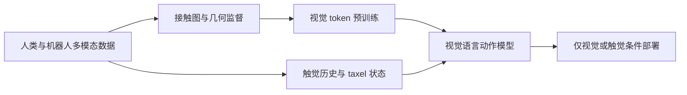
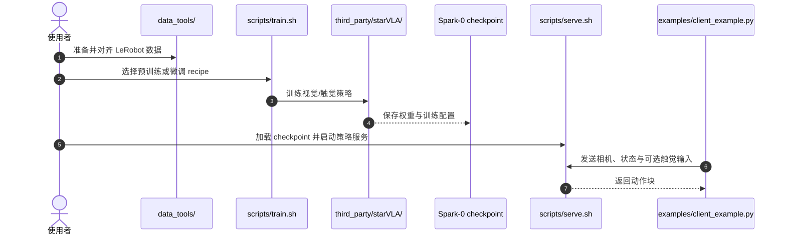

# Spark-0：规模化空间对齐触觉预训练

## 一句话定义

**Spark-0 将触觉同时用作视觉空间接触监督和动作专家输入，让策略在预训练阶段学习接触位置、在部署时按需使用触觉。**

## 英文缩写速查

| 缩写 | 英文全称 | 简要说明 |
|------|----------|----------|
| VTLA | Vision-Tactile-Language-Action | 联合视觉、触觉、语言与动作的策略 |
| VLA | Vision-Language-Action | 视觉语言条件的机器人动作策略 |
| DA3 | Depth Anything 3 | 论文用作冻结 3D 几何教师的模型 |
| HDF5 | Hierarchical Data Format 5 | 论文/基准使用的数据容器格式之一 |

## 为什么重要

图像对接触力、柔顺性和初始滑移的观测有限。Spark-0 探索触觉数据能否不仅作为上线时额外传感输入，也能在大规模预训练时改善视觉表征和动作学习。

## 核心原理

- **空间对齐监督：** 触觉手套生成图像空间接触图，冻结的 DA3 几何教师提供额外空间表征，二者监督视觉 token；这部分训练目标推理时移除。
- **触觉条件动作：** 触觉编码器把区域力历史和 taxel 三维状态送入动作专家，帮助生成接触相关动作。
- **统一检查点：** 同一模型既能只用视觉运行，也能在部署时接入触觉。
- **数据规模：** HumanTouch 汇集 1,000 小时全手触觉人类操作；SparkArena 将仅视觉仿真和触觉真实机器人测试置于统一评测框架。

## 源码运行时序图

README 给出的公开入口包括 `data_tools/`、`scripts/train.sh`、`scripts/serve.sh` 与 `examples/client_example.py`：

## 实验与评测

- 摘要报告 Spark-0 在 SparkArena 两条赛道平均成功率领先，并在 Ego Humanoid Manipulation Benchmark 八项汇总指标中排名第一。
- 同数据、同算力消融中，保留 1,000 小时触觉监督后，Ego Humanoid 视觉-only 成功率从 52.5% 提升至 71.7%；SparkArena-Real 从 44.0% 提升至 52.0%。
- 结果提示触觉监督可迁移为视觉表征收益，但这些是论文基准和训练配置下的报告值。

## 工程实践与局限

- 仓库基于补丁版 StarVLA，训练依赖预训练权重、DA3 teacher、数据转换与统计缓存。
- 独立代码、检查点和 XPolicyLab 集成已公开；SparkArena-Sim 代码仍标记 Coming soon。
- HumanTouch 的独立下载地址本次未确认，复现该数据规模的预训练目前存在资料缺口。
- 对触觉部署的评估需区分传感器是否存在、触觉是否进模型，以及仅视觉收益是否来自触觉监督。

## 与其他工作对比

| 工作 | 触觉 / 力信号的用法 | 与 Spark-0 的差异 |
|------|---------------------|-------------------|
| [OmniVTLA](./paper-sa-2508-08706-omnivtla-vision-tactile-language-action-model-wi.md) | 语义对齐的触觉编码器 + dual-path encoder，触觉作为策略输入模态 | Spark-0 另把触觉接触图用作视觉 token 的空间监督，推理时移除该目标 |
| [ForceVLA](./paper-forcevla.md) | 6 轴外载 wrench 作为 VLM 后的一等模态 | 力/力矩而非分布式触觉；Spark-0 使用全手 taxel 触觉与图像空间接触图 |
| [Star-VTLA](./paper-star-vtla.md) | 视触联合预训练、稀疏全局触觉 token、稀疏未来触觉预测 | 同为预训练配方；Spark-0 的主张集中在触觉监督对仅视觉部署的迁移 |
| [𝒩₀-VTLA](./paper-n0-vtla.md) | 预测未来动作块的潜空间触觉 token，条件化动作专家 | 触觉作为预测目标服务动作生成；Spark-0 同时保留触觉条件与仅视觉两种部署 |

Spark-0 的可比主张是“训练期触觉监督能提升仅视觉策略”（Ego Humanoid 52.5% → 71.7%）；与要求部署时必须有触觉传感器的 VTLA 对比时，应把仅视觉与触觉条件两种部署分开报告。人类触觉采集侧可对照 [HumanTouch](./humantouch.md) 条目，其公开规模与发布状态需以该页和项目页为准。

## 结论

**Spark-0 把触觉从推理时的额外观测扩展为预训练时的空间监督信号，并报告了可迁移到视觉-only策略的收益。**

1. 消融时分别比较训练期触觉监督和部署期触觉输入。
2. 接入数据前检查手、相机、触觉 taxel 与机器人坐标的空间对齐。
3. 复现训练需额外准备 DA3、基础 VLM、数据和预计算统计量。
4. 数据集本身的公开下载状态仍需根据项目页后续链接确认。

## 关联页面

- [触觉感知](../concepts/tactile-sensing.md)
- [接触丰富操作](../concepts/contact-rich-manipulation.md)
- [REKI：VLA 的寄存器记忆](./paper-reki-vla-register-memory.md)

## 参考来源

- [Spark-0 论文归档](../../sources/papers/spark0_arxiv_2610_22342.md)
- [项目页与数据/代码边界](../../sources/sites/spark-0.md)
- [官方仓库](../../sources/repos/spark-0.md)

## 推荐继续阅读

- [Spark-0 项目页](https://xsparkai.com/Spark-0/)
- [Spark-0 官方代码](https://github.com/XsparkAI/Spark-0)
