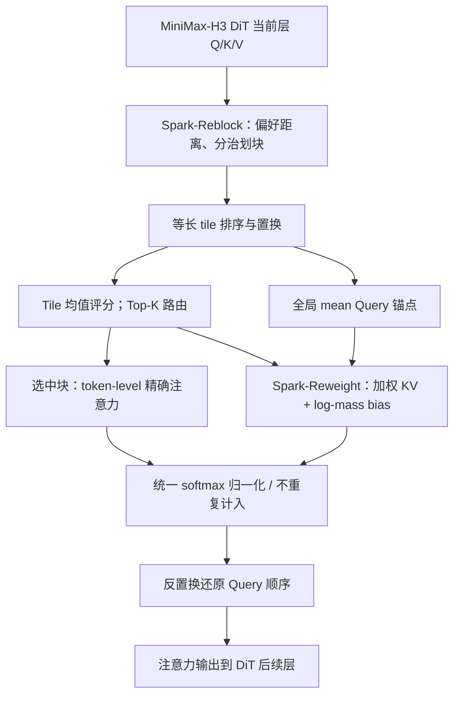
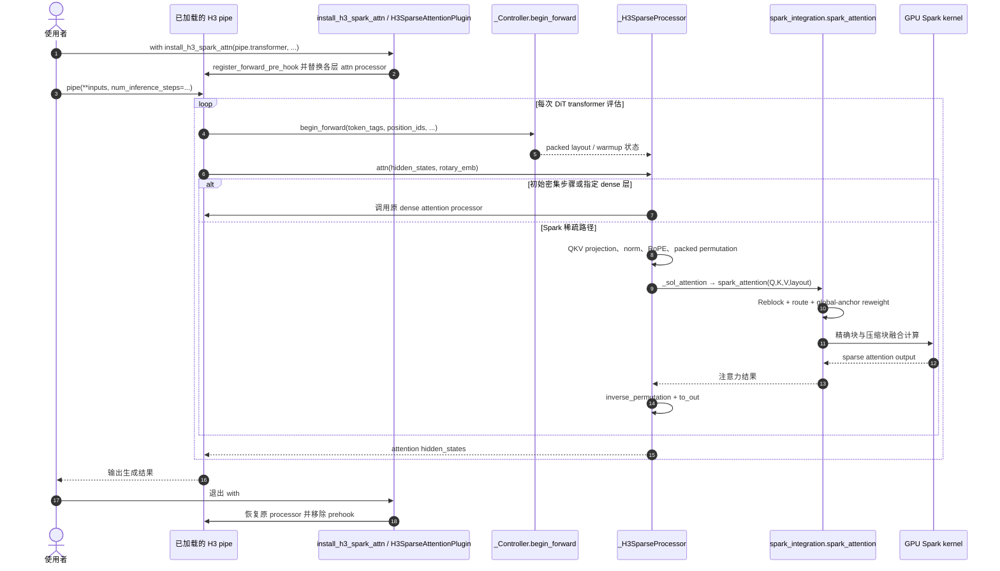

# Spark-H3：面向视频扩散模型的自适应分块稀疏注意力 / Adaptive Block Sparse Attention for Video Diffusion Models

> **一手资料**：[arXiv:2611.24256v1（2026-11-18）](https://arxiv.org/html/2611.24256v1) · [官方代码](https://github.com/zechengtang/Spark-H3) · [项目主页](https://zechengtang.github.io/Spark-H3/) · [Hugging Face](https://huggingface.co/Aazeus/Spark-H3)。论文作者 Zecheng Tang 等 8 人；下述数值均为作者报告，**未独立复测**。

## 一句话定义

**Spark-H3** 是在 [MiniMax-H3](minimax-h3.md) 上实现的免训练分块稀疏注意力后端：Spark-Reblock 把注意力偏好相似的 token 分到等长块，Spark-Reweight 使用全局均值查询校准未选块的 KV 压缩和注意力总质量，在精确计算与近似计算间平衡保真度和速度。

## 英文缩写速查

| 缩写 | 英文全称 | 简要说明 |
|---|---|---|
| BSA | Block Sparse Attention | 选中 tile 精算，其余 tile 压缩近似 |
| CSA | Cluster Sparse Attention | 动态 token 分组的稀疏注意力路线 |
| DiT | Diffusion Transformer | MiniMax-H3 的视频去噪计算主干 |
| KV | Key-Value | 注意力的 key / value，未选块压缩表示 |
| PSNR | Peak Signal-to-Noise Ratio | 相对 Dense 输出的重建保真度指标 |
| VBench | Video Generation Benchmark | 视频质量基准，非稠密输出误差 |
| LoRA | Low-Rank Adaptation | 社区少步蒸馏权重，可与 Spark 叠加 |

## 为什么重要

- **静态分块选错重要交互：** 混杂不同注意力偏好的 token 后，以 tile 均值做 Top-K 会漏掉高质量的精确块。
- **未选块不能一删了之：** 均值池化会低估压缩块 log-sum-exp 的 attention mass，扰动归一化。
- **兼容已有 H3 权重：** 在推理阶段替换注意力而非另训策略/主干，可与社区少步 LoRA 结合；节约的是视频生成 attention/DiT 的部分成本，并非机器人控制闭环延迟。

## 核心原理

### 1. 双分支 BSA 与路由

对单个 attention head 的 Q/K/V，按 64-token 等长 tile 构建分块；query tile 均值与 KV tile 均值的点积选择比例 ρ 的 **Top-K 精确块**，保留 token-level attention；其余未选块采用加权 KV 与 bias 近似。两支在同一个 softmax 分母合并，被精确选中块的压缩贡献必须 mask，不能双算。

### 2. Spark-Reblock：按注意力偏好重组

使用从 Q/K 相互作用诱导的二阶矩度量偏好相似性，在各树节点从 landmark 构建局部划分方向，以 rank 平衡分裂、递归形成大小一致的 tile；分组开销为 O(N log N)，避免直接求全量 N² 注意力矩阵。论文 H3 配置默认 32 个 landmarks、每分裂两次更新、64 token/tile，并以 key 分组的置换同时作用于 Q、K、V（独立 Q/K 分组是 dagger 消融版本）。

### 3. Spark-Reweight：查询锚点的压缩校准

令全局查询均值 q̄ 为锚点，KV tile J 内以该锚点的注意力 softmax 作权重，求加权代表 k̃_J、ṽ_J，并设置 β_J = log m_J(q̄) − score(q̄,k̃_J)。未选 tile 对 query q 的近似质量为 exp(score(q,k̃_J)+β_J)，而非简单的 exp(score(q,mean(K_J))+log tile_size)。这种线性近似在 **q̄** 处匹配原质量与一阶梯度，离开锚点仍有近似误差，不能理解为精确重建。

## 流程总览

依据论文 Fig. 3、`3.1–3.3 的 attention 数据流：

## 源码运行时序图

已对齐官方 `h3_sparse_attention/README.md`、`__init__.py`、`processor.py` 与 `spark_integration.py` 的 **已发布推理入口**；非对论文模型训练流程的猜测：

说明：`processor.py` 实际使用 `_H3SparseProcessor`、`_Controller`、`H3SparseAttentionPlugin`；`spark.py` 还导出 `spark_reblock`/`spark_reweight` 低级函数。图示是静态源码走查，**未在 GPU 上运行**。

## 工程实践

| 条件 | 官方路径与要点 |
|---|---|
| 安装 | 先依照上游 MiniMax-H3 配置模型和 CUDA，再在 Spark-H3 目录 `python -m pip install -e '.[cuda]'` |
| Diffusers | `from h3_sparse_attention import install_h3_spark_attn`；`with install_h3_spark_attn(pipe.transformer, num_denoise_steps=19, warmup_steps=4, warmup_mode="warmup_steps", dense_layers=0, topk_ratio=0.1)` |
| 调度约定 | `MiniMaxH3Scheduler` 包含 σ=0 终点；`num_inference_steps=20` 表示 19 次真实去噪调用，须与论文 20-step benchmark 标注区分 |
| Sparse 作用域 | 目标视频 token 稀疏，文本/音频上下文查询仍 dense；Ref2VA 有可配置 scope，必要时保留条件视频精确计算 |
| 社区集成 | 代码提供 Ref2VA、ComfyUI 后端及社区 LoRA 联用；部分 GPU/ComfyUI 版本须匹配相应 release |
| 开源程度 | **推理后端已开源**，Hugging Face 不是 H3 基础权重镜像；权重从 [MiniMaxAI/MiniMax-H3](https://huggingface.co/MiniMaxAI/MiniMax-H3) 获取 |
| 迁移边界 | 此项是视频 DiT 的推理加速，不具备机器人 action-conditioned 物理闭环或直接执行输出 |

完整用法和 kernel 支持矩阵见 [官方代码归档](../../sources/repos/zechengtang-spark-h3.md)。

## 实验与评测

**作者论文 Table 1–5；未复测。** MiniMax-H3 基准为 14.4 s / 345 帧 / 1344×768 / 20 个去噪步骤；前 4 步为 dense warmup。**DiT latency 排除了文本编码与 VAE 解码，不代表端到端耗时。**

| MiniMax-H3 注意力 | 精确块密度 | DiT 延迟（s，论文值） | DiT 加速 | 相对 Dense PSNR |
|---|---:|---:|---:|---:|
| Dense | 100% | 4061.8 | 1.00× | ∞ |
| PISA | 10% | 1643.4 | 2.47× | 20.20 dB |
| Sol-H3 | 约 20.8% | 1781.9 | 2.28× | 21.26 dB |
| Spark-H3 | **10%** | **1629.6** | **2.49×** | **24.81 dB** |
| Spark-H3 | **20%** | **1796.1** | **2.26×** | **26.76 dB** |

- **消融（Table 4–5）：** 10% 下 Reblock 带来 61.36%→79.69% 选中块 attention-mass recall；20% 下叠加 Reweight 使 log-mass MAE 1.39→1.16、PSNR 26.24→26.76。
- **跨模型（Table 2）：** LTX-2.5 仅在高分辨率第二阶段用稀疏注意力，10% exact 该阶段 DiT 3.92×、PSNR 30.84；不是完整两阶段总加速。
- **少步模型（Table 3）：** MiniMax-H3-Turbo 8-step LoRA，在 10%/20% 密度下分别 2.27×/2.08× DiT；不要和原版 20-step 的加速倍数叠加成声称的实测值。
- **评测意义：** PSNR/SSIM/LPIPS 比的是相同输入下密集注意力输出的差异；VBench 以视频质量评价，二者不能互相替代。

## 结论

**Spark-H3 的关键收益是用更合适的精确块选择与压缩质量校准，在不重新训练主干的前提下优化视频 DiT 延迟与相对 Dense 的保真度；不是让所有视频生产流程或机器人推理直接获得相同倍数的端到端加速。**

1. **读速度先问边界：** 2.49× 仅是 Table 1 的 DiT，固定 14.4 s/1344×768/20-step 设置；排除 VAE 与文本编码。
2. **在同预算下优先检查 Reblock：** 它决定 Top-K 是否抓住真正重要的注意力质量，而非仅调低密度。
3. **不应直接删除尾块：** Reweight 的 log-mass 偏置可抑制均值压缩对注意力归一化的系统性低估。
4. **部署先核显卡和后端：** 核对 CUDA 构建、pack layout、密集热身、Ref2VA context 与 ComfyUI release；保持 baseline 协议一致。
5. **迁移到 VLA/WAM 仍需新实验：** 当前论文验证的是视频扩散生成而非机器人 action head、系统闭环成功率或毫秒级控制周期。

## 与其他工作对比

- [FlashAttention](paper-2205-14135-flashattention.md) 是计算 dense exact attention 的 IO 优化；Spark-H3 通过 exact+compressed 的近似替换进一步减少部分 QK 交互，因此允许输出误差。
- 论文对照 PISA、Sol-Attn（BSA 的未选块近似）及 SVG2、SVG-EAR、SVOO（CSA 的动态分组）；Spark-H3 将偏好重组与尾块校准结合。
- [MiniMax-H3](minimax-h3.md) 是多模态生成基础模型，本条为**独立的第三方加速论文和推理后端**；不能混同 MiniMax 官方模型权重、H3 内生稀疏算子或另一个生成模型。
- [生成式世界模型](../methods/generative-world-models.md) 覆盖动作条件预测与视频仿真。Spark-H3 本身只改注意力计算，不输出机器人动作或可验证物理状态。

## 局限与风险

- **硬件/版本条件：** 自定义 CUDA/Triton kernel 和打包配置有架构限定；Linux、Windows、ComfyUI 不同 release 的适用范围需查 README，不能泛称所有 GPU 可用。
- **非精确 attention：** Reweight 仅在全局均值 query 附近做一阶匹配，压缩误差会随内容、提示词、长视频和部署差异变化。
- **密度口径：** 10% 是候选视频块的精确计算比例，不是全网络 90% 的端到端 FLOPs 减少；密集热身与条件 context 仍消耗计算。
- **评价依赖：** PSNR 是到 Dense 的重建相似度，VBench 与主观质量不能证明实际动作、物理接触或时序控制正确性。
- **本页只做论文与静态源码阅读：** 未复跑作者 benchmark 或在本地 GPU 生成视频。

## 关联页面

- [MiniMax H3 基座与本地运行边界](minimax-h3.md)
- [FlashAttention 与精确注意力 IO 优化](paper-2205-14135-flashattention.md)
- [生成式世界模型及具身边界](../methods/generative-world-models.md)
- [ComfyUI 工程节点](comfyui.md)

## 参考来源

- [arXiv 2611.24256v1 原文通读及 Table 1–5](../../sources/papers/spark_h3_arxiv_2611_24256.md)
- [Spark-H3 官方项目页与 HF 模型卡](../../sources/sites/spark-h3-project.md)
- [Spark-H3 官方源码入口核对](../../sources/repos/zechengtang-spark-h3.md)

## 推荐继续阅读

- [论文 HTML v1](https://arxiv.org/html/2611.24256v1)
- [项目主页与质量/速度对比](https://zechengtang.github.io/Spark-H3/)
- [GitHub 快速接入与兼容性说明](https://github.com/zechengtang/Spark-H3)
- [Hugging Face 模型卡和 Ref2VA 示例](https://huggingface.co/Aazeus/Spark-H3)
