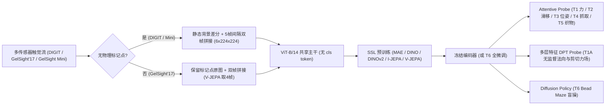
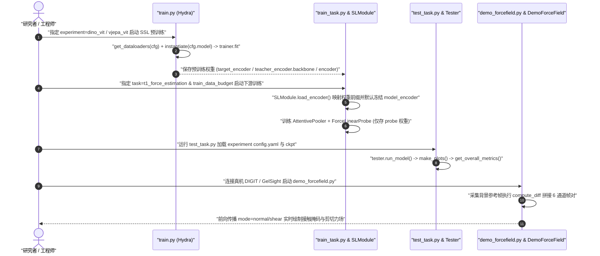

# Sparsh（通用视触觉自监督表征与 TacBench 基准）

> 来源：[arXiv:2410.24090](https://arxiv.org/abs/2410.24090) · [Project Page](https://sparsh-ssl.github.io/) · [GitHub (`facebookresearch/sparsh`)](https://github.com/facebookresearch/sparsh) · [HuggingFace Collection](https://huggingface.co/collections/facebook/sparsh-67167ce57566196a4526c328) · CoRL 2024

## 一句话定义

**Sparsh**（Meta FAIR、华盛顿大学 UW、卡内基梅隆大学 CMU，CoRL 2024）是一套面向视触觉传感器（VBTS）的通用自监督表征家族与标准评估套件 **TacBench**：它利用 **462.7k**（总数据集约 **661k** 的 70% 预训练子集）跨 DIGIT、GelSight 2017 与 GelSight Mini 的无标注触觉帧对，统一训练 **MAE / DINO / DINOv2 / I-JEPA / V-JEPA** 五类 ViT-B/14 编码器，在冻结主干 + 轻量化注意力探针（Attentive Probe）下支撑力反演、滑移检测、局部 $SE(2)$ 位姿与策略学习等 6 项下游任务。

## 英文缩写速查

| 缩写 | 英文全称 | 简要说明 |
| :--- | :--- | :--- |
| **VBTS** | Vision-Based Tactile Sensor | 视触觉传感器（如 DIGIT、GelSight 系列），用内部相机观测硅胶弹性体形变 |
| **SSL** | Self-Supervised Learning | 自监督学习，利用大规模无标签触觉帧学习跨传感器共享接触表征 |
| **JEPA** | Joint-Embedding Predictive Architecture | 联合嵌入预测架构（含 I-JEPA 与 V-JEPA），在抽象表征空间而非像素空间做掩码预测 |
| **DPT** | Dense Prediction Transformer | 稠密预测变换器，在 Sparsh 中用于隐空间收敛监控与像素级法向/剪切力场无监督反演 |

## 为什么重要

1. **打破“单传感器—单任务”数据孤岛**：不同厂商视触觉传感器的照明、内参、凝胶软硬度和标记点排布差异极大，传统端到端（End-to-End, E2E）监督学习必须在每款新手指上重采数万条高精度力/位姿标定数据。Sparsh 证明跨 DIGIT、GelSight 2017 与 GelSight Mini 混合预训练可沉淀出跨构型的通用接触物理表征。
2. **明确触觉物理表征的 SSL 范式差异**：不同于自然图像默认 DINO/MAE 通吃，Sparsh 在触觉上首次系统对照生成重构（MAE）、自蒸馏（DINO/DINOv2）与隐空间掩码预测（I-JEPA/V-JEPA），揭示了 **DINO 系列在几何回归与力回归上占优，而 JEPA/V-JEPA 在低标注与滑移时序动态任务上优势显著**。
3. **开源标准基准 TacBench 填补评测空白**：此前视触觉表征缺乏统一评测协议；TacBench 将物理感知（T1/T1A/T2/T3）、抓握语义（T4/T5）与闭环策略（T6）收口到同一冻结表征 + Attentive Probe 协议，使不同触觉基础模型具备可比性。

## 核心原理

### 核心信息

| 属性 | 内容 |
| :--- | :--- |
| **作者与机构** | Carolina Higuera（FAIR/UW）、Akash Sharma（FAIR/CMU）、Taosha Fan、Byron Boots、Mustafa Mukadam 等（Meta FAIR、UW、CMU） |
| **发布与开源** | CoRL 2024；源码（CC-BY-NC-4.0）与 HuggingFace ViT-B/14 权重全开源 |
| **预训练数据** | 总计 ~661k 帧，取 70%（**462.7k**）用于预训练：Touch-Slide（DIGIT 180k）+ YCB-Slide（DIGIT 180k）+ Touch-and-Go（GelSight'17 220k）+ ObjectFolder-Real（GelSight Mini 81k） |
| **骨干与参数** | ViT-B/14（768 维，无 `[cls]` token，DINO 复用 register tokens）：MAE `86.25M`（104 FPS）、DINO `86.26M`（112 FPS）、I-JEPA `86.39M`（112 FPS）、V-JEPA `86.54M`（60 FPS） |
| **训练硬件** | 8× NVIDIA A100 80GB，AdamW 优化器训练 150 epochs，RTX 3080 单卡推理验证 |

### 关键机制拆解

1. **双源预处理与时空配对输入**：
   - 触觉核心信号在于“接触引起的相对形变”，而非静态硅胶纹理或灯珠颜色。对无物理标记点的传感器（DIGIT、GelSight Mini），Sparsh 减去无接触静态参考背景图（Background Subtraction）；对自带物理标记点的 GelSight 2017，保留原始图像以免破坏切向位移线索。
   - 拼接两帧间隔 5 步的图像 $I_t \oplus I_{t-5} \in \mathbb{R}^{h \times w \times 6}$（在 60 Hz 采样下对应约 **80 ms** 的人类滑移响应窗口），统一缩放至 $224 \times 224$ 输入 ViT-B/14；时序版 **V-JEPA** 则取 `[t, t-2, t-4, t-6]` 4 帧 clip（约 100 ms）。
2. **多范式自监督目标与隐空间收敛监控**：
   - 去除传统 `[cls]` token，保留完整空间 patch tokens 以服务局部接触定位与稠密解码；DINO 实验启用 ViT register tokens 吸收冗余全局背景信息。
   - 由于 I-JEPA/V-JEPA 在隐空间回归预测目标、没有像素重构损失可供肉眼判别收敛性，Sparsh 额外接入在线 **DPT 图像重建探针**（仅反向传播至探针自身、不回传编码器主干），实时检验隐表示是否仍完整保留接触几何与纹理。
3. **冻结主干 + 轻量化 Attentive Probe 下游范式**：
   - 为验证表征本身的可迁移性，TacBench 中 T1–T5 均**冻结 ViT 编码器**，仅训练一个轻量化注意力池化探针 `AttentivePooler`（1 层 12 头 768 维交叉注意力 + 2 层 MLP）；T1A 通过读取 ViT 第 `[2, 5, 8, 11]` 层多尺度特征接入无监督 DPT，结合光流重投影与 Charbonnier+SSIM 平滑约束反演稠密法向与剪切力场；T6 则作为视觉-触觉 Diffusion Policy（`obs_horizon=2`, `pred_horizon=8`）的触觉特征提取器。

### 流程总览

## 实验与评测

在 TacBench [T1–T6] 全部 6 项下游任务上与从零监督训练（E2E）对比核心指标如下（数据核对自原文正文与 Appendix Table 7–14）：

| 任务 | 数据集与标注规模 | 核心指标 | E2E 从零训练 | Sparsh 最优 / 代表表现 |
| :--- | :--- | :--- | :--- | :--- |
| **T1 力估计 (DIGIT)** | 25k 测试集（1/3 / 1/100 预算） | RMSE (mN ↓) | `61.42` / `187.51` | **DINOv2 `26.85`**（1/3）；**DINO `97.95`**（1/100） |
| **T1 力估计 (GelSight Mini)** | 25k 测试集（Full / 1/3 / 1/100） | RMSE (mN ↓) | `57.21` / `59.09` / `82.42` | **DINO `20.25` / `23.79` / `53.43`**；MAE `22.72` / `23.28` |
| **T2 滑移检测** | 125k 样本（13% 正样本，1/3 / 1/100） | F1 (↑) | `0.238` / `0.214` | **V-JEPA `0.828` / `0.760`**；MAE `0.818`；I-JEPA `0.791` |
| **T3 局部 $SE(2)$ 位姿** | Allegro 指尖 DIGIT（630 测试集，Full / 1/3） | 准确率 (↑) | `0.812` / `0.245` | **DINO `0.913` / `0.834`**；V-JEPA `0.856` / `0.648` |
| **T4 抓取稳定性** | Feeling of Success（GelSight'17，1.3k，1/3 / 1/10） | 准确率 (↑) | `0.725` / `0.682` | **I-JEPA `0.782`**（1/3）；**DINO `0.773`**（1/10） |
| **T5 织物 20 分类** | GelSight'17（26k 测试集，Full / 1/3 / 1/10） | 准确率 (↑) | `0.437` / `0.365` / `0.373` | **MAE `0.599` / `0.588` / `0.527`**（跨传感器至 DIGIT 10-shot DINO **61.8%** vs E2E **10.9%**） |
| **T6 Bead Maze 盲操** | Franka + DIGIT 50 演示（~34k 对，10 未知起点） | 离线误差 (mm ↓) / 实机行进 (cm ↑) | `8.46` mm / `6.70` cm | I-JEPA 离线 **`5.47` mm**；MAE 微调实机 **`11.25` cm**（DINO 冻结 `10.80` cm） |

关键补充发现（Appendix E）：
- **少样本平均增益：** 在 33%–50% 标签预算下，Sparsh 相对 E2E 在 TacBench 上平均提升 **+95.1%**（Appendix Table 13 按 6 任务细分均值为 **+98.75%**，其中 T2 滑移 +242.70%、T3 位姿 +235.89%、T1-GelSight +59.74%）；**DINO 总体平均领先 I-JEPA +5.6%**（Table 13 细项均差 +8.91%）。
- **微调策略消融：** 全量解冻微调对隐空间编码器（I-JEPA / V-JEPA）在 T1/T3 连续几何回归上增益明显，部分解冻（最后数层）接近完全冻结。
- **骨干尺度的敏感性：** 从 ViT-B（768 维）缩减到 ViT-S（384 维），在 1/3 预算下会使 T1 DIGIT RMSE 恶化 **+74%**、GelSight 恶化 **+50.3%**、T3 准确率下降约 **20%**，而 T2/T4/T5 分类任务相对稳健。

## 结论

**对于多传感器视触觉学习，使用大规模无标注跨传感器帧对预训练的 ViT-B/14（尤其是 Sparsh-DINO 与 V-JEPA）配合背景差分和双帧拼接，可在不重构每台硬件标定管线的前提下显著替代从零端到端训练。**

1. **任务选型有明确的最优 SSL 分工**：连续几何/力反演与跨传感器少样本迁移（T1、T3、T5 跨传感器）首选 **DINO / DINOv2**；强时序动态与稀疏事件（T2 滑移）首选 **V-JEPA**；低预算抓握判别（T4）可优先考虑 **I-JEPA / DINO**。
2. **背景差分 + ~80 ms 帧对是跨传感对齐的低成本杠杆**：统一将无标记点传感器的参考背景剔除，并拼接 `t` 与 `t-5` 双帧，比单帧静态输入天然注入接触演化信息。
3. **保留空间 patch token 比仅靠 `[cls]` 更贴合接触任务**：接触域往往只占硅胶局部像素，去除 `[cls]` 并用 `AttentivePooler` 或多层特征接 DPT（T1A）能更精细地汇聚压痕边界。
4. **切勿为了算力盲目将编码器降为 ViT-Small**：主干宽度从 768 降到 384 会导致连续三维力与 $SE(2)$ 位姿回归在少样本下崩塌（+50%~+74% 误差放大）。
5. **表征不能代替底层力控闭环**：T6 在未见起点的 Bead Maze 实机中虽行进距离提升 20%–53%，但缺少主动柔顺/力控反馈时仍会因累积漂移导致无法全程通关；而在单迷宫过拟合设定下，端到端专用模型反而优于通用表征（~80% vs ~30%）。

## 与其他工作对比

| 维度 | Sparsh | AnySkin (`painode-146-anyskin`) | OmniVTLA (`paper-sa-2508-08706-omnivtla`) |
| :--- | :--- | :--- | :--- |
| **传感硬件** | 光学视触觉（DIGIT / GelSight'17 / GelSight Mini） | 柔性磁感皮肤（3 轴磁场矩阵） | 视触觉 + 视觉-语言-动作端到端集成 |
| **训练核心** | 无标注跨传感器视觉 SSL + 冻结表征复用 | 硬件一致化低维磁场自校准与低延迟力表征 | 跨模态预训练将触觉 token 注入 VLA 动作生成 |
| **典型优势** | 462.7k 无标注帧零标定冷启动、通用物理探针 | 抗形变漂移、超薄曲面贴合、硬件高频鲁棒性 | 直接驱动双臂/灵巧手长程力反馈 VLA 策略 |
| **主要局限** | 尚未接入全局视觉-语言语义；高频帧对达 60–112 FPS 受相机带宽限制 | 缺乏空间纹理图像级局部高分辨率几何 | 依赖特定配对多模态轨迹数据，泛化依赖底座 VLA |

## 源码运行时序图

以下时序严格对应官方仓库 `facebookresearch/sparsh` 中的三大官方 CLI 入口：`train.py`（SSL 预训练）、`train_task.py` + `SLModule`（TacBench 下游探测/微调）、`test_task.py` 与 `demo_forcefield.py` / `DemoForceField`（实时力场推理）。

## 工程实践

1. **Hydra 配置与权重前缀匹配（`SLModule.load_encoder`）**：源码中会根据 `encoder_type` 自动检索 checkpoint 键前缀（`jepa` 找 `target_encoder`、`dino` 找 `teacher_encoder.backbone`、MAE 找 `encoder`）；若自主加载 HuggingFace 权重做自定义 Downstream，需显式对齐 `num_register_tokens`（如 DINO 的 register 设置）和 `in_chans=6`。
2. **真机部署时的背景帧重置策略**：`DemoForceField` 将初始化时的首帧作为背景参考执行 `compute_diff`；在长期抓握或硅胶表面受温度/压痕缓变影响时，建议在每次机械臂复位张开且确认零接触后定期刷新背景参考帧。
3. **脚本命名与论文任务编号对齐**：在官方配置目录下，织物分类的 YAML 为 `config/task/t6_textile_classification.yaml`，与论文正文中 **T5（织物分类）/ T6（Bead Maze 策略）** 的编号存在历史错位，检索配置或引用实验脚本时应以任务名而非数字前缀为准。
4. **帧率与时间窗标定**：论文双帧拼接默认间隔 5 帧对应 60 Hz 下的 ~80 ms 窗口；若移植到 30 Hz 的低帧率光学触觉模组，建议将帧间隔缩小为 2–3 帧，避免跨度过长引起形变脱敏。

## 常见误区与局限

1. **误区：通用 SSL 表征能压倒一切端到端策略**：当目标任务极度固定（如单一已知起始位姿的迷宫路径重复执行）时，专用从零端到端策略可以过拟合视觉-触觉与全局轨迹的快捷相关性并取得更高上限（单迷宫测试 ~80% vs Sparsh ~30%）；Sparsh 的真正价值在于少样本泛化与多任务复用。
2. **误区：ViT 特征本身就够完成高精度力控操作**：T6 实验中所有模型在 10 个未见起点的全迷宫路径中均未完赛，暴露出缺乏显式底层阻抗/力控闭环时的动作漂移累积问题。
3. **跨传感器物理尺度不一致**：尽管跨传感器表示已在特征空间出现对齐（T5 跨传感器 10-shot 达 61.8%），不同传感器因凝胶杨氏模量与光学折射几何不同，连续绝对力回归（mN 级 T1）与亚毫米局部几何仍需在目标硬件上用少量标定样本拟合或微调探针。
4. **非光流触觉模态尚未覆盖**：当前预训练完全面向基于光学相机成像的平面/指尖 VBTS，对于非成像阵列型磁感/压阻传感器需要完全不同的 patch 嵌入与前处理设计。

## 关联页面

- [视触觉传感基础](../concepts/tactile-sensing.md)
- [视触觉融合（Visuo-Tactile Fusion）](../concepts/visuo-tactile-fusion.md)
- [富接触操作（Contact-Rich Manipulation）](../concepts/contact-rich-manipulation.md)
- [AnySkin 柔性磁感触觉皮肤](./painode-146-anyskin.md)
- [OmniVTLA：视觉-触觉-语言-动作模型](./paper-sa-2508-08706-omnivtla-vision-tactile-language-action-model-wi.md)
- [TAF-VLA：视觉-语言-动作中的触觉力对齐](./paper-sa-2601-20321-taf-vla-tactile-force-alignment-in-vision-langua.md)
- [触觉智能九篇代表作地图](../overview/tactile-intelligence-nine-papers-map.md)

## 参考来源

- [Sparsh 原文笔记（早期条目归档）](../../sources/papers/sparsh_arxiv_2410_24090.md)
- [Sparsh 原文精读归档（全文主文与附录 E 核对）](../../sources/papers/sparsh_arxiv_2410_24090_reading.md)
- [Sparsh 项目主页归档](../../sources/sites/sparsh-ssl-github-io.md)
- [facebookresearch/sparsh 源码结构与 TacBench 归档](../../sources/repos/facebookresearch_sparsh.md)

## 推荐继续阅读

- [基于视觉的触觉智能综述（Vision-Based Tactile Intelligence）](./paper-vision-based-tactile-intelligence.md)
- [触觉引导机器人学习综述](./paper-tactile-guided-robot-learning-survey.md)
- [OmniTacTune：触觉残差适应](./paper-omnitactune-tactile-residual-adaptation.md)
- [Awesome Touch Technology 资料地图](../overview/sun-awesome-touch-technology-map.md)
