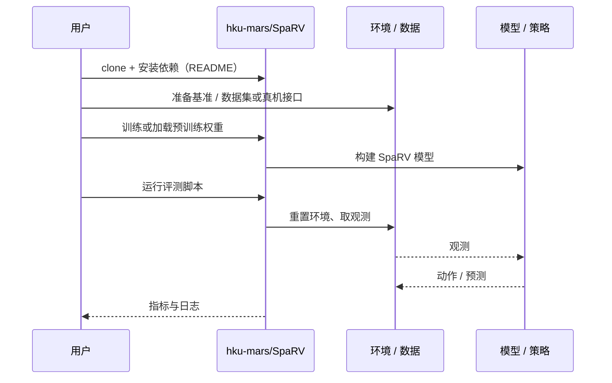

# SpaRV（arXiv:2610.25665）

**SpaRV**（*SpaRV: Sparse Radiance Voxels for Scalable Geometrically Consistent LiDAR-Visual Mapping and Rendering*，[arXiv:2610.25665](https://arxiv.org/abs/2610.25665)，[代码](https://github.com/hku-mars/SpaRV)）来自 [具身智能小站 2026-11-01 盘点](../../sources/blogs/wechat_embodied_station_56_papers_libero_dynamic_latency_eval_2026-11-01.md)，属「感知、规划与系统」组。

## 一句话定义

**SpaRV让激光深度和图像共同监督稀疏辐射体素，交替校正相机参数，并用分层子图控制显存；校园级重建验证规模，离轨几何也纳入评估。**

## 英文缩写速查

| 缩写 | 英文全称 | 简要说明 |
|------|----------|----------|
| SpaRV | SpaRV: Sparse Radiance Voxels for Scalable Geometrically Consistent LiDAR-Visual Mapping and Rendering | 本文方法 / 基准的简称 |

## 为什么重要

- 大场景重建，同时约束几何与显存。
- 开源结论：**已开源**（步骤 2.5，2026-11-01）。仓库可达（git ls-remote）。
- 同期同组工作见 [动态评测、技能编译与环境潜变量适配：具身智能小站 11-01 期 56 篇阅读坐标](../overview/embodied-station-2026-11-01-56-papers-technology-map.md)。

## 核心机制

| 项 | 内容 |
|----|------|
| **arXiv** | [2610.25665](https://arxiv.org/abs/2610.25665) |
| **开源** | **已开源** |
| **要点** | SpaRV让激光深度和图像共同监督稀疏辐射体素，交替校正相机参数，并用分层子图控制显存；校园级重建验证规模，离轨几何也纳入评估。 |
| **文内指标** | 公众号未给具体数字，本页不引用。 |

## 源码运行时序图

以下为按仓库入口（`hku-mars/SpaRV`）推断的通用运行链路；入库日仅核实仓库可达，未逐文件阅读，具体脚本名以 README 为准。

## 实验与评测

- 公众号未给具体数字，本页不引用。
- **读法：** 本页为索引级摘要，依据公众号转述的官方摘要与仓库信息整理；逐项数字与 baseline 以原文 PDF 为准。

## 与其他工作对比

- 横向索引见 [动态评测、技能编译与环境潜变量适配：具身智能小站 11-01 期 56 篇阅读坐标](../overview/embodied-station-2026-11-01-56-papers-technology-map.md)；同 arXiv 不重复造页。

## 结论

**大场景重建，同时约束几何与显存：SpaRV让激光深度和图像共同监督稀疏辐射体素，交替校正相机参数，并用分层子图控制显存；校园级重建验证规模，离轨几何也纳入评估。**

1. 开源边界：**已开源** — 仓库可达（git ls-remote）。
2. 核心机制：SpaRV让激光深度和图像共同监督稀疏辐射体素，交替校正相机参数，并用分层子图控制显存；校园级重建验证规模，离轨几何也纳入评估。
3. 复现与选型前核对任务协议、硬件与基准口径，勿直接横比公众号摘录数字。

## 关联页面

- [manipulation](../tasks/manipulation.md)
- [locomotion](../tasks/locomotion.md)
- [sim2real](../concepts/sim2real.md)
- [embodied-station-2026-11-01-56-papers-technology-map](../overview/embodied-station-2026-11-01-56-papers-technology-map.md)
- [机器人视觉感知栈选型闭环](../queries/robot-perception-stack-selection-loop.md) — 本页感知能力在机器人视觉感知栈中的位置与选型

## 参考来源

- [sparv_arxiv_2610_25665.md](../../sources/papers/sparv_arxiv_2610_25665.md)
- [wechat_embodied_station_56_papers_libero_dynamic_latency_eval_2026-11-01.md](../../sources/blogs/wechat_embodied_station_56_papers_libero_dynamic_latency_eval_2026-11-01.md)
- [arXiv:2610.25665](https://arxiv.org/abs/2610.25665)

## 推荐继续阅读

- [arXiv PDF](https://arxiv.org/pdf/2610.25665)
- [https://github.com/hku-mars/SpaRV](https://github.com/hku-mars/SpaRV)
