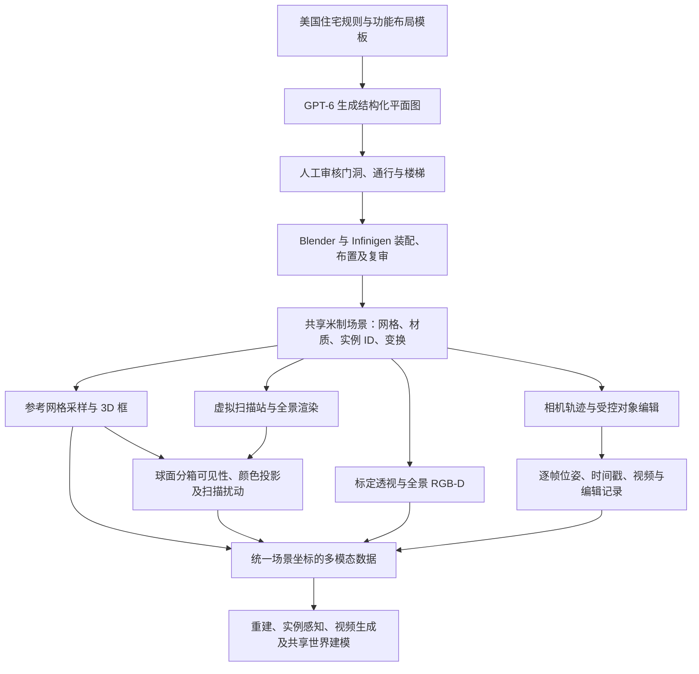

# Spatial Foundry: A Multimodal Dataset for Spatial Intelligence（空间智能多模态数据集）

## 一句话定义

Spatial Foundry 是 Ranolabs 提出的合成住宅多模态数据资源，以可编辑三维场景统一几何、视觉、相机轨迹与对象状态，为空间感知与世界建模提供对齐的监督数据。

## 英文缩写速查

| 缩写 | 英文全称 | 简要说明 |
|---|---|---|
| RGB | Red Green Blue | 彩色图像 |
| RGB-D | Red Green Blue and Depth | 彩色与深度观测 |
| AABB | Axis-Aligned Bounding Box | 世界坐标轴对齐的三维包围框 |
| ID | Identifier | 跨视角关联的实例标识 |
| UV | UV Texture Coordinates | 网格表面的纹理坐标 |

## 核心信息

| 项目 | 信息 |
|---|---|
| 论文 | arXiv:2611.17318v1（2026-11-12） |
| 作者 | Ethan Lin、Yang Song |
| 机构 | Ranolabs |
| 规模 | 5,280 个有家具的住宅场景配置（含同户型变体） |
| 开放状态 | 演示公开；评估样本需申请；完整数据与项目代码公开下载未确认 |

## 为什么重要

单张 RGB 难以区分视角改变与场景本身的变化。显式三维参照允许固定环境改变相机路径，或固定相机路径改变对象状态，形成可控的反事实观测；持久实例 ID 也便于检查遮挡后重访和多视角一致性。它补的是空间监督数据，而非机器人控制动作轨迹。

## 流程总览

依据：原文 §3–4、Fig. 3、式 (1)–(11)。

## 核心原理

### 场景与观测

场景由几何、对象实例表、材质及照明组成；对象含唯一标识、网格、变换及可用语义描述。每帧记录 RGB、米制深度、投影/标定、相机到世界变换及时间戳。用内参反投影轴向深度时，世界点为 $x_w=R(zK^{-1}u)+t$；若深度表示径向距离，则须先将视线归一化（式 10）。

### 扫描与编辑

参考表面点云保留真实合成几何的标注；虚拟扫描站在球面角度分箱中保留最近点以近似遮挡，再关联全景颜色并施加距离相关噪声与离群扰动。另有针对玻璃和镜面的光线投射变体（§4.4–4.5）。

状态编辑明确记录对象的平移、旋转、插入、删除及外观变化。固定相机路径隔离编辑影响，多观察者共享同一状态序列（式 11），使跨视角状态更新有共同参照。

## 评测与结果

原文 Fig. 1 是数据模态与可编辑能力对照，比较 RealEstate10K、ScanNet++、Structured3D、3D-FRONT、Hypersim 和 ProcTHOR；Table 1 说明数据对应关系。§5 给出六类应用，而非量化模型对照实验：

| 应用 | 数据监督 |
|---|---|
| 平面图条件场景生成 | 平面图与三维环境配对 |
| 几何重建 | 标定 RGB-D、参考网格及点云 |
| 实例级空间感知 | 3D 框、尺寸、实例 ID 与变换 |
| 相机条件视频 | 逐帧相机位姿、时间及视频 |
| 多智能体共享世界建模 | 同一状态的多观察者视角 |
| 状态条件编辑 | 编辑事件及前后状态 |

项目页视频是数据能力展示；没有可据此引用的下游模型精度、真机成功率或在线推理性能。

## 结论

Spatial Foundry 的价值在于可控场景和一致的空间标注，而不是已经验证的机器人策略。

- 按底层户型或场景家族划分训练与测试，避免家具变体泄漏。
- 先验收米制坐标、相机方向和深度约定，再做重投影与融合。
- 分别测试固定环境的视角变化及固定相机的对象编辑。
- 如用于具身策略训练，另行获得动作、接触及闭环反馈监督。
- 在正式训练前确认样本规格、完整数据访问方式与许可证。

## 源码运行时序图

不适用：截至 2026-11-24，官方项目页未提供可运行的数据构建源码；论文流程图不等同于经源码验证的运行时序。Blender 与 Infinigen 是上游工具，并非该项目实现。

## 工程实践

建议评估样本时检查 RGB-D 重投影残差、实例 ID 跨帧一致性、编辑前后未受影响对象的状态、单位与深度有效掩码、真实扫描与合成扰动差异。项目页给出的评估建议不应当作已发布的 benchmark 分数。

## 局限与风险

- 美国式住宅与合成布置可能限制跨地域、真实传感器及长尾环境泛化（工程判断）。
- 场景网格可编辑并不等于物理仿真资产已经具备接触、关节、质量与摩擦等完整标定；论文未证明机器人动力学或策略闭环效果。
- 官方公开了视频及交互预览；评估样本需联系团队，完整数据、可运行源码和数据许可证尚未找到公开下载入口。
- 论文的扫描扰动是模拟近似，不能直接替代真实设备噪声标定。

## 关联页面

- [SimFoundry](./paper-simfoundry-real2sim-scene-generation.md) — 从实拍视频构建可仿真场景与策略评测，和本项目的合成住宅空间监督互补。
- [Holi-World](./paper-holi-world.md) — 从第一视角记录提取世界表示，本项目则从可编辑场景生成对齐观测。
- [生成式数据增强](../methods/generative-data-augmentation.md) — 独立改变视角及场景状态的合成监督。
- [具身数据纵深路线](../../roadmap/depth-embodied-data.md) — Stage 4 扩增与合成。

## 参考来源

- [论文归档](../../sources/papers/spatial-foundry.md)
- [项目页归档](../../sources/sites/spatial-foundry.md)

## 推荐继续阅读

- [论文 HTML v1](https://arxiv.org/html/2611.17318v1)
- [论文 PDF v1](https://arxiv.org/pdf/2611.17318v1)
- [官方项目页与数据申请](https://ranolabs.com/Blog/spatial-foundry)
