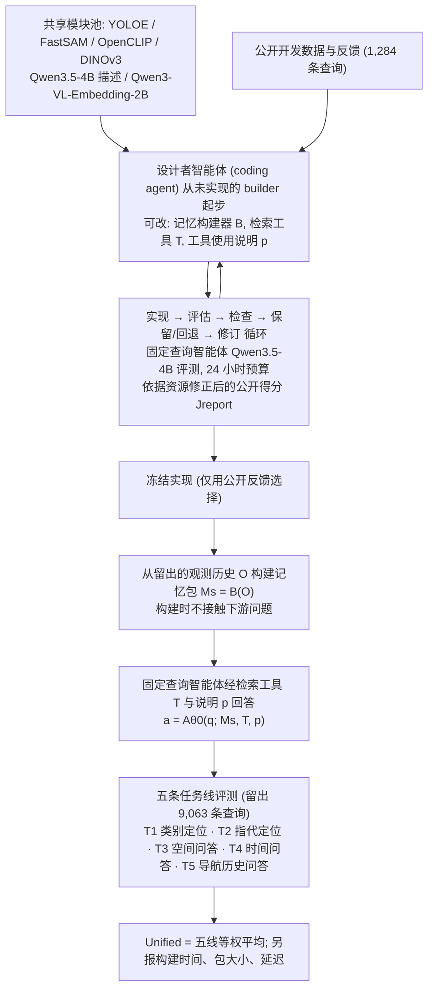

# Spatial Memory by Agents（arXiv:2610.22736）

**Spatial Memory by Agents**（*Spatial Memory by Agents, for Agents*，[arXiv:2610.22736](https://arxiv.org/abs/2610.22736)，[项目页](https://ba-fa-3344.github.io/)）来自 [具身智能小站 2026-11-01 盘点](../../sources/blogs/wechat_embodied_station_56_papers_libero_dynamic_latency_eval_2026-11-01.md)，属「具身智能体与导航」组。

## 一句话定义

**在固定预算内迭代记忆构建与检索代码，冻结后面向未见历史回答多类问题；跨任务比较展示设计潜力，但定位证据、完整计数和物理终点核验仍会失败。**

## 英文缩写速查

| 缩写 | 英文全称 | 简要说明 |
|------|----------|----------|
| Spatial Memory by Agents | Spatial Memory by Agents, for Agents | 本文方法 / 基准的简称 |

## 为什么重要

- 让编码智能体设计可检索的空间记忆。
- 开源结论：**待发布**（步骤 2.5，2026-11-01）。项目页 HTTP 200，未列 GitHub，页面含 soon 字样（脚本扫描）。
- 同期同组工作见 [动态评测、技能编译与环境潜变量适配：具身智能小站 11-01 期 56 篇阅读坐标](../overview/embodied-station-2026-11-01-56-papers-technology-map.md)。

## 流程总览

图依据：论文 §III Spatial Memory Design with Coding Agents / §IV 评测协议 / Fig.1-3 / 式(1)

## 核心机制

| 项 | 内容 |
|----|------|
| **arXiv** | [2610.22736](https://arxiv.org/abs/2610.22736) |
| **开源** | **待发布** |
| **要点** | 在固定预算内迭代记忆构建与检索代码，冻结后面向未见历史回答多类问题；跨任务比较展示设计潜力，但定位证据、完整计数和物理终点核验仍会失败。 |
| **文内指标** | 公众号未给具体数字，本页不引用。 |

## 源码运行时序图

**不适用（待发布）** — 项目页 HTTP 200，未列 GitHub，页面含 soon 字样（脚本扫描）。 不编造运行脚本；代码公开后再补。

## 实验与评测

- 公众号未给具体数字，本页不引用。
- **读法：** 本页为索引级摘要，依据公众号转述的官方摘要与仓库信息整理；逐项数字与 baseline 以原文 PDF 为准。

## 与其他工作对比

- 横向索引见 [动态评测、技能编译与环境潜变量适配：具身智能小站 11-01 期 56 篇阅读坐标](../overview/embodied-station-2026-11-01-56-papers-technology-map.md)；同 arXiv 不重复造页。

## 结论

**让编码智能体设计可检索的空间记忆：在固定预算内迭代记忆构建与检索代码，冻结后面向未见历史回答多类问题；跨任务比较展示设计潜力，但定位证据、完整计数和物理终点核验仍会失败。**

1. 开源边界：**待发布** — 项目页 HTTP 200，未列 GitHub，页面含 soon 字样（脚本扫描）。
2. 核心机制：在固定预算内迭代记忆构建与检索代码，冻结后面向未见历史回答多类问题；跨任务比较展示设计潜力，但定位证据、完整计数和物理终点核验仍会失败。
3. 复现与选型前核对任务协议、硬件与基准口径，勿直接横比公众号摘录数字。

## 关联页面

- [llm-robotics-control-interfaces](../concepts/llm-robotics-control-interfaces.md)
- [vision-language-navigation](../tasks/vision-language-navigation.md)
- [manipulation](../tasks/manipulation.md)
- [embodied-station-2026-11-01-56-papers-technology-map](../overview/embodied-station-2026-11-01-56-papers-technology-map.md)

## 参考来源

- [spatial_memory_by_agents_arxiv_2610_22736.md](../../sources/papers/spatial_memory_by_agents_arxiv_2610_22736.md)
- [wechat_embodied_station_56_papers_libero_dynamic_latency_eval_2026-11-01.md](../../sources/blogs/wechat_embodied_station_56_papers_libero_dynamic_latency_eval_2026-11-01.md)
- [arXiv:2610.22736](https://arxiv.org/abs/2610.22736)
- [arXiv PDF](https://arxiv.org/pdf/2610.22736)：已通读全文：§III 设计者协议与冻结的构建-打包-查询评测，§IV 五条任务线与评分，§V 实验设置

## 推荐继续阅读

- [arXiv PDF](https://arxiv.org/pdf/2610.22736)
- [项目页](https://ba-fa-3344.github.io/)
