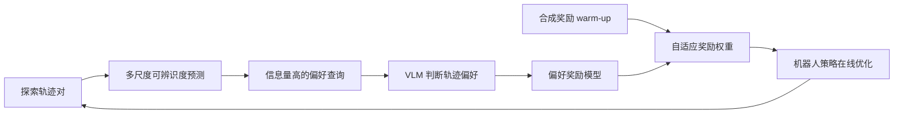

# SPEAR：机器人强化学习中的选择性 VLM 偏好询问

## 一句话定义

**通过可辨识度预测挑选 VLM 容易判断且信息量高的轨迹比较，训练早期使用合成引导奖励，再逐步转向偏好奖励。**

## 英文缩写速查

| 缩写 | 英文全称 | 简要说明 |
|------|----------|----------|
| SPEAR | Selective Preference Elicitation with Adaptive Rewards | 选择性偏好询问与自适应奖励 |
| VLM | Vision-Language Model | 视觉语言判断器 |
| PbRL | Preference-based Reinforcement Learning | 基于偏好的强化学习 |

## 为什么重要

可辨识查询与自适应奖励的机器人偏好学习，关注现有控制、数据或机器人学习方法在复杂任务中的失效点。这里单独建论文实体，避免与其他论文共用详情页；当前是待完成全文与源码复核的草稿。

## 核心机制

多尺度视觉特征和 distinguishability predictor 筛选轨迹对，减少 VLM 的弃答；在采集的偏好数据上学习奖励，并采用合成奖励 warm-up→偏好奖励的自适应权重过渡、relay exploration 扩大有效覆盖。

## 方法流程（待全文逐节复核）

以下流程仅依据已核对的论文 HTML 方法描述，不代替源代码调用图。

## 源码运行时序图

**待核实，不绘制未经代码阅读确认的时序图。** 目前未确认可运行官方源码，待项目源文件发布或访问恢复后补充。

## 实验与评测

论文在操作任务基准中报告平均成功率 88.9%，相对基线高 23.3 个百分点；使用 Mobile ALOHA 在 3 个真机任务上在线学习。真机运行仍限定工作空间并由人工复位。

## 局限与工程实践

- 自动偏好并非无误的真实奖励，需要诊断 VLM 的弃答及偏差；项目页本次访问失败，暂不确认代码开放。
- **源码状态：** arXiv 给出官方项目页，但本次工具未成功访问，源码和权重状态待核查。
- **原文状态：** 本轮已核查 arXiv 部分章节，尚未通读全部正文/附录，保持 draft，不宣称健康度满分。

## 结论

**减少无效 VLM 查询和合理安排探索奖励，比单纯增加偏好询问次数更可控。**

1. 使用与论文一致的任务、硬件和评测协议复验，不跨实验口径比较数据。
2. 把方法改善的指标与额外的数据、计算或控制成本分开记录。
3. 对未经独立核查的复现入口，暂不声称完成验证。

## 关联页面

- [PRM4RL：大语言模型生成的任务进度奖励](./paper-prm4rl-progress-reward.md)
- [CoDA：失败驱动的数据引擎与动作策略协同进化](./paper-coda-coevolving-data-policy.md)

## 参考来源

- [论文归档](../../sources/papers/spear-selective-preference_arxiv_2610_21621.md)
- [官方项目页归档](../../sources/sites/spear-selective-preference.md)

## 推荐继续阅读

- [arXiv 原文](https://arxiv.org/abs/2610.21621)
- [官方项目页](https://zevinwu.github.io/spear-project/)
