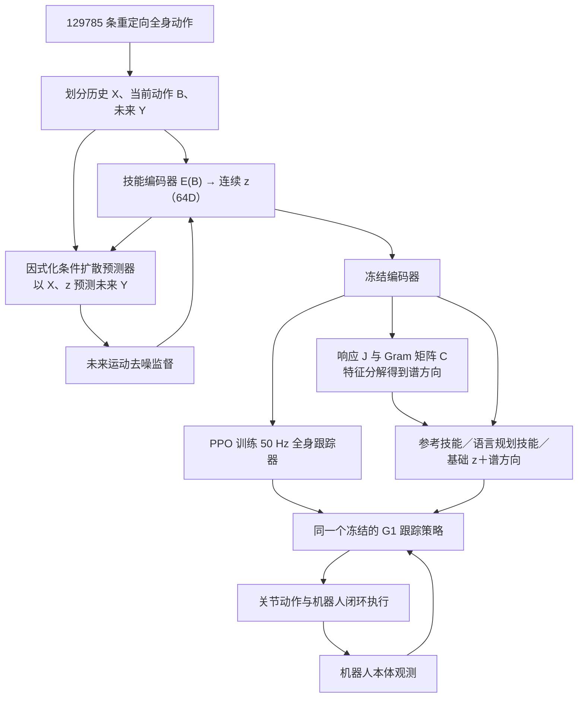

# Spectral Skills：可组合全身运动的谱技能表示 / Learning Expressive and Compositional Motion Representation via Spectral Skills

**论文：** [arXiv:2609.37677v1（2026-09-29）](https://arxiv.org/abs/2609.37677) ｜ **项目：** [Spectral Skills](https://spectral-skill.github.io/) ｜ **机构：** 佐治亚理工学院（Georgia Institute of Technology）

## 一句话定义

Spectral Skills 将短时全身运动压缩成**可供上层预测、可由底层执行的连续技能**，再把预测响应中的正交谱方向叠加到基础技能，以同一个冻结的全身控制器完成运动跟踪、切换和可控组合。

## 英文缩写速查

| 缩写 | 英文全称 | 简要说明 |
|---|---|---|
| DoF | Degrees of Freedom | 本文使用 29 自由度 Unitree G1 |
| RL | Reinforcement Learning | 以 PPO 训练条件化全身运动跟踪器 |
| PPO | Proximal Policy Optimization | 50 Hz 冻结技能接口下的低层策略训练 |
| MPJPE-G | Mean Per-Joint Position Error, Global | 含根部漂移的全局关节位置跟踪误差 |
| MPJPE-L | Mean Per-Joint Position Error, Local | 对齐根部后测量的局部关节位置误差 |
| SONIC | SONIC motion tracker | 原文的主要全身动作跟踪对照模型 |
| ONNX | Open Neural Network Exchange | 项目浏览器演示使用的策略运行格式 |
| BFM | Behavior Foundation Model | 上层规划或技能建模的背景技术 |

## 为什么重要

- **上层容易生成：** 相比直接输出高维整段关节轨迹，连续低维技能提供了一个紧凑的运动命令接口。
- **下层无需为组合再训练：** 同一跟踪器接收参考动作技能、切换技能和经过谱方向修改的技能。
- **可测试的组合能力：** 不止演示“从动作库选一个”，还可以给走路加抬手、转向、抬脚等连续属性；但动作是否安全、可执行必须实验验证。

## 核心信息

| 字段 | 论文设定 |
|---|---|
| 作者 | Feiyang Wu、Chenxiao Gao、Chen Yang、Ye Zhao、Bo Dai、Anqi Wu |
| 机构 | 佐治亚理工学院（Georgia Institute of Technology） |
| 机器人与控制 | Unitree G1，29 DoF；200 Hz 仿真物理、50 Hz 策略 |
| 数据 | 129,785 条重定向动作；评测含 4096 动作集与 124 动作能力集 |
| 技能 | 64 维连续向量 z；每 10 帧＝0.2 s 动作编码窗口 |
| 训练 | 先训练预测式技能编码器，再冻结编码器并用 PPO 训练全身跟踪器 |
| 项目源码 | 截至 2026-11-08 仅核实到浏览器运行演示，未发现官方训练/评测 GitHub 链接 |

## 核心原理

### 1. 从“重建当前动作”改成“预测下一段动作”

- 一条动作切为历史上下文 X、编码窗口 B 和后续运动 Y；论文实现设置 P=6、H=10、L=10 帧（50 Hz）。
- 编码器 E(B) 将 0.2 s 的全身动作转为 64 维技能 z，扩散噪声预测器用 X 与 z 来**预测后续 Y**。目标不是单纯恢复 B 的原始姿态。
- 后续训练的跟踪策略将本体观测与 z 一并作为输入；预训练编码器冻结，底层用 PPO 学会执行该技能。

### 2. 谱方向来自预测器响应，而非人工给每个方向贴标签

作者将扩散噪声预测器因式化，使技能只通过 **Az+b** 的仿射变换进入预测响应。对一组上下文计算响应雅可比 J，并以平均 Gram 矩阵 **C＝E[JᵀJ]** 的特征向量产生正交方向 vᵢ。

高层应用时，只需把方向叠加至基础技能：

`z_steer = z_base + Σ ηᵢ(t) · vᵢ`

ηᵢ 为不同时间的方向强度。例如，在走路技能上依次加抬手、转弯、抬脚方向，再逐个释放，底层仍然是同一套冻结策略。

**证明范围：** 原文所说的“组合即加法”严格针对**固定上下文、单步去噪预测响应**的线性结构；完整扩散采样、接触动力学以及闭环机器人行为没有被证明为精确线性。方向按预测响应排序，并非保证每个方向都具有独立清晰的语义。

### 3. 语言规划与 64 维谱控制器必须分开读

项目展示语言条件高层规划器（基于 conditional flow matching 的技能块预测）驱动 G1。**但论文语言规划基准中的成功率比较使用早期 256 维技能控制器**（附录 C），不是主要 64 维仿射谱方向模型。附录 A.4 另描述 64 维接口上的规划器训练，切勿将两种实验无差别合并。

## 流程总览

依据论文 §3、附录 A/B 的训练阶段与推理阶段绘制；实线表达源论文可核对的数据／控制流：

## 源码运行时序图

**不适用（官方训练/评测源码仍待公开）**。截至 2026-11-08 项目页未给出可核实的 GitHub 源码链接；虽可在网页以 ONNX Runtime Web ＋ MuJoCo WebAssembly 运行交互 Demo，但没有可审计的实际训练、推理仓库入口。不能根据方法示意编造源码调用时序。见[官方站点开放状态归档](../../sources/sites/spectral-skill-github-io.md)。

## 工程实践

| 工程问题 | 可借鉴做法与限定 |
|---|---|
| 想把高层 planner 接入全身控制 | 将关节轨迹命令压缩为连续潜在运动技能；高层负责生成 z，固定低层负责运动约束与关节执行 |
| 技能窗口与刷新频率 | 每 10 帧编码成 0.2 秒窗口；策略以 50 Hz 控制。**不要把窗口时长当作推理耗时** |
| 新组合怎么来 | 先选兼容的基础技能，再调少数谱方向幅值；依次单向、双向、连续时间切换测试，记录是否偏航或跌倒 |
| 真机验证 | 在 Unitree G1 上以姿态安全、转向漂移、切换稳定性、外力扰动及运动幅度为核心；项目真机展示不代替独立量化测评 |
| 复现准备 | 论文提供模型结构、伪代码／优化设定和附录实验协议；完整源码发布前不可声称训练流程可一键复现 |

## 实验与评测

以下**跟踪数值来自仿真**、相对公开 SONIC v1.1 在同设置的评测，并非真机测得：

| 4096 动作集指标 | SONIC | Spectral Skills | 读法 |
|---|---:|---:|---|
| 全局关节位置误差 MPJPE-G | 187.86 mm | **70.51 mm** | 下降约 **62.5%**；主要收益涉及全局根部漂移 |
| 局部位置误差 MPJPE-L | 26.74 mm | **20.54 mm** | 下降约 23% |
| 完成率 SR | **98.88%** | 98.27% | 轻微下降，不能只报告误差 |
| 仿真训练帧数 | 约 6.29×10¹¹（SONIC 最大版本报告） | 约 5×10¹⁰ | 约 12.6 倍的帧数差异；不是同预算严格消融 |

- **124 动作能力集：** MPJPE-G 173.92 → 65.06 mm，双方完成率 100%。
- **技能拼接：** 42 条序列中 36 条过渡更平滑；13 次双技能切换约 0.04 s。**这是测得的过渡行为，不是所有任务的系统延迟上界**。
- **组合：** 走、跑、蹲、倒走等基础技能叠加抬手、转弯和高抬脚，生成数据中罕见组合。可用的方向和幅值需筛选，组合效果不保证严格独立。
- **语言规划：** 比较实验 N=10 的成功率 91.1% vs 77.1%；该数值属于**早期 256D 接口对照**，不是主要 64D 模型的直接基准。
- **Unitree G1 真机：** 官网页面分别展示跟踪、切换、技能组合和语言控制视频；**没有与上述 MPJPE 表同口径的真机误差量化**。
- **评测分布：** 4096 动作测试取自运动语料，不能表述成完全未知动作的零样本成功率。

## 结论

**真正的贡献是把“可预测的低维命令”与“可组合的连续运动”统一到同一个冻结全身控制接口，而非证明动作可以无限无代价相加。**

1. **跟踪收益要看全局项：** 仿真全局误差比 SONIC 低约 62.5%，局部误差改善约 23%，完成率略降。
2. **组合比检索多一步：** 基础技能叠加谱方向可连续修改姿态与运动属性，无须每次重新训练低层策略。
3. **不是物理意义上的完全线性：** 数学结构限定于固定上下文的单步预测响应；真机可行性需实验确认。
4. **0.2 秒不是 0.2 秒延迟：** H=10 是技能编码窗口，控制器为 50 Hz；拼接过渡约 0.04 s 属特定评测。
5. **规划器数字需分版本：** 91.1% 的比较使用早期 256 维控制器，不能归到 64 维谱控制器。
6. **开源边界明确：** 可玩网页 Demo 不等于官方训练/评测源码已经发布。

## 与其他工作对比

| 方法 | 主要接口 | 相比 Spectral Skills 的侧重点 |
|---|---|---|
| [SONIC](../methods/sonic-motion-tracking.md) | 通用运动跟踪 | 论文主要跟踪精度对照；要对齐全局误差、局部误差和成功率 |
| [ASE](../methods/ase.md) | 潜在技能空间 | 都可用潜变量提示控制；Spectral Skills 特别强调未来预测与谱方向连续组合 |
| [BFM-Zero](./paper-bfm-zero.md) | 可提示的行为基础模型 | 同属复用行为先验，但反馈／提示定义与技能谱方向构造不同 |
| [Behavior Foundation Model for Humanoid](./paper-behavior-foundation-model-humanoid.md) | 低维行为接口 | 更侧重统一多任务调用；此文重点验证连续组合与跟踪误差 |

## 局限与风险

- **不能承诺无限组合：** 论文显示有的谱方向会让机器人跌倒；叠加多个方向的效应可能干扰或衰减，方向排序也不等于语义清晰。
- **控制器与数据分布相关：** 面向 29 DoF G1 的动作语料与接触条件；未证明任意人形平台或未见物理任务同样有效。
- **结果口径不能混淆：** 62% 是仿真全局跟踪指标，0.04 s 是特定切换过渡；真机公开视频证明执行展示，不等于对应量化性能。
- **源码未核实公开：** 官方项目页含交互运行示例，但尚缺公开训练/评测源码的真实入口。

## 关联页面

- [ASE：Adversarial Skill Embeddings](../methods/ase.md)
- [SONIC 全身运动跟踪](../methods/sonic-motion-tracking.md)
- [BFM-Zero](./paper-bfm-zero.md)
- [人形行为基础模型](./paper-behavior-foundation-model-humanoid.md)

## 参考来源

- [论文原文通读笔记：arXiv:2609.37677v1](../../sources/papers/spectral_skills_arxiv_2609_37677.md)
- [官方项目站点与代码开放状态](../../sources/sites/spectral-skill-github-io.md)
- [arXiv HTML 全文及附录](https://arxiv.org/html/2609.37677)
- [官网视频、实验数字及网页 Demo](https://spectral-skill.github.io/)
- [既有运动先验策展索引](../../sources/blogs/humanoid_motion_intelligence_day2_locomotion_motion_priors_2026_10_03.md)

## 推荐继续阅读

- [Spectral Skills 官方项目与交互 Demo](https://spectral-skill.github.io/)
- [Learning Expressive and Compositional Motion Representation via Spectral Skills（完整附录）](https://arxiv.org/html/2609.37677)
- [SONIC 全身运动跟踪对照方法](../methods/sonic-motion-tracking.md)
