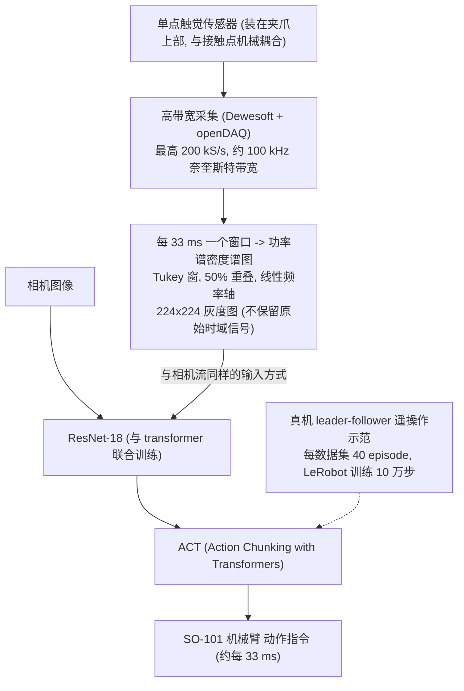

# SpectRobot（arXiv:2609.24621）

**SpectRobot**（*Learning tactile perception from high-bandwidth single-point sensing*，[arXiv:2609.24621](https://arxiv.org/abs/2609.24621)，[项目页](https://huggingface.co/jogarulfop)，[资源](https://github.com/spectrobot-project)）来自 [具身智能小站 2026-10-18 盘点](../../sources/blogs/wechat_embodied_station_26_papers_embodiedswe_2026-10-18.md)，属「灵巧与触觉」组。

## 一句话定义

**把高带宽单点传感信号转成时频图，让视觉编码器读取接触历史。**

## 英文缩写速查

| 缩写 | 英文全称 | 简要说明 |
|------|----------|----------|
| Spectrogram | Time-Frequency Map | 时频图 |

## 为什么重要

- 时间与频率信息能帮助识别遮挡盒内物体；用现成视觉编码器读取触觉降低了建模成本。
- 开源结论：**项目页未列 GitHub**（步骤 2.5，2026-10-18）。公众号给的 GitHub 为组织主页（本环境访问返回 403，无法核实具体仓库）；项目页为 Hugging Face 个人主页，未见具体项目链接。
- 同期同组工作见 [编程智能体造数据与 VLA 闭环评测：具身智能小站 10-18 期 26 篇阅读坐标](../overview/embodied-station-2026-10-18-26-papers-technology-map.md)。

## 流程总览

图依据：论文 §II-A / §II-B / §II-D / Fig.1(b)

## 核心机制

| 项 | 内容 |
|----|------|
| **arXiv** | [2609.24621](https://arxiv.org/abs/2609.24621) |
| **开源** | **项目页未列 GitHub** |
| **要点** | 高带宽单点信号 → 时频图 → 视觉编码器。 |
| **文内指标** | 公众号称实验也比较不同传感技术，尚不代表通用灵巧操作；未给具体数字。 |

## 源码运行时序图

**不适用（项目页未列 GitHub）** — 公众号给的 GitHub 为组织主页（本环境访问返回 403，无法核实具体仓库）；项目页为 Hugging Face 个人主页，未见具体项目链接。 不编造运行脚本；代码公开后再补。

## 实验与评测

- 公众号称实验也比较不同传感技术，尚不代表通用灵巧操作；未给具体数字。
- **读法：** 本页为索引级摘要，依据公众号转述的官方摘要与仓库信息整理；逐项数字与 baseline 以原文 PDF 为准。

## 与其他工作对比

- 横向索引见 [编程智能体造数据与 VLA 闭环评测：具身智能小站 10-18 期 26 篇阅读坐标](../overview/embodied-station-2026-10-18-26-papers-technology-map.md)；同 arXiv 不重复造页。

## 结论

**单点高带宽触觉经时频图可复用视觉编码器，但目前不是通用灵巧操作方案。**

1. 开源边界：**项目页未列 GitHub** — 公众号给的 GitHub 为组织主页（本环境访问返回 403，无法核实具体仓库）；项目页为 Hugging Face 个人主页，未见具体项目链接。
2. 核心机制：高带宽单点信号 → 时频图 → 视觉编码器。
3. 复现与选型前核对任务协议、硬件与基准口径，勿直接横比公众号摘录数字。

## 关联页面

- [tactile-sensing](../concepts/tactile-sensing.md)
- [dexterous-kinematics](../concepts/dexterous-kinematics.md)
- [embodied-station-2026-10-18-26-papers-technology-map](../overview/embodied-station-2026-10-18-26-papers-technology-map.md)

## 参考来源

- [spectrobot_single_point_tactile_arxiv_2609_24621.md](../../sources/papers/spectrobot_single_point_tactile_arxiv_2609_24621.md)
- [wechat_embodied_station_26_papers_embodiedswe_2026-10-18.md](../../sources/blogs/wechat_embodied_station_26_papers_embodiedswe_2026-10-18.md)
- [arXiv:2609.24621](https://arxiv.org/abs/2609.24621)
- [arXiv PDF](https://arxiv.org/pdf/2609.24621)：已通读方法部分（实验与附录以略读为准）：§I 引言、§II Material and Methods（II-A–II-D）、§III-A 触觉分拣任务；其余结果略读

## 推荐继续阅读

- [arXiv PDF](https://arxiv.org/pdf/2609.24621)
- [项目页](https://huggingface.co/jogarulfop)
- [https://github.com/spectrobot-project](https://github.com/spectrobot-project)
