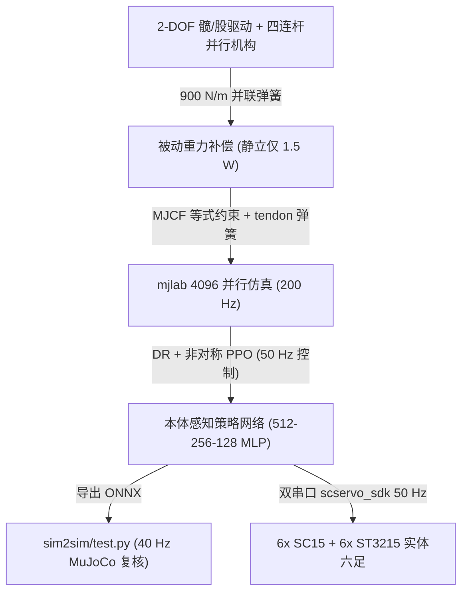
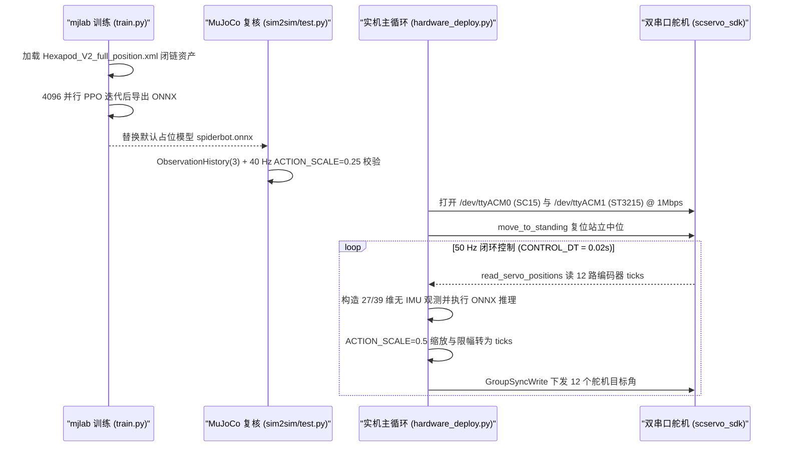

# Spiderbot：带被动重力补偿的 12-DOF 开源低功耗六足机器人

## 一句话定义

**Spiderbot**（[arXiv:2609.26989](https://arxiv.org/abs/2609.26989)，Electronics and Robotics Club, BITS Pilani, KK Birla Goa Campus）是一款总 BOM 不超过 400 美元的 12-DOF 开源六足机器人：通过带并联弹簧的 **并行四连杆机构** 被动承担机身与负载重力矩，把静态站立功耗压低至 **1.5 W**（比去弹簧构型降逾 90%），并在 **mjlab** 中以 MuJoCo 等式约束与 `tendon` 弹簧建模闭链动力学，用非对称 Actor-Critic PPO 策略实现 Sim-to-Real 迁移。

## 英文缩写速查

| 缩写 | 英文全称 | 简要说明 |
| --- | --- | --- |
| DOF | Degree of Freedom | 机械自由度，Spiderbot 单腿由常规 3-DOF 精简为 2-DOF + 被动四连杆弹簧 |
| CoT | Cost of Transport | 运输成本 $P / (mgv)$，衡量单位重量移动单位距离的能耗代价 |
| BOM | Bill of Materials | 物料清单，Spiderbot 整机 BOM 控制在 400 美元以内 |
| PPO | Proximal Policy Optimization | 近端策略优化强化学习算法，论文以非对称 Actor-Critic 形式训练步态策略 |
| MJCF | MuJoCo XML Model Format | MuJoCo 物理建模格式，原生支持闭链等式约束与柔性 `tendon` 弹簧 |

## 为什么重要

传统多足机器人（如 18-DOF 的 PhantomX MK-III 或 24-DOF 研究平台）每条腿至少需要 3 个主动舵机，即便静止站立也必须持续输出电流对抗重力，导致静立功耗动辄 10–40 W、续航严重受限且单机成本过千至数万美元。Spiderbot 展示了一条“机构换能耗 + RL 补工作空间”的低成本工程路线：在硬件端省去胫节主动电机并以弹性连杆卸除静态重力负载，在软件端突破 URDF 无法表达闭链连杆的限制，用 MJCF + `mjlab` 端到端学习速度跟踪策略，为长续航低成本多足集群提供全套开源软硬件基线。

## 核心原理

### 1. 四连杆被动重力补偿与机构参数化

- **机械拓扑与尺寸约束**：每条腿仅含两个主动旋转关节（髋关节 `coxa` 由 SC15 驱动，大腿 `femur`/平行上连杆由 ST3215 驱动），借助并行四连杆（$l_{L1}=0.1463\text{ m}$，$l_{L3}=0.1583\text{ m}$，竖直分离 $l_V=0.05\text{ m}$，弹簧枢轴距 $l_S=0.05\text{ m}$）强制小腿始终竖直，保证中立站立最小离地间隙 $\ge 10\text{ cm}$、动态最大抬足高度 $5\text{ cm}$。
- **弹性刚度选型**：基于中立 6 足着地与三脚（tripod）静态力学平衡分析（Eq. 1–3），三脚支撑扭矩-刚度曲线在 **880 N/m** 处出现拐点，超过后动态阻力急剧抬头；据此每腿并联两根 **450 N/m** RC 减震弹簧（等效 **900 N/m**），实现最高 **3.25 kg** 载荷下静态几乎零额外舵机扭矩增长。
- **核心 BOM 与电控（< 400 USD）**：机身整重约 `3.0 kg`（基体 `2.59 kg` + 2S 5200 mAh LiPo），包含 6× ST3215（20 kg·cm，126 USD）、6× SC15（15 kg·cm，108 USD）、Arduino Uno Q 开发板（44 USD）、12× 弹簧（18 USD）、2× Waveshare 串行舵机驱动板（20 USD）、MPU-6050 IMU（2 USD）与 PLA 耗材（10 USD）。

### 2. mjlab 闭链仿真与非对称 PPO 训练

- **MJCF 闭链建模**：标准 URDF/XACRO 树形拓扑无法直接表示四连杆闭链。项目采用 MuJoCo `equality` 等式约束闭合平行连杆，并通过 `tendon` 弹簧元件与 `BuiltinPositionActuatorCfg`（含 1–15 步通信滞后 `MIN_LAG/MAX_LAG` 建模）还原实机驱动动态。
- **课程地形与域随机化**：在 **4096** 个并行环境中按 `200 Hz` 物理步进、`50 Hz` 控制策略（`decimation=4`）迭代训练 5000 轮（3 层 MLP：`512, 256, 128`）。环境在 10×20 栅格上混排 7 类地形（平地 20%、金字塔阶梯 20%、倒置阶梯 20%、正/反斜坡各 10%、随机粗糙 10%、正弦波纹 10%），同时随机化足端摩擦 `[0.3, 1.2]`、编码器偏置 `[-0.015, 0.015] rad`、质心/质量及每回合重采样的 PD 增益 `[0.8, 1.2]` 与电枢惯量 `[0.25, 2.0]`。
- **非对称 Actor-Critic**：Critic 在训练期接收特权地形高度扫描 `height_scan` 与真实基座线速度 `base_lin_vel`，而 Actor 仅保留关节角/角速度、历史动作与速度指令等本体输入，并在实机脚本中进一步支持纯无 IMU 推理。

## 实验与对比评测

基于论文 Table VI–XII 与实机 N=10 重复试验，核心定量对比如下：

| 评测维度 | 关键对比项 | 仿真表现 | 实机表现 | 结论要点 |
| --- | --- | --- | --- | --- |
| 静态站立功耗（0 / 3.25 / 3.75 kg 负载） | 有弹簧 vs 去弹簧 | — | **1.5 / 1.76 / 4.11 W** vs 15.0 / 33.92 / 39.87 W | 降耗 >90%，3.25 kg 内零额外静态能耗 |
| 同类平台静立功耗对比 | Spiderbot vs HexaV4 vs PhantomX | — | **1.5 W** vs ~10 W vs ~40 W | 较 3-DOF 商业套件节能最高 **96%** |
| 平地行走 CoT（0.2 m/s） | 有弹簧 vs 去弹簧 | 1.936（有弹簧） | **6.22** vs 4.97 | 弹簧在行进间引入 ~25% 额外机械阻尼代价 |
| 高速平地跟随（指令 0.5 m/s） | 实测速度 / CoT | 0.4305 m/s / 0.960 | **0.231 m/s / 3.54** | 驱动器电气损耗与通信开销放大实机 CoT 3×+ |
| 斜坡与崎岖地面（Table VIII/X） | 15° 爬坡 / 随机粗糙地形 | 爬坡 2.46 CoT / 粗糙 2.03 CoT | **15° 爬坡 9.54 CoT** / 粗糙 **9.79 CoT** | 稳定通过 5°–15° 坡面及土壤/砖石混杂地 |
| 离散台阶越障（Table IX） | 2.0 cm (40%) / 3.0 cm (60%) / 5.0 cm (100%) | 通过 / 通过 / 失败 | **通过 / 失败 / 失败** | 2-DOF 小腿竖直约束决定几何抬足上限 |

### 与其他工作对比

- **对比传统 18-DOF 六足（PhantomX MK-III / HexaV4 / `Spider3d` 3-DOF 对照模型）**：常规每腿三主动自由度构型虽拥有更高抬足工作空间，但站立阶段需持续主动电流平衡重力矩（静立功耗约 10–40 W）；Spiderbot 以并行四连杆加 `900 N/m` 并联弹簧换取 1.5 W 极低静态功耗（降幅最高 **96%**）与 < 400 美元成本，代价是硬性小腿竖直姿态与 5.0 cm 越障物理上限。
- **对比通用刚体 URDF + IsaacGym 足式训练管线**：标准 URDF 树形结构难以直接求解闭链四连杆动力学，本作依托 MuJoCo `equality` + `tendon` 在 [mjlab](./mjlab.md) 中端到端闭链学习（详见 [人形机器人并联关节运动学](../concepts/humanoid-parallel-joint-kinematics.md) 的并联建模共性）。

## 结论

1. **一句话总判**：Spiderbot 证明了“2-DOF 弹簧四连杆被动重力补偿 + MJCF 闭链强化学习”能在 400 美元成本下兼具 **1.5 W** 超低静立功耗与 15° 斜坡/粗糙地形的稳定行进能力，是轻量化长续航低速巡检集群的高性价比平台。
2. **选型优先级**：若任务包含长时间驻留监视或定点载荷承载（≤ 3.25 kg），被动弹簧收益远高于约 25% 的行进 CoT 增量；若需频繁攀爬高过抬腿极限的垂直台阶或压身钻行，则必须回归 3-DOF 腿构型。
3. **跨工程可直接复用模式**：任何含闭合四连杆/平行连杆的足式与双足机器人（见 [人形机器人并联关节运动学](../concepts/humanoid-parallel-joint-kinematics.md)）应直接绕开 URDF 近似拆分，改用 MuJoCo `equality + tendon` 在 `mjlab` 训练。
4. **能量建模缺口**：当前仿真仅积分机械功率，低估舵机驱动板、半双工串口及反电动势损耗逾 3 倍；后续能耗感知策略训练须显式加入电-机耦合损耗模型。

## 源码运行时序图

以下时序严格对应仓库 `src/mjlab/scripts/train.py`、`sim2sim/test.py` 与 `sim2real/hardware_deploy.py` 的实际运行流：

## 工程实践

1. **双串口分流降延时**：`hardware_deploy.py` 明确将 6 个 SC15 髋舵机和 6 个 ST3215 大腿舵机分挂 `/dev/ttyACM0` 与 `/dev/ttyACM1`（各 1 Mbps 半双工通信），若单口串联全部 12 舵机容易出现轮询超时并破坏 `50 Hz` 节拍。
2. **留意 `sim2sim` 与 `sim2real` 的观测与缩放差异**：仓库 `sim2sim/test.py` 使用 **40 Hz**、`ACTION_SCALE = 0.25`、`ObservationHistory(3)` 且含 `imu_ang_vel` 和 `projected_gravity`；而 `sim2real/hardware_deploy.py` 默认使用 **50 Hz**、`ACTION_SCALE = 0.5` 及 **27/39 维无 IMU 观测**。迁移自训权重前必须严格对齐两者观测维数、历史窗口长度及 `action_scale`，切勿直接沿用仓库自带的占位测试文件名 `spiderbot.onnx`。
3. **总线堵转与超时回退**：代码允许在串口回读过慢时用 `joint_pos_rad = last_action.copy()` 充当伪本体闭环（牺牲外力抗扰换取周期稳定），并设定了以 `MIDDLE_POS_SC/ST ± LIMIT` 为基准的硬软件行程限幅，实机首次上电前应逐一标定舵机中位 tick。

## 常见误区与局限

- **误区 1：以为弹簧能永久降低所有运动能耗**：弹簧只在静立和小摆幅支撑时抵消重力；在高速动态摆动期间，固定 900 N/m 恢复力矩反而会成为主动抬腿的阻力源，使行进 CoT 增加约 25%。
- **误区 2：误把“2-DOF 仅少一个自由度”当作仅微调步态就能弥补**：四连杆机构强制小腿保持绝对竖直且缩减足端径向包络，一旦台阶超过 `5.0 cm` 物理抬足极值，无论训练多久强化学习策略都会撞击台阶前缘失败。
- **硬件局限**：低成本塑料/金属混杂串行舵机无力矩闭环能力、存在减速箱反向间隙，且固定刚度弹簧无法在不拆机换件的情况下适配变质量任务。

## 关联页面

- [PPO（近端策略优化）](../methods/ppo.md) — Spiderbot 在 `mjlab` 中使用的在线强化学习训练算法
- [足式运动控制（Locomotion）](../tasks/locomotion.md) — 多足复杂地形速度跟踪任务主线
- [Sim2Real（仿真到真机迁移）](../concepts/sim2real.md) — 闭链仿真与无特权策略跨虚实迁移框架
- [领域随机化（Domain Randomization）](../concepts/domain-randomization.md) — 针对摩擦、编码器偏置与延迟的参数扰动实践
- [人形机器人并联关节运动学](../concepts/humanoid-parallel-joint-kinematics.md) — 闭链四连杆机构在 MJCF 中的建模与迁移共性原理
- [mjlab（基于 MuJoCo MJWarp 的轻量级 GPU 仿真框架）](./mjlab.md) — Spiderbot 官方训练与闭链任务构建底座

## 参考来源

- 论文归档：[Spiderbot 原文通读归档](../../sources/papers/spiderbot-hexapod-open-source_arxiv_2609_26989.md)（arXiv:2609.26989 全文核对）
- 仓库归档：[ERC-BPGC/SpiderBot 源码核查](../../sources/repos/spiderbot.md)
- 原始来源：https://arxiv.org/abs/2609.26989 | https://erc-bpgc.github.io/SpiderBot/ | https://github.com/AnshumanSahoo07/SpiderBot

## 推荐继续阅读

- [mjlab（基于 MuJoCo MJWarp 的轻量级 GPU 仿真框架）](./mjlab.md) — 深入理解 `BuiltinPositionActuatorCfg` 延迟建模与等式约束仿真。
- [RSL-RL（高速 GPU 强化学习框架）](./rsl-rl.md) — 了解非对称 Actor-Critic PPO 在 GPU 并行足式任务中的标准接口。
