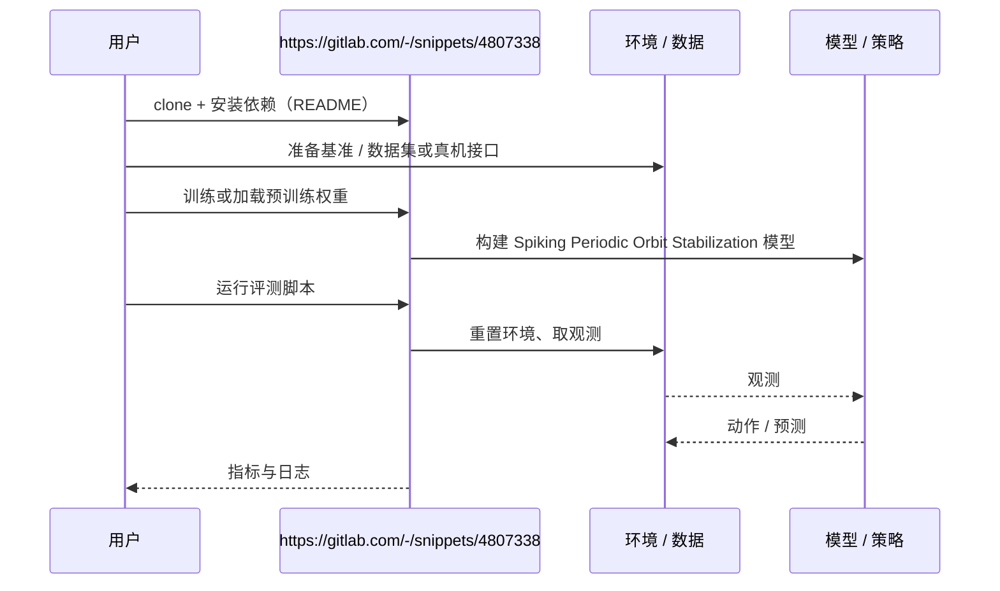

# Spiking Periodic Orbit Stabilization（arXiv:2610.37310）

**Spiking Periodic Orbit Stabilization**（*Spiking Neuromorphic Control for Periodic Orbits Stabilization in Underactuated Robots: A Greedy Lyapunov-Based Approach*，[arXiv:2610.37310](https://arxiv.org/abs/2610.37310)，[代码](https://gitlab.com/-/snippets/4807338)）来自 [具身智能小站 2026-10-28 盘点](../../sources/blogs/wechat_embodied_station_59_papers_human_video_to_robot_experience_2026-10-28.md)，属「控制、规划与系统」组。

## 一句话定义

**将欠驱动机器人的周期轨道稳定问题化为周期线性时变系统，再把基于李雅普诺夫的贪心设计扩展到脉冲控制。**

## 英文缩写速查

| 缩写 | 英文全称 | 简要说明 |
|------|----------|----------|
| Spiking Periodic Orbit Stabilization | Spiking Neuromorphic Control for Periodic Orbits Stabilization in Underactuated Robots: A Greedy Lyapunov-Based Approach | 本文方法 / 基准的简称 |

## 为什么重要

- 用脉冲反馈稳定周期运动。以蝴蝶机器人轨迹稳定为例，关注范围是局部轨道控制。
- 开源结论：**部分开源**（步骤 2.5，2026-10-28）。公众号给出的是 GitLab snippet（gitlab.com/-/snippets/...），不是完整仓库，git ls-remote 失败；不能当作完整开源。
- 同期同组工作见 [潜在动作、免渲染事件仿真与机器人评测：具身智能小站 10-28 期 59 篇阅读坐标](../overview/embodied-station-2026-10-28-59-papers-technology-map.md)。

## 核心机制

| 项 | 内容 |
|----|------|
| **arXiv** | [2610.37310](https://arxiv.org/abs/2610.37310) |
| **开源** | **部分开源** |
| **要点** | 将欠驱动机器人的周期轨道稳定问题化为周期线性时变系统，再把基于李雅普诺夫的贪心设计扩展到脉冲控制。 |
| **文内指标** | 公众号转述：以蝴蝶机器人轨迹稳定为例，关注范围是局部轨道控制。 |

## 源码运行时序图

以下为按仓库入口（`https://gitlab.com/-/snippets/4807338`）推断的通用运行链路；入库日仅核实仓库可达，未逐文件阅读，具体脚本名以 README 为准。

## 实验与评测

- 公众号转述：以蝴蝶机器人轨迹稳定为例，关注范围是局部轨道控制。
- **读法：** 本页为索引级摘要，依据公众号转述的官方摘要与仓库信息整理；逐项数字与 baseline 以原文 PDF 为准。

## 与其他工作对比

- 横向索引见 [潜在动作、免渲染事件仿真与机器人评测：具身智能小站 10-28 期 59 篇阅读坐标](../overview/embodied-station-2026-10-28-59-papers-technology-map.md)；同 arXiv 不重复造页。

## 结论

**用脉冲反馈稳定周期运动：以蝴蝶机器人轨迹稳定为例，关注范围是局部轨道控制。**

1. 开源边界：**部分开源** — 公众号给出的是 GitLab snippet（gitlab.com/-/snippets/...），不是完整仓库，git ls-remote 失败；不能当作完整开源。
2. 核心机制：将欠驱动机器人的周期轨道稳定问题化为周期线性时变系统，再把基于李雅普诺夫的贪心设计扩展到脉冲控制。
3. 复现与选型前核对任务协议、硬件与基准口径，勿直接横比公众号摘录数字。

## 关联页面

- [manipulation](../tasks/manipulation.md)
- [impedance-control](../concepts/impedance-control.md)
- [llm-robotics-control-interfaces](../concepts/llm-robotics-control-interfaces.md)
- [embodied-station-2026-10-28-59-papers-technology-map](../overview/embodied-station-2026-10-28-59-papers-technology-map.md)

## 参考来源

- [spiking_periodic_orbit_stabilization_arxiv_2610_37310.md](../../sources/papers/spiking_periodic_orbit_stabilization_arxiv_2610_37310.md)
- [wechat_embodied_station_59_papers_human_video_to_robot_experience_2026-10-28.md](../../sources/blogs/wechat_embodied_station_59_papers_human_video_to_robot_experience_2026-10-28.md)
- [arXiv:2610.37310](https://arxiv.org/abs/2610.37310)

## 推荐继续阅读

- [arXiv PDF](https://arxiv.org/pdf/2610.37310)
- [https://gitlab.com/-/snippets/4807338](https://gitlab.com/-/snippets/4807338)
