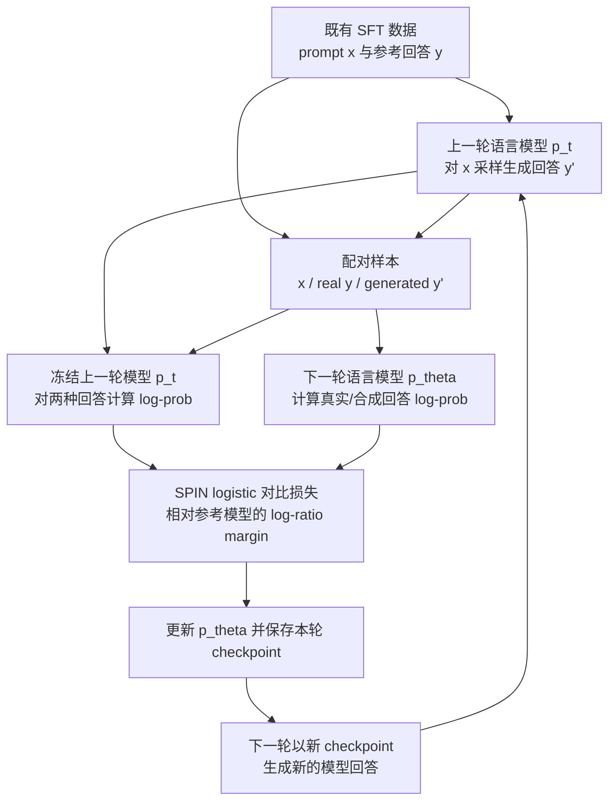
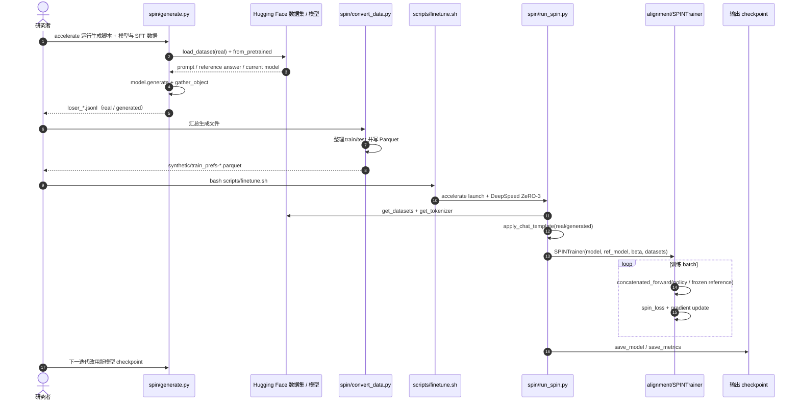

# SPIN：自博弈微调使弱语言模型变强 / Self-Play Fine-Tuning Converts Weak Language Models to Strong Language Models

## 一句话定义

**SPIN（Self-Play Fine-Tuning）**是 UCLA 在 ICML 2024 提出的语言模型后训练方法：用**旧模型自产回答**与**已有 SFT 参考回答**构成对照，在冻结的上一轮模型参照下更新新模型，逐轮提升指令遵循能力，**不需要额外收集人类偏好比较标注**。

## 英文缩写速查

| 缩写 | 英文全称 | 简要说明 |
|---|---|---|
| SPIN | Self-Play Fine-Tuning | 基于历史模型输出的迭代自博弈微调 |
| LLM | Large Language Model | 本文被训练和用于生成回答的语言模型 |
| SFT | Supervised Fine-Tuning | 提供原始高质量参考答案及初始 checkpoint |
| DPO | Direct Preference Optimization | 作为相近的成对偏好损失与实验对照 |
| MT-Bench | Multi-turn Benchmark | 作者用于评价多轮对话表现的基准 |
| ZeRO-3 | Zero Redundancy Optimizer Stage 3 | 官方多 GPU 全量微调使用的 DeepSpeed 分片配置 |

## 为什么重要

- **数据闭环：** 把历史模型自己生成的答案变成可重复利用的训练负例，减少对新增人工偏好比较数据的依赖，但**仍然依赖最初的 SFT 参考数据**。
- **机制清晰：** “self-play”不是两个机器人或两个智能体在环境里竞争，而是新旧语言模型对“参考回答与生成回答”的分布判别。
- **研究边界：** 属于[RSI 纵深路线 Stage 2](../../roadmap/depth-rsi.md)的**有界权重级迭代**；不能等同开放式递归自我改进，更没有在真实机器人上验证。

## 核心信息

| 项 | 内容 |
|---|---|
| 英文标题 | Self-Play Fine-Tuning Converts Weak Language Models to Strong Language Models |
| 中文标题 | 自博弈微调使弱语言模型变强 |
| 作者 | Zixiang Chen、Yihe Deng、Huizhuo Yuan、Kaixuan Ji、Quanquan Gu |
| 机构 | 加州大学洛杉矶分校（University of California, Los Angeles，UCLA） |
| 发表 | ICML 2024；[arXiv:2401.01335v3](https://arxiv.org/abs/2401.01335v3)（2024-06-14） |
| 基座与任务 | Mistral-7B 派生 Zephyr SFT；语言指令跟随 |
| 项目 / 源码 | [官方项目](https://uclaml.github.io/SPIN/) / [uclaml/SPIN](https://github.com/uclaml/SPIN)，已开源 |
| 数据 | 现有 SFT 参考回答 + 历史模型生成回答；作者提供迭代数据和模型 |
| 证据边界 | 语言基准实验；无机器人闭环 / 真机评测 |

## 核心原理

### 1. 旧模型负责生成，新模型负责区分（``3–4）

设已有 SFT 训练集含提示 `x` 与高质量参考回答 `y`，第 `t` 轮模型 `p_t` 对相同提示采样回答 `y'`。下一轮策略 `p_θ` 不仅提高参考回答的相对概率，还降低历史模型生成回答的相对概率，同时以 **冻结的 `p_t`** 作为参照计算对数概率比值。

对于 logistic 损失，可将目标理解为最大化以下 margin：

\[
m = \beta\left[\log p_\theta(y\mid x)-\log p_\theta(y'\mid x)
-\log p_t(y\mid x)+\log p_t(y'\mid x)\right]
\]

其中 `β` 控制更新尺度；损失为 `-log sigmoid(m)`。这一形式由原文 `4 的目标与 [SPINTrainer.spin_loss](https://github.com/uclaml/SPIN/blob/main/spin/alignment/trainer.py) 对应核实。与普通 DPO 不同，负例 `y'` 由历史模型自产，不依赖新一批偏好标注。

### 2. 流程总览（原文 `4、Figure 1）

### 3. 理论读法（`5）

论文讨论目标数据分布与策略分布的固定点：在假设的损失函数与可表达性条件下，当模型分布与参考数据分布一致时可达到理论平衡。这是**理想化分布分析**，不能推出训练中每轮都单调增益、不会坍缩，更不能推出自动超越参考数据分布的可靠性。

## 源码运行时序图

已阅读官方 [README](https://github.com/uclaml/SPIN)、[生成入口](https://github.com/uclaml/SPIN/blob/main/spin/generate.py)、[转换脚本](https://github.com/uclaml/SPIN/blob/main/spin/convert_data.py)、[微调入口](https://github.com/uclaml/SPIN/blob/main/spin/run_spin.py) 与 [SPINTrainer](https://github.com/uclaml/SPIN/blob/main/spin/alignment/trainer.py)（[源码归档](../../sources/repos/spin-uclaml.md)）。以下节点与实际脚本调用路径一致；逐轮执行由独立脚本和配置驱动，不是 `SPINTrainer.train` 内部自动跨轮生成：

## 工程实践

| 环节 | 官方实现与注意点 |
|---|---|
| 环境 | README：Python 3.10；`pip install .`；`flash-attn`；Hugging Face 登录 |
| 生成 | `spin/generate.py`：读取 `real`，调用 `model.generate`，多 GPU 汇总输出 `loser_*.jsonl` |
| 数据 | `spin/convert_data.py`：将成对 `real/generated` 转成可微调的 Parquet |
| 微调 | `scripts/finetune.sh`：`accelerate launch` → `spin/run_spin.py` → `SPINTrainer.train()` |
| 多轮 | `finetune_iter1.sh`、`finetune_iter2.sh`、`finetune_iter3.sh` 用对应模型 / 数据组合 |
| 复现坑点 | 2024-04-04 官方重传更正数据；Alignment Handbook checkpoint 更新后，须核对 README 提供的历史 SFT revision |
| 算力 | 官方全量微调以 8 GPU 的 DeepSpeed ZeRO-3 示例复现，README 注明使用 A100 80GB |
| 验证 | 本次已核对论文全文与关键源码，**没有**执行本地多卡训练或独立复现实验数字 |

## 实验与评测

下表均为**论文作者报告**，不是本仓库独立复现：

| 语言模型 / 迭代 | Open LLM Leaderboard 六任务均分 |
|---|---:|
| Zephyr SFT 起点 | 58.14 |
| SPIN iteration 0 | 60.80 |
| SPIN iteration 1 | 62.12 |
| SPIN iteration 2 | 62.97 |
| SPIN iteration 3 | 63.16 |
| Zephyr DPO 基线（外部偏好数据） | 61.31 |

- 论文另报 **MT-Bench 5.94 → 6.78**（SFT 起点到 iter3）。
- SPIN iter3 超过表中的 DPO 均分，但这不是在所有评测任务、所有模型与同等成本下的普遍结论；具体单项指标存在波动。
- 官方 README 明确说明 `lm-evaluation-harness` 的评测版本与 few-shot 配置会影响绝对分数；应固定版本复测。

## 结论

**SPIN 的实证价值在于：已有 SFT 参考数据配合“旧模型自生成负例”，可以驱动多轮语言模型后训练；它没有证明不受约束的自我进化。**

1. **保留数据锚点** — 新样本的“正例”仍来自原始 SFT 数据，不能把 SPIN 解释成完全摆脱示范。
2. **保存历史模型快照** — `SPINTrainer` 的 log-ratio 依赖冻结 reference/opponent 模型；换轮次时要同时对齐模型和生成数据。
3. **复现须固定版本** — 官方已更正早期数据；SFT 基座与评测版本漂移都会影响结论。
4. **外部评测不能省** — 检查语言基准各子项而非只看平均分；多轮迭代的收益未保证无限持续。
5. **迁移机器人需加物理验证锚** — 真机成功率、碰撞、接触与时延需另立闭环评测，不能直接照搬文字回答“好坏”。

## 与其他工作对比

| 方法 | 对照信号来源 | 更新对象 | 区别 |
|---|---|---|---|
| 常规 SFT | 静态参考回答 | 模型权重 | 直接最大似然拟合示范，无旧模型生成负例 |
| DPO | 外部构建偏好对 | 模型权重 | SPIN 的负例来自上一轮模型而非新增的人工偏好配对 |
| [Self-Rewarding Language Models](./paper-self-rewarding-language-models.md) | **同一模型充当 judge** 给候选打分、构造 winner/loser | 模型权重 | SPIN 不让模型自评答案质量，而以原 SFT 参考作为“真”样本 |
| [开放式 RSI](../concepts/recursive-self-improvement.md) | 自主改进机制和可信验证 | 可能涉及元学习或改进器 | SPIN 固定训练协议、数据锚和实验任务，属于有界权重迭代 |

## 局限与风险

- **适用范围：** 论文只验证语言模型的指令跟随/评测；不包含机器人运动控制、接触动力学或 Sim2Real。
- **目标分布边界：** 现有示范数据质量、覆盖范围与生成偏差会影响上限；没有普遍的无限迭代增强保证。
- **复现成本：** 多卡全量微调、数据版本和初始 checkpoint 固定成本较高，论文分数对评测配置敏感。
- **名称歧义：** 此 SPIN 为 2024 LLM 后训练论文，与机器人旋转、自博弈 RL 或其他同名软件不等同。

## 关联页面

- [Self-Rewarding Language Models：自评判驱动偏好更新](./paper-self-rewarding-language-models.md)
- [监督微调（SFT）](../concepts/supervised-fine-tuning.md)
- [递归自我改进（RSI）](../concepts/recursive-self-improvement.md)
- [RSI 全谱系综述](./paper-rsi-survey-2607-07663.md)
- [RSI 纵深路线 Stage 2](../../roadmap/depth-rsi.md)

## 参考来源

- [SPIN v3 通读归档](../../sources/papers/spin_self_play_fine_tuning_arxiv_2401_01335.md)
- [官方源码归档与执行入口](../../sources/repos/spin-uclaml.md)
- [官方项目页与开源核查](../../sources/sites/spin-project.md)
- [arXiv:2401.01335v3](https://arxiv.org/abs/2401.01335v3)
- [SPIN 官方 GitHub](https://github.com/uclaml/SPIN)

## 推荐继续阅读

- [SPIN 项目页](https://uclaml.github.io/SPIN/)
- [SPIN 原文 v3](https://arxiv.org/pdf/2401.01335v3)
- [DPO：Direct Preference Optimization](https://arxiv.org/abs/2305.18290)
