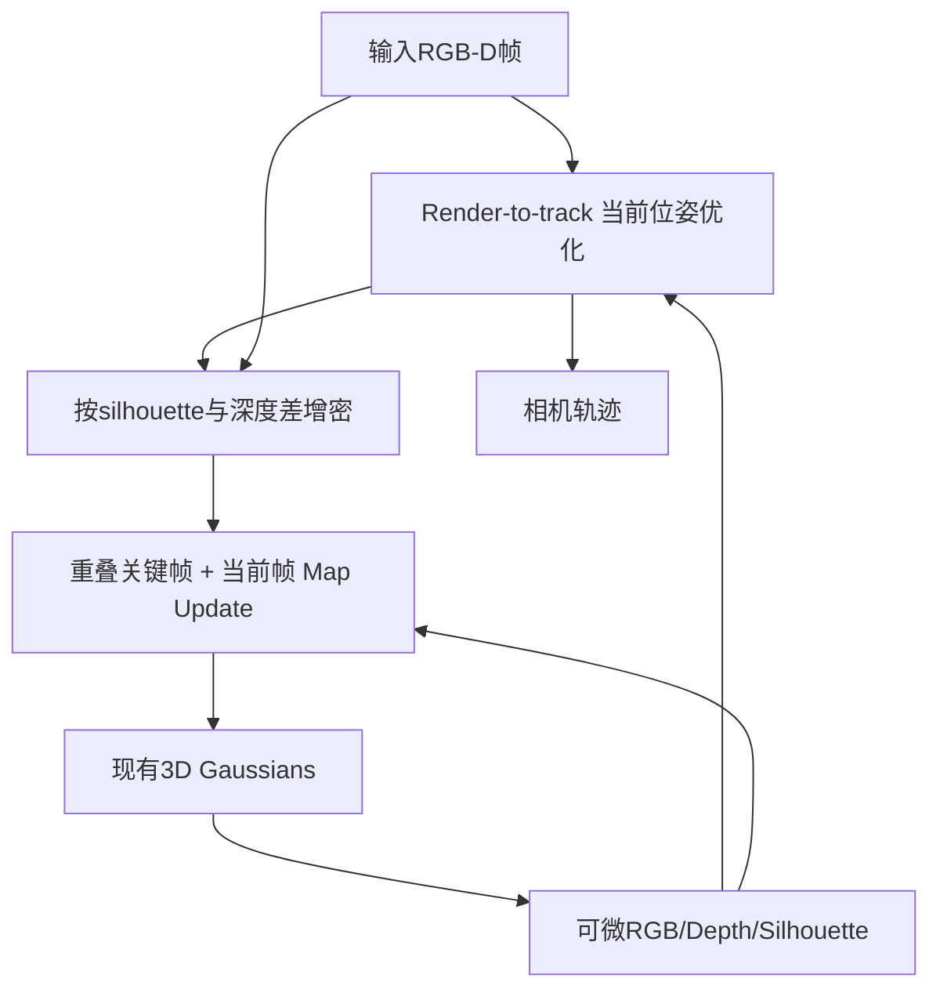
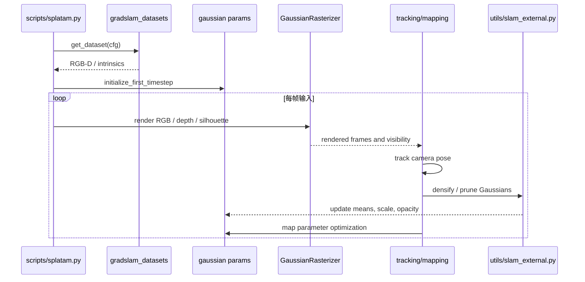

# SplaTAM — 论文与作者源码深读

## 一句话定义

SplaTAM 从未经位姿标注的 RGB-D 帧在线优化 3D Gaussian 地图与相机轨迹，用 silhouette 掩码处理可见区域、地图增密和建图。

## 英文缩写速查

| 缩写 | 英文全称 | 简要说明 |
|---|---|---|
| SLAM | Simultaneous Localization and Mapping | 同步定位与建图 |
| RGB-D | Red Green Blue Depth | 彩色和对齐深度 |
| ATE | Absolute Trajectory Error | 位姿估计误差 |
| PSNR | Peak Signal-to-Noise Ratio | 渲染质量指标 |
| 3DGS | 3D Gaussian Splatting | 显式高斯场景表示 |

## 为什么重要

在机器人三维感知中，隐式体积场、显式高斯和传统点云的选择会影响在线相机跟踪、地图更新、渲染质量与系统时延。SplaTAM 的关键设计需要区分**地图表示、位姿优化、显式新区域处理和系统运行时间**。

## 核心原理与方法

在首帧 RGB-D 反投影初始化球形/各向同性 Gaussians；后续每帧先使用 3D Gaussian splatting 可微渲染 RGB、深度和 silhouette，利用 silhouette>阈值的已有地图像素只优化相机位姿，避免未观测区域干扰；再据 silhouette 与深度差把新出现的 RGB-D 表面反投影为新 Gaussians，随后以当前帧和有重叠关键帧优化高斯位置、颜色、尺度、不透明度。每帧 Tracking→Gaussian Densification→Map Updating 是作者 §3 明确顺序。

## 流程总览（原论文）

## 源码运行时序图

README：python scripts/splatam.py configs/iphone/splatam.py；scripts/splatam.py::get_dataset、initialize_first_timestep、get_pointcloud、initialize_optimizer；diff_gaussian_rasterization 渲染，utils/slam_external.py::densify / prune_gaussians 管理显式高斯。 以下图依据作者源码主循环，不等于已在本环境运行。

## 实验与评测

论文 §5 Table3 ScanNet++ novel-view 合成视角平均 PSNR **24.41 dB**，训练视角平均 **27.98 dB**，两类渲染不应混用；引言/图1 指明 876×584 条件下可达 **400 FPS 的渲染**（不是完整 SLAM Tracking/Mapping 帧率）。论文还在 Replica/TUM RGB-D 上评价 ATE、深度重建。

## 结论

**SplaTAM 从未经位姿标注的 RGB-D 帧在线优化 3D Gaussian 地图与相机轨迹，用 silhouette 掩码处理可见区域、地图增密和建图。**

- 跟踪和建图使用不同梯度目标，不能把渲染速度等同在线 SLAM 总帧率。
- 数据集划分与 metric 必须与原论文一致，避免比较不同深度、相机位姿来源的结果。
- 对机器人部署必须先完成相机内参、深度外参、时间同步及真实硬件测量。

## 工程实践

README：python scripts/splatam.py configs/iphone/splatam.py；scripts/splatam.py::get_dataset、initialize_first_timestep、get_pointcloud、initialize_optimizer；diff_gaussian_rasterization 渲染，utils/slam_external.py::densify / prune_gaussians 管理显式高斯。

建议分别记录 ATE、深度 L1、PSNR 和关键帧时间成本，并把源码 commit、GPU、分辨率与传感器参数写入实验日志。

## 局限与风险

需要标定过的 RGB-D 相机和相对可靠的深度；大运动、跟踪失败或位姿误差会污染高斯地图；渲染 FPS 不等于完整 SLAM 系统速度。官方代码中基于 torch 和 CUDA renderer 的设置、密度更新与 keyframe 选择必须匹配具体数据集。

## 关联页面

- [4D-GS（动态新视角合成）](./paper-4d-gaussian-splatting-wu.md)
- [COLMAP 稀疏/稠密重建](./colmap.md)
- [LVI-SAM](./paper-lvi-sam.md)

## 参考来源

- [论文深读来源档案](../../sources/papers/vision3d_splatam_primary_paper_20261108.md)
- [官方仓库深读档案](../../sources/repos/vision3d_splatam_20261108.md)
- [原文全文](https://arxiv.org/html/2312.02126)
- [原作者源码](https://github.com/spla-tam/SplaTAM)

## 推荐继续阅读

- [作者论文和补充材料](https://arxiv.org/html/2312.02126)
