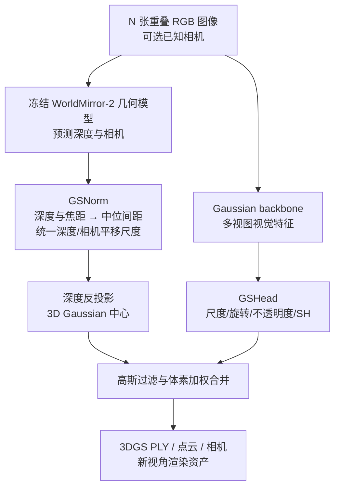
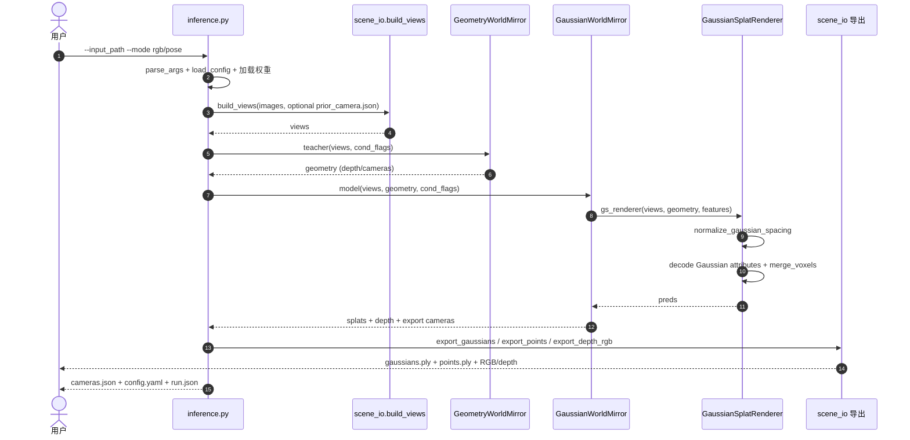

# SplatAnything（InfiniSplat v3）：跨任意场景的 Gaussian Spacing Normalization 3DGS

## 一句话定义

**SplatAnything** 是浙江大学与 Tencent Hunyuan 等提出的前向 3D Gaussian Splatting 重建方法：让模型在预测高斯属性前用 **GSNorm** 统一相邻高斯中心的代表性间距，从而改善跨物体、室内、街景、航拍及不同相机配置的新视角合成泛化。

## 英文缩写速查

| 缩写 | 英文全称 | 简要说明 |
|---|---|---|
| 3DGS | 3D Gaussian Splatting | 显式高斯场景表示和新视角渲染目标 |
| GSNorm | Gaussian Spacing Normalization | 以场景级高斯间距中位数建立归一化尺度 |
| RDNorm | Radial Distance Normalization | 以参考相机原点的平均径向距离归一化的基线 |
| SH | Spherical Harmonics | Gaussian 的视角相关颜色系数 |
| LPIPS | Learned Perceptual Image Patch Similarity | 评测新视角渲染感知差异，越小越好 |
| DISTS | Deep Image Structure and Texture Similarity | 结构与纹理感知差异指标，越小越好 |

## 为什么重要

- 传统前向 3DGS 模型经常继承几何基础模型的 RDNorm 坐标：平均半径相近，不代表像素投影得到的相邻高斯中心间距相同。
- 同样的视觉局部纹理若对应不同稠密度，会要求不一致的 Gaussian scale；预测过小产生空洞，预测过大导致相互覆盖、模糊。
- GSNorm 为不同物体距离、焦距和分辨率提供更一致的监督空间；本文把**跨数据集 / 稀疏视角 / 外推视角**作为基准，避免仅凭同域插值分数断言泛化。

## 流程总览

主干取自 [论文 §3 与图 3](https://arxiv.org/html/2611.08264#S3)，并对照官方 README / 推理源码：



## 核心原理

### 从邻像素几何量推导 GSNorm

局部深度近似常数、针孔内参为 `fx, fy` 时，水平方向与垂直方向的反投影间距分别约为 `D/fx` 和 `D/fy`；其几何平均为：

```text
d_i(u) ≈ D_i(u) / sqrt(fx_i * fy_i)
s_g = median_{i,u in valid pixels} d_i(u)
```

论文通过用 `s_g` 等比例缩放深度、三维点和相机**平移**，令归一化后的高斯间距中位数约为 1；旋转和相机内参不随这个空间尺度改变。其目标是对齐 Gaussian scale 的学习参照，不是估计绝对米制。

**论文定义与代码数值勿混淆：** 官方 `GaussianSplatRenderer.normalize_gaussian_spacing` 先对齐预测/提供相机的尺度，再计算间距中位数，随后使用 `spacing_target / median_spacing` 缩放深度和相机平移。当前推理默认目标值是 `0.0013227513`，并非代码坐标里恰好设为 1。

### 架构与输出

- **几何先验：** `GeometryWorldMirror`（WorldMirror-2 权重）先预测深度、相机与置信度；pose-conditioned 模式用提供的相机作重建坐标参考，但深度仍来自几何模型。
- **高斯预测：** `GaussianWorldMirror` 特征经 `GSFeatHead` / `DPTDecoder` 生成旋转、尺度、opacity、SH 等属性；Gaussian 中心由深度反投影。
- **合并与导出：** 推理过滤大尺度/悬浮点/可选天空后，对同体素高斯按预测权重合并，输出 `gaussians.ply`、`points.ply`、`cameras.json`、逐视角 RGB/深度等。
- **训练与监督：** 论文通过多视角新视角重建损失学习 Gaussian 属性；不等同于机器人实时规划、碰撞几何估计或物理动力学建模。

## 源码运行时序图

依据 [官方 `inference.py`](https://github.com/zju3dv/SplatAnything/blob/main/inference.py)、[`scene_io.py`](https://github.com/zju3dv/SplatAnything/blob/main/src/utils/scene_io.py)、[`gaussian_worldmirror.py`](https://github.com/zju3dv/SplatAnything/blob/main/src/models/models/gaussian_worldmirror.py) 与 [`rasterization.py`](https://github.com/zju3dv/SplatAnything/blob/main/src/models/models/rasterization.py) 的实际推理入口：



上述是**公开推理路径**；官方仓的相关文件自述为 *inference-only release*，因此不能把这个时序图当作论文训练运行时序。

## 工程实践

| 维度 | 官方可验证信息 |
|---|---|
| 开源状态 | [官方源码](https://github.com/zju3dv/SplatAnything) 提供推理入口；[模型权重](https://huggingface.co/ritianyu/SplatAnything) 提供下载入口；训练代码不在该推理版中 |
| 环境 | Python 3.10+，PyTorch 2.4+，兼容驱动的 CUDA；`python -m pip install -r requirements.txt` |
| RGB-only | `python inference.py --input_path examples/object --mode rgb --output_path outputs/object/rgb` |
| Pose-conditioned | `python inference.py --input_path examples/object --mode pose --output_path outputs/object/pose`；场景目录需有 `prior_camera.json` |
| 输入 | `SCENE/images/` 中相互重叠的 RGB 视图；默认使用全部视图，按文件名排序 |
| 解析度 | 默认 `756 756`；`--resolution W H`，宽高均需为 14 的正整数倍 |
| 权重 | 完整 Gaussian student + WorldMirror-2 geometry；README 与 YAML 大小写书写可能不同，建议以实际文件路径或 CLI `--ckpt_path` 为准 |
| 应用 | 可用已校准 rig 多相机进行 Rig-Recon；全景先以 `scripts/convert_panorama.py` 转 24 个透视视图再走 pose 模式 |
| 输出 | `gaussians.ply`、`points.ply`、`cameras.json`、`rgb/`、`depth/`，可选 `--sky_seg` 需 skyseg ONNX |

## 实验与评测

- **跨域数据集：** ScanNet、NRGBD、DL3DV、Tanks and Temples、Mip-NeRF 360、ETH3D、DTU；同时测试无位姿 / 提供位姿、不同输入视图数与外推新视角（论文 §4、附录 A.3）。
- **定量效果：** 论文 Table 3 的归一化消融（无输入位姿、8 张输入图）如下；DISTS 与 LPIPS 均为越低越好：

| 归一化 | DISTS ↓ | LPIPS ↓ |
|---|---:|---:|
| RDNorm | 0.223 | 0.272 |
| **GSNorm** | **0.196** | **0.237** |

- **读数边界：** 上表为论文中同条件模型对照，不是仓库运行结果；不同输入数、视角、数据集不应直接横向合并指标。论文认为稀疏及外推视角上的总体收益与训练目标一致。

## 结论

**GSNorm 的核心价值是让高斯尺度预测拥有跨场景一致的空间参照，而不是引入复杂的逐场景优化。**

1. **优先核查坐标尺度**：做前向 3DGS 时，`RDNorm` 的全局半径归一化并不保证相邻高斯中心间距一致。
2. **跨尺度先看焦距与深度**：`D/sqrt(fx·fy)` 的中位数将相机分辨率/焦距和场景距离影响合并到统一量。
3. **不要把规范化高斯的坐标直接作米制地图**：导出结果如需用于机器人定位/碰撞建模，必须重新与真实世界尺度和几何校准。
4. **可先复现推理而非训练**：仓库可读的两条模式、权重入口和 PLY 导出具备，但论文训练流程不是该发布版本的可运行组件。
5. **评测关注外推与稀疏输入**：比起单一测试集的插值 PSNR，更能反映真实机器人新场景资产构建的泛化风险。

## 与其他工作对比

| 工作 | 主要目标 | 区别 |
|---|---|---|
| **SplatAnything** | 任意场景、任意视角布局的前向静态 3DGS 重建 | GSNorm 改进跨尺度高斯属性监督；提供 RGB-only/pose 两种入口 |
| [Instant NuRec](./paper-instant-nurec.md) | 驾驶片段快速 3D 重建与仿真初始化 | 重心在自动驾驶时序、多相机、动态层/天空及仿真消费 |
| [Foundation4D](./paper-foundation4d.md) | 共享多相机感知与重建 | 联合深度、检测、占据与 Gaussian 重建；不是以高斯间距归一化为主贡献 |
| [GS-Playground](./gs-playground.md) | 大规模物理仿真 + Gaussian 渲染 | 可**消费**重建资产，但 SplatAnything 本身不提供动力学或闭环 RL 环境 |

## 局限与风险

- **观测盲区：** 论文明确指出极稀疏/困难场景下，几何基础模型的误差会传递到高斯，未观测区仍可能出现孔洞；未引入强生成式先验补全。
- **开源边界：** 当前仅能直接检查公开推理代码、配置、示例和权重入口；没有可核查的完整官方训练脚本。未在本次 ingest 运行 GPU 复现。
- **许可证：** 官方 `License.txt` 包含 Tencent HunyuanWorld-Mirror 社区许可和地域限制，不能据此假设可无限制商用。
- **机器人侧：** 3DGS 外观质量与机器人碰撞几何/动态仿真/导航成功率不是同一指标；与 [Sim2Real](../concepts/sim2real.md) 管线结合仍需尺度锚定、动态体分离和几何验证。

## 关联页面

- [Instant NuRec：驾驶场景前向 3DGS](./paper-instant-nurec.md)
- [Foundation4D：多相机感知与 Gaussian 重建](./paper-foundation4d.md)
- [GS-Playground：Gaussian 场景与物理仿真](./gs-playground.md)
- [ESI-Bench：3D 感知误差对具身空间推理的影响](./esi-bench.md)
- [Sim2Real：感知资产与仿真迁移](../concepts/sim2real.md)

## 参考来源

- [论文归档：arXiv:2611.08264v1](../../sources/papers/splatanything_arxiv_2611_08264.md)
- [官方项目页归档](../../sources/sites/splatanything.md)
- [GitHub 官方源码归档](../../sources/repos/splatanything.md)
- [论文 HTML 全文](https://arxiv.org/html/2611.08264v1)

## 推荐继续阅读

- [SplatAnything 项目页 / 交互式 3D 结果](https://zju3dv.github.io/SplatAnything/)
- [SplatAnything 仓库 README 与推理文档](https://github.com/zju3dv/SplatAnything/blob/main/docs/inference.md)
- [InfiniSplat 系列](https://github.com/zju3dv/InfiniSplat)
