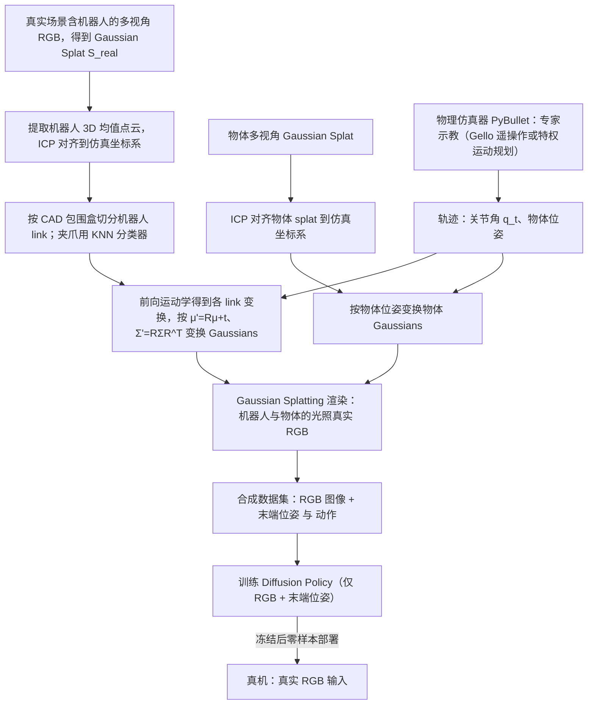

# SplatSim: zero-shot sim2real transfer of RGB manipulation policies using Gaussian splatting

**SplatSim: zero-shot sim2real transfer of RGB manipulation policies using Gaussian splatting**（[arXiv:2409.10161](https://arxiv.org/abs/2409.10161)）收录于 [自由度FreeDof · Sim2Real 四条路线梳理](../../sources/blogs/wechat_freedof_sim2real_four_routes_dr_to_residual_2026-08-23.md) 参考文献 **[39/44]**，归类 **视觉 Sim2Real**。

## 一句话定义

用 3D Gaussian Splatting 从真实场景重建可渲染仿真，实现 RGB 操控策略零样本迁移。

## 英文缩写速查

| 缩写 | 英文全称 | 简要说明 |
|------|----------|----------|
| 3DGS | 3D Gaussian Splatting | 三维高斯溅射 |
| Sim2Real | Simulation to Real | 仿真到真机 |
| RGB | Red Green Blue | 视觉像素策略 |

## 为什么重要

- 文内视觉 gap 旁支代表，与动力学 Sim2Real 正交。
- 在 [44 篇技术地图](../overview/freedof-sim2real-44-papers-technology-map.md) 与 [四条路线对比](../comparisons/sim2real-four-routes-identifiability.md) 中作为 **视觉 Sim2Real** 节点。
- 开源结论：**待核实**（步骤 2.5，2026-09-20）。

## 流程总览

图依据：论文 §IV-A–G（Fig. 2 / Fig. 3 / Fig. 4）。

## 核心机制

| 项 | 内容 |
|----|------|
| **出处** | ICRA 2025 |
| **文内章节** | 视觉 Sim2Real |
| **要点** | Real-to-sim 场景重建 + 策略在重建渲染中训练。 |
| **开源** | **待核实** |

## 源码运行时序图

**不适用（待核实）** — 截至 2026-09-20 以项目页/论文 Code availability 为准；入库未核验可运行入口。

## 实验与评测

- **本页为索引级节点**（FreeDof 44 篇梳理 [39/44]）：正文固化文内角色与机制要点，**未转存原文实验表**。
- **回原文须核对的证据**：本页要点是「Real-to-sim 场景重建 + 策略在重建渲染中训练」，对应证据是在重建渲染上训练的策略直接迁真机的成功率，以及与真实图像训练 / 传统渲染训练的对比。
- **读法：** 先对齐平台、任务、指标定义与成功阈值，再读任何数字；勿从公众号摘录外推。

## 与其他工作对比

| 维度 | 读法 |
|------|------|
| **文内路线** | 归类 **视觉 Sim2Real**；同路线其他节点见 [44 篇技术地图](../overview/freedof-sim2real-44-papers-technology-map.md) 与 [四条路线对比](../comparisons/sim2real-four-routes-identifiability.md) |
| **横比口径** | 成功率强依赖重建质量与视角覆盖；换场景重建一次，数字就要重测。 |
| **开源状态** | **待核实** — 部署 / 复现前以项目页或原文 Code availability 为准 |

## 结论

**观测层 gap 应走视觉/渲染路线，勿用动力学 SysID 硬修。**

1. 文内角色：视觉 Sim2Real 路线上的参考节点，非重复 arXiv 页面。
2. 机制要点：Real-to-sim 场景重建 + 策略在重建渲染中训练。…
3. 部署/复现前请对照原文与项目页，勿直接外推公众号数字。

## 关联页面

- [GradSplat：前向传播中的梯度细化](./paper-gradsplat.md) — 面向多视角高斯重建的相关方法。

- [Sim2Real 四条路线（可辨识性）](../comparisons/sim2real-four-routes-identifiability.md)
- [44 篇技术地图](../overview/freedof-sim2real-44-papers-technology-map.md)
- [Sim2Real](../concepts/sim2real.md)

## 参考来源

- [freedof_sim2real_39_splatsim-gaussian-splatting-sim2real.md](../../sources/papers/freedof_sim2real_39_splatsim-gaussian-splatting-sim2real.md)
- [wechat_freedof_sim2real_four_routes_dr_to_residual_2026-08-23.md](../../sources/blogs/wechat_freedof_sim2real_four_routes_dr_to_residual_2026-08-23.md)
- [freedof_sim2real_44_catalog.md](../../sources/papers/freedof_sim2real_44_catalog.md)
- 论文 PDF：<https://arxiv.org/pdf/2409.10161>（已通读方法部分（实验与附录以略读为准）：方法 §IV、实验 §V 及 Table I）

## 推荐继续阅读

- [arXiv PDF](https://arxiv.org/pdf/2409.10161)
- [44 篇 Sim2Real 技术地图](../overview/freedof-sim2real-44-papers-technology-map.md)
