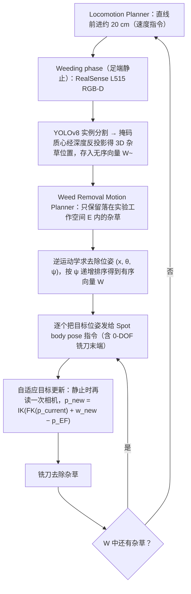

# Spot 精准除草（arXiv:2609.20048）

**Spot 精准除草**（*Mechanical Precision Weeding with a Quadruped Robot*，[arXiv:2609.20048](https://arxiv.org/abs/2609.20048)）来自 [senlanke 具身运控lab 周更盘点](../../sources/blogs/wechat_senlanke_weekly_humanoid_quadruped_2026-09-14_18.md)（2026-09-14–18）。

## 一句话定义

**Boston Dynamics Spot 刚性安装铣削除草工具；足端不动、用本体 DoF 定位工具；集成检测、规划与室内外流程。**

## 英文缩写速查

| 缩写 | 英文全称 | 简要说明 |
|------|----------|----------|
| DoF | Degrees of Freedom | 自由度 |
| SLAM | Simultaneous Localization and Mapping | 同步定位与建图 |
| CV | Computer Vision | 计算机视觉 |

## 为什么重要

- 农业精准作业需移动基座 + 工具定位；四足可复用现有 Spot 平台。

## 流程总览

图依据：论文 §3 控制架构（Fig. 4）、§3.2 杂草检测、§3.3 去除规划、§3.4 杂草去除、§3.5 步行规划。

## 核心机制

| 项 | 内容 |
|----|------|
| **arXiv** | [2609.20048](https://arxiv.org/abs/2609.20048) |
| **开源** | **待发布**（步骤 2.5，2026-09-20） |
| **方法摘要** | Fixed feet + body DoF tool positioning; weed detection + motion planning pipeline. |

## 源码运行时序图

**不适用**（截至 2026-09-20 未发布可运行官方代码或待核实）。

## 实验与评测

- Indoor/outdoor weeding workflow（以 PDF 为准）。
- 读法：先对齐任务设定、传感器与成功定义，再解读 headline 数字。

## 与其他工作对比

| 维度 | 读法 |
|------|------|
| **同周对照** | 见对应 [周更盘点](../../sources/blogs/wechat_senlanke_weekly_humanoid_quadruped_2026-09-14_18.md) 映射表，勿跨任务直接比 SR |
| **开源状态** | **待发布** — 部署前以项目页/arXiv 为准 |

## 结论

**Spot 精准除草展示四足作为农业机械载体的系统级集成样本。**

1. 开源：**待发布**；勿凭公众号摘要臆断可复现性。
2. 指标须连同实验条件解读（仿真/真机、平台、成功阈值）。
3. 关注 arXiv 版本更新与代码发布。

## 关联页面

- [paper-autonomous-spot-nebula-exploration](../entities/paper-autonomous-spot-nebula-exploration.md)
- [manipulation](../tasks/manipulation.md)
- [locomotion](../tasks/locomotion.md)

## 参考来源

- [spot-precision-weeding_arxiv_2609_20048.md](../../sources/papers/spot-precision-weeding_arxiv_2609_20048.md)
- [wechat_senlanke_weekly_humanoid_quadruped_2026-09-14_18.md](../../sources/blogs/wechat_senlanke_weekly_humanoid_quadruped_2026-09-14_18.md)
- [arXiv:2609.20048](https://arxiv.org/abs/2609.20048)
- [arXiv PDF](https://arxiv.org/pdf/2609.20048)：已通读方法部分（实验与附录以略读为准）：§1.4 贡献、§2.1 平台、§3 控制架构、§3.2 杂草检测、§3.3/3.4 去除规划与自适应更新、§3.5 步行规划；§4 结果仅略读

## 推荐继续阅读

- [arXiv PDF](https://arxiv.org/pdf/2609.20048)
