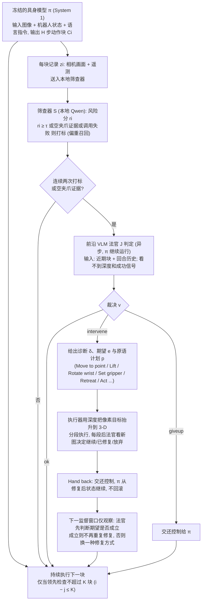

# Spotter（具身模型主导、VLM 反思的失败修复层）

## 一句话定义

**Spotter 让冻结的具身模型持续执行，由并行的轻量 screener 盯住每个动作块，只有确认错误时才让 VLM 修复并交还控制。**

## 英文缩写速查

| 缩写 | 英文全称 | 简要说明 |
|------|----------|----------|
| VLM | Vision-Language Model | 视觉语言模型，本文用于确认与修复错误 |
| screener | Screener（本页用语） | 本地轻量错误检测器，并行运行 |
| VLA | Vision-Language-Action | 具身模型一类，对应 π0.5 等基线 |
| BEST-OF-N | Best-of-N selection | 对照的重试选择策略（摘要用语） |

## 为什么重要

- 具身模型失败后很少能自我恢复，而 VLM 主导的串行规划会带来延迟与长段误差。
- 把 VLM 的职责缩小为「发现、修复、检查」，使本地开源 Qwen 也能工作，无需任务成功信号（据 README）。

## 流程总览

图依据：论文 §3.2 Spotter（Parallel supervision / Screening, repair, and reflection）/ Fig.3 / 式(1)-(3) / Table 2

## 方法与机制

- **具身模型（System 1）：** 持续执行，常规路径不等待 VLM。
- **screener：** 并行检测每个动作块是否出错。
- **VLM（System 2）：** 只在确认错误后介入，用短的原语计划修复并检查结果，然后交还控制。

## 实验与评测

- RoboCasa：Cosmos Policy +5.6，π0.5 +7.5（以 GPT 作为 VLM）。
- RoboTwin 2.0 Hard：π0.5 47.2% → 57.0%。
- 真机：53% → 83%。
- 效率：Qwen 版本成功 episode 比单独执行多 13–16 秒，约比 VLM 主导基线少 70% 时间。

## 与其他工作对比

- 与 VLM 主导的串行代理相比，摘要称其在成功 episode 上延迟与调用次数更低。
- 与 best-of-N 重试相比，作者认为重试难以可靠选出成功动作（摘要的论点，未在本次核对全文实验）。

## 结论

本文的核心判断是：把 VLM 放在并行监督位置，只为确认的错误介入，比让它逐段规划更适合闭环机器人。

- 错误检测与修复可以解耦：轻量 screener 负责常规监控，VLM 负责少量修复。
- 效率提升来自「大多数 episode 不需要 VLM」，而非模型更强。
- 代码与部分权重已公开（MIT），但完整复现仍依赖 RoboCasa / RoboTwin 环境与大模型权重。

## 工程实践

- 代码：`zqc3117/Spotter`（MIT），含 `spotter.sh` 与 `robotwin_eval.sh` 入口。
- 权重：README 列出 pi0.5（RoboCasa、RoboTwin 2.0）、Cosmos Policy 与 Qwen 模型的 Hugging Face 链接。
- 作者单位（论文首页）：Griffith University、清华大学 IIIS、MainCode、腾讯、复旦大学、同济大学。
- 本次只做浅克隆核查，未安装环境或运行评测。

## 局限与风险

- 论文摘要与项目页数字的全文核对未完成（项目页内容被截断；2026-11-01 补核时项目页仍未能打开，PDF 与运行入口源码尚未通读）。
- 复现需要多套仿真环境与大模型（如 Qwen 27B 量级，README 所列），硬件门槛高。
- 推测：screener 的漏检会让错误继续传播，误检则会增加 VLM 调用。

## 关联页面

- [具身大模型分类学选型闭环](../overview/hub-embodied-foundation-model.md) — 具身模型与 VLM 分工的选型背景
- [VLA 方法](../methods/vla.md) — Spotter 所包裹的具身模型类别

## 参考来源

- [Spotter 论文归档](../../sources/papers/spotter_arxiv_2609_36808.md)
- [Spotter 代码仓归档](../../sources/repos/spotter.md)
- [arXiv PDF](https://arxiv.org/pdf/2609.36808)：已通读方法部分（实验与附录以略读为准）：§3.2 并行监督、筛查-修复-反思、异步问题与物理重置，§4.1 实验设置与 Table 3

## 推荐继续阅读

- [arXiv 2609.36808](https://arxiv.org/abs/2609.36808)
- [项目页](https://zqc3117.github.io/Spotter/)
- [代码仓](https://github.com/zqc3117/Spotter)
