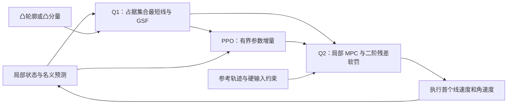

# SRL-MPC：面向形状感知的强化学习模型预测控制 / Shape-Aware Reinforcement Learned Model Predictive Control

## 一句话定义

用强化学习按局部拥挤程度调整路径跟踪、控制代价和安全裕度，差速机器人仍由显式 MPC 产生速度指令；邻居的形状进入优化，而不是统一近似成圆盘。

## 英文缩写速查

| 缩写 | 英文全称 | 简要说明 |
| --- | --- | --- |
| MPC | Model Predictive Control | 滚动优化，执行预测控制序列首项 |
| HOCBF | High-Order Control Barrier Function | 二阶离散形式耦合相邻预测时刻 |
| GSF | Geometric Separation Feature | 最近分离方向与集合间距离 |
| PPO | Proximal Policy Optimization | 训练三项参数的自适应策略 |
| OOD | Out-of-Distribution | 分布外测试，不等同于真机迁移 |

## 为什么重要

带货架、拖车或不规则外壳的移动平台，外接圆可能把可通过的空间判为不可通过，过小的圆又会低估转弯时的扫掠区域。SRL-MPC 把形状变化留在几何和优化层，学习模块只在有限范围里调整权重和安全距离，便于与手调 MPC 做消融对照。

| 项 | 内容 |
| --- | --- |
| 机构 | 香港大学、南方科技大学、密歇根大学、中国科学院深圳先进技术研究院 |
| 会议 | NeurIPS 2026；全文核对版本为 arXiv:2608.21175v1 |
| 控制接口 | 2D 形状与邻居名义轨迹输入；差速底盘线速度与角速度输出 |

## 核心原理

1. **Q1 几何更新。** 用支撑函数表达两个凸占据集合的最短距离；实现从名义轨迹上的占据集合提取最短分离方向与距离。圆形可用闭式方向，凸多边形由 Shapely/GEOS 最短线计算。固定维的是每对每时刻的 GSF，不是整个求解时间与邻居数无关。
2. **PPO 调参。** 自观测为前向速度和三个当前参数，近邻分离特征按三个通道、五邻居、五步排列，总计 79 个标量。策略输出有界增量，更新位置跟踪权重、相对参考控制的偏差权重和 `d_safe`；航向权重固定。
3. **Q2 局部优化。** 固定几何方向并线性化运动学，软罚二阶 HOCBF 负残差的平方，保留运动学、输入与输入增量的硬约束。论文设置每控制步一轮外迭代，求解后只执行首个控制量。

### 流程总览

## 工程实践

- 预印本以 IR-SIM 随机凸多边形场景训练；训练密度固定 15 台，控制周期 0.1 s，预测五步；选择五个近邻供策略观测，其中三个纳入 HOCBF 残差。到达目标的机器人停驻，仍可能堵住其他机器人的路径。
- 密集避碰的调试建议：同时统计整局完成、碰撞、超时，而非只看到达机器人的平均速度。把几何更新、策略与控制输出延迟分别测量；控制求解墙钟不能替代完整端到端时延。
- **源码运行时序图：不适用。** [官方仓库](https://github.com/hku-sail/srl_mpc)可读，但固定快照仅含站点、图表和演示素材；未见训练、仿真或部署入口与权重。此处 Mermaid 是论文方法图，不是源码调用链。

## 评测

| 来源与口径 | 20 台 | 25 台 | 如何读 |
| --- | --- | --- | --- |
| arXiv v1 表 1，100 局/设置 | 93% | **92%** | 所有机器人到达且无碰撞、无超时才计成功；25 台另有 6% 碰撞、2% 超时 |
| 官方项目页，3 个独立训练种子，每种子每设置 100 局 | 91.0% ±2.6 pp | **86.7% ±0.6 pp** | 均值 ± 跨种子样本标准差；相对 25 台最强外部基线 SARL 的 21%，高 65.7 个百分点 |

- v1 表 2 的 25 台消融：固定参数 HOCBF-MPC **68%**，卡住后按规则切参数 **75%**，学习连续调参 **92%**；仅静态距离惩罚的分布式 MPC 为 **7%**。这是同一论文表内的比较。
- 项目页补充 OOD 测试不重新训练，五组宏平均 **77.5% ±2.5 pp**；其中交叉几何 **59.3%**、非凸并集 **96.7%**、异构动力学 **95.0%**（官方热图）。不要用演示视频替代统计。
- 附录 A.6 的 25 台控制器耗时 **10.34 ±1.80 ms/台/步** 是 Apple M4 Pro 上整次控制决策墙钟除以台数，不是感知到执行的真机时延，也不是最坏情况。

## 局限与风险

- 局部 Q2 的 HOCBF 残差是软罚，并非部署中的无碰撞硬保证；感知、邻居短期预测和底盘模型误差会影响安全。表 3 的 15 台实验中，执行延迟到三步（0.3 s）时成功率降至 2%，而策略参数滞后五步仍得 100%；该结果属于指定仿真扰动，不意味着真机可接受相同延迟。
- 非凸体示例采用凸分量表示；研究展示的是平面占据形状，不是三维多关节人体避碰。真机仅有受控室内对照，未公布足以复现大规模评估的控制源码、权重与原始试验记录。

## 结论

**SRL-MPC 的可迁移思路是让学习调度有界参数，而非把几何安全与底盘指令全部交给端到端策略。**

- 优先检查控制端时延和状态误差，不能用策略推理速度代表系统安全。
- 用形状感知 MPC、固定参数和规则调参作对照，分开判断几何表示与学习的贡献。
- 选型引用时标清是 v1 的单策略结果还是项目页多种子均值，不把二者拼成同一个表项。

## 关联页面

- [模型预测控制](../methods/model-predictive-control.md) · [强化学习](../methods/reinforcement-learning.md) · [罚函数与障碍函数](../methods/penalty-barrier-augmented-lagrangian.md)
- [导航纵深路线：Stage 3 学习型导航](../../roadmap/depth-navigation.md#stage-3-学习型导航)

## 参考来源

- [arXiv 全文核对归档](../../sources/papers/srl_mpc_arxiv_2608_21175.md)
- [官方项目页及 OOD 补充归档](../../sources/sites/srl-mpc-hanruihua.md)
- [官方仓库及代码开放核查](../../sources/repos/srl-mpc.md)

## 推荐继续阅读

- [SRL-MPC 原文 HTML（含原图）](https://arxiv.org/html/2608.21175v1) · [论文 PDF](https://arxiv.org/pdf/2608.21175v1) · [官方项目页](https://hku-sail.github.io/srl_mpc/)
