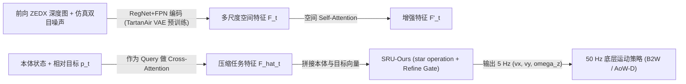
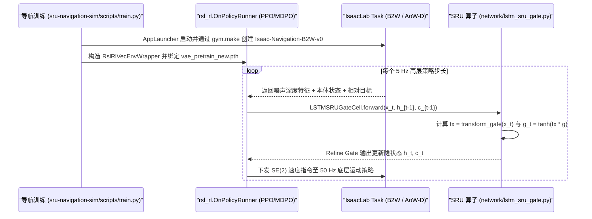

# SRU：面向长程无地图导航的空间增强循环记忆（IJRR 2025）

> **开源仓库勘误说明**：早期社区引用常将该工作源码误指向已 404 的 `ManifoldTechLtd/sru-pytorch-spatial-learning`。经核验 ETH Zurich RSL 官方主页（https://michaelfyang.github.io/sru-project-website/ ），正式官方代码仓为 [`leggedrobotics/sru-pytorch-spatial-learning`](https://github.com/leggedrobotics/sru-pytorch-spatial-learning)（核心算子与 Appendix A 空间记忆测试）与 [`leggedrobotics/sru-navigation-sim`](https://github.com/leggedrobotics/sru-navigation-sim)（Isaac Lab v2.1.1 导航任务环境）；而 [SRU-Odin](./sru-odin.md) 为社区团队基于该论文延伸的工程化独立分支。

## 一句话定义

**SRU（Spatially-Enhanced Recurrent Unit）**（[arXiv:2506.05997](https://arxiv.org/abs/2506.05997)，IJRR 2025，Fan Yang、Marco Hutter 等 / ETH Zurich RSL & University at Buffalo）针对标准 LSTM/GRU 与现代状态空间模型（S4 / Mamba-SSM）“能记序、难对齐空间坐标”的缺陷，在循环候选门中注入基于当前观测与自车运动输入的 **逐元素乘法（star operation）空间变换门** 与 **Refine Gate**，配合双阶段空间注意力、TartanAir 深度预训练及深度互学习（DML）正则，让无全局先验地图的轮足机器人仅凭单目前向深度相机即可零样本穿越 100 米级迷宫、楼梯与森林复杂地形。

## 英文缩写速查

| 缩写 | 英文全称 | 简要说明 |
| --- | --- | --- |
| SRU | Spatially-Enhanced Recurrent Unit | 空间增强循环单元，通过 star operation 逐元素乘积赋予隐状态隐式空间变换能力 |
| DML | Deep Mutual Learning | 深度互学习，平行训练双策略并加 KL 互蒸馏，防止 SRU 早期退化为纯时序过拟合 |
| TC-Dropout | Temporally Consistent Dropout | 时间一致随机失活，在整个采样序列和训练期锁死同一 Dropout 掩码 |
| MDPO | Mirror Descent Policy Optimization | 官方 `sru-navigation-sim` 对接 `rsl_rl` 时支持与 PPO 并行的策略优化器 |
| EMHP | Explicit Mapping and Historical Path | 显式局部建图与历史轨迹基线，受固定时间/距离记忆窗口（约 20 m）制约 |

## 为什么重要

在强遮挡、狭窄折返或带有死胡同的长程无图导航中，显式局部建图（如 EMHP）面临构建延时高与滑窗裁剪遗忘（>40 m 成功率陡降）的瓶颈；而主流端到端方法若直接采用 LSTM、GRU、帧堆叠 Transformer（如 GTRL）乃至 S4/Mamba，虽然都能 100% 记下地标出现顺序，却无法稳定学习自车持续旋转平移下的空间几何配准（在螺旋路径地标召回实验中空间 MSE 居高不下）。SRU 以极小的参数增幅打破隐式循环记忆的几何天花板，使纯端到端 5 Hz 高层决策不仅超越固定窗口显式建图基线，而且可直接在真机 Unitree B2W 上零样本跑出超出训练距离（30 m）数倍的百米级死胡同脱困轨迹。

## 核心原理

### 1. 空间增强循环单元：Star Operation 与 Refine Gate

论文受齐次坐标变换矩阵乘法形式以及 Ma et al. (2024) “star operation” 高阶非线性交互启发，在候选状态生成中由当前输入 $x_t$（蕴含压缩深度特征、本体速度/重力投影及目标相对矢量）生成变换门 $s_t = W_{xs} x_t + b_s$，对线性特征施加逐元素乘积：
- **SRU-LSTM / SRU-GRU**：$g_t = \tanh(s_t \odot (W_{xg} x_t + W_{hg} h_{t-1} + b_g))$，赋予网络隐式旋转-平移对齐能力而不显式硬编码相机位姿矩阵乘。
- **SRU-Ours（`LSTMSRUGateCell`）**：结合 Gu et al. (2020b) Refine Gate，$r_t = i_t \odot (1 - (1 - f_t)^2) + (1 - i_t) \odot f_t^2$，并按 $c_t = r_t \odot c_{t-1} + (1 - r_t) \odot g_t$ 更新，有效抑制传统门控饱和导致的长程记忆冲刷。

### 2. 双阶段空间注意力压缩与合成深度预训练

- **Self-Attention + Cross-Attention 特征瓶颈**：先在二维特征图 $F_t \in \mathbb{R}^{C \times H \times W}$ 上执行空间自注意力以增强远近障碍上下文；随后由本体状态 $[v_t, \omega_t, n_t, a_{t-1}]$ 与相对目标 $p_t$ 构造 Query，经交叉注意力把二维特征压缩为一维 $F_{\text{hat},t} \in \mathbb{R}^{C \times 1}$，既大幅降低进入 SRU 的信息熵又自发学会朝转向方向聚焦（Fig. 5 & Fig. 11）。
- **TartanAir VAE 预训练 + 可并行双目深度噪声**：RegNet + FPN 深度编码器先在 TartanAir 大规模合成深度图上做变分自编码自重建预训练，并叠加含 **Edge（边缘畸变）、Filling（空洞插值模糊）、Rounding（视差量化）** 的 GPU 并行深度噪声（Algorithm B.1）。实验测得真实 ZEDX 深度与仿真特征的马氏距离（MD）从仅 RL 图像的 **1.15** 降至预训练 **0.82**，叠加噪声后进一步降至 **0.69**。

### 3. 稀疏奖励、非对称训练与防过拟合正则

- **非对称 Actor-Critic + 稀疏时间窗奖励**：Actor 仅输入带噪声与 0–600 ms 延迟的前向深度及本体状态，Critic 额外读取无噪声 360° 高度扫描；任务奖励集中在回合末窗或以小概率 $\delta_{\text{check}}$ 随机检视，避免中途局部致密奖励诱发怯于绕行。
- **DML + TC-Dropout 打破早期局部极小**：由于学习空间转换比单纯记时序收敛更慢，常规 PPO 易迫使网络在初期过拟合于短视时序规律。论文同时训练双策略加入 KL 散度互相蒸馏（DML），并在 rollout 与反向传播阶段保持相同时间一致 Dropout 掩码（TC-Dropout），将总体成功率一举从无 DML 时的 `65.7%` 推高到 `78.9%`。

## 实验与对比评测

基于论文 Table 1–5（4800 回合、120 个未见仿真场景及轮足真机实测）：

| 实验对比组别 | 核心模型/方法 | 关键指标（SR %） | 关键发现 |
| --- | --- | --- | --- |
| **循环单元对比（Table 1）** | GRU / LSTM / SRU-GRU / SRU-LSTM / **SRU-Ours** | 61.0 / 63.5 / 75.2 / 76.5 / **78.9** | 较标准 RNN 平均提升 **+23.5%**；楼梯场景从 33.1% 跃升至 **82.8%** |
| **导航范式对比（Table 2, ANYmal）** | GTRL(帧堆叠) / EMHP(显式建图) / GTRL* / **Ours** | 38.2 / 60.4 / 66.3 / **78.3** | 相对 EMHP **+29.6%**、GTRL **+105.0%**；120 m 距离外推仍维持 **>70%** SR |
| **注意力结构消融（Table 3）** | w/o Attention / GoT(GTRL*) / **Spatial Attn (Ours)** | 50.5 / 68.4 / **78.9** | 二阶段空间压缩比无注意力提高 **+56.2%**、比 GoT 提高 **+15.4%** |
| **正则消融（Table 4–5）** | SRU w/o DML / +DML / w/o TC-D / +TC-D | 65.7 / **78.9** / 77.2 / **78.9** | DML 为 SRU 带来 **+20% 以上**关键涨幅（LSTM 仅增 2.8%） |
| **Unitree B2W 实机零样本测试** | ZEDX + Jetson AGX Orin + RIVR 步态 | 办公室动态封路 + 70 m+ 主厅/露台/森林（>100 m 路径） | 超出训练 30 m 目标上限倍增泛化，成功脱出多重死胡同（LSTM 陷入死循环） |

### 与其他工作对比

- **对比标准 RNN（LSTM / GRU）与状态空间模型（S4 / Mamba）**：标准循环单元虽擅长序列记忆，但在无显式位姿变换矩阵时易在视角大幅旋转后混淆局部障碍方位（Table 1 总体 SR 仅 `61.0%–63.5%`）；SRU 在候选门引入 `star operation` 与 Refine Gate 后跃升至 **`78.9%`**（楼梯场景 `82.8%` vs LSTM `33.1%`），并验证其局部感知优于隐式定长窗口帧堆叠（GTRL）。
- **对比显式局部建图路线（EMHP）与工程延伸分支（[SRU-Odin](./sru-odin.md)）**：EMHP 依赖显式局部高程建图融合，面对双目深度外点与动态遮挡更脆弱（ANYmal 基准 SR `60.4%` vs SRU `78.3%`）；而社区延伸分支 [SRU-Odin](./sru-odin.md) 则在此原论文记忆架构上进一步展开工程化系统部署。

## 结论

1. **一句话总判**：SRU 证明了仅依靠输入门控的 `star operation` 乘法交互与精细门控更新（无需显式位姿矩阵变换），就能让轻量级端到端循环网络习得强遮挡长程导航所需的隐式空间地图记忆。
2. **正则化与空间压缩不可拆分**：单独换上 `LSTMSRUGateCell` 而缺少双阶段空间注意力或 DML 互学习，成功率仅提升至 50%–65% 区间；必须把特征注意力压缩与 DML 防早熟收敛当成固定训练配方协同部署。
3. **跨工程复用建议**：面向实机深度视觉端到端导航应优先使用带 Edge/Filling/Rounding 视差噪声的 TartanAir 合成深度预训练编码器，可将跨领域特征偏移压低 40%。
4. **选型边界**：SRU 的局部隐状态本质仍受指数衰减制约，适合 **百米级无先验地图自主穿行与局部死胡同脱困**；数公里级跨楼栋返航任务仍需接入高层全局拓扑规划。

## 源码运行时序图

以下时序结合官方代码库 `leggedrobotics/sru-pytorch-spatial-learning` 与 `leggedrobotics/sru-navigation-sim` 的实际符号绘制：

## 工程实践

1. **正确区分两个官方仓库与底层依赖**：[`sru-pytorch-spatial-learning`](https://github.com/leggedrobotics/sru-pytorch-spatial-learning) 主要交付可直接 `import` 的 `LSTM_SRU_Gate` / `LSTM_SRU` / `GRU_SRU` 及 Appendix A 空间点云记忆实验（`run_pointcloud.py`）；而 [`sru-navigation-sim`](https://github.com/leggedrobotics/sru-navigation-sim)（Isaac Lab v2.1.1 / Isaac Sim 4.5）封装了迷宫课程环境、B2W/AoW-D 资产及预训练深度 VAE 权重 `vae_pretrain_new.pth`，其 RL 训练依赖独立安装的 `leggedrobotics/rsl_rl` PPO/MDPO 模块。
2. **分层控制节拍分离**：官方仿真与真机均采用 **5 Hz 高层导航输出速度指令 + 50 Hz 底层运动控制（RIVR / 预训练策略）** 的异步分层接口；部署前需按机器人的 ZEDX 等效视场（水平 105° / 垂直 78°、10 m 量程）校验深度截断范围。
3. **目标切换时主动重置隐状态**：论文在长距多段巡航测试中明确说明每次下达新目标需复位 SRU 记忆状态 `(h, c)`，以避免残留历史局部障碍几何扰动新一轮全局目标方向。

## 常见误区与局限

- **误区 1：误以为 SRU 在细胞内显式用里程计矩阵 $T_{t-1}^t$ 做了特征重投影**：实际代码 `LSTMSRUGateCell` 完全不依赖显式矩阵旋转，而是把本体观测一并编入 `x_t` 后由 `transform_gate(x_t) * g` 隐式习得视角空间对齐。
- **误区 2：误把 `ManifoldTechLtd/sru-pytorch-spatial-learning` 当作上游源码地址**：该 GitHub URL 已返回 404，正确官方源码全部托管于 `leggedrobotics` 组织；[SRU-Odin](./sru-odin.md) 是下游移植衍生项目。
- **固有局限**：(1) 循环状态存在随时间衰减的上界，不支持跨数小时、公里级全局回环重访；(2) 无明确语义可解释机制解析隐状态所存几何结构；(3) 训练端需要高质量里程计或状态估计提供准确 `o^prop_t` 与相对目标 `p_t`。

## 关联页面

- [循环神经网络（RNN）](../concepts/recurrent-neural-network.md) — SRU 所改进的基础时序隐状态递推架构
- [Sim2Real（仿真到真机迁移）](../concepts/sim2real.md) — 基于 TartanAir 预训练与立体噪声模型的零样本部署路径
- [PPO（近端策略优化）](../methods/ppo.md) — 非对称 Actor-Critic 结合 DML 正则的核心优化基础
- [自主探索（Autonomous Exploration）](../tasks/autonomous-exploration.md) — 未知长程迷宫与盲区折返探测的任务背景
- [楼梯与障碍感知运动（Stair & Obstacle Locomotion）](../tasks/stair-obstacle-perceptive-locomotion.md) — 高遮挡立体障碍与底层运动协同场景
- [SRU-Odin](./sru-odin.md) — 社区基于 SRU 延伸适配的导航工程分支对比
- [RSL-RL（高速 GPU 强化学习框架）](./rsl-rl.md) — `sru-navigation-sim` 实际调用的 `OnPolicyRunner` 依赖库

## 参考来源

- 论文通读归档：[SRU 原文通读归档](../../sources/papers/sru_arxiv_2506_05997_reading.md)（arXiv:2506.05997v2 全文核对）
- 仓库源码归档：[leggedrobotics 官方双仓源码核查](../../sources/repos/leggedrobotics_sru.md)
- 协同摘要归档：[SRU IJRR 2025 摘要档案](../../sources/papers/sru_spatially_enhanced_recurrent_memory_ijrr_2025.md)
- 原始来源：https://arxiv.org/abs/2506.05997 | https://michaelfyang.github.io/sru-project-website/ | https://github.com/leggedrobotics/sru-pytorch-spatial-learning | https://github.com/leggedrobotics/sru-navigation-sim

## 推荐继续阅读

- [SRU-Odin](./sru-odin.md) — 查看社区对 SRU 工程化移植与实机平台扩展方案。
- [RSL-RL（高速 GPU 强化学习框架）](./rsl-rl.md) — 深入了解 `OnPolicyRunner` 如何承载循环网络策略与非对称 Critic 训练。
