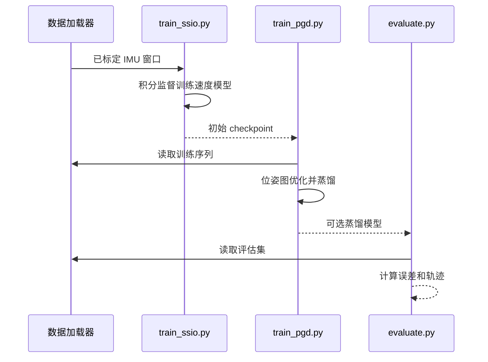

# SSIO（自监督惯性里程计）

**SSIO** 使用已标定 IMU 数据构造训练信号，无需速度或位置标签即可从头训练惯性速度估计模型。

## 英文缩写速查

| 缩写 | 英文全称 | 简要说明 |
|------|----------|----------|
| SSIO | Self-Supervised Inertial Odometry | 自监督惯性里程计 |
| IMU | Inertial Measurement Unit | 惯性测量单元 |
| PGD | Pose Graph Distillation | 位姿图蒸馏 |
| AVE | Average Velocity Error | 平均速度误差 |

## 核心机制

积分教师独立处理每个短 IMU 窗口，给出速度变化；学生预测窗口两端速度，约束其差值匹配教师。可选的 PGD 融合跨窗口 IMU 与网络因子，优化整段序列的速度，并用结果微调学生。静止帧可施加速度正则化；关节状态等本体感觉可作为附加输入。

## 源码运行时序图

官方 README 的 EuRoC smoke test 展示三个入口；PGD 是可选步骤。

## 实验与评测

六个数据集覆盖行人、无人机、四足和 Unitree G1；论文报告自监督模型与同架构有监督基线的 AVE 差距不超过 0.07 m/s。TLIO 上 20 秒速度变化误差为 0.141 m/s，短窗口积分教师为 0.885 m/s。该对比是特定实验，不代表所有平台均有同等提升。

## 结论

SSIO 将无标注数据转化为惯性速度监督，降低新平台的数据标注需求。

1. 新平台仍需标定 IMU、采集数据并训练模型；不等于零样本迁移。
2. 本体感觉可降低腿式平台误差，但并非所有实验都使用纯 IMU 输入。
3. 页面展示的世界系轨迹使用真值姿态；部署时姿态估计误差和长期漂移需要另行评估。
4. 官方发布训练、评估代码、权重及 G1 数据；PGD checkpoint 的结果与论文表格不完全一致。

## 工程实践与局限

仓库提供训练与评估流程，参见[代码归档](../../sources/repos/amazon-far-ssio.md)。姿态、重力和传感器偏置处理会影响积分监督；论文展示使用真值姿态的轨迹，不能直接当作无需外部姿态估计的完整定位系统。MIPO 转换器未随代码发布。

## 关联页面

- [X-IONet](./paper-x-ionet-cross-platform-inertial-odometry.md)：使用专家网络和 EKF 的惯性里程计。
- [状态估计](../concepts/state-estimation.md)：机器人状态估计总体框架。

## 参考来源

- [论文归档](../../sources/papers/ssio_arxiv_2610_25988.md)
- [项目页归档](../../sources/sites/ssio.md)
- [官方仓库归档](../../sources/repos/amazon-far-ssio.md)

## 推荐继续阅读

- [项目页](https://ssio-imu.github.io/)
- [论文 v2](https://arxiv.org/html/2610.25988v2)
