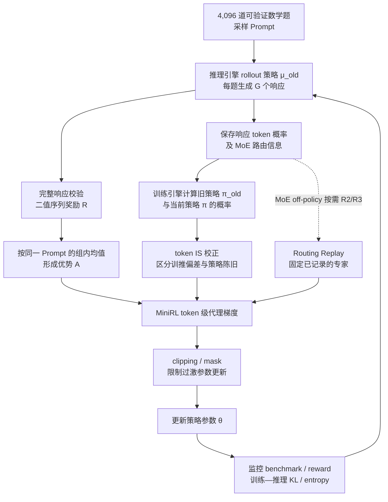

# Stabilizing Reinforcement Learning with LLMs：稳定大语言模型的强化学习

**Stabilizing Reinforcement Learning with LLMs: Formulation and Practices**（*稳定大语言模型的强化学习：形式化分析与实践*；Qwen Team / Alibaba；[arXiv:2512.01374v3](https://arxiv.org/abs/2512.01374)，2025）解释 LLM 的序列级奖励与 token 级策略梯度如何对齐；它研究的是**训练 LLM 的 RL**，不是让 LLM 为机器人环境设计奖励。

## 一句话定义

把 token 级重要性采样策略梯度视为真实序列级回报目标的**局部一阶近似**；要稳定训练，需同时控制**训练—推理概率偏差**与**rollout 策略陈旧**，尤其要处理 MoE 专家路由变化。

## 英文缩写速查

| 缩写 | 英文全称 | 简要说明 |
|------|----------|----------|
| LLM | Large Language Model | 本文接受强化学习更新的自回归语言模型 |
| RL | Reinforcement Learning | 利用完整回答的可验证奖励改善推理能力 |
| IS | Importance Sampling | 用新旧策略的概率比修正 rollout 与训练分布差异 |
| MoE | Mixture of Experts | 动态专家路由会额外引入概率与路由偏差 |
| R2 | Vanilla Routing Replay | 复用训练引擎旧路由，主要降低 staleness |
| R3 | Rollout Routing Replay | 复用推理 rollout 路由，同时缓解训推差异和 staleness |
| KL | Kullback–Leibler Divergence | 用于监控训练与推理策略的分布差异 |
| GRPO | Group Relative Policy Optimization | 组相对策略优化，附录中的对照目标 |

## 为什么重要

LLM 生成一整段回答才获得一个标量奖励，训练时却常逐 token 更新。如果 rollout 采用推理引擎、更新采用不同数值精度与内核的训练引擎，且同批样本被分成多次更新，计算出的 token 级重要性权重未必还能代表真正的序列级优化方向。论文把这两个失稳来源拆开，解释为何有些「看起来只是工程细节」的修正不可省。

对机器人 RL 的价值是**理解策略更新失稳的诊断思路**，不能直接把论文在数学推理 LLM 上的结果当作人形运动控制的验证结论。

## 核心信息

| 项目 | 原文核对 |
|------|----------|
| 机构 | 阿里巴巴（Alibaba）Qwen 团队 |
| 论文 | [arXiv:2512.01374](https://arxiv.org/abs/2512.01374)，v3，13 页 |
| 基础模型 | Qwen3-30B-A3B-Base 衍生的 **30B MoE**；cold-start 另使用早期实验 Qwen3Next 小模型 |
| 任务与奖励 | 数学推理；对完整回答进行正确/错误**二值奖励**，而不是 LLM 评分 |
| 核心方法 | 一阶近似形式化 + MiniRL / token IS + clipping / R2、R3 |
| 评测 | AIME24、AIME25、HMMT25；三组各 30 道题 |
| 官方代码 | 原论文及 arXiv 条目未提供可确认的本研究官方可运行仓库（核对日 2026-11-08） |

## 核心原理

### 1. 序列级目标与 token 级近似（`2，Eq. 1–4）

论文真正优化的目标为：

$$
J_{\mathrm{seq}}(\theta)=\mathbb{E}_{x\sim\mathcal D,\,y\sim\pi_\theta(\cdot|x)}[R(x,y)].
$$

实际生成来自推理引擎的 rollout 策略 $\mu_{\theta_{\mathrm{old}}}$。序列级 IS 权重是整段回答的概率比，数值跨度和方差很大；作者改用逐 token 的代理：

$$
J_{\mathrm{token}}(\theta)=
\mathbb E_{x,\,y\sim\mu_{\theta_{\mathrm{old}}}}
\left[\sum_{t=1}^{|y|}
\frac{\pi_\theta(y_t|x,y_{<t})}
{\mu_{\theta_{\mathrm{old}}}(y_t|x,y_{<t})}\,
R(x,y)\right].
$$

若 token 级概率比 $\rho_t=1+\delta_t$，其中每个 $\delta_t$ 足够小，则序列比率 $\prod_t(1+\delta_t)\approx 1+\sum_t\delta_t$，忽略 $\delta_i\delta_j$ 等高阶项；因此**两者梯度近似相等是局部结论，不是任意策略距离下的恒等式**。

### 2. 为什么会失效（`2.4，Eq. 5）

$$
\underbrace{\frac{\pi_\theta(y_t\mid h_t)}{\mu_{\theta_{\mathrm{old}}}(y_t\mid h_t)}}_{\text{token IS}}
=
\underbrace{\frac{\pi_{\theta_{\mathrm{old}}}(y_t\mid h_t)}{\mu_{\theta_{\mathrm{old}}}(y_t\mid h_t)}}_{\text{训练—推理偏差}}
\cdot
\underbrace{\frac{\pi_\theta(y_t\mid h_t)}{\pi_{\theta_{\mathrm{old}}}(y_t\mid h_t)}}_{\text{policy staleness}},
\quad h_t=(x,y_{<t}).
$$

- **训练—推理偏差**：不同数值精度、GPU 内核和动态批处理使相同参数产生不同 token 概率；MoE 还可能选中不同专家。
- **策略陈旧**：rollout 收集数据后，模型连续消费多个 mini-batch 或异步更新，后续数据来自更旧策略。
- **MoE Routing Replay**：R2 固定训练旧策略专家路由；R3 固定推理 rollout 专家路由。两者能减小不一致，但也会改变「自然重新路由」的目标策略，带来偏差（`3 / Table 1）。

### 3. MiniRL（`4.1，Eq. 7）

作者用 **REINFORCE + 组内奖励均值 baseline + 逐 token IS + stop-gradient + 根据优势符号的裁剪掩码**作为统一实验基线。组内优势为 $\hat A(x,y)=R(x,y)-\operatorname{mean}_{y'\sim\mu}[R(x,y')]$。

裁剪比较使用当前训练策略 / **训练引擎旧策略** 的概率比，而 IS 校正使用当前训练策略 / **推理 rollout 策略** 的概率比；两种分母不要混淆。

## 流程总览

此图是**原文 `2–4 的算法/实验数据流**，不是一个已公开运行代码库的调用链；R2/R3 与 clipping 的组合随 on-/off-policy 设置不同而变化。

## 源码运行时序图

**不适用。** 论文 PDF 和 arXiv 条目没有提供与该研究匹配的作者官方可运行代码及入口。不能把第三方 MiniRL 复现或文中作为例子的 vLLM / SGLang / FSDP 拼成「已验证源码时序图」。

## 工程实践

| 场景 | 论文内得到的操作建议 |
|------|----------------------|
| On-policy（一次 rollout 对应一次训练更新） | 优先保留 **token-level train–infer IS 校正**，单独增加 R3 不一定有收益 |
| Off-policy（同批 rollout 切 N 次更新） | **clipping + Routing Replay** 配合使用；N 小可对照 R2，N 大重点对照 R3 |
| 监控指标 | 同时观测 benchmark、training reward、**train–infer KL** 与 token entropy；不要只看 reward |
| MoE 排错 | 对比推理 rollout 专家和训练时专家选择，尤其核查 R2/R3 是否引入目标策略偏置 |
| 模型/精度 | 论文用 **FP8 推理 + BF16 训练**放大训推不一致；对齐其他精度/引擎时不能直接复用结论 |
| 复现实验 | Mini-batch 固定 **1,024 responses**；max generation length **32,768**，ε_high **0.27**、ε_low **0.20**，Truncated IS 阈值 **5**（均是本文设置，非普适默认） |

## 实验与评测

- **主设置（`4.2）：** 30B MoE，4,096 训练题；AIME24 / AIME25 / HMMT25 每组 30 题，32 次采样取平均正确率；每更新 B=64 提示词 × G=16 回答 = **1,024 responses**；总计算为数十万 GPU hours（作者估计每 gradient step 5–6 GPU hours）。
- **On-policy（`4.3 / Fig. 1，N=1）：** 基础 MiniRL（保留 train–infer IS）表现最稳定；去掉 IS 快速崩溃且 entropy 下降；加入长度归一化虽可稳定却更差；R3 单独加入未提升 benchmark。
- **Off-policy（`4.4 / Figs. 2–4，N=2/4/8）：** 设全局 batch 为 **2,048 / 4,096 / 8,192**，固定 mini-batch 1,024；缺失 clipping 或 Replay 会提前崩溃；N=2 下 R2 优于 R3，N=4/8 下 R3 更稳，R2 在高度离策略设置下可失稳。
- **Cold-start（`4.5 / Fig. 5）：** 使用 Qwen3-Max-Thinking-Preview、DeepSeek-R1-0528、gpt-oss-120b (high) 的蒸馏数据构造三个初始化，在**另一小型 Qwen3Next MoE** 上用 MiniRL+R2 训练，长期性能接近。不能把这个结果错误地归于 30B 主实验模型。
- **附录（A–B）：** 对照 GRPO / CISPO 原始目标，并分别提供 HMMT25、AIME24、AIME25 分项曲线；论文并未提供可直接读取的每步性能精确数值表。

## 结论

**训练稳定性的关键不是用 LLM 重写奖励，而是保证 token 级更新持续贴近其所代表的序列级目标；训练—推理偏差与 policy staleness 必须分别诊断。**

1. **先测 train–infer KL**：数值/路由不一致会让看似 on-policy 的训练也偏离 rollout 分布。
2. **不要省略 IS**：本文 on-policy 消融显示，去掉训练—推理 IS 后会迅速训练崩溃。
3. **离策略程度决定 Replay 选型**：轻度 N=2 下 R2 更合适，高度 N=4/8 下 R3 在本文实验中更稳。
4. **R3 不是无代价修复**：即使降低训推 KL，也可能因为强制旧路由而偏移真实目标策略；on-policy 未见净收益。
5. **保持监控多维度**：平均训练奖励、评测分数、entropy 与 train–infer KL 要同时观察，不用单一 reward 曲线判断是否「稳定」。
6. **不要过度归因 cold start**：本文限定设置中不同蒸馏初始化长期接近；并不保证任何模型/任务都如此。

## 与其他工作对比

| 方法 | 本文强调的差异 |
|------|----------------|
| [REINFORCE / Policy Optimization](../methods/policy-optimization.md) | MiniRL 基于 token-level 策略梯度，并额外显式考虑训练—推理 IS |
| [GRPO](../methods/grpo.md) | 论文 Appendix A 指出原始 GRPO 目标含长度归一化，且没有在目标中显式加入训推概率差异校正 |
| CISPO | 同样存在长度归一化；其 clipped 权重不等于按优势符号 mask 掉相应 token 梯度 |
| R2 vs R3 | R2 优先降低策略陈旧影响；R3 同时约束训推路由偏差，但更可能改变第一 mini-batch 的目标策略 |

## 局限与风险

- **不是 LLM-for-RL 奖励塑造方案**：没有把 LLM 当环境评审、奖励修复器或机器人奖励生成器；数学题奖励直接按真值二值验证。
- **场景有限**：主实验集中于 LLM 数学推理和 MoE；不等于证明该配方可直接转移到接触丰富的机器人控制/连续动作空间。
- **理论是近似**：token 比率偏离 1 时，被忽略的二阶及以上项可能不可忽略；长序列尤其需要注意累积偏差。
- **Replay 存在 trade-off**：路由固定改善近似成立条件，却会改变原自然路由对应的目标策略。
- **复现性边界**：截至 2026-11-08，未核实到官方可执行训练仓库；本文的大规模训练成本高，暂不能从公开源码复核实现细节。

## 关联页面

- [策略优化（Policy Optimization）](../methods/policy-optimization.md) — 策略比、PPO clip 与 on/off-policy 直觉
- [强化学习（Reinforcement Learning）](../methods/reinforcement-learning.md) — RL 的通用问题形式
- [PPO](../methods/ppo.md) — 与本文 clip 的分母和作用边界对照
- [GRPO](../methods/grpo.md) — 与 MiniRL 的优势归一化及 IS 目标对照

## 参考来源

- [论文通读归档](../../sources/papers/stabilizing_rl_with_llms_arxiv_2512_01374.md) — `1–5、公式、Table 1、Figure 1–10、附录 A–B
- [Qwen Team 原始论文 arXiv:2512.01374v3](https://arxiv.org/abs/2512.01374) — 2025-12-03，13 页

## 推荐继续阅读

- [原文 PDF（arXiv:2512.01374）](https://arxiv.org/pdf/2512.01374) — 包含 MiniRL 公式与全部评测曲线
- [Group Sequence Policy Optimization](https://arxiv.org/abs/2507.18071) — 本论文引用的序列级目标相关工作
- [Stabilizing MoE Reinforcement Learning by Aligning Training and Inference Routers](https://arxiv.org/abs/2510.11370) — R3 背景
