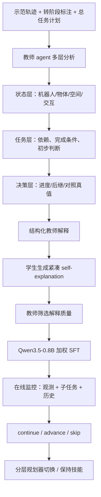

# StageGuard｜通过 Agentic Distillation 学习长时程机器人阶段切换

[English: Learning Stage Transitions for Long-Horizon Robot Tasks via Agentic Distillation](https://arxiv.org/abs/2609.20791) · arXiv v1（2026-09-17）

## 一句话定义

StageGuard 用**执行示范 + 多层教师解释 + 学生短解释训练**，把大模型对“当前子任务完成了吗”的判断压缩到轻量 VLM，输出 `continue / advance / skip`、下一任务和历史摘要。

## 英文缩写速查

| 缩写 | 英文全称 | 简要说明 |
|---|---|---|
| VLM | Vision-Language Model | 从图像与任务文本理解阶段状态 |
| CoT | Chain-of-Thought | 教师产生并由学生压缩的推理解释 |
| SFT | Supervised Fine-Tuning | 加权训练轻量学生预测阶段切换 |
| PDDL | Planning Domain Definition Language | 集成实验中上层子任务序列来源 |
| VLA | Vision-Language-Action | 与 StageGuard 结合的底层执行策略 |

## 为什么重要

长程执行中，计划正确且单技能可靠仍可能在**切换时机**失败：过早切换丢失前置条件，过迟则浪费时间或破坏已有状态。人工写 checker 难拓展，大型云 VLM 又有延迟和任务完成条件不对齐问题。

## 核心原理与流程总览

训练时教师看到正确切换标注以修正解释，**执行时学生不需要真实标签或大型教师**。原文 §V 使用三层教师理由，学生先压缩推理再拟合决策；损失中解释 token 权重 0.5，结构化结果权重 1.0。

## 源码运行时序图

**不适用**：截至 2026-11-14 未找到论文作者官方可运行训练、推理仓库；不能将无关同名 GitHub 账号视为实现。上图为**论文方法**，不是源码调用时序。

## 工程实践

- **输入：** 当前图像、任务目标、任务序列、最近执行历史；输出下一阶段决策及 history。
- **数据：** 仅使用 LIBERO-Logic 与 BEHAVIOR-1K，后者限定 6 个选定任务；每任务 10 条训练轨迹，剩余用于评测。不能外推到 BEHAVIOR-1K 全任务。
- **训练：** teacher Qwen3.5-397B-A17B、student Qwen3.5-0.8B，教师筛选每样本 3 条学生候选解释；评测方案在原文 §VI。
- **系统集成：** PDDL 上层规划生成子任务，pick-and-place 用 motion planning，其余由任务微调 π₀.₅ 执行；监视器作为阶段终止与切换信号。
- **部署风险：** 1.03/1.74 Hz 为各基准的监测吞吐，并非低层控制频率；不能直接等同于 VLA 控制周期。

## 实验与评测

| 原文指标 | 数值 | 口径 |
|---|---:|---|
| LIBERO 阶段切换完成率 | 96.23% | 表 I，允许 ±3 秒匹配真值 |
| BEHAVIOR-1K 阶段切换完成率 | 90.18% | 表 II，对照 Decision-only 37.72% |
| LIBERO / BEHAVIOR-1K 推理吞吐 | 1.03 / 1.74 Hz | 表 I–II，测试环境不同 |
| BEHAVIOR-1K 端到端 / StageGuard / GT transition 成功率 | 0.30 / 0.53 / 0.63 | 表 III，闭环集成 |
| UR5e / Piper 真机闭环成功 | 18/20 / 16/20 | §VIII，各 20 次；真机监测约 2.2 Hz |

## 结论

**阶段切换值得作为独立、可蒸馏的决策模型训练，而非把 checker 规则散落在每个技能中。**

1. 用已标注成功/失败的切换轨迹构造训练数据，避免纯提示的 VLM 自由臆断。
2. 保留 `skip` 处理不可恢复失败，避免将所有终止一律等同于子任务完成。
3. 带短解释的蒸馏在 BEHAVIOR-1K 上明显优于只学决策或直接模仿长解释。
4. 用闭环成功率与 oracle transition 对照，才能区分切换错误与底层策略失败。
5. 监测频率和低层控制频率是两个预算；并行部署需测延迟与误切换成本。

## 与其他工作对比

- [RoboHarness](./paper-robo-harness.md) 是**选哪个策略及如何跨策略交接**；StageGuard 是**何时结束当前策略**。
- [Self-CriTeach](./paper-self-criteach.md) 改善符号任务规划本身；StageGuard 蒸馏执行期的状态监控器。

## 局限与风险

- 依赖带切换时间标注的示范，教师数据构建代价大。
- 部分遮挡仍会导致误判；无法修复底层动作失败。
- 当前未确认论文官方可执行代码或可下载学生权重。

## 关联页面

- [RoboHarness](./paper-robo-harness.md)
- [Self-CriTeach](./paper-self-criteach.md)
- [机器人操作任务](../tasks/manipulation.md)

## 参考来源

- [StageGuard v1 原文核对](../../sources/papers/stageguard_arxiv_2609_20791.md)

## 推荐继续阅读

- [arXiv HTML 全文](https://arxiv.org/html/2609.20791)
- [arXiv PDF](https://arxiv.org/pdf/2609.20791)
