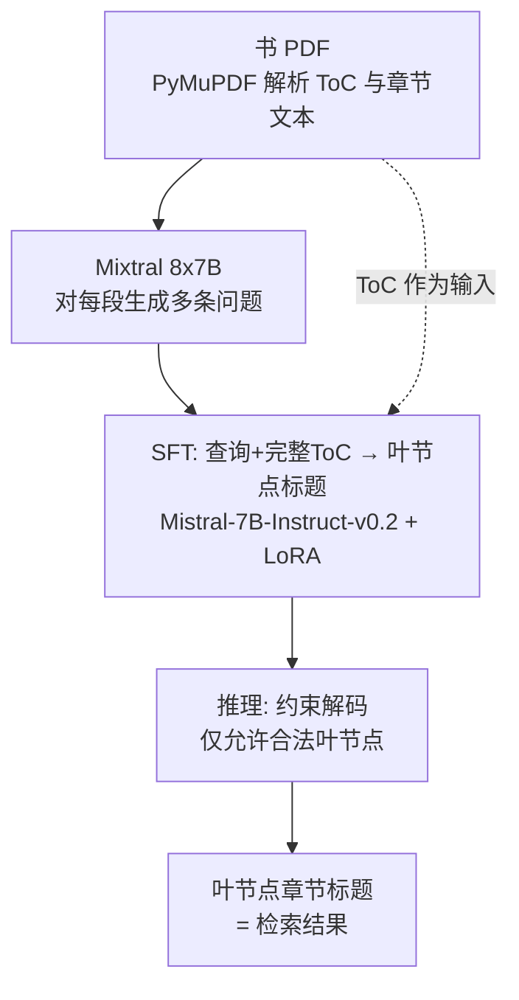

# STAIR：用目录做寻址的生成式检索

**STAIR**（*STructure Aware Information Retriever*，[arXiv:2609.03874](https://arxiv.org/abs/2609.03874)，IBM 的 Vineet Kumar 等；2026-09-03）把文档目录（ToC）当作全局结构，让 LLM 把语料知识存进参数，并通过目录叶节点标题完成检索；同时发布基准 **SearchTome**。

## 一句话定义

**输入“查询 + 整本书目录”，让微调后的 LLM 在约束解码下直接生成正确叶节点的章节标题，以此代替固定长度切块与数值 docid。**

## 英文缩写速查

| 缩写 | 英文全称 | 简要说明 |
|------|----------|----------|
| STAIR | STructure Aware Information Retriever | 本文方法 |
| ToC | Table of Contents | 目录；叶节点标题作文档标识符 |
| DSI | Differentiable Search Index | 生成式检索基线，用数值 docid、输入上限 512 |
| DPR | Dense Passage Retrieval | 稠密检索基线（论文用 NV-Embed-v2 开箱） |
| BM25 | Best Matching 25 | 词项检索基线（Elasticsearch 8.11.2） |
| RAG | Retrieval-Augmented Generation | 检索增强生成，本文动机场景 |
| R@k / nDCG@k | Recall@k / Normalized Discounted Cumulative Gain | 评测指标（BEIR 实现） |

## 为什么重要

- **切块丢结构：** 固定长度切块抛弃手册、教材、长报告自带的层级；目录已编码这层全局信息。
- **非法输出被约束消除：** 约束到合法叶节点后，非叶（无效标识符）输出降到 0.05%，而 DSI 为 3.25%。
- **少样本叶节点收益更大：** 论文图 4 显示训练样本少的叶节点上 STAIR 与 DSI 差距最大（原文只给曲线，无具体数字）。

## 方法栈 / 流程总览

## 方法

- **输入输出：** 输入查询加该书完整 ToC，输出正确叶节点标题；叶节点标题（如“12.9 Step seven: …”）充当标识符，论文认为比 DSI 式数值 docid 与内容有更强语义联系。
- **训练数据：** Mixtral 8x7B 对每个段落生成多条问题，构成合成 QA。
- **模型与训练：** Mistral-7B-Instruct-v0.2，LoRA（r=16，α=32），最多 200 epoch、dev Recall@1 早停（patience 20）；STAIR 输入上限 14k token（DSI 512），输出 64 token。
- **SearchTome：** 摘要与表 1 为 18 本书、6 个领域（每域 3 本，开放教材来源 opentextbooks）；引言处写作“1818 books / 66 domains”，与摘要矛盾，本页按 18/6 记录并标注不一致。

## 实验与评测

指标为 Recall@1、Recall@3、nDCG@3（论文未报告 Recall@5）。

| 方法 | 平均 R@1 | 平均 R@3 | 平均 nDCG@3 |
|------|---------|---------|------------|
| Mistral（开箱） | 13.8 | 16.4 | 15.4 |
| BM25 | 59.5 | 77.6 | 70.1 |
| Claude Haiku 4.5 | 45.6 | 64.1 | 56.4 |
| DPR（NV-Embed-v2） | 68.7 | 85.4 | 78.6 |
| DSI（微调） | 76.9 | 85.3 | 81.9 |
| **STAIR** | **82.6** | **90.8** | **87.5** |

- STAIR 比 DSI 的 R@1 绝对高 5.7 个点（论文的“+7.4%”是相对增益）；论文报告随机化检验显著（p<0.05），其领域级检验措辞引用“66 domains”，与 6 个领域不一致。
- 错误率：Mistral 86.20%、DSI 24.31%、STAIR 18.67%；非叶（幻觉）预测 Mistral 26.81%、DSI 3.25%、STAIR 0.05%。
- 唯一核心消融是 DSI（无 ToC）对 STAIR（有 ToC）；Haiku 4.5 在表中，但基线小节没有描述。

## 源码运行时序图

不适用：论文给出的是匿名评审仓库 `anonymous.4open.science/r/s_331`，本次抓取只返回页面标题，无法核实其内容；没有可对齐的官方公开仓库，故不画仓库时序。

## 工程实践

- 适用语料需有可靠 ToC（教材、手册、长报告）；无结构语料论文列为未来工作（人工诱导 ToC）。
- 训练前需为每本书合成问题并解析 ToC；推理需把整本书目录放入 14k 以内的输入（推测：目录很长的书会受限，原文未讨论）。
- 约束解码把输出限定在合法叶节点，是压低无效标识符的关键。

## 与机器人学习的关系

无直接关系；如果机器人系统用 RAG 检索操作手册或技术文档，可借鉴“利用文档目录作寻址”的思路（参见 [RAG](../concepts/retrieval-augmented-generation.md)），论文未在机器人场景验证。

## 结论

**对带目录的长文档，把目录作为输入并生成叶节点标题的生成式检索，在 SearchTome 上优于 DSI、DPR 与 BM25，且基本消除无效标识符。**

1. 有 ToC 就用：R@1 82.6% 对 DSI 76.9%。
2. 用语义化章节标题而非数值 docid 做标识符。
3. 解码时约束到合法叶节点，非法输出降到 0.05%。
4. 样本稀少的章节收益更大，适合冷启动章节。
5. 结论只适用于有全局结构的语料。
6. “幻觉 <0.05%”指非法标识符比例，不等于答案事实性。

## 局限与风险

- 仅评测有 ToC 的语料；无结构语料、百万级 URL 企业语料属未来工作。
- 查询由 Mixtral 8x7B 合成，与真实用户查询分布的差距未验证。
- 论文内部有 18/1818 本书、6/66 领域的数字不一致。
- 每本书需单独微调，语料更新（新增章节）的成本原文未讨论（推测需重训）。
- **开源状态：** 仅匿名评审链接，内容未核实；截至 2026-10-12 未见公开仓库。

## 与其他工作对比

| 对照 | 差异读法 |
|------|----------|
| DSI | 数值 docid、短输入；STAIR 用标题作标识并输入整本 ToC |
| BM25 / DPR | 切块后词项/稠密检索；STAIR 直接生成叶节点 |
| [RAG](../concepts/retrieval-augmented-generation.md) | STAIR 是其中检索环节的替代方案 |
| [LoRA](../concepts/lora.md) | STAIR 的微调手段 |

## 关联页面

- [WaytoAGI 本周顶级 AI 论文技术地图](../overview/waytoagi-top-ai-papers-2026-09-07-09-13-technology-map.md)
- [检索增强生成（RAG）](../concepts/retrieval-augmented-generation.md)
- [LoRA](../concepts/lora.md)
- [AI 智能体评测](../concepts/ai-agent-evaluation.md)

## 参考来源

- [stair_arxiv_2609_03874.md](../../sources/papers/stair_arxiv_2609_03874.md) — 论文摘录
- [WaytoAGI 周报归档](../../sources/blogs/waytoagi_feishu_top_ai_papers_2026-09-07-09-13.md) — 线索来源
- [arXiv:2609.03874](https://arxiv.org/abs/2609.03874)

## 推荐继续阅读

- [arXiv HTML 全文](https://arxiv.org/html/2609.03874v1)
- [DAIR Academy 论文页](https://academy.dair.ai/papers/stair-structure-aware-information-retriever-a-novel-dataset-and-llm-based-retrie-2609.03874)
