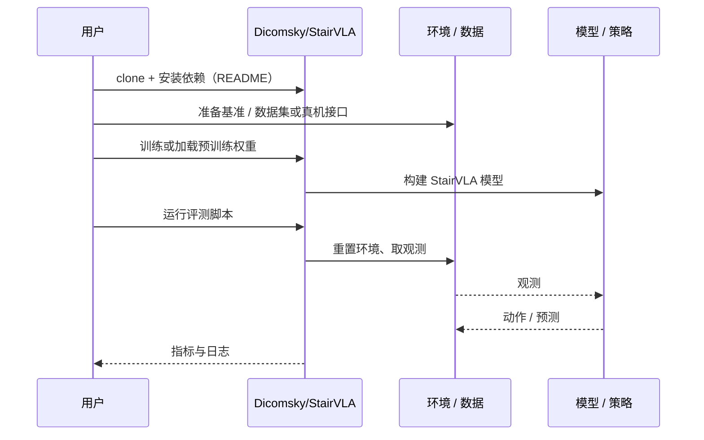

# StairVLA（arXiv:2610.07756）

**StairVLA**（*StairVLA: Stage-Aware Hierarchical Action Generation for Vision-Language-Action Models*，[arXiv:2610.07756](https://arxiv.org/abs/2610.07756)，[项目页](https://dicomsky.github.io/projects/stairvla)，[代码](https://github.com/Dicomsky/StairVLA)）来自 [具身智能小站 2026-10-13 盘点](../../sources/blogs/wechat_embodied_station_34_papers_mulligan_2026-10-13.md)，属「VLA 与动作生成」组。

## 一句话定义

**重型 VLA 做粗规划、轻量模型做高频修正，用部分去噪轨迹衔接两层以摊薄昂贵推理。**

## 英文缩写速查

| 缩写 | 英文全称 | 简要说明 |
|------|----------|----------|
| VLA | Vision-Language-Action | 视觉–语言–动作策略 |
| FM | Flow Matching | 流匹配 |
| Hz | Hertz | 控制频率 |

## 为什么重要

- VLA 推理延迟与闭环修正的矛盾需要分层。
- 开源结论：**已开源**（步骤 2.5，2026-10-14）。项目页链接的 GitHub 仓库可达（基于 starVLA）。
- 同期同组工作见 [失败导向采集与可组合世界动作模型：具身智能小站 10-13 期 34 篇阅读坐标](../overview/embodied-station-2026-10-13-34-papers-technology-map.md)。

## 核心机制

| 项 | 内容 |
|----|------|
| **arXiv** | [2610.07756](https://arxiv.org/abs/2610.07756) |
| **开源** | **已开源** |
| **要点** | 延迟指标是动作块摊销值。 |
| **文内指标** | 以原文为准。 |

## 源码运行时序图

以下为按仓库入口（`Dicomsky/StairVLA`）推断的通用运行链路；入库日仅核实仓库可达，未逐文件阅读，具体脚本名以 README 为准。

## 实验与评测

- 以原文为准。
- **读法：** 本页为索引级摘要，依据公众号转述的官方摘要与仓库信息整理；逐项数字与 baseline 以原文 PDF 为准。

## 与其他工作对比

- 横向索引见 [失败导向采集与可组合世界动作模型：具身智能小站 10-13 期 34 篇阅读坐标](../overview/embodied-station-2026-10-13-34-papers-technology-map.md)；同 arXiv 不重复造页。

## 结论

**分层 VLA 的衔接点选在部分去噪轨迹，是值得复用的接口设计。**

1. 开源边界：**已开源** — 项目页链接的 GitHub 仓库可达（基于 starVLA）。
2. 核心机制：延迟指标是动作块摊销值。
3. 复现与选型前核对任务协议、硬件与基准口径，勿直接横比公众号摘录数字。

## 关联页面

- [vla](../methods/vla.md)
- [flow-matching-embodied-policy](../concepts/flow-matching-embodied-policy.md)
- [star-vla](../methods/star-vla.md)
- [control-inference-frequency-decoupling](../concepts/control-inference-frequency-decoupling.md)
- [embodied-station-2026-10-13-34-papers-technology-map](../overview/embodied-station-2026-10-13-34-papers-technology-map.md)

## 参考来源

- [stairvla_stage_aware_hierarchical_action_arxiv_2610_07756.md](../../sources/papers/stairvla_stage_aware_hierarchical_action_arxiv_2610_07756.md)
- [wechat_embodied_station_34_papers_mulligan_2026-10-13.md](../../sources/blogs/wechat_embodied_station_34_papers_mulligan_2026-10-13.md)
- [arXiv:2610.07756](https://arxiv.org/abs/2610.07756)

## 推荐继续阅读

- [arXiv PDF](https://arxiv.org/pdf/2610.07756)
- [项目页](https://dicomsky.github.io/projects/stairvla)
- [https://github.com/Dicomsky/StairVLA](https://github.com/Dicomsky/StairVLA)
