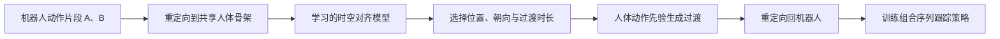

# STAMP：Robot Motion Transition with a Human Motion Prior

**一句话定义：** STAMP（Spatio-Temporal Alignment with a Motion Prior）通过先选择时空边界条件，再用人体动作先验补间，连接独立获得的人形机器人动作片段。

## 英文缩写速查

| 缩写 | 英文全称 | 简要说明 |
|------|----------|----------|
| STAMP | Spatio-Temporal Alignment with a Motion Prior | 本文的时空对齐与动作先验框架 |
| G1 | Unitree G1 | 论文评测的人形机器人平台之一 |
| K1 | ROBOTIS K1 | 论文评测并用于真机演示的人形机器人 |
| GMR | General Motion Retargeting | 相关的通用动作重定向工具 |

## 为什么重要

动作库通常由分别采集或生成的短片段组成。即使各片段都能独立跟踪，直接拼接也可能让根位姿、航向或时长不匹配。STAMP 的做法是先调整下一片段的边界条件，再生成过渡，避免把“怎样接上”完全留给插值或生成模型自行处理。

## 核心原理

### Robot-to-Human-to-Robot 流程

两段机器人动作先映射到共同的人体动作表示。对齐模型根据边界运动上下文排序候选位置、朝向和过渡时长；人体动作先验在选中的边界条件下生成过渡。随后将组合序列转回目标机器人，并以该序列为参考训练动作跟踪策略。

## 实验与评测

项目页转引论文 Tables II–III：每个平台使用 18 对动作片段，每对、每种方法进行 1,024 次 rollout。

| 平台 | STAMP 跟踪成功率 | 插值 | 其他基线 |
|---|---:|---:|---|
| Unitree G1 | 80.69% | 69.59% | MotionBricks 56.91%；Kimodo† 50.69% |
| ROBOTIS K1 | 87.52% | 84.70% | Kimodo† 64.55% |

项目页还展示了 ROBOTIS K1 的跑步到出拳过渡与较长动作组合。评测成功率按各方法自身生成的参考动作衡量跟踪能力，因此不代表与共同真实转场轨迹的相似度。

## 与其他工作对比

- **直接插值：** 用边界对齐与简单插值连接片段；STAMP 额外搜索位置、朝向和过渡时长，再由动作先验生成更有上下文的过渡。
- **动作生成模型：** 若输入边界条件不合适，生成模型可能补出不必要的平移或转向；STAMP 把边界选择作为生成前的独立步骤。
- **跟踪策略：** STAMP 生成的每条完整组合序列仍需训练对应的跟踪策略；项目页说明该阶段使用 BeyondMimic。

## 工程实践

| 环节 | 实施要点 |
|---|---|
| 输入准备 | 将来源不同的机器人动作重定向到共同人体骨架；检查节段边界与坐标系 |
| 对齐搜索 | 同时检查下一动作的相对位置、朝向及过渡时长，避免只对齐单帧关节姿态 |
| 生成与回转 | 在选定边界下生成过渡，再重定向回机器人并检查运动学可行性 |
| 策略训练 | 对完整组合序列训练跟踪策略；组合变化后需重新评估策略 |
| 代码复现 | **当前不适用**：截至 2026-10-26，项目页没有提供可核实的公开代码仓库 URL，故无法确认运行入口 |

## 结论

**一句话总判：STAMP 的关键工程选择是先优化片段边界条件，再生成过渡；公开评测支持其提高跟踪可行性，但不能据此判断动作质量相对共同真值的优劣。**

1. G1 上相对插值提高 11.10 个百分点；K1 上提高 2.82 个百分点，收益随平台而异。
2. 评测采用各自生成的参考序列，读数回答“策略能否跟踪”，不直接回答“转场是否最自然”。
3. 长序列由各组成动作及过渡形成，项目页说明每条序列仍需训练自己的跟踪策略。
4. 项目页展示了 K1 实机组合演示，但截至入库日未核实到公开代码仓库，独立复现入口仍不明确。

## 局限与风险

- 成功率不是基于统一真值动作的质量指标；跨方法比较应结合视频、运动学连续性与同一参考下的评测。
- K1 相对插值的提升幅度较小，应避免把 G1 的差值直接外推到其他平台。
- 重定向误差与机器人的关节范围、足端接触和动力学约束可能影响过渡质量。
- 截至 2026-10-26，项目页未提供可核实的源码或数据下载链接；这里记录的是“链接未核实”，不推断其是否会公开。

## 关联页面

- [BeyondMimic：组合序列跟踪策略](../methods/beyondmimic.md)
- [Motion Retargeting GMR：通用动作重定向](../methods/motion-retargeting-gmr.md)
- [VIBE：全身动作跟踪相关工作](./paper-vibe.md)

## 参考来源

- [论文归档：Robot Motion Transition with a Human Motion Prior](../../sources/papers/robot_motion_transition_human_motion_prior_arxiv_2610_30817.md)
- [STAMP 官方项目页归档](../../sources/sites/stamp-project-page.md)
- [arXiv:2610.30817](https://arxiv.org/abs/2610.30817)

## 推荐继续阅读

- [STAMP 官方项目页](https://childtoy.github.io/STAMP-project/)
- [arXiv 论文（v2）](https://arxiv.org/abs/2610.30817)
