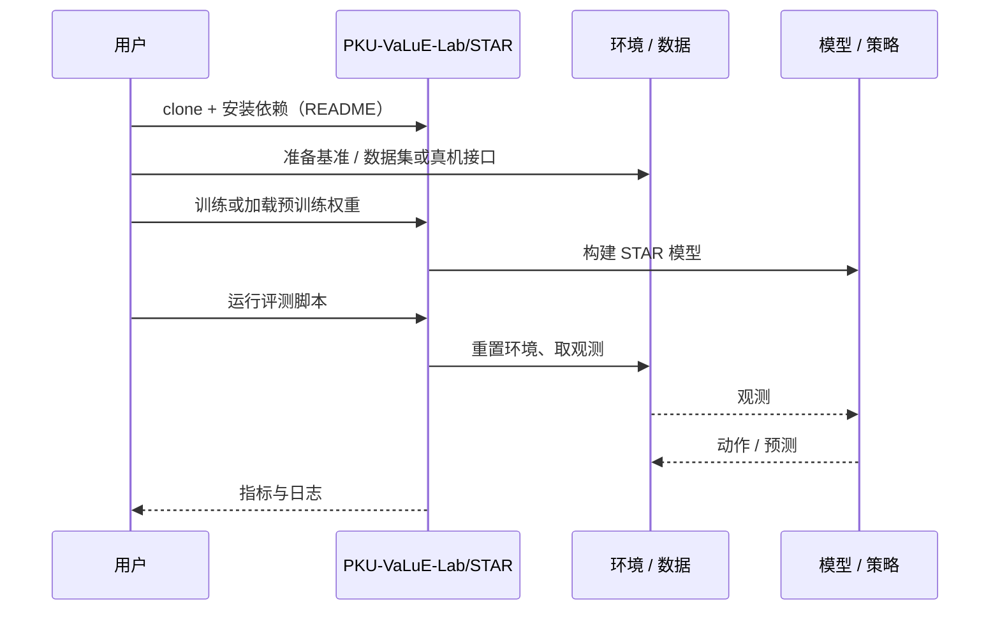

# STAR（arXiv:2610.41009）

**STAR**（*STAR: Steering Action Representations with Proprioception for VLA Inference*，[arXiv:2610.41009](https://arxiv.org/abs/2610.41009)，[代码](https://github.com/PKU-VaLuE-Lab/STAR)）来自 [具身智能小站 2026-11-03 盘点](../../sources/blogs/wechat_embodied_station_49_papers_sacq_action_aware_quantization_2026-11-03.md)，属「策略学习与部署」组。

## 一句话定义

**STAR 对后层残差更新做指数滑动融合，并用近期本体状态调整混合强度，让动作表征继承较早层的物体信息。**

## 英文缩写速查

| 缩写 | 英文全称 | 简要说明 |
|------|----------|----------|
| STAR | STAR: Steering Action Representations with Proprioception for VLA Inference | 本文方法 / 基准的简称 |
| VLA | Vision-Language-Action | 视觉–语言–动作策略 |

## 为什么重要

- 无需再训练，调整动作表征。适合探索推理阶段的策略改进。
- 开源结论：**已开源**（步骤 2.5，2026-11-03）。仓库可达（git ls-remote）。
- 同期同组工作见 [动作感知量化、失败定位与可验证自主：具身智能小站 11-03 期 49 篇阅读坐标](../overview/embodied-station-2026-11-03-49-papers-technology-map.md)。

## 核心机制

| 项 | 内容 |
|----|------|
| **arXiv** | [2610.41009](https://arxiv.org/abs/2610.41009) |
| **开源** | **已开源** |
| **要点** | STAR 对后层残差更新做指数滑动融合，并用近期本体状态调整混合强度，让动作表征继承较早层的物体信息。 |
| **文内指标** | 公众号转述：适合探索推理阶段的策略改进。 |

## 源码运行时序图

以下为按仓库入口（`PKU-VaLuE-Lab/STAR`）推断的通用运行链路；入库日仅核实仓库可达，未逐文件阅读，具体脚本名以 README 为准。

## 实验与评测

- 公众号转述：适合探索推理阶段的策略改进。
- **读法：** 本页为索引级摘要，依据公众号转述的官方摘要与仓库信息整理；逐项数字与 baseline 以原文 PDF 为准。

## 与其他工作对比

- 横向索引见 [动作感知量化、失败定位与可验证自主：具身智能小站 11-03 期 49 篇阅读坐标](../overview/embodied-station-2026-11-03-49-papers-technology-map.md)；同 arXiv 不重复造页。

## 结论

**无需再训练，调整动作表征：适合探索推理阶段的策略改进。**

1. 开源边界：**已开源** — 仓库可达（git ls-remote）。
2. 核心机制：STAR 对后层残差更新做指数滑动融合，并用近期本体状态调整混合强度，让动作表征继承较早层的物体信息。
3. 复现与选型前核对任务协议、硬件与基准口径，勿直接横比公众号摘录数字。

## 关联页面

- [vla](../methods/vla.md)
- [imitation-learning](../methods/imitation-learning.md)
- [reinforcement-learning](../methods/reinforcement-learning.md)
- [embodied-station-2026-11-03-49-papers-technology-map](../overview/embodied-station-2026-11-03-49-papers-technology-map.md)

## 参考来源

- [star_arxiv_2610_41009.md](../../sources/papers/star_arxiv_2610_41009.md)
- [wechat_embodied_station_49_papers_sacq_action_aware_quantization_2026-11-03.md](../../sources/blogs/wechat_embodied_station_49_papers_sacq_action_aware_quantization_2026-11-03.md)
- [arXiv:2610.41009](https://arxiv.org/abs/2610.41009)

## 推荐继续阅读

- [arXiv PDF](https://arxiv.org/pdf/2610.41009)
- [https://github.com/PKU-VaLuE-Lab/STAR](https://github.com/PKU-VaLuE-Lab/STAR)
