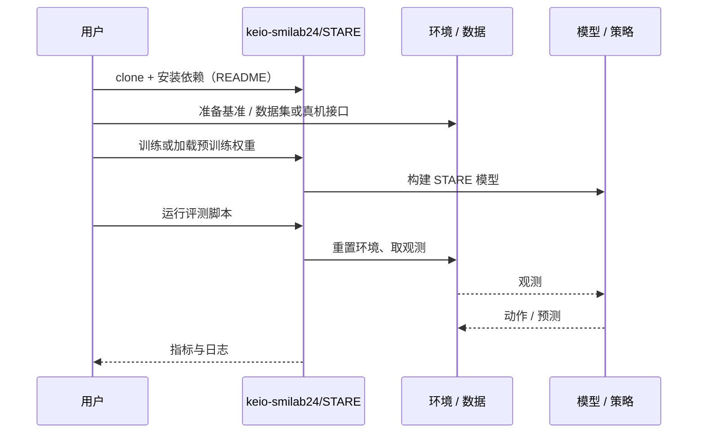

# STARE（arXiv:2611.06089）

**STARE**（*STARE: Scene Text-Aware multimodal Retrieval for Everyday objects*，[arXiv:2611.06089](https://arxiv.org/abs/2611.06089)，[项目页](https://stare-projectpage.pages.dev/)，[代码](https://github.com/keio-smilab24/STARE)）来自 [具身智能小站 2026-11-06 盘点](../../sources/blogs/wechat_embodied_station_20_papers_curobov2_fast_halo_humanwam_2026-11-06.md)，属「导航与闭环评测」组。

## 一句话定义

**STARE 把指令里的品牌或品名与场景文字、物体外观一起检索，再让机器人去抓。**

## 英文缩写速查

| 缩写 | 英文全称 | 简要说明 |
|------|----------|----------|
| STARE | STARE: Scene Text-Aware multimodal Retrieval for Everyday objects | 本文方法 / 基准的简称 |

## 为什么重要

- 机器人找调料瓶，也能读瓶身上的字。12 种布置共测 100 次，目标进入前五个检索结果且抓取成功的比例为 80%。
- 开源结论：**已开源**（步骤 2.5，2026-11-06）。仓库可达（git ls-remote）。项目页 HTTP 200。
- 同期同组工作见 [按路段调速的规划、虚拟房间到真机的人形动作与人类视频缩放：具身智能小站 11-06 期 20 篇阅读坐标](../overview/embodied-station-2026-11-06-20-papers-technology-map.md)。

## 核心机制

| 项 | 内容 |
|----|------|
| **arXiv** | [2611.06089](https://arxiv.org/abs/2611.06089) |
| **开源** | **已开源** |
| **要点** | STARE 把指令里的品牌或品名与场景文字、物体外观一起检索，再让机器人去抓。 |
| **文内指标** | 公众号转述：12 种布置共测 100 次，目标进入前五个检索结果且抓取成功的比例为 80%。 |

## 源码运行时序图

以下为按仓库入口（`keio-smilab24/STARE`）推断的通用运行链路；入库日仅核实仓库可达，未逐文件阅读，具体脚本名以 README 为准。

## 实验与评测

- 公众号转述：12 种布置共测 100 次，目标进入前五个检索结果且抓取成功的比例为 80%。
- **读法：** 本页为索引级摘要，依据公众号转述的官方摘要与仓库信息整理；逐项数字与 baseline 以原文 PDF 为准。

## 与其他工作对比

- 横向索引见 [按路段调速的规划、虚拟房间到真机的人形动作与人类视频缩放：具身智能小站 11-06 期 20 篇阅读坐标](../overview/embodied-station-2026-11-06-20-papers-technology-map.md)；同 arXiv 不重复造页。

## 结论

**机器人找调料瓶，也能读瓶身上的字：12 种布置共测 100 次，目标进入前五个检索结果且抓取成功的比例为 80%。**

1. 开源边界：**已开源** — 仓库可达（git ls-remote）。项目页 HTTP 200。
2. 核心机制：STARE 把指令里的品牌或品名与场景文字、物体外观一起检索，再让机器人去抓。
3. 复现与选型前核对任务协议、硬件与基准口径，勿直接横比公众号摘录数字。

## 关联页面

- [simulation-evaluation-infrastructure](../concepts/simulation-evaluation-infrastructure.md)
- [vision-language-navigation](../tasks/vision-language-navigation.md)
- [manipulation](../tasks/manipulation.md)
- [embodied-station-2026-11-06-20-papers-technology-map](../overview/embodied-station-2026-11-06-20-papers-technology-map.md)

## 参考来源

- [stare_arxiv_2611_06089.md](../../sources/papers/stare_arxiv_2611_06089.md)
- [wechat_embodied_station_20_papers_curobov2_fast_halo_humanwam_2026-11-06.md](../../sources/blogs/wechat_embodied_station_20_papers_curobov2_fast_halo_humanwam_2026-11-06.md)
- [arXiv:2611.06089](https://arxiv.org/abs/2611.06089)

## 推荐继续阅读

- [arXiv PDF](https://arxiv.org/pdf/2611.06089)
- [项目页](https://stare-projectpage.pages.dev/)
- [https://github.com/keio-smilab24/STARE](https://github.com/keio-smilab24/STARE)
