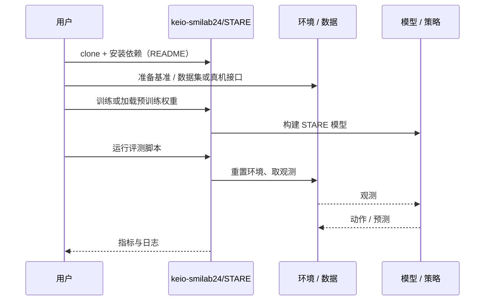

# STARE（arXiv:2611.06089）

**STARE**（*STARE: Scene Text-Aware multimodal Retrieval for Everyday objects*，[arXiv:2611.06089](https://arxiv.org/abs/2611.06089)，[项目页](https://stare-projectpage.pages.dev/)，[代码](https://github.com/keio-smilab24/STARE)）来自 [具身智能小站 2026-11-06 盘点](../../sources/blogs/wechat_embodied_station_20_papers_curobov2_fast_halo_humanwam_2026-11-06.md)，属「导航与闭环评测」组。

## 一句话定义

**STARE 把指令里的品牌或品名与场景文字、物体外观一起检索，再让机器人去抓。**

## 英文缩写速查

| 缩写 | 英文全称 | 简要说明 |
|------|----------|----------|
| STARE | STARE: Scene Text-Aware multimodal Retrieval for Everyday objects | 本文方法 / 基准的简称 |

## 为什么重要

- 机器人找调料瓶，也能读瓶身上的字。12 种布置共测 100 次，目标进入前五个检索结果且抓取成功的比例为 80%。
- 开源结论：**已开源**（步骤 2.5，2026-11-06）。仓库可达（git ls-remote）。项目页 HTTP 200。
- 同期同组工作见 [按路段调速的规划、虚拟房间到真机的人形动作与人类视频缩放：具身智能小站 11-06 期 20 篇阅读坐标](../overview/embodied-station-2026-11-06-20-papers-technology-map.md)。

## 核心机制

任务（STMR）：预探索时收集含场景文字的图像，按自由指令检索并排序目标图像，再由机器人导航抓取。预探索阶段完成 OCR 与图像嵌入并存储，查询时只做指令侧处理，故延迟低。

| 模块 | 做法 |
|------|------|
| **MFIE** | 一次 LLM 调用做查询扩展（把品名改写成外观描述）与命名实体抽取；Stella + CLIP 文本特征经 SSM（Mamba）融合 |
| **STVE / CVP** | 重叠分块的多编码器（CLIP、DINOv2）特征；OCR 框顶叠加片假名标记（非字母数字，避免与原文字混淆），交 MLLM 生成叙述描述，再与 DINOv2 中间层特征交叉注意力 |
| **STRR** | 相似度 = 余弦相似度 + λ·命名实体与场景文字的 token 交集（按候选集最大值归一化），λ 可学习 |

| 项 | 内容 |
|----|------|
| **arXiv** | [2611.06089](https://arxiv.org/abs/2611.06089) |
| **开源** | **已开源** |
| **文内指标** | 真机 100 回合（12 种布置）recall@5 88%、成功率 80%，最佳基线 81% / 73% |

## 源码运行时序图

以下为按仓库入口（`keio-smilab24/STARE`）推断的通用运行链路；入库日仅核实仓库可达，未逐文件阅读，具体脚本名以 README 为准。

## 实验与评测

- **基准：** 自建 GoGetIt（27,280 条样本、3,657 张图）与 TextCaps-test（400 条指令、105 张图），另用无场景文字的 LTRRIE。
- **离线（recall@10）：** GoGetIt-RefText 94.4、GoGetIt-Instruction 92.8、TextCaps-test 95.4、LTRRIE 86.6，分别领先最佳基线 13.2、8.2、3.6、2.3 个点（p < 0.01）。
- **消融（GoGetIt-Instruction recall@10）：** 去 STRR 降 6.9；STRR 用整条指令而非命名实体降 5.1；去掉全部 OCR 相关特征降 10.5；CVP 换字符类型或去分块只降 0.2–0.7。
- **真机：** 家用服务机器人零样本，100 回合 recall@5 88%、SR 80%；成功要求目标图进前五且抓取成功。

## 与其他工作对比

- 横向索引见 [按路段调速的规划、虚拟房间到真机的人形动作与人类视频缩放：具身智能小站 11-06 期 20 篇阅读坐标](../overview/embodied-station-2026-11-06-20-papers-technology-map.md)；同 arXiv 不重复造页。

## 工程实践

- **离线 / 在线分离：** 预探索时跑 OCR（Google Cloud Vision）、CVP 的 MLLM 描述和图像嵌入并缓存；查询时只跑一次 LLM（扩展 + 实体抽取）、MFIE 与 STRR。预探索可持续更新图像集。
- **开销：** 约 4000 万可训练参数，单张 RTX 4090 训练约 1.2 小时；100 个预存嵌入的相似度计算约 39.8 ms；查询延迟含 LLM 2.0 s（GPT-4o 端到端 21.3 s），显存约 7.2–7.4 GB。
- **真机链路：** 预探索沿 15 个路点用头部相机拍 RGB；检索前五命中后，由深度图与目标分割掩码算抓取点。
- **依赖：** MFIE 与 STVE 用 GPT-4o，OCR 用商业 API，复现需外部服务；训练细节（损失、指标）在补充材料中。

## 局限

- 依赖 OCR：遮挡与朝向不佳会造成识别错误，STRR 的字符串匹配对噪声敏感（论文靠归一化缓解）。
- 依赖闭源 MLLM / LLM（GPT-4o）与商业 OCR，且 MLLM 可能幻觉文字，论文用 OCR 文本与 CVP 约束。
- 系统只做检索排序：抓取成功需目标图进前五，真机成功率 80% 与 recall@5 88% 之差来自抓取失败。
- 真机仅一台家用服务机器人、100 回合，且为静态预探索图像；无场景文字的 LTRRIE 上优势较小（recall@10 领先 2.3 个点）。
- 本页依据 arXiv v1 正文；失败案例、误差分析与 MFIE 消融在补充材料中，未核对。

## 结论

**机器人找调料瓶，也能读瓶身上的字：12 种布置共测 100 次，目标进入前五个检索结果且抓取成功的比例为 80%。**

1. 开源边界：**已开源** — 仓库可达（git ls-remote）。项目页 HTTP 200。
2. 核心机制：STARE 把指令里的品牌或品名与场景文字、物体外观一起检索，再让机器人去抓。
3. 复现与选型前核对任务协议、硬件与基准口径；数字取自 arXiv v1 正文，不含补充材料。

## 关联页面

- [simulation-evaluation-infrastructure](../concepts/simulation-evaluation-infrastructure.md)
- [vision-language-navigation](../tasks/vision-language-navigation.md)
- [manipulation](../tasks/manipulation.md)
- [embodied-station-2026-11-06-20-papers-technology-map](../overview/embodied-station-2026-11-06-20-papers-technology-map.md)
- [具身大模型评测基准选型闭环](../queries/embodied-eval-benchmark-selection-loop.md) — 主要归其 ③ 策略任务成功率层，但指标「检索进前五且抓取成功」同时包含 ① 认知层的文字 / 品名接地成分

## 参考来源

- [stare_arxiv_2611_06089.md](../../sources/papers/stare_arxiv_2611_06089.md)
- [wechat_embodied_station_20_papers_curobov2_fast_halo_humanwam_2026-11-06.md](../../sources/blogs/wechat_embodied_station_20_papers_curobov2_fast_halo_humanwam_2026-11-06.md)
- [arXiv:2611.06089](https://arxiv.org/abs/2611.06089)

## 推荐继续阅读

- [arXiv PDF](https://arxiv.org/pdf/2611.06089)
- [项目页](https://stare-projectpage.pages.dev/)
- [https://github.com/keio-smilab24/STARE](https://github.com/keio-smilab24/STARE)
