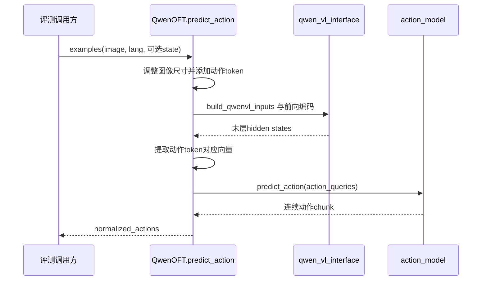

# StarVLA-α：简化 VLA 系统的受控基线

## 一句话定义

StarVLA-α 以强 VLM、轻量连续动作回归和统一数据流程构成基线，固定其他变量后比较动作头、机器人预训练和接口工程；独立于提供基础设施的 [StarVLA 框架论文](./paper-starvla-framework.md)。

## 英文缩写速查

| 缩写 | 英文全称 | 简要说明 |
|---|---|---|
| VLA | Vision-Language-Action | 从图像与语言预测机器人动作的策略 |
| VLM | Vision-Language Model | 提供视觉语言预训练表征的骨干 |
| MLP | Multi-Layer Perceptron | 本文连续动作回归头 |
| SR | Success Rate | 完成整项任务的比例，与进度分不同 |
| OOD | Out-of-Distribution | 相对于特定训练分布的测试条件 |

## 为什么重要

跨项目成功率常混合骨干、数据量、动作接口和训练预算的差异。α把这些因素尽量固定，让“复杂结构是否必要”成为可检验问题；结果支持将简单基线作为研究起点，而不是证明所有机器人任务都只需MLP。

## 核心信息

| 字段 | 内容 |
|---|---|
| 机构 | 香港科技大学、西安交通大学、香港中文大学、清华大学、阿里巴巴通义实验室、思谋科技 |
| 主论文 | arXiv:2604.11757，2026-11-15读取HTML正文与附录 |
| 默认骨干 | Qwen3-VL-4B；动作头随机初始化，无额外动作预训练 |
| 训练设置 | Specialist各基准独立模型；Generalist合并训练、动作补到32维 |
| 官方实现 | starVLA/starVLA；当前分支的默认示例不等于论文配置 |

## 核心原理与流程总览

训练只用训练集统计动作归一化。Generalist通过padding共享输出形状，仍需按本体解释有效维度、单位和控制语义。正文比较FAST自回归、MLP回归、PI流匹配和GR00T双系统；连续头差距依场景变化，不能由这些实验否定其他任务上的生成式建模。

## 源码运行时序图

以下从已读 `QwenOFT.predict_action` 的调用边界开始，不包含未重新阅读的服务器内部。

训练路径 `forward` 用同样的动作query预测并计算 `masked_l1_loss`。当前LIBERO启动脚本默认QwenPI/Qwen3.5-0.8B；复现α时应显式选择对应骨干和MLP框架，不能只运行默认脚本后声称复现本文。依据[原文与代码核对](../../sources/papers/star_vla_alpha_arxiv_2604_11757_full_reading_2026_11_15.md)。

## 实验与评测

| 协议 | 作者报告 | 解释边界 |
|---|---|---|
| Specialist，表1/5 | LIBERO 98.8%；Google VM 76.0%；RoboCasa-GR1 53.8% | 每基准分别训练模型 |
| Generalist，表5 | LIBERO 97.8%；Google VM 74.3%；RoboCasa-GR1 57.3% | 合并训练，不能视作未见基准零样本 |
| ARX5，表7 | SR 33.6% vs π0.5 12.7%；进度分54.5 vs27.6 | 11任务；SR差20.9个百分点，进度分另计 |
| Franka OOD，附录F | ID/OOD均值85.3%/76.3% | 独立的三任务自建实验 |
| LIBERO-Plus，表17 | Specialist77.8%；Generalist79.7% | 标准LIBERO训练后测扰动 |

## 结论

**先用强VLM和简单动作头建立受控基线，再用同协议消融证明额外结构的价值。**

1. 固定骨干、数据和训练预算，动作头比较才有解释性。
2. 区分specialist与generalist；联合训练过的基准不是未见测试域。
3. 动作预训练的收益依赖域对齐，跨本体数据不保证普遍增益。
4. SR、进度分与不同平台试验分别报告，不能合成单一“提升20%”。
5. 当前代码默认示例与论文配置不同，复现先核对配置与归一化。

## 与其他工作对比

[框架论文](./paper-starvla-framework.md)研究模块化开发基础设施，α研究受控基线；两篇论文共用仓库。FAST对照是离散自回归动作，PI/GR00T是不同连续生成头；α结果只在其特定骨干、数据和预算上支持简单回归的竞争力。

## 工程实践

先保存骨干、framework、action_horizon、训练数据配比和动作统计，再以单套基准验证接口。联合训练时保存有效动作维掩码，客户端恢复对应本体的单位和动作空间。本次仅阅读论文与代码，没有GPU或真机复现；开放实现与发布状态见[框架归档](../../sources/papers/starvla_framework_arxiv_2604_05014_full_reading.md)。

## 局限与风险

“轻量动作头”不消除VLM推理、数据或硬件成本。各设置算力与训练数据量不同，不能将论文成功率当作任意部署上界；源表的部分基线数字和配置有差异，引用须点名表格。OOD结论限于已测试对象、背景、位姿和平台。

## 关联页面

- [模型架构纵深路线](../../roadmap/depth-model-architecture.md)
- [VLA 纵深路线](../../roadmap/depth-vla.md)
- [具身测评纵深路线](../../roadmap/depth-embodied-eval.md)

- [StarVLA 方法入口](../methods/star-vla.md)
- [StarVLA 框架论文](./paper-starvla-framework.md)
- [VLA](../methods/vla.md)
- [具身评测基准选型闭环](../queries/embodied-eval-benchmark-selection-loop.md)

## 参考来源

- [α 主论文全文及源码核对](../../sources/papers/star_vla_alpha_arxiv_2604_11757_full_reading_2026_11_15.md)
- [框架论文与官方指南](../../sources/papers/starvla_framework_arxiv_2604_05014_full_reading.md)
- [官方仓库索引](../../sources/repos/star_vla.md)

## 推荐继续阅读

- [arXiv:2604.11757 原文与附录](https://arxiv.org/html/2604.11757)
- [官方代码](https://github.com/starVLA/starVLA)
- [与框架论文共用的项目主页](https://starvla.github.io/)
