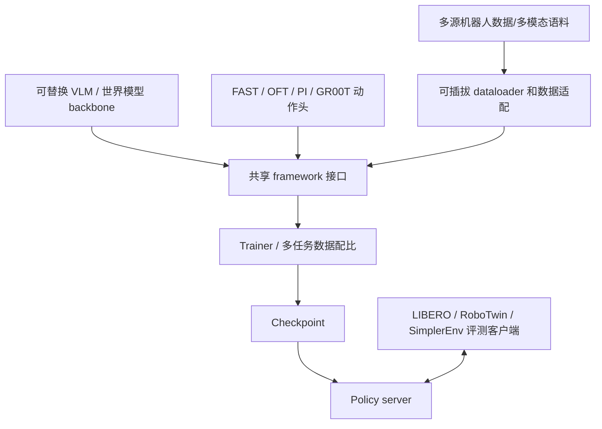
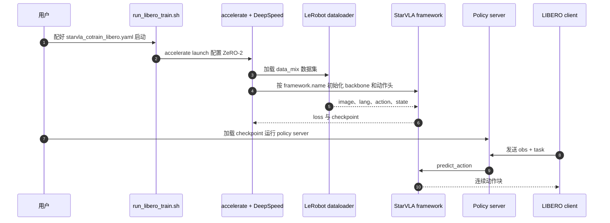

# StarVLA：模块化 VLA 实验与部署框架 / A Lego-like Codebase for Vision-Language-Action Model Developing

## 一句话定义

**StarVLA** 是把 **backbone、action head、dataset adapter、trainer、evaluation server** 拆开的开源 VLA 研究平台，使同一实验管线可以切换 VLM/世界模型骨干及动作生成策略，比较结构而非重复维护不同项目代码。

## 英文缩写速查

| 缩写 | 英文全称 | 简要说明 |
|---|---|---|
| VLA | Vision-Language-Action | 视觉语言动作的通用策略研究框架 |
| VLM | Vision-Language Model | 可被替换的视觉语言骨干 |
| WAM | World-Action Model | 支持视频世界模型骨干的同生态方向 |
| FAST | Fast Action Sequence Tokenization | 自回归离散动作头选项 |
| OFT | OpenVLA Optimized Fine-Tuning | 本框架的并行连续回归动作头族 |
| SFT | Supervised Fine-Tuning | 可复用的监督模仿训练 |
| EEF | End Effector | 策略输出接口的重要物理量 |

## 为什么重要

StarVLA 的核心价值不是“又一个 VLA 成功率最高”，而是能够让研究者在统一观测/动作协议下，控制地替换模型骨干、解码头、异构数据组合和 benchmark，以此更可信地研究哪个部件提高了性能。

## 核心原理

- **组合架构：** 支持 Qwen3-VL 等 VLM 与 Cosmos 等世界模型相关骨干；动作头覆盖 StarVLA-FAST、OFT、PI/flow 和 GR00T 双系统。以相同输入输出接口替换组件。
- **训练：** 共享 SFT、多模态协同训练和跨本体数据混合策略，数据加载器返回模型无关原始字典，具体框架负责预处理与 `forward/predict_action`。
- **评测：** 服务端加载策略，客户端接入 LIBERO/RoboTwin/SimplerEnv/RoboCasa 等基准；同一框架下的任务/数据/参数仍须固定以确保可比。
- **独立论文身份：** 此页对应 StarVLA **框架论文 2604.05014**；[StarVLA-α 论文详情](./paper-starvla-alpha.md) 对应 **2604.11757**，侧重极简动作头控制变量实验，不能混作同一论文。

## 流程总览

## 源码运行时序图

官方 `docs/starVLA_guideline.md` 与 `README` 提供的 LIBERO 路径；可核验 `run_libero_train.sh` 使用 `accelerate launch` / ZeRO-2，评测为两终端 server/client。

## 实验与评测

- 论文覆盖 LIBERO、SimplerEnv、RoboTwin 2.0、RoboCasa-GR1、跨 benchmark 联合训练和扩展性测试；成功率是指定策略版本与评测环境的作者报告。
- LIBERO 示例协议每套 10 tasks × 每任务 50 rollouts；正文比较 30k 训练步与 OpenVLA-OFT 175k 步，**不同训练轮数、配置或数据不可假定完全等价**。
- 官方 README 的训练计划已支持 SFT、多模态协同与跨本体 co-training；**原文 v1 将 RLinf 集成列为进行中，后续官方 README 已给出 RLinf 训练教程**；需按发布日期与外部依赖区分支持边界。

## RoboCasa 动作头对比：9.8 个百分点从何而来

原文 **§5.3 / Table 5–6** 在 **RoboCasa-GR1 Tabletop（24 个任务）** 做**单基准训练**：同一框架、同一 benchmark 数据集上的不同动作头，均按每任务 **50 次 rollout** 评估；作者报告训练使用 **16×A100**，最多 **100K steps**。这是特定 RoboCasa 评测中的成功率差异，不是任意机器人/任务上更换动作头的固定收益。

| 动作头 | 动作表示 | RoboCasa-GR1 平均成功率（Table 5） |
|---|---|---:|
| StarVLA-FAST | 离散 token 自回归 | 39.0% |
| StarVLA-π | 连续流匹配 | 43.9% |
| StarVLA-GR00T | 双系统流匹配 | 47.8% |
| StarVLA-OFT | MLP 并行连续回归 | **48.8%** |

**48.8 − 39.0 = 9.8 个百分点**（*percentage points*），而非相对提升 9.8%。动作头比较时不能只改名字就默认成本相同：FAST 需要动作词表/分词器匹配，π/GR00T 还涉及解码和推理计算路径。

原文 **§7.1–7.2 / Table 9** 则是另一实验：将 **LIBERO、SimplerEnv、RoboTwin 2.0、RoboCasa-GR1 的训练集混合**，以 **batch 256、学习率 1e-4** 联合训练**一个 Generalist**，动作维度不足的本体填充到 **32 维**，再分别按官方协议评测，**无额外 benchmark-specific 微调**。该 Generalist 的 RoboCasa-GR1 成功率为 **57.3%**；这不代表对完全未见 RoboCasa 数据的零样本迁移。

**表格口径提醒：** 同一篇框架论文 Table 5 的单基准 OFT 为 **48.8%**，Table 9 的 Specialist OFT 行却为 **53.8%**。若只在 Table 9 内比较，57.3% 对 53.8% 是 **3.5 个百分点**；论文 §7.2 正文使用 48.8% 作为比较基线，和 Table 9 的 OFT 行不一致。保留原表号及数值差异，不擅自统一或跨表将 8.5 个百分点归因为联合训练收益。

## 可操作复现实验与源码边界

- 官方 [Quick Start](https://github.com/starVLA/starVLA/blob/starVLA_dev/docs/starVLA_guideline.md) 展示的 YAML 在 `framework.name` 选择 `QwenOFT`、`QwenFAST`、`QwenPI_v3`、`QwenGR00T`；具体分支应以**代码支持的名称、骨干、动作维度和 tokenizer** 联合核对，不能只保证名称合法。
- 代码入口 `examples/simBenchmarks/LIBERO/train_files/run_libero_train.sh` 把 `Framework_name` 传入 `--framework.name`；该脚本当前默认 `QwenPI` + `Qwen3.5-0.8B`，而同目录 YAML 默认 `QwenGR00T` + `Qwen3-VL-4B`。两者不等同于论文 RoboCasa 的对照配置，复现前需明确记录实际覆盖后的参数。
- `starVLA/model/framework/VLM4A/QwenOFT.py` 的 `predict_action` 提取动作 token hidden states，并调用 `action_model.predict_action` 得到连续动作块；这是已静态核查的实际代码调用关系，**并未运行训练、部署或 24 任务评测**。
- 论文 v1 §3.1.4 将 RLinf 强化学习集成描述为进行中；官方后续 README **2026-04-09** 更新提供 StarVLA × RLinf 教程。应区分**论文提交时状态**与**仓库后续集成**，不能把外部 RLinf 通路说成每种 RL 方法均内置且验证完成。
- 官方 README 提醒 `starVLA_dev` 是活跃开发分支、可能不稳定，复现已验证结果需优先核对稳定 `starVLA` 分支、配置和对应 checkpoint。

数据与源码核查细节见[框架原文归档](../../sources/papers/starvla_framework_arxiv_2604_05014_full_reading.md)及[官方项目页归档](../../sources/sites/starvla-framework-official-project.md)。

## 结论

**StarVLA 提供能够独立替换 VLA 结构和训练配方的实验基础设施，不应将其当作单一固定动作网络。**

1. 做模型消融时先固定数据、骨干、动作头以外的变量。
2. 将训练脚本与评测 server/client 协议分别检查。
3. 星标、仓库支持列表和论文成功率应标清版本/协议。
4. 对 RL 训练路线优先核对实际可运行入口，不能把 TODO 当 release。
5. StarVLA 框架论文与 StarVLA-α benchmark 论文分别维护。

## 与其他工作对比

- [StarVLA-α 论文详情](./paper-starvla-alpha.md)：框架研究 vs 受控极简基线研究的不同论文。
- [OpenWAM](./paper-openwam.md)：后者深挖世界–动作联合生成预训练变量；StarVLA 定位更广的 VLA 实验组合。
- [2026 VLA 三条路线](../comparisons/vla-open-source-ecosystem-2026-three-shifts.md)：属于工程基础设施。

## 工程实践

官方仓库公开 `starVLA_dev` 分支与 `docs/starVLA_guideline.md`、`examples/simBenchmarks/LIBERO/train_files/` 和 benchmark server/client 工具。建议用示例 checkpoint 先跑 smoke test 与单套 LIBERO，再改骨干和数据混合。此处为源码静态核对，未做 GPU 复现。

## 局限与风险

不同模型头可能有不同 tokenizer、动作归一化与显存预算；“统一框架”并不使所有 checkpoint / benchmark 完全可互换。论文介绍的训练扩展吞吐也不是相同硬件上的策略推理频率。

## 关联页面

- [模型架构纵深路线](../../roadmap/depth-model-architecture.md)

- [具身评测基准选型闭环](../queries/embodied-eval-benchmark-selection-loop.md) — 统一训练框架后仍须对齐任务、输入条件、成功判据和评测协议。
- [StarVLA-α](./paper-starvla-alpha.md)
- [StarVLA 方法入口](../methods/star-vla.md)
- [VLA](../methods/vla.md)
- [2026 VLA 项目对比](../comparisons/vla-open-source-ecosystem-2026-three-shifts.md)

## 参考来源

- [StarVLA 框架论文原文核对](../../sources/papers/starvla_framework_arxiv_2604_05014_full_reading.md)
- [StarVLA 源码索引](../../sources/repos/star_vla.md)
- [StarVLA 官方项目页与当前开源状态](../../sources/sites/starvla-framework-official-project.md)

## 推荐继续阅读

- [arXiv:2604.05014](https://arxiv.org/html/2604.05014)
- [GitHub](https://github.com/starVLA/starVLA)
- [StarVLA-α: arXiv 2604.11757](https://arxiv.org/abs/2604.11757)
