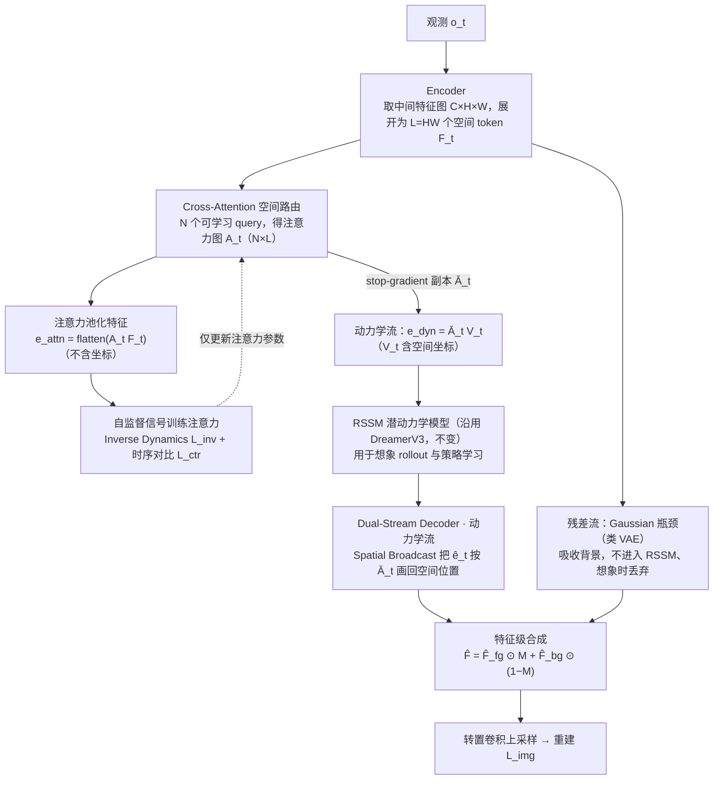

# StarWM: Self-Supervised Trained Attention Routing for Robust World Models

StarWM用注意力路由减少移动背景对任务相关预测的干扰。

## 英文缩写速查

| 缩写 | 英文全称 | 简要说明 |
|---|---|---|
| VLA | Vision-Language-Action | 视觉与指令条件化的机器人动作策略。 |
| WM | World Model | 预测行动后的环境变化。 |
| WAM | World Action Model | 联合建模未来视觉和动作。 |

## 为什么重要

StarWM用注意力路由减少移动背景对任务相关预测的干扰。 评读时应将问题、观测条件与执行接口一并记录，避免从单个演示或指标外推能力。

## 流程总览

图依据：论文 §3 / Fig.1、§3.1–§3.3（Eq.5–9）。

## 方法栈

自监督动力学目标训练路由器，选择关键区域并分别解码前景内容与背景。

## 实验与评测

原文章报告受控背景变化下优于重建式基线；证据仍主要来自仿真与受控环境。

## 与其他工作对比

相较全帧重建，模型容量集中在任务相关变化；路由错误可能丢失有效信息。

## 工程实践

当前归档仅核实到arXiv入口，未核实可运行官方代码。

## 源码运行时序图

**不适用**：当前没有核实到该论文的可运行官方训练、推理或部署入口。

## 结论

**一句话总判：** StarWM用注意力路由减少移动背景对任务相关预测的干扰。

1. 核对方法实际改变的是数据、表征、规划、控制还是评测。
2. 只把论文覆盖的任务、平台与扰动范围当作证据。
3. 复现前确认代码、权重、数据许可和硬件依赖状态。

## 局限与风险

相较全帧重建，模型容量集中在任务相关变化；路由错误可能丢失有效信息。 当前导读以用户提供的文章和预印本题录为索引；详细配置与结果应核对论文全文。

## 关联页面

- [Day 5 导读](../overview/humanoid-motion-intelligence-day5-world-models-decision.md)
- [生成式世界模型](../methods/generative-world-models.md)

## 参考来源

- [Day 5 原文归档](../../sources/blogs/humanoid_motion_intelligence_day5_world_models_decision_2026_10_06.md)
- [arXiv:2609.30667](https://arxiv.org/abs/2609.30667)
- [arXiv PDF](https://arxiv.org/pdf/2609.30667)：已通读方法部分（实验与附录以略读为准）：摘要、§2 预备知识、§3 方法（3.1–3.3）、§4 实验开头

## 推荐继续阅读

- [Day 5 导读](../overview/humanoid-motion-intelligence-day5-world-models-decision.md)
