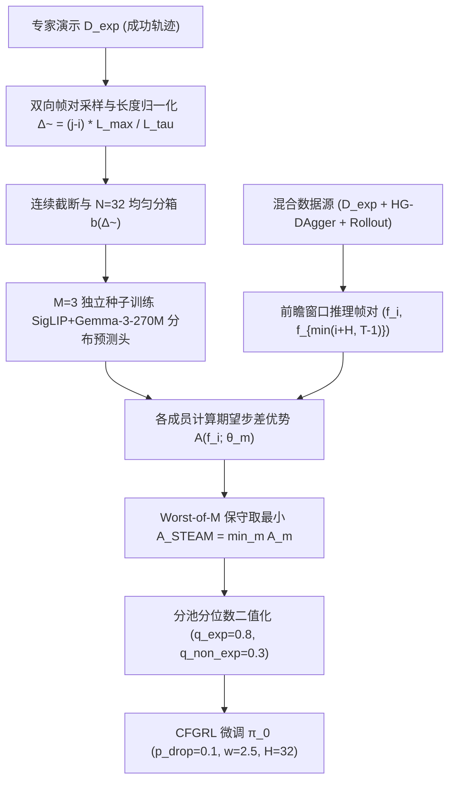
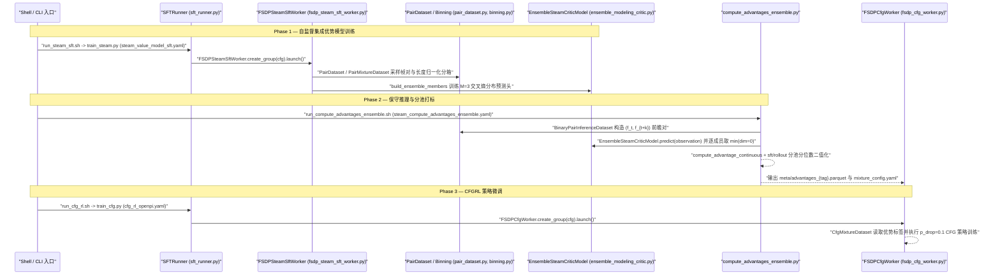

# STEAM: Self-Supervised Temporal Ensemble Advantage Modeling

## 一句话定义

**STEAM**（Self-Supervised Temporal Ensemble Advantage Modeling，arXiv:2606.29834 v2）是一种无须人工奖励标注或状态值函数拟合的离线强化学习优势建模框架：仅在专家演示上自监督预测帧对的长度归一化相对时间步差分布，并通过多模型最坏值集成与分池分位数二值化，从混合质量真机轨迹中筛选高质量动作片段以驱动 [CFGRL](../methods/reinforcement-learning.md) 策略微调。

## 英文缩写速查

| 缩写 | 英文全称 | 简要说明 |
| :--- | :--- | :--- |
| **STEAM** | Self-Supervised Temporal Ensemble Advantage Modeling | 本文提出的自监督时间集成优势建模框架 |
| **CFGRL** | Classifier-Free Guidance Reinforcement Learning | 将优势二值标签作为条件信号并用无分类器引导提纯策略的离线 RL 方法 |
| **VLA** | Vision-Language-Action Model | 视觉-语言-动作联合策略模型（论文对照实验采用 $\pi_0$） |
| **HG-DAgger** | Human-Gated DAgger | 人工在真机执行过程中介入纠偏并回收纠正轨迹的交互式模仿学习基线 |
| **I-AUROC** | Incident Area Under the ROC Curve | 在轨迹失败前预先识别退化/将败片段的 AUROC 诊断指标 |
| **OOD** | Out-of-Distribution | 自主 rollout 中出现、专家演示未覆盖的分布外失败或停滞状态 |

## 为什么重要

在面向真机的[视觉-语言-动作策略（VLA）](../methods/vla.md)后训练中，企业与研究团队很容易通过真机运行和[遥操作](../tasks/teleoperation.md)低成本收集大量包含成功与失败的自主 rollout 以及部分人工纠偏轨迹，但这批混合质量数据通常缺少稠密奖励。

1. **绕开状态值函数伪相关失效：** 以 RECAP 为代表的值函数路线需要拟合 $V_\psi(o_t, \ell)$ 并回推 TD 优势；当演示集中轨迹长度高度一致或包含大量停滞/重试段时，值函数会把帧外观或绝对进度误差带入优势信号（表 1 中 RECAP I-AUROC 仅 48.3%）。
2. **仅需专家数据即可建立进度标尺：** STEAM 仅在成功专家演示集 $\mathcal{D}_{\text{exp}}$ 上预测帧对相对步差，不拟合任何状态价值，也能在纠偏与失败 rollout 上给出可对齐跨任务长短的帧级进度估计。
3. **Worst-of-$M$ 集成抑制 OOD 假阳性：** 自主 rollout 的分布外停滞片段常诱发单模型自信高估优势；通过 $M=3$ 个独立种子模型的逐点最小值聚合，可压低不一致样本，仅让多视角达成共识的有效推进动作进入策略优化。

## 核心原理与方法架构

STEAM 包含三阶段流水线：**专家帧对自监督训练 $\rightarrow$ 集成保守推理与分池打标 $\rightarrow$ CFGRL 策略提纯**。

### 1. 长度归一化帧对分箱监督（Sec. 3.1, Eq. 1–3）

只从专家演示 $\tau_k \in \mathcal{D}_{\text{exp}}$ 采样间隔受限帧对 $(f_{k,i}, f_{k,j})$，其中 $1 \le |j-i| \le k_{\max}$（主实验 $k_{\max}=H=32$，20 fps 下约 1.6 s），正向（$j > i$）和逆向（$j < i$）样本等概率覆盖，使模型显式学会区分「推进」与「倒退」。由于不同成功演示执行速率各异，将步差按专家最长轨迹 $L_{\max}$ 归一化后再截断并离散为 $N=32$ 个箱：

$$\tilde{\Delta} = (j - i) \cdot \frac{L_{\max}}{L_{\tau_k}}, \qquad b(\tilde{\Delta}) = \operatorname{clip}\!\left(\left\lfloor \frac{\tilde{\Delta} + \tilde{\Delta}_{\max}}{2\tilde{\Delta}_{\max}} \cdot N \right\rfloor,\ 0,\ N-1\right)$$

预测器主干由 `SigLIP-SO400M` 视觉编码器与 `Gemma-3-270M` 语言/多模态主干组成，以标准多分类交叉熵学习条件概率分布 $p_\theta(\Delta \mid f_{k,i}, f_{k,j}, \ell)$。

### 2. 从时间步差到 H 步优势（Sec. 3.2, Eq. 4–5）

推理时构造锚点帧与 $H$ 步前瞻帧 $(f_{k,i}, f_{k,\min(i+H, L_{\tau_k}-1)})$，将模型输出概率分布映射为期望分箱偏差：

$$A(f_{k,i}; \theta) = \frac{2}{N}\!\left(\mathbb{E}_{b \sim p_\theta}[b] - \tilde{\Delta}^B_{\tau_{\max}}(i, i+H)\right) \propto \frac{A^{(H)}(s_{k,i})}{\tilde{\Delta}_{\max}}$$

当某段轨迹动作推进速度明显快于专家平均水平（所需时间更短、$H$ 步跨越的归一化时间进度更大）时，$A$ 为正；停滞、重复徘徊或倒退时，$A$ 降为负值。该推导与[行为克隆](../methods/behavior-cloning.md)中的纯均匀监督形成根本对比。

### 3. 保守集成与分池分位数 CFGRL（Sec. 3.3–3.4, Eq. 6–7）

1. **Worst-of-$M$ 最小聚合：** 训练 $M=3$ 个不同随机种子初始化的优势模型，推理取逐帧最小值 $A_{\text{STEAM}}(f_i) = \min_{m \in \{1..M\}} A(f_i; \theta_m)$。当 rollout 进入分布外重试状态时（如图 4 毛巾折叠 1200–1350 帧），个别成员的乐观误判会被其余成员拉低，从而剔除不良片段。
2. **分池分位数阈值：** 为防止专家与低质非专家轨迹互相挤压入选名额，分别对**专家池**（$q^{\text{exp}} = 0.8$，保留 Top-80%）和**非专家池**（纠偏 + rollout，$q^{\text{non-exp}} = 0.3$，保留 Top-30%）划定阈值生成二值标签 $I_t \in \{0, 1\}$。
3. **CFGRL 策略提纯：** 将二值优势标记作为文本/条件前缀输入 $\pi_0$（[$\pi_0$ 策略](../methods/π0-policy.md)），训练期以 $p_{\text{drop}}=0.1$ 随机丢弃条件实现无条件/有条件联合建模；推理期采用 $w=2.5$ 执行无分类器引导采样，稳定输出高优势动作块。

## 实验评测与方法对比

### 1. 优势信号离线诊断（Table 1）

在包含成功与失败的离线片段评测集上对比 5 类无人工奖励/时间进度基线：

| 方法 | 聚类准确率 Clustering Acc (%) | 失败前瞻判别 I-AUROC (%) | 核心差异说明 |
| :--- | :---: | :---: | :--- |
| ReWiND | 63.3 | 53.3 | 依赖视频倒放与步长回归，未做多模型保守集成 |
| RECAP | 60.0 | 48.3 | 需直接拟合值函数 $V_\psi$，失败数据多时易过估计 |
| RoboMeter | 75.0 | 45.5 | 进展评分受局部外观影响，失败预警偏弱 |
| TimeRewarder | 88.3 | 65.1 | 单体相对时间奖励无分箱细粒度与保守聚合 |
| **STEAM** | **93.3** | **78.8** | 长度归一化分箱 + worst-of-3 集成，I-AUROC 超次优 +13.7% |

### 2. 四项双臂真机长程操作对比（v2 Table 2，统一 $\pi_0$ + CFGRL）

实验平台为 ARX 双臂机器人配 3 路 Orbbec Astra Pro RGB（头视 + 双腕，20 Hz 绝对末端位姿控制）。所有方法共享同一份混合轨迹集与相同的 $\pi_0$+CFGRL 策略微调框架，仅替换优势打标器（`Succ %` / `Prog 阶段均值` / `Throughput ep/h`）：

| 任务（阶段数 / 轨迹构成） | TimeRewarder | RoboMeter | RECAP | **STEAM** |
| :--- | :---: | :---: | :---: | :---: |
| **Towel Folding**（5 阶段；240 Exp + 125 Roll + 20 Corr） | 53.3% / 3.9 / 27 | 60.0% / 4.1 / 30 | 55.6% / 2.9 / 39 | **92.3% / 4.9 / 58** |
| **Chip Checkout**（8 阶段；200 Exp + 63 Roll + 20 Corr） | 70.6% / 5.7 / 30 | 58.8% / 4.8 / 24 | 53.3% / 5.3 / 24 | **93.8% / 7.5 / 48** |
| **Table Clearing**（21 阶段；203 Exp + 94 Roll + 42 Corr） | 46.7% / 14.5 / 20 | 33.3% / 12.3 / 13 | 36.4% / 12.5 / 15 | **72.7% / 17.7 / 37.5** |
| **Cola Restocking**（4 阶段；89 Exp + 49 Roll + 27 Corr） | 64.7% / 2.6 / 64 | 60.0% / 2.7 / 57 | 52.9% / 2.1 / 46 | **75.0% / 3.0 / 90** |
| **四任务平均成功率** | 58.8% | 53.0% | 49.6% | **83.5%** |

### 3. 消融实验、更新器与数据边界（Tables 3–4, Fig. 5, App. A.5–A.7）

- **分箱粒度 $N$（Table 3，Towel Folding）：** $N=2$ 退化为步差符号（仅 `27.3%`，甚至低于纯 BC 的 `33.3%`），$N=8$ 升至 `54.6%`，$N=32$ 达到 `92.3%`（吞吐由 41 提至 58 ep/h）。
- **集成规模 $M$（Table 4，Towel Folding）：** 单模型 $M=1$ 受 OOD 误判影响为 `72.7%`；$M=3$ 达 `92.3%`；$M=5$ 为 `90.9%`（额外训练开销不再换来增益）。
- **前瞻步长与策略更新器（App. A.5–A.6）：** 前瞻由 $H=32$ 缩至 $H=16$，Towel Folding 成功率从 `92.3%` 降至 `80.0%`；相同优势信号下，CFGRL（`92.3%`）显著高于 AWR 加权回归（`73.3%`）和 BC（`33.3%`）。
- **数据组成与短程边界（Fig. 5 & App. A.7）：** 在全部 4 项双臂任务上，`STEAM (Exp)` 即高于 BC 与 HG-DAgger，进一步加入纠偏和 rollout 后稳步提升至 `STEAM (Full)`。但在 Franka 单臂短程 **Pick-and-Place**（2 阶段，仅 50 条专家演示 + 594 条自主 rollout，$H=k_{\max}=N=16$）上，BC 为 `63.8%`、RECAP 为 `53.8%`、仅用少量干净专家过滤的 `STEAM (Exp)` 为 `55.0%`，直到并入大量 rollout 的 `STEAM (Full)` 才跃升至 `80.0%`，说明当演示极少且本身噪声低时，先筛选会削减覆盖面。

## 结论

**STEAM 证明在混合质量真机数据中，“自监督预测归一化时间步差分布 + 保守集成最坏值聚合”比先拟合状态值函数再回推 TD 优势更稳定，能在不引入人工奖励或价值估计偏差的情况下，使四项双臂操作任务平均成功率从 BC/RECAP 阵营的 50% 上下提升至 83.5%。**

- **核心判据：** 若只做二分类“前进/后退”（$N=2$），优势建模将丧失速度区分度并可能掉点；采用 $N \ge 32$ 连续分箱能保留执行节奏差异。
- **关键防线：** 面向长程和存在 OOD 卡死风险的真机 rollout 数据时，务必使用 $M=3$ 保守取最小（worst-of-3），否则单个评论员的乐观误差会把停滞帧放进优集。
- **分池机制：** 专家演示与自主 rollout 的优势分布截然不同，必须分开按分位数阈值（如 0.8 与 0.3）二值化后再输入 CFGRL。
- **数据边界：** 若专家演示量少且动作极短、噪声低（如 50 条单臂抓取），切忌仅用 `STEAM (Exp)` 丢弃有效演示，应并入自主 rollout 数据发挥筛选优势。
- **工程落地：** 可直接复用 [RLinf](https://github.com/RLinf/RLinf) 开源仓库内完整的三阶段 LeRobot 离线 RL 脚本，但需注意文档页示例保留了早期 v1 版本的任务表，而默认 CFG 训练配置以 $\pi_{0.5}$ 为主。

## 工程实践

- **开源情况：** 官方代码与全部配置已在 [`RLinf/RLinf`](https://github.com/RLinf/RLinf) 开源（Apache-2.0），包含 LeRobot 数据读取、多机 FSDP 分布式训练与 CFG-RL 微调全流程；专用于论文四任务的真机原始数据集暂未随仓库公开。
- **核心训练参数（论文 App. A.2）：**
  - 优势模型（$\times 3$ 独立种子）：`SigLIP-SO400M` + `Gemma-3-270M`，分箱 $N=32$，$H = k_{\max} = 32$（20 Hz 下 1.6 s）；
  - 下游策略：$\pi_0$，chunk 长度 $H=32$，AdamW 学习率 `5e-5`，`batch_size = 512`，训练 `30,000` 步，$p_{\text{drop}} = 0.1$，推理引导权重 $w = 2.5$。
- **RLinf 开源管线三阶段清单：**
  1. `examples/offline_rl/advantage_labeling/steam/run_steam_sft.sh`（配置 `steam_value_model_sft.yaml`）：自监督训练优势集成成员。
  2. `examples/offline_rl/advantage_labeling/steam/process/run_compute_advantages_ensemble.sh`（配置 `steam_compute_advantages_ensemble.yaml`）：分布式并发推理并取成员最小预期步差，写回 `meta/advantages_{tag}.parquet`。
  3. `examples/offline_rl/policy_optimization/cfg_rl/run_cfg_rl.sh`（配置 `cfg_rl_openpi.yaml`）：加载带标签的 LeRobot 混合数据集执行 CFG-RL 微调。
- **与论文 v2 的版本核对：** `RLinf` 文档 `docs/source-en/rst_source/examples/embodied/steam.rst` 反映论文 v1（主表含 Pick-and-Place，Chips Checkout 吞吐记为 47.5），而 arXiv v2 主表已将第 3 任务替换为 21 阶段 Table Clearing 并将单臂 Pick-and-Place 迁入 Appendix A.7；此外 `cfg_rl_openpi.yaml` 默认指向 `model/pi0_5`，复现论文 $\pi_0$ 基线时需显式切换模型配置。

## 源码运行时序图

以下时序图严格对应 `RLinf/RLinf` 中 STEAM 三阶段实际脚本入口、Runner、FSDP Worker、Dataset 与 Model 模块：

## 局限与风险

1. **相位进度均匀假设：** 对所有阶段使用统一的时间偏移分箱权重，无法区分“高价值关键对准”与“长距空移”的单位步长权重差异；作者指出可结合阶段感知信号（如 SPARS）改进。
2. **纯视觉可观测性边界：** 当前预测器仅看多视角 RGB 图像与任务文本，缺乏本体状态（关节力矩、接触/夹爪力、精细位移）输入，对于视觉差异极小但力/接触状态错误的失败较难剔除。
3. **跨物理速率依赖：** 轨迹长度归一化按任务内最强基准尺度对齐，若同一策略需跨 5× 差异的超慢/超快异质物理平台混训，仍需重标定时间步窗口 $H$。

## 关联页面

- 方法基础：[VLA 综述](../methods/vla.md) · [强化学习与后训练](../methods/reinforcement-learning.md) · [行为克隆](../methods/behavior-cloning.md) · [π₀ 策略](../methods/π0-policy.md) · [LWD 隐世界动力学](../methods/lwd.md)
- 路线对比：[在线 RL vs 离线 RL](../comparisons/online-vs-offline-rl.md)
- 任务与基础设施：[操作任务](../tasks/manipulation.md) · [遥操作数据采集](../tasks/teleoperation.md) · [LeRobot 数据基础设施](./lerobot.md)
- 相关论文实体：[χ₀ / kai0：真机鲁棒操作与分布式 DAgger](./paper-kai0.md) · [ROVE：人形 VLA 人工干预与恢复](./paper-rove-humanoid-vla-intervention.md) · [DEED：双臂精细操作纠偏与数据演化](./paper-deed.md) · [LeHome：双臂衣物折叠评测基准](./paper-lehome-learning-to-fold.md)

## 参考来源

- **论文与官方代码核对档案：** [arXiv:2606.29834 STEAM 论文与 RLinf 源码核对档案](../../sources/papers/steam_arxiv_2606_29834.md)
- **扩展系统归档：** [RLinf 强化学习训练基础设施笔记](../../sources/repos/rlinf.md) · [χ₀ / kai0 论文归档](../../sources/papers/chi0_kai0_arxiv_2602_09021.md)

## 推荐继续阅读

- 想对比同样使用时间进度或隐世界模型的路线，继续阅读：[WCM 世界评论员模型](./paper-wcm-world-critic-model.md) 与 [LWD](../methods/lwd.md)。
- 想深入对比离线打标筛选与在线纠偏回收的实验取舍，查看：[在线 RL vs 离线 RL](../comparisons/online-vs-offline-rl.md) 与 [χ₀ / kai0](./paper-kai0.md)。
