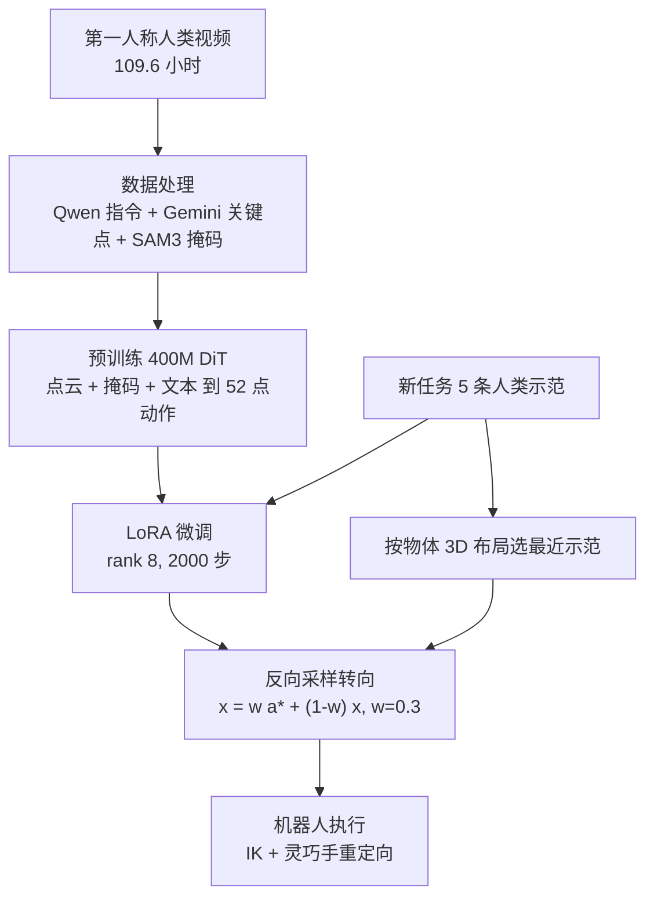

# Steertuning：用几条人类视频给策略「微调 + 转向」

**Steertuning 先在大规模第一人称人类交互视频上预训练一个扩散策略，部署新任务时仅用约 5 条人类示范做 LoRA 微调，并在反向采样的每一步把动作朝与当前场景最相似的那条示范拉近。**

论文 *Steertuning Policies from a Few Human Videos*（[arXiv:2610.18711](https://arxiv.org/abs/2610.18711)，[项目页](https://steertuning.github.io/)）。

## 英文缩写速查

| 缩写 | 英文全称 | 简要说明 |
|------|----------|----------|
| LoRA | Low-Rank Adaptation | 冻结底座、只训低秩适配器；本文 rank 8，2,000 步约 2 分钟 |
| DiT | Diffusion Transformer | 400M 参数的动作去噪骨干 |
| DDIM | Denoising Diffusion Implicit Models | 推理用 8 步确定性采样 |
| SAM | Segment Anything Model | 用于生成物体掩码并从点云去除机器人手臂 |

## 为什么重要

- 机器人示范昂贵，人类第一人称视频便宜；本文把「预训练学通用交互先验、微调 + 采样期转向适配新任务」串成一条 5 分钟内可走完的路径（页面表述）。
- 转向是推理期操作：不再训练即可借用示范的具体空间信息，对新物体布局尤其有用（消融：转向单独只有 2.3/10，但与微调结合到 8.3/10）。
- 评测放在新家庭环境（租来的 Airbnb）而非单一实验室，更接近真实部署。

## 核心信息

| 项 | 内容 |
|----|------|
| **机构** | 纽约大学（New York University，项目页署名） |
| **平台** | YOR 移动底盘 + Wuji 20 自由度灵巧手；Aria Gen 2 眼镜装于机器人头部；其它评测所用机器人页面未命名 |
| **数据** | 109.6 小时 Aria Gen 2 第一人称录像，3.69M 帧，48.7k 条自动指令；新任务 5 条人类示范 |
| **开源** | **宣称将开源**（2026-10-17 核查）：摘要称数据集、权重、代码将发布；项目页 Code / Model 按钮无 URL，无 GitHub / Hugging Face 链接 |

## 核心原理

### 流程总览

- **统一表示：** 动作是 52 个 3D 点（双手各 21 关键点 + 3 腕朝向点，加头部 4 点），点云里的手臂被运动学链遮掉，以此缓解人到机器人的本体差异。
- **转向公式：** 把选中示范动作加噪到当前噪声级后按权重混入样本；w=0.3 是论文图 6 的最佳折中。
- **落地：** 腕部笛卡尔 IK、手部运动学重定向、real-time chunking 平滑。

## 源码运行时序图

**不适用**：截至 2026-10-17 项目页 Code / Model 无链接，不存在可对齐的官方入口。

## 与其他工作对比

| 维度 | Steertuning（本文） | [EgoMimic](./paper-ego-03-egomimic.md) | [EgoWAM](./paper-egowam-egocentric-human-wam-co-training.md) | [Diffusion Policy](../methods/diffusion-policy.md) |
|------|------|------|------|------|
| 人类数据用法 | 约 110 小时 Aria 第一人称视频预训练，新任务仅 5 条人类示范 | Aria 第一视角 + 3D 手部轨迹与机器人遥操数据共训 | 人–机协同训练，替换世界预测目标弥合具身差距 | 通常只用机器人示范 |
| 适配新任务 | LoRA 2 分钟微调 + 采样期向最近示范转向 | 依赖机器人遥操数据共训 | 固定 HPT 骨干与数据混合的受控对比 | 每任务收集示范后训练 |
| 本体差距处理 | 统一 52 点动作表示 + 点云中遮掉手臂 | 页面未详述 | WAM 状态分支（Pixel / DINO / 3D flow） | 不涉及 |
| 推理期机制 | 反向采样每步混入示范动作（w=0.3） | 页面未详述 | 页面未详述 | 标准去噪采样 |

- **相对 EgoMimic：** 同用 Aria 第一人称数据，EgoMimic 需与机器人遥操数据共训；Steertuning 新任务只用人类示范，靠预训练先验 + 转向完成适配。
- **相对 EgoWAM：** EgoWAM 研究"预测什么世界目标"能让人数据随规模起作用；Steertuning 关注少样本部署期适配，二者问题层次不同。
- **相对 Diffusion Policy：** 继承扩散去噪骨干（DiT），差异在于用示范动作在采样期做非训练的转向，消融显示单独转向仅 2.3/10、需与微调组合。
- 各文任务、平台与评测环境不同，成功率不可横比。

## 工程实践

| 项 | 建议 |
|----|------|
| 先看什么 | 示范选择：按物体布局最近邻（8.3/10）明显好于 VINN（5.3）与腕位姿（5.7） |
| 点云编码 | Utonia 8.3 > PTv3 7.7 > PointNeXt 6.0（/10，实验室三任务均值） |
| 解码器 | DiT 8.3 优于 UNet 7.3 |
| 数据管线 | 依赖 Qwen3-VL-8B、Gemini 2.5 Flash、SAM3，自行复现需这些外部模型 |
| 开源状态 | 未发布；入库日期 2026-10-17，后续复查 |

## 实验与评测

- **总体：** 12 个任务、12 个新环境（9 个 Airbnb + 3 个实验室）成功率 71%。
- **实验室 Trash / Flower / Bread（各 10 次）：**

| 流水线 | Trash | Flower | Bread | 均值 |
|--------|-------|--------|-------|------|
| Steertuning | 9 | 7 | 9 | 8.3 |
| 仅 steering | 2 | 2 | 3 | 2.3 |
| 微调 2k 步 | 0 | 0 | 0 | 0 |
| 微调 150k 步 | 7 | 8 | 8 | 7.7 |

- **物体泛化（项目页）：** 浇花 7/10（原水壶）、6/10（换水壶）；玩具抓放 10/10 与 9/10。
- **口径注意：** 微调 150k 步在表格里写 150k，正文写 128k（原文不一致）；总体 71% 的 12 任务清单正文只点名了部分。

## 结论

**Steertuning 的收益来自「少量微调给出任务技能 + 采样期转向给出场景具体位置」的组合，任一单项都明显不足。**

1. **组合才有效** — 仅微调 2k 步为 0/10，仅转向 2.3/10，合用 8.3/10。
2. **接近大训练预算** — 2 分钟微调的结果（8.3）略高于 150k 步全量微调（7.7），这是推测为预训练先验的作用，论文未单独验证。
3. **示范选择是关键旋钮** — 物体布局最近邻比 VINN、腕位姿高约 2.6–3.0/10。
4. **跨环境读法** — 71% 是 12 环境平均，单任务差异大，Airbnb 任务清单未全部披露。
5. **复现未就绪** — 权重与代码仅"将发布"。

## 局限与风险

- 数据与模型未发布，无法独立验证。
- 实验室三任务每项仅 10 次试验，方差大。
- 外部大模型（Gemini、Qwen、SAM3）在数据管线与整机规划中均有依赖。
- 机器人除 YOR + Wuji 外未命名；跨本体结论（未核实）。

## 关联页面

- [扩散策略](../methods/diffusion-policy.md) — 动作去噪骨干
- [模仿学习](../methods/imitation-learning.md) — 示范驱动适配
- [LoRA](../concepts/lora.md) — 轻量微调
- [基础策略](../concepts/foundation-policy.md) — 预训练 + 适配范式
- [EgoWAM](paper-egowam-egocentric-human-wam-co-training.md) — 另一条第一人称人类数据路线

## 参考来源

- [steertuning_arxiv_2610_18711.md](../../sources/papers/steertuning_arxiv_2610_18711.md) — 论文摘录与开源核查
- [steertuning-project.md](../../sources/sites/steertuning-project.md) — 项目页归档
- [arXiv:2610.18711](https://arxiv.org/abs/2610.18711) — 原文

## 推荐继续阅读

- [Steertuning 项目页](https://steertuning.github.io/)
- [Awesome Egocentric Vision](awesome-egocentric-vision.md)
