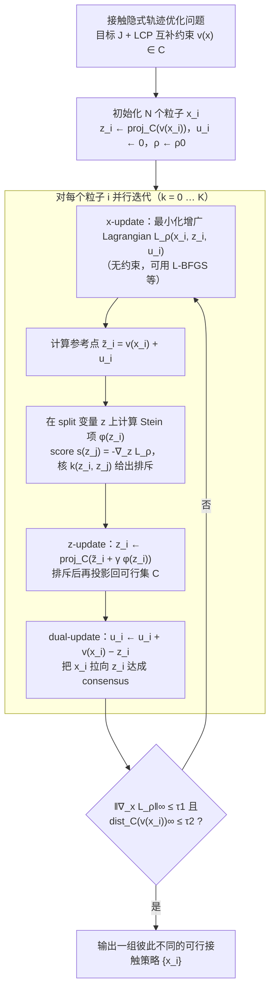

# Stein-ADMM（arXiv:2609.28299）

**Contact-Implicit Stein Projected ADMM for Discovery of Diverse Contact-Rich Manipulation Strategies**（[项目页](https://anon-website-submission.github.io/stein-admm-website/)，[arXiv:2609.28299](https://arxiv.org/abs/2609.28299)）来自 [具身智能小站 · 13 篇盘点](../../sources/blogs/wechat_embodied_13_papers_forgetmimic_2026-09-24.md)（2026-09-24）。

## 一句话定义

**接触隐式 TO 易陷单一局部接触模式；Stein 排斥力加在 ADMM 分裂变量上可发现 **多样** 抓取/推/交接策略。**

## 英文缩写速查

| 缩写 | 英文全称 | 简要说明 |
|------|----------|----------|
| VLA | Vision-Language-Action | 视觉–语言–动作策略 |
| RL | Reinforcement Learning | 强化学习 |
| TO | Trajectory Optimization | 轨迹优化 |
| HITL | Human-in-the-Loop | 人在回路 |

## 为什么重要

- 接触丰富任务常有多条同等可行接触模式；单解优化对初始化敏感且缺乏重规划余量。
- 纳入 [13 篇技术地图](../overview/embodied-13-papers-technology-map.md) 阅读坐标。
- 开源结论（步骤 2.5，2026-09-24）：**待发布**。

## 流程总览

图依据：论文 §IV（Stein Projected ADMM，Eq. 12–16）与 Algorithm 1、Fig. 2。

## 核心机制

| 项 | 内容 |
|----|------|
| **arXiv** | [2609.28299](https://arxiv.org/abs/2609.28299) |
| **开源** | **待发布** |
| **要点** | SVGD 式排斥只作用于 split variable z，再精确投影到可行集；x-update 追踪已可行且多样的目标。 |
| **文内指标** | 推箱、Allegro 抓取、多机 handover 等；N=512 粒子覆盖可行集（文内图/视频）。 |

## 源码运行时序图

**不适用**（截至 2026-09-24 项目页/论文未提供可运行官方代码；开源状态：**待发布**）。

## 实验与评测

- 推箱、Allegro 抓取、多机 handover 等；N=512 粒子覆盖可行集（文内图/视频）。
- **读法：** 公众号归纳；逐项 baseline 与协议以 arXiv PDF 为准。

## 与其他工作对比

- 横向索引见 [13 篇技术地图](../overview/embodied-13-papers-technology-map.md)。

## 结论

**多样性应进 split 变量而非与约束抢同一更新** — 代码待匿名审稿后跟进。

1. 开源边界：**待发布** — 以项目页/仓库实际链接为准（入库日 2026-09-24）。
2. 核心机制：SVGD 式排斥只作用于 split variable z，再精确投影到可行集；x-update 追踪已可行且多样的目标。…
3. 部署前核对任务协议与硬件条件，勿直接横比公众号摘录数字。

## 关联页面

- [Trajectory Optimization](../methods/trajectory-optimization.md)
- [Contact Dynamics](../concepts/contact-dynamics.md)
- [Manipulation](../tasks/manipulation.md)
- [Embodied 13 Papers Technology Map](../overview/embodied-13-papers-technology-map.md)

## 参考来源

- [13 篇盘点（公众号）](../../sources/blogs/wechat_embodied_13_papers_forgetmimic_2026-09-24.md)
- [Contact-Implicit Stein Projected ADMM for Discovery of Diverse Contact-Rich Manipulation Strategies](../../sources/papers/stein-admm-contact_arxiv_2609_28299.md)
- [arXiv PDF](https://arxiv.org/pdf/2609.28299)：已通读方法部分（实验与附录以略读为准）：摘要、§I 引言、§III 预备知识、§IV Stein Projected ADMM（含 Algorithm 1）、§V-A/B 结果（略读其余实验与附录）

## 推荐继续阅读

- [arXiv:2609.28299](https://arxiv.org/abs/2609.28299) — 原文
