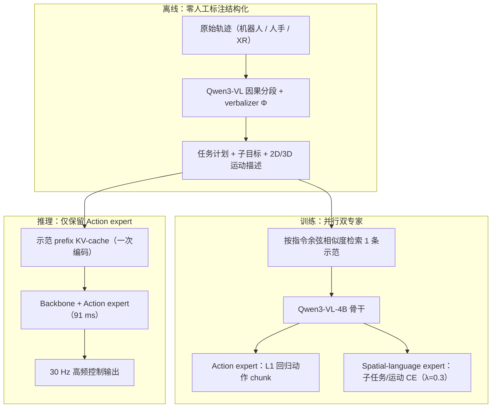

# StellaVLA（结构化 In-Context 示范 · VLA）

**StellaVLA**（*In-Context Structured Demonstration for Generalizable Vision-Language-Action Models*，[arXiv:2608.11671](https://arxiv.org/abs/2608.11671)，[StellarEdge 博客](https://stelledge.com/blog/stellavla)，[VLA-Arena 排行榜](https://vla-arena.github.io/#leaderboard)）由 StellarEdge AI Technical Team 发布（Siyu Xu、Yunke Wang、Zijian Wang、Dihao Zhu、Chenghao Xia、Chengbin Du、Daochang Liu、Tao Huang、Chang Xu），提出面向视觉-语言-动作（VLA）模型分布外（OOD）适应的 **结构化上下文示范（In-Context Structured Demonstration）** 框架。

## 一句话定义

**把单次检索示范从「原始轨迹堆叠」升级为「可读的程序结构」：离线自动抽取子目标与 2D/3D 运动语义，训练时双专家内化推理，部署时零梯度、无语言解码开销地适应 OOD 操作。**

## 英文缩写速查

| 缩写 | 英文全称 | 简要说明 |
|------|----------|----------|
| VLA | Vision-Language-Action | 视觉-语言-动作统一策略 |
| ICL | In-Context Learning | 测试时不更新权重，靠上下文示范适应 |
| ICIL | In-Context Imitation Learning | 用检索示范作前缀的模仿学习框架 |
| OFT | Optimized Fine-Tuning | OpenVLA-OFT 风格轻量残差 MLP action head 微调 |
| OOD | Out-of-Distribution | 场景/视角/物体分布外泛化 |

## 为什么重要

- **ICL 表征升级：** 相对 [BPP](./paper-behavior-prompting-policy.md) 等「原始 sensorimotor 示范作 prompt」，StellaVLA 显式编码 **why（子目标）** 与 **how（2D/3D 运动 verbalization）**，缓解 OOD 下的 behavioral inertia。
- **推理效率：** 与需要每步自回归生成推理文本的 CoT-VLA 不同，**推理移除 spatial-language expert**，示范前缀只做一次 KV-cache；模型侧延时 **88–91 ms**（真机总流水线约 **205 ms/chunk**，对比解码 83 tokens 需 **3177 ms**）。
- **跨具身 context：** 机器人遥操作、纯人手视频或 XR 重定向示范均统一转化为同一文本结构并参与检索，而底层可执行动作仅在目标机器人控制空间监督——与 [Zero-WAM](./paper-zero-wam.md) 的合成人视频规格、[WAM-TTT](./paper-wam-ttt-human-video-test-time-steering.md) 的快权重记忆形成机制对照。

## 核心信息

| 项 | 内容 |
|----|------|
| **团队 / 作者** | StellarEdge AI Technical Team（Siyu Xu, Yunke Wang, Zijian Wang, Dihao Zhu, Chenghao Xia, Chengbin Du, Daochang Liu, Tao Huang, Chang Xu） |
| **出处** | arXiv:2608.11671v1（2026-08-12；技术日期 2026-08-01） |
| **骨干与动作头** | Qwen3-VL-4B-Instruct + 两层残差 MLP action expert（仿真 chunk `H=8`，真机 `H=16`、30 Hz 下执行前 8 步滚动重规划） |
| **开源状态** | **未开源（2026-11-19 再核）**：arXiv 全文与 VLA-Arena 页未公布官方 GitHub 仓或权重；对比基线 StarVLA-OFT 基于 [arXiv:2604.05014](https://arxiv.org/abs/2604.05014) |

## 核心原理

### 核心结构与方法栈

| 模块 | 作用与关键设计 |
|------|----------------|
| **离线结构化管线** | 利用 Qwen3-VL 因果推断自动分段（零人工标注），再经确定性 verbalizer `Φ(A_t)` 生成：全局任务计划 + 段级子目标 `s_t` + 3D 相对位移/夹爪变化与 2D 相机投影路径（人手/XR 亦映射到同一空间） |
| **检索对齐构造** | 以文本嵌入余弦相似度检索单条同任务结构化示范（`P_demo ⊕ I ⊕ o_t`）；真机可直接在机器人示范、人手视频、XR 重定向三种来源间做上下文迁移 |
| **Qwen3-VL-4B 骨干** | 联合编码当前双视角图像（第三人称 + 腕部 RGB）、语言化的本体状态、任务指令与检索前缀 |
| **Action expert** | OpenVLA-OFT 风格两层残差 MLP，采用 `L1` 回归输出连续动作 chunk，并共享主干视觉-语言表征 |
| **Spatial-language expert** | 训练期用交叉熵（`λ=0.3`）同步监督当前子任务 `s_t` 与对应动作块的 2D/3D 运动文本；**推理阶段完全移除** |

### 流程总览

## 实验与评测

| 基准 | StellaVLA 要点 | 强基线对照 |
|------|----------------|------------|
| **LIBERO** | 平均 **98.8%** SR（Spatial 99.6 / Object 99.0 / Goal 99.6 / Long 96.8） | StarVLA-OFT **96.6%**（同骨干无 structured context；Goal **+3.4**、Long **+3.0**） |
| **VLA-Arena（2026-08-01 榜）** | Overall **0.63**；L0/L1/L2 均值 **0.84 / 0.62 / 0.43**（Long Horizon L1=0.02、L2=0.00） | π0.5 **0.44**；LingBot-VLA **0.22** |
| **LIBERO-Plus（零样本）** | 平均 **85.1%** SR（Camera +23.5 / Noise +19.7 / Robot +14.7 / Lang +8.3 / Layout +0.1） | StarVLA-OFT **75.0%** |
| **AgileX Piper 真机 OOD** | 125 条机器人样本 + 26 组人手/XR 示范：ID **85.0%**、OOD-L1 **75.0%**（仅降 5 pt）、OOD-L2 未见抽屉得分 **1.9/4** | StarVLA-OFT（OOD-L1 掉 25 pt，L2 **1.1**）；π0.5（OOD-L1 掉 20 pt，L2 **1.5**） |
| **三向干预（LIBERO 均值）** | 正确示范 **98.8** / 无示范 **62.4** / 错误示范 **44.9**（Goal 维度骤降至 99.6 / 24.8 / 0.0） | 错误明显低于无示范，证明策略 **主动读取** 上下文而非忽略 |
| **模态与关键帧消融** | Text-only **98.8 / 84.4** 显著高于 Image-only **92.9 / 75.7**；关键帧 3/5/8/10 对应 98.1/98.2/98.3/98.8 | 证明可迁移核心信号在结构化文本运动描述而非像素帧堆叠 |

**消融补充（Table 2–4）：** 去掉 3D 运动 verbalization 使 LIBERO 均值降至 **97.8%**；去掉 2D 投影路径降至 **97.3%**（2D 图像空间锚点对视觉 grounding 更敏感）。Cross-Source Consistency 实验表明加入结构化示范后，同任务机器人/人手/XR 不同提示引发的动作标准差由 `0.0041–0.0045σ` 收敛至 `0.0014–0.0016σ`。语言辅助权重 `λ=0.3` 兼顾 ID 98.8% 与 OOD 85.1%，而 `λ=0` 时 LIBERO-Plus OOD 可达 **86.9%**（ID 降为 97.6%）。

## 与其他工作对比

| 路线 | 适应机制 | 示范形态 | 与 StellaVLA 差异 |
|------|----------|----------|-------------------|
| **StellaVLA** | 纯 ICL，权重不变 | 结构化计划 + 子目标 + 2D/3D 运动（1 条检索前缀） | 本页 |
| [BPP](./paper-behavior-prompting-policy.md) | 纯 ICL | 原始人类示范 sensorimotor prompt | 缺少离线抽取的 why/how 程序结构与语言辅助监督 |
| [ICI-VLA](./paper-ici-vla-spatiotemporal-icl.md) | 纯 ICL | 子任务 micro-demo + DTW 相位检索 | 对齐机制在时空片段检索而非 2D/3D 文本 verbalization |
| [RoboTTT](./paper-robottt-test-time-training-vla-context.md) | TTT fast weights | 机器人 visuomotor 流 / 人视频 prefix | 部署期写快权重（需梯度），擅长 8K 步超长历史纠偏 |
| [Zero-WAM](./paper-zero-wam.md) | WAM 纯 ICL | 合成人类视频任务规格 | 视频-动作联合生成模型，代码/权重已开 |

## 结论

**StellaVLA 把机器人 ICL 从「模仿像素轨迹」推进到「模仿可读的程序结构」：结构化示范加训练期空间语言辅助监督显著提升 OOD 鲁棒性，部署时仅靠 KV-cache 示范前缀即可零梯度保持高频控制，无需测试时梯度更新。**

1. 驱动泛化增益的核心是 **结构化语义内容**（子目标与 2D/3D 运动文本），而不是简单拼接原始视频帧；wrong-task 示范会把成功率拉低至 44.9%，证实模型真在依赖上下文。
2. 相对同骨干 StarVLA-OFT，增益集中在 **Goal / Long / 视角与外观扰动**——当前帧不足以唯一确定子目标或视角已偏离训练分布时，结构化前缀最有价值。
3. **VLA-Arena Long Horizon L1/L2 仍近零（0.02 / 0.00）**：固定单条检索 prefix 能传递任务程序，但执行中途状态大幅漂移后缺乏闭环自重规划能力。
4. 若追求更高 OOD 迁移表现可调低 `λ`（论文表 3 显示 `λ=0` 在 LIBERO-Plus 达 86.9%），同时推理务必剥离语言专家并打开 prefix KV-cache（91 ms vs 3177 ms）。
5. 截至 `2026-11-19` 无官方代码与权重放出；复现评估可借助开源基准 **VLA-Arena** 与社区对照基线 **StarVLA**，避免与官方闭源实现混同。

## 源码运行时序图

**不适用** — 截至 `2026-11-19` 再次核查 `arXiv:2608.11671v1` 全文、StellarEdge 博客与 VLA-Arena 页面，均未提供 StellaVLA 可运行官方代码仓或模型权重；论文中引用的社区代码为对照基线 StarVLA（[arXiv:2604.05014](https://arxiv.org/abs/2604.05014)），非本方法实现。

## 工程实践

| 项 | 内容 |
|----|------|
| **训练超参** | Qwen3-VL-4B-Instruct 全参微调 30k steps，global batch 128；存在同任务示范时 context dropout 为 `0.0`，否则以 `0.5` 随机屏蔽；辅助头权重 `λ=0.3`（侧重 OOD 可测试 `λ=0`） |
| **真机控制与输入** | AgileX Piper CAN 总线 30 Hz 运行，`H=16` chunk 每次执行前 8 步；输入含第三人称 + 腕部 RGB 与语言化关节/末端状态 |
| **前缀 KV-cache** | 每个任务回合开始前把检索到的结构化示范编码入 KV-cache，后续每步只送入实时视觉与状态（模型延时由 183 ms 降至 91 ms） |
| **选型参考** | 桌面操作存在相机/外观 OOD 且允许检索 1 条同任务结构化示范时适用；若长程执行中需在线失败恢复，宜结合 [RoboTTT](./paper-robottt-test-time-training-vla-context.md) 或 DAgger |

## 局限与风险

- **同任务示范检索假设：** 若完全没有对应新任务的机器人/人手/XR 示范供检索或结构化提取失败，性能显著回落（无示范 LIBERO 均值降至 62.4%）。
- **强布局扰动改善有限：** 在 LIBERO-Plus Layout 轴上仅较 StarVLA-OFT 提升 `+0.1`，且 VLA-Arena Long Horizon L1/L2 仍近乎失败（0.02 / 0.00）。
- **依赖离线 VLM 质量：** 子目标切分精度和 2D/3D 投影准确率直接决定前缀信噪比；错误标注会被策略在上下文中忠实执行。
- **尚未开源：** 缺乏官方仓库与检查点，跨论文对照需警惕基线调参或评测环境细节差异。

## 与其他页面的关联

- [机器人 In-Context Learning](../concepts/robot-in-context-learning.md) — 真 ICL vs TTT vs 映射选择 taxonomy
- [VLA](../methods/vla.md) — 长程记忆与部署期适应分支
- [模仿学习（Imitation Learning）](../methods/imitation-learning.md) — 单次检索模仿学习演进
- [Manipulation](../tasks/manipulation.md) — OOD 桌面操作与 VLA-Arena 评测语境
- [BPP](./paper-behavior-prompting-policy.md) — 原始示范 prompting 对照
- [ICI-VLA](./paper-ici-vla-spatiotemporal-icl.md) — 时空相位对齐检索 ICL 对照
- [RoboTTT](./paper-robottt-test-time-training-vla-context.md) — 层内 TTT 上下文 scaling
- [Zero-WAM](./paper-zero-wam.md) — 人类视频作 WAM 任务规格
- [四路线对比（WAM-TTT / RoboTTT / StellaVLA / Zero-WAM）](../comparisons/wam-ttt-robottt-stellavla-zero-wam-embodied-icl.md)

## 参考来源

- [StellaVLA 论文摘录（arXiv:2608.11671）](../../sources/papers/stellavla_arxiv_2608_11671.md)
- [VLA-Arena 站点归档](../../sources/sites/vla-arena.md)
- [每日智能四篇 ICL 纵横向解读（2026-08-31）](../../sources/blogs/wechat_meiri_zhineng_embodied_icl_four_papers_2026-08-31.md)
- [多模态与 VLA 周报（2026-08-10）](../../sources/blogs/wechat_duomo_vla_weekly_trends_2026-08-10_part2.md)

## 推荐继续阅读

- 论文 PDF：<https://arxiv.org/abs/2608.11671>
- StellarEdge 博客：<https://stelledge.com/blog/stellavla>
- VLA-Arena 基准与榜单：<https://vla-arena.github.io/>
