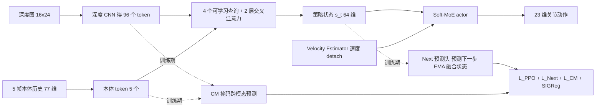

# STEP：显式预测时空训练的感知式人形运动（arXiv:2611.08097）

**STEP**（*Spatiotemporal Training with Explicit Prediction*，[arXiv:2611.08097](https://arxiv.org/abs/2611.08097)，v1，2026-11-05）。作者来自中国科学技术大学、松延动力（Noetix Robotics）、北京化工大学、国防科技大学（论文首页脚注）。

## 一句话定义

**STEP 是一个单阶段框架：用多个可学习查询把深度与本体感知聚合成紧凑策略状态，并在与 PPO 联合训练时，用双向掩码跨模态预测和动作条件下一状态预测共同监督该状态；预测只在训练期使用，部署时直接推理。**（摘要、I 引言）

## 英文缩写速查

| 缩写 | 英文全称 | 简要说明 |
|------|----------|----------|
| STEP | Spatiotemporal Training with Explicit Prediction | 本文框架 |
| CM | Cross-Modal prediction | 掩掉一种模态，用另一种预测其 EMA 教师潜特征（III-C） |
| Next | Action-conditioned next-state prediction | 由 s_t 与动作预测下一步融合状态（III-C） |
| EMA | Exponential Moving Average | 教师网络权重滑动平均，系数 0.99 / 0.01（式 12） |
| SIGReg | Sketched Isotropic Gaussian Regularization | 防潜表征塌缩的正则，引自 LeJEPA（III-C） |
| PPO | Proximal Policy Optimization | 策略优化算法 |
| AMP | Adversarial Motion Prior | 对抗运动先验，作风格奖励（式 3） |
| MoE | Mixture of Experts | actor 用稠密 Soft-MoE，4 个专家（III-A） |
| SR / TR | Success Rate / Traversal Rate | 到达目标距离的比例 / 归一化通过距离（IV-A） |
| L5 / L6 / L8 | Curriculum Level 5 / 6 / 8 | 地形课程难度档（IV） |

## 为什么重要

- **作者的论点（自述）：** 感知式人形运动里，地形几何是否相关取决于机身状态与动作；只做特征融合没有规定该学哪些跨模态关系，同时刻观测之间的预测又没有约束动作驱动的演化（摘要、I）。
- **做法上的取舍：** 不另做表征预训练，预测头与教师只在训练使用，部署时仍是「编码器 + 速度估计 + actor」（贡献 1、III-A「Deployment interface」）。
- **证据：** 仿真多地形整体均值 95.17%（Table III）；一步深度延迟下五类地形都领先消融（Table V）；Noetix E1 实机 98/100（Table VI）。
- **我的判断：** 论文把「多查询聚合」与「预测目标」拆开做了消融（Table III、V），这是它最有信息量的部分；但所有仿真对比均为作者自己的变体，没有与已发表的外部系统在同一环境里比（见局限）。

## 核心机制

### 流程总览

### 方法栈（按论文章节）

1. **接口（III-A，式 1、4）：** 控制周期 0.02 s；输入 5 帧 × 77 维本体（指令 3、角速度 3、roll/pitch 2、关节位置 23、关节速度 23、上一动作 23）与处理后的 16×24 深度图（0.3–2.0 m 以外置零）；相机周期 0.015 s，与控制周期不同步。actor 输入 144 维 = 当前本体 77 + 速度 3 + 融合状态 64，输出 23 维；动作裁剪到 [-18, 18] 后转为关节位置目标。
2. **多查询聚合（III-B，式 5，Table I）：** 4 个与输入无关的可学习查询、2 个残差交叉注意力块（各 4 头），对 5 个本体 token + 96 个深度 token 的联合上下文取注意力，平均得 64 维 s_t。
3. **CM（式 6）：** mask-depth 只读本体 token 得 s^{-d}，mask-proprio 只读深度 token 得 s^{-p}，分别回归 EMA 教师的深度投影（2×2 池化后 4×32）与本体投影（32）；各路共享融合权重与查询 Q0。
4. **Next（式 7–9）：** g_φ 以 [s_t, sg(a_t)] 预测下一步教师融合状态（教师在未投影的 64 维空间，87→64→64，GELU）。
5. **总损失（式 11）：** L_PPO + α_k·L_Next + L_CM + 0.02·R_modal + 0.005·R_joint；α_k 在前 200 次迭代线性升到 0.1。
6. **奖励（式 3，Table II）：** 任务奖励 ×0.8 加 AMP 风格项 ×0.16，critic 用特权信息训练。
7. **速度估计（式 2）：** 沿用 Long 等人的 Velocity Estimator 思路，单独优化，仅给 actor 一个 detach 的速度。

### 关键数字（均来自论文）

| 项 | 数值 | 出处 |
|----|------|------|
| 仿真整体均值（16 项 SR/TR 平均） | STEP 95.17；w/o Prediction 91.02；w/o Multi Query 69.98；Proprio-Query 86.17 | Table III |
| STEP 踏脚石 SR（L5 / L8） | 93.80 / 74.90 | Table III |
| STEP 下楼梯 SR（L5 / L8） | 99.76 / 95.46 | Table III |
| 一步（20 ms）深度延迟，STEP vs w/o CM（沟隙） | 96.8 vs 23.5 | Table V |
| 一步深度延迟，踏脚石 STEP / w/o CM / w/o Next / Fusion-only | 88.6 / 0 / 54.1 / 0 | Table V |
| 持续深度丢帧，沟隙与踏脚石（四个变体） | 全部 0 | Table V |
| 实机成功 / 试验 | 楼梯 20/20；平台 20/20；沟隙 18/20；踏脚石 20/20；倒走台阶 20/20，共 98/100 | Table VI |
| 融合方式 SR（延迟取 p50，近似读图） | STEP 94.25%；Prop+LearnedQuery 90.13%；ProprioQuery 84.43%；SelfAttn 73.26%；Concat 63.02% | Fig. 3(a) |

## 实验与评测

- **仿真（IV-A）：** Isaac Lab + RSL-RL（PPO），2048 并行环境，沟隙 / 上楼梯 / 下楼梯 / 踏脚石各取课程 L5 与 L8；SR = 到达「地图一半长度」的比例，TR = 归一化通过距离。作者称 STEP 总均值最高、在难的下楼梯与踏脚石上差距更明显，但「并不在每一项指标上领先」——例如 L8 上楼梯的 TR，w/o Prediction 为 93.07，高于 STEP 的 92.95（Table III）。
- **聚合分析（IV-B，Fig. 3）：** STEP 与 Concat 在 SR–延迟 Pareto 前沿上；Concat 延迟最低，STEP 成功率最高。移除单个查询的影响随地形而异（如去掉 q1 对平台与上楼梯降幅最大，去掉 q2 对踏脚石与下楼梯），作者明确说不给每个查询赋予唯一语义。
- **退化视觉（IV-C，Table V，L6）：** 「持续深度丢帧」指整个评测期冻结最后一帧；「深度延迟」指使用前一控制步的深度。延迟下 w/o CM 在沟隙与踏脚石损失最大，w/o Next 在踏脚石上明显下降（54.1），两者在下楼梯都下降到 65 左右。作者据此称两个预测目标互补。
- **实机（IV-D）：** Noetix E1（23 自由度，机载 IMU、关节编码器、机身深度相机俯仰 60°），每任务 20 次、无人工干预，成功要求通过并稳定站立；倒走台阶为 15 cm、一次含完整上与下，用来说明后方无视野也能走（图 4 展示一次「先碰脚后无碰撞」的序列）。

## 结论

**STEP 的主要价值在于把「多查询聚合」与「两类训练期预测目标」拆开验证：在一步深度延迟下它明显更稳，部署成本不增；但对比对象全是作者自己的变体或重实现，持续丢帧下不连续地形仍全部失败。**

1. **真正该看的是退化视觉下的不连续地形：** 一步深度延迟时踏脚石 STEP 88.6，w/o CM 与 Fusion-only 为 0（Table V）；这比整体均值 95.17 对 91.02（Table III）更能说明预测目标的作用。
2. **多查询聚合是最大单项贡献：** 去掉后整体均值降到 69.98（Table III），融合方式比较中 Concat 仅 63.02%（Fig. 3(a)）。
3. **部署零额外开销：** 预测头与 EMA 教师只在训练期使用，上机仍是「编码器 + 速度估计 + actor」（III-A）；推理延迟 STEP 高于 Concat，但处于 Pareto 前沿（Fig. 3(a)）。
4. **持续深度丢帧是硬上限：** 沟隙与踏脚石全部为 0（Table V），上线需另有视觉失效检测或安全降级，不能指望表征预测兜底。
5. **实机按可行性读：** Noetix E1 共 98/100，失败集中在 70 cm 沟隙（18/20，Table VI）；每项 20 次、无实机基线对照。
6. **复现需自建：** 论文未给代码、种子数与置信区间，引用数值时应注明为单一实现的作者报告。

## 与其他工作对比

论文的对比全部在同一 Isaac Lab 环境内完成，对象是作者自己的变体与重实现，而非外部发布系统：

| 对照 | 论文结果 | 说明 |
|------|----------|------|
| Proprio-Query（参照 [AME-2](./paper-notebook-ame-2-agile-and-generalized-legged-locomotion-vi.md) 与 CReF 的实现） | 整体均值 86.17 对 STEP 95.17（Table III） | 作者重实现，不能当作对原方法的结论 |
| 融合方式 Concat / SelfAttn / ProprioQuery / Prop+LearnedQuery | 63.02% / 73.26% / 84.43% / 90.13% 对 STEP 94.25%（Fig. 3(a)，读图近似） | Concat 延迟最低，STEP 成功率最高 |
| 去掉预测（w/o Prediction）、去掉 CM / Next | 见 Table III、V | 用于说明两个预测目标互补 |

方法来源上，防塌缩正则 SIGReg 取自 [LeJEPA](./paper-lejepa.md)，速度估计沿用 Long 等人的 Velocity Estimator 思路（III-A、III-C）；与 [AME](./paper-ame-attention-based-map-encoding.md) 一类以注意力编码地图的工作相比，STEP 的差异在于额外用掩码跨模态预测与动作条件下一状态预测监督融合状态（摘要、I）。

## 工程实践

- **部署形态：** 预测头、EMA 教师全部不上机；部署需保持与训练一致的关节顺序、观测预处理与动作缩放（III-A「Deployment interface」）。
- **输入形状：** 展平的 5 帧本体 [B,385] 与深度图 [B,384]，输出 23 维原始动作（III-A）。
- **训练要点：** PPO 每环境 24 步 rollout、5 epoch、4 minibatch，价值系数 1、熵系数 0.01、clip 0.2；SIGReg 256 个随机方向（Table I）。每个 minibatch 最多采样 64 个观测算掩码损失与正则，时间预测最多 64 对（III-A）。
- **相机与控制异步：** 相机 0.015 s，控制 0.02 s，不假设同步更新（III-A）；这与后文「一步延迟」实验的设定相呼应。
- **关联实践页：** 同一平台的开发资料见 [松延动力 E1 实验室](./cn-os-noetix-e1-lab.md)。

## 局限

**论文自己承认的：**

- 持续深度丢帧下，所有评测配置在不连续地形（沟隙、踏脚石）上都失败；作者将其列为遗留限制（IV-C、V）。
- 预测只做一步；后续工作计划延长预测视野并引入时间记忆（V）。
- 实机沟隙 18/20，作者指出可靠性随任务不同（IV-D）。
- 倒走台阶成功「不能说明在线学习或对未见地形的重建」（IV-D）。

**我看到的未验证之处（推测与判断，非论文所述）：**

- 仿真对比里 Proprio-Query 是作者「参照 AME-2 与 CReF 的实现」，不是原作者代码或同环境复现（IV-A），所以不能当作对这些已发表方法的结论。
- Table III 的 STEP 与 Fig. 3(a) 的 STEP 数值不同（95.17 对 94.25；Proprio-Query 86.17 对 84.43），论文没有说明两处评测集合的差别（推测：地形或课程设置不同）。
- 论文没有给出随机种子数、置信区间或多次训练的方差；SR/TR 的评测回合数只说明了并行环境数 2048。
- 实机只在室内、固定几类地形，每类 20 次；没有与基线在实机上比较，也没有用同一批试验拆分预测目标的贡献。
- Fig. 3(a) 延迟为策略推理 p50，不含感知与控制整环（IV-B 自述）；延迟数值在图中约 0.03–0.15 ms 量级（读图估计）。
- 正文未给出代码、权重或项目页，复现需要自行实现（见源码归档的开源状态）。

## 方法比较补充

- [DKWBC](./paper-dkwbc.md)：同属人形运动控制，但 DKWBC 用显式逆动力学跟踪 + RL 力矩平衡残差；STEP 用深度/本体感知表征训练并通过位置目标控制地形运动，两者在感知输入、执行器接口和目标任务上不同，**不能直接对比成功率**。
- [ForPC](./paper-forpc-cart-pushing.md)：同样涉及步态与平衡，但 ForPC 额外处理双手推车接触力耦合，实机 G1 演示不代表 STEP 的感知式越障指标。

## 关联页面

- [DKWBC：动力学跟踪与平衡解耦](./paper-dkwbc.md)
- [ForPC：推车全身控制](./paper-forpc-cart-pushing.md)
- [人形机器人运动控制](../tasks/humanoid-locomotion.md)
- [楼梯与障碍的感知式运动](../tasks/stair-obstacle-perceptive-locomotion.md)
- [PPO](../methods/ppo.md)
- [AMP 奖励](../methods/amp-reward.md)
- [特权训练](../concepts/privileged-training.md)
- [地形自适应](../concepts/terrain-adaptation.md)
- [Sim2Real](../concepts/sim2real.md)
- [LeJEPA（SIGReg 的出处）](./paper-lejepa.md)
- [AME 注意力地图编码](./paper-ame-attention-based-map-encoding.md)
- [AME-2 精读](./paper-notebook-ame-2-agile-and-generalized-legged-locomotion-vi.md)
- [BeamDojo 精读](./paper-notebook-beamdojo-learning-agile-humanoid-locomotion-on-s.md)
- [感知内部模型（PIM）精读](./paper-notebook-learning-humanoid-locomotion-with-perceptive-int.md)
- [Isaac Lab](./isaac-lab.md)
- [RSL-RL](./rsl-rl.md)
- [松延动力 E1 实验室](./cn-os-noetix-e1-lab.md)

## 参考来源

- [step-spatiotemporal-humanoid-locomotion_arxiv_2611_08097.md](../../sources/papers/step-spatiotemporal-humanoid-locomotion_arxiv_2611_08097.md)（全文通读归档，含与周报说法的逐条核对）
- [arXiv:2611.08097](https://arxiv.org/abs/2611.08097)

## 继续阅读

- [arXiv PDF](https://arxiv.org/pdf/2611.08097)
- [LeJEPA 页面](./paper-lejepa.md)（理解 SIGReg）
- [AME-2 精读](./paper-notebook-ame-2-agile-and-generalized-legged-locomotion-vi.md)（对照 Proprio-Query 的参考实现）
