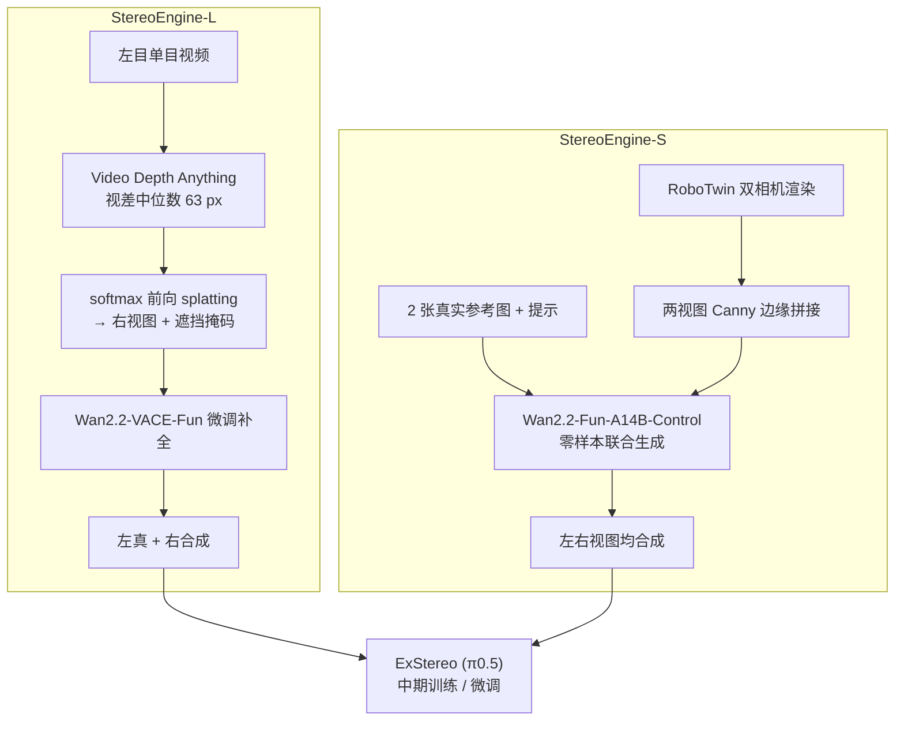

# StereoEngine：没有双目相机也能扩充双目示范

**StereoEngine**（*Scaling Stereo Bimanual Robot Data without Stereo Cameras*，[arXiv:2610.12734](https://arxiv.org/abs/2610.12734)，[项目页](https://stereoengine.github.io/)）来自 **南加州大学（USC）**：针对「机器人数据集绝大多数是单目、真实双目数据稀缺」的问题，给出两条合成双目数据的路线，用来给双目条件策略做中期训练或直接训练。

## 一句话定义

**一路把已有单目演示补成「左真右合成」的双目，另一路在仿真里渲染双目几何再让视频扩散模型生成逼真外观，两路都不需要双目相机。**

## 英文缩写速查

| 缩写 | 英文全称 | 简要说明 |
|------|----------|----------|
| VLA | Vision-Language-Action | 本文下游策略（ExStereo 基于 π0.5，StereoVLA） |
| VACE | Video All-in-one Creation and Editing | Wan2.2-VACE-Fun 视频补全基座 |
| PSNR / SSIM / LPIPS | Peak SNR / Structural Similarity / Learned Perceptual Image Patch Similarity | 立体质量指标 |
| CTC | （论文所用时序一致性指标，全称原文未核实） | 视频时序一致性 |
| StereoEngine-L / -S | Lifting / Simulation | 单目升维路线 / 仿真联合生成路线（缩写含义为依据命名的推测） |

## 为什么重要

- 双目提供显式几何线索，但大规模机器人数据多是单目，策略难直接受益。
- L 路线可把已有单目示范（本文用 3,469 条 PiPER episode）变为立体数据，不需要重新采集。
- S 路线连真实示范也不需要，仿真 200/50/50 条合成数据就把点云基线的 0/20 提到 7–15/20。

## 方法栈 / 流程总览

## 方法

- **L：** Video Depth Anything 逐帧逆深度，缩放到视差中位数 δ₀=63 px（约 7.6% 帧宽）；softmax 前向 splatting（权重 √2^d）warp 出右视图，空洞形成遮挡掩码并略膨胀；Wan2.2-VACE-Fun 经微调补全，warp 视频与掩码同为填充区与控制输入。
- **L 的训练：** 不用任何真实双目对，仅用 3,469 条 PiPER 单目 episode，掩码取自同一前向 warp，δ₀ 在 35–95 px 采样，部分机械臂掩码教模型补机械臂，10% 片段做视差 dropout；训练超参未报告。
- **S：** 在 RoboTwin 里放第二个虚拟相机渲染真双目，两视图转 Canny 边缘并拼成一段视频，加两张真实参考图与文本提示，Wan2.2-Fun-A14B-Control 零样本联合生成两视图，无微调。
- **硬件与策略：** 两只 AgileX PiPER，ZED Mini 2 双目，Meta Quest 2 遥操作；策略 ExStereo（基于 π0.5，L 与 S）与 StereoVLA（仅 S）。

## 源码运行时序图

不适用：论文写明会发布代码，但项目页与 arXiv 页都没有仓库链接，截至 2026-10-12 无可对齐的官方目录与脚本。

## 工程实践

| 项 | 建议 |
|----|------|
| 已有单目数据 | 优先 L 路线做中期训练，再用少量真实双目微调（20–200 条） |
| 缺任何真实数据 | S 路线，需要逐场景设计提示和参考图 |
| 物体材质 | 透明/高反光物体视频扩散易出错，先小规模目检 |
| 深度 | L 继承单目深度误差，深度不稳的场景先排查 |

## 实验与评测

- **立体质量（50 条真实片段）PSNR/SSIM/LPIPS/CTC：** StereoEngine 15.31/0.5304/0.4696/0.9857，SVG 12.83/0.5137/0.5128/0.9752，StereoCrafter 10.50/0.4574/0.6211/0.9807；PSNR 比 SVG 高 2.48 dB。
- **L 策略成功（ExStereo，每任务 20 次；无中期训练 / SVG / StereoCrafter / StereoEngine）：** Stack Two Bowls 9/7/10/13；Lift Transparent Bottles 11/10/13/18；Close Door 16/14/17/19。60 次合计 StereoEngine 50（83.3%）、StereoCrafter 40（66.7%）、无中期训练 36（60.0%）、SVG 31（51.7%）。
- **S 策略成功（20 次/任务）：** 点云基线均 0/20；ExStereo+StereoEngine 11/13/15（Stack Two Bowls / Lift Two Bottles / Container Plate）；StereoVLA+StereoEngine 7/9/11。
- **微调数据：** Stack Two Bowls 200、Lift Transparent Bottles 50、Close Door 20 条真实遥操作示范。

## 结论

**合成双目作为中期训练数据，质量越高下游越有用，但低质量合成（SVG）反而比不做中期训练更差。**

1. L 路线在立体质量上优于 SVG、StereoCrafter，下游成功 83.3% 对 60.0%（无中期训练）。
2. 合成质量差时中期训练有害：SVG 为 51.7%，低于不做中期训练。
3. S 路线可在零真实示范下训出非零成功率（7–15/20），但需手工提示与参考图。
4. 先排查透明、反光物体与深度失败案例，再扩大规模。
5. 范围小：每路线仅 3 个任务，结论外推需谨慎。

## 与其他工作对比

| 对照 | 差异读法 |
|------|----------|
| StereoCrafter / SVG（论文基线） | 通用单目转立体视频方法；StereoEngine 针对机械臂场景微调并在策略层验证 |
| [立体匹配基础模型](../methods/stereo-matching-foundation-models.md) | 站内页：从双目估深度；本文反向，生成双目 |
| [视频即仿真](../concepts/video-as-simulation.md) | 同样用视频生成模型产出训练数据 |
| [生成式世界模型](../methods/generative-world-models.md) | 背景：视频扩散作为数据引擎 |

## 局限与风险

- **开源状态：** 截至 2026-10-12 代码与数据集均未发布（论文承诺发布）；项目页署名 Anonymous Authors。
- 透明/反光物体、深度误差、提示工程、Canny 在远距离更噪。
- 每路线仅 3 个任务；Geometric Reciprocity、StereoPolicy 因无公开代码未对比；ExStereo 在发表时未公开。

## 关联页面

- [34 篇论文空间落地技术地图（汇总页）](../overview/embodied-station-34-papers-spatial-grounding-technology-map.md)
- [双臂操作](../tasks/bimanual-manipulation.md)
- [立体匹配基础模型](../methods/stereo-matching-foundation-models.md)
- [视频即仿真](../concepts/video-as-simulation.md)
- [生成式世界模型](../methods/generative-world-models.md)

## 参考来源

- [34 篇论文盘点（具身智能小站，2026-10-12）](../../sources/blogs/wechat_embodied_station_34_papers_spatial_grounding_2026-10-12.md)
- [stereoengine_arxiv_2610_12734.md](../../sources/papers/stereoengine_arxiv_2610_12734.md) — 论文摘录
- [stereoengine-project.md](../../sources/sites/stereoengine-project.md) — 项目页核查
- [arXiv:2610.12734](https://arxiv.org/abs/2610.12734)

## 推荐继续阅读

- [StereoEngine 项目页](https://stereoengine.github.io/)
- [arXiv HTML 全文](https://arxiv.org/html/2610.12734v1)
