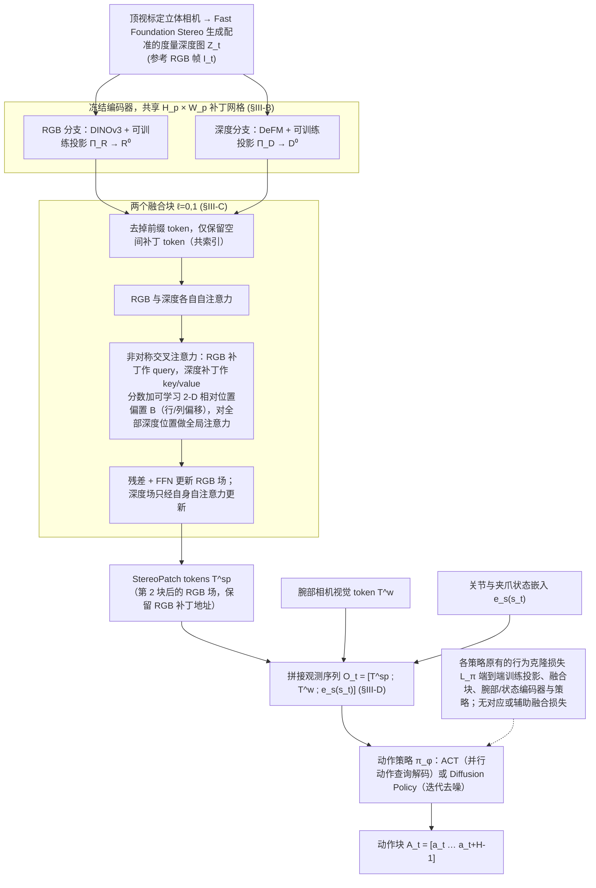

# StereoPatch（arXiv:2609.15509）

**StereoPatch**（*StereoPatch: Patch-Aligned RGB-Depth Fusion for Spatial Perception in Robot Manipulation*，[arXiv:2609.15509](https://arxiv.org/abs/2609.15509)，[项目页](https://aus.bot/research/stereopatch/)，[代码](https://github.com/YananZHOU5555/stereopatch)）来自 [具身智能小站 12 篇盘点](../../sources/blogs/wechat_embodied_station_12_papers_vla_deploy_2026-09-16.md)。

## 一句话定义

**把注册后的度量深度绑定到动作预测所用的 RGB patch，非对称 cross-attention 融合，消解控制相关几何歧义。**

## 英文缩写速查

| 缩写 | 英文全称 | 简要说明 |
|------|----------|----------|
| RGB-D | RGB + Depth | 彩色图与深度融合 |
| Patch | Image Patch | 与策略骨干对齐的图像块 |
| CA | Cross-Attention | 跨模态注意力融合 |
| Sim2Real | Simulation to Real | 仿真到真机 |

## 为什么重要

- 外观相似场景可能因高度/位置/接触几何不同而需不同动作；深度需与策略看的 patch 对齐。
- 开源结论：**部分开源**（步骤 2.5，2026-09-16）。
- 与 [12 篇技术地图](../overview/vla-deploy-12-papers-technology-map.md) 中同类工作可横向对照。

## 流程总览

图依据：论文 §III-A 至 §III-D、Fig. 2 / Fig. 3、式 1–7

## 核心机制

| 项 | 内容 |
|----|------|
| **arXiv** | [2609.15509](https://arxiv.org/abs/2609.15509) |
| **开源** | **部分开源** |
| **要点** | patch 级 RGB–Depth 绑定 + 非对称 cross-attention；仓库入库日以媒体 release 为主。 |
| **文内指标** | RoboMimic 等仿真任务与真机 rollout 视频（项目页）；具体成功率以原文为准。 |

## 源码运行时序图

**部分开源** — 入库日以项目页媒体/权重发布为主；完整训练管线以官方后续更新为准。

## 实验与评测

- RoboMimic 等仿真任务与真机 rollout 视频（项目页）；具体成功率以原文为准。
- **读法：** 清单摘要；逐项对照与 baseline 以原文 PDF 为准。

## 与其他工作对比

- 横向索引见 [12 篇技术地图](../overview/vla-deploy-12-papers-technology-map.md)。

## 结论

**StereoPatch 强调「深度对齐到动作 patch」而非全局早期融合，适合空间感知选型。**

1. 开源边界：**部分开源** — 以项目页实际链接为准（入库日 2026-09-16）。
2. 核心机制：patch 级 RGB–Depth 绑定 + 非对称 cross-attention；仓库入库日以媒体 release 为主。…
3. 部署前核对任务协议与硬件条件，勿直接横比公众号摘录数字。

## 关联页面

- [manipulation](../tasks/manipulation.md)
- [vla](../methods/vla.md)
- [paper-proxidex](./paper-proxidex.md)
- [visuo-tactile-fusion](../concepts/visuo-tactile-fusion.md)

## 参考来源

- [stereopatch_arxiv_2609_15509.md](../../sources/papers/stereopatch_arxiv_2609_15509.md)
- [wechat_embodied_station_12_papers_vla_deploy_2026-09-16.md](../../sources/blogs/wechat_embodied_station_12_papers_vla_deploy_2026-09-16.md)
- [arXiv:2609.15509](https://arxiv.org/abs/2609.15509)
- [arXiv PDF](https://arxiv.org/pdf/2609.15509)：已通读方法部分（实验与附录以略读为准）：§III 方法全部（问题表述、对齐的外观与几何场、检索几何到 RGB 补丁、策略集成）；§IV 开头的实现与对照设定

## 推荐继续阅读

- [arXiv PDF](https://arxiv.org/pdf/2609.15509)
- [项目页](https://aus.bot/research/stereopatch/)
- [https://github.com/YananZHOU5555/stereopatch](https://github.com/YananZHOU5555/stereopatch)

