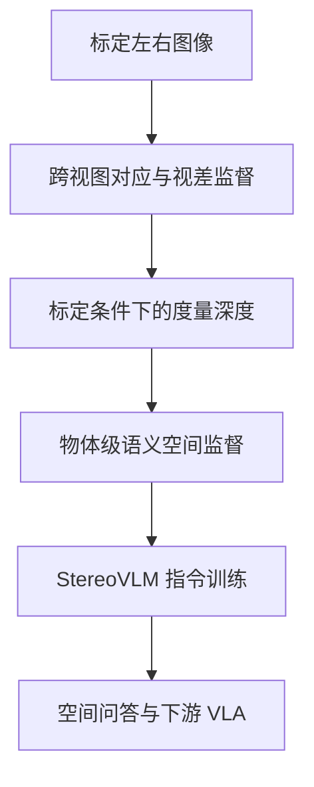

# StereoVLM：度量三维空间推理的双目视觉语言模型（Binocular Vision-Language Models for Metric 3D Spatial Reasoning）

## 一句话定义

利用标定双目和层次几何监督，把跨视图匹配、视差、度量深度与语义空间问答接入视觉语言模型。

## 英文缩写速查

| 缩写 | 英文全称 | 简要说明 |
|---|---|---|
| VLM | Vision-Language Model | 视觉语言模型 |
| VQA | Visual Question Answering | 空间问答监督 |
| VLA | Vision-Language-Action | 下游机器人动作策略 |

## 为什么重要

标定双目几何与视觉语言骨干的空间推理。将其作为可比较的独立研究或工程入口，而不是仅记录热度。

## 核心信息

| 字段 | 内容 |
|---|---|
| 机构 | 香港科技大学、小鹏机器人 |
| 论文 | [arXiv:2611.27915](https://arxiv.org/abs/2611.27915) |
| 日期 | 2026-11-20 |
| 开放状态 | 截至 2026-11-24 项目页 Code / Models 未提供可点击公开链接；未确认公开实现或权重。 |

## 核心原理与流程总览

用左右图像与标定参数建立点级跨视图对应、视差和度量深度监督，再引入语言定位的物体级任务。对整流双目，深度与视差、焦距、基线存在几何约束；模型学习利用双目证据而不是仅凭单图语义猜尺度。Stereo3D-Bench 覆盖点级与物体级共八项任务，并用右视图干预检验真实双目贡献。

以下为已查阅官方资料支持的概念流程，完整原文核对待补。

## 源码运行时序图

不适用：官方项目页未提供可运行代码链接。

## 工程实践

截至 2026-11-24 项目页 Code / Models 未提供可点击公开链接；未确认公开实现或权重。 复现入口与版本依赖见参考来源。本次未执行训练、推理或仿真复现。

## 实验与评测

项目页报告 StereoVLM-8B 深度 δ₁ 95.17%、物体级均分 66.98。匹配的 geometry-only 训练中，未见场景的视差监督深度 δ₁ 74.92%，直接深度监督 45.89%。五个空间基准平均 +3.54 分；相同 GR00T 架构及双目输入设置下 RoboCasa 成功率 38.1%→42.4%。

## 结论

利用标定双目和层次几何监督，把跨视图匹配、视差、度量深度与语义空间问答接入视觉语言模型。 工程选型时应同时验证指标口径及使用边界。

- 保留相机内外参，评估跨设备及未见场景。
- 点级几何和物体级语义指标分开报告。
- 对下游 VLA 采用同架构同输入对照，避免把基座变化混入结果。

## 局限与风险

依赖标定和双目观测，错误外参、遮挡、纹理不足等需单独检查；RoboCasa 为仿真，不是实机泛化证明。代码与权重未确认发布，暂不能完整复现。

**核对状态：** 草稿；完整原文及必要源码尚未通读，不宣称健康度满分。

## 关联页面

- [vla](../methods/vla.md)
- [robocasa](./robocasa.md)
- [相关纵深路线](../../roadmap/depth-vla.md)

- [双目匹配基础模型](../methods/stereo-matching-foundation-models.md) — 跨视图对应与视差估计的几何基础。

## 参考来源

- [papers：stereovlm](../../sources/papers/stereovlm_arxiv_2611_27915.md)
- [sites：stereovlm](../../sources/sites/stereovlm.md)

## 推荐继续阅读

- [论文 HTML](https://arxiv.org/html/2611.27915)
- [arXiv](https://arxiv.org/abs/2611.27915)
- [官方项目页](https://xpeng-robotics.github.io/stereovlm/)
