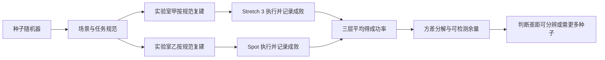

# Stochastic Challenges / KALLAX 基准（arXiv:2611.12804）

*Benchmarking Real-World Robotic Manipulation through Stochastic Challenges*（[arXiv:2611.12804](https://arxiv.org/abs/2611.12804)，波恩大学 / Lamarr / 苏黎世联邦理工 / 微软，CoRL 2026）。原文归档见 [sources 归档](../../sources/papers/stochastic-challenges-kallax_arxiv_2611_12804.md)；项目页 <https://rpl-bonn.github.io/stochastic-challenges/>（论文未给代码仓库）。

## 一句话定义

**不固定真机测试集，而是固定「场景与任务的抽样分布」：各实验室按随机种子复建 KALLAX 货架场景，用成功率加方差分解判断两台机器人的差距是否可分辨。**

## 英文缩写速查

| 缩写 / 符号 | 英文全称 | 简要说明 |
|------|----------|----------|
| KLX / KALLAX | IKEA KALLAX shelf benchmark | 论文的实例基准，基于宜家 3×4 格货架（§4） |
| YCB | Yale-CMU-Berkeley object set | 经典固定物体集；本文把「固定集」推广为「抽样分布」（§1） |
| σ²_seed | between-configuration variance | 场景难度在种子间的方差（§3.2） |
| B | per-task Bernoulli variance aggregate | 单次尝试的成败噪声汇总（§3.2、附录 B） |
| J / K | attempts per task / number of seeds | 每任务重复次数 / 评测种子数 |
| α / 1−β | Type I error / power | 显著性水平 / 检验功效；实验取 0.10 与 0.80（§5.3） |
| δ | true gap to detect | 想分辨的真实成功率差 |
| p | fraction of shared seeds | 两机器人共享种子的比例（§3.4） |
| VLM | Vision-Language Model | 论文展望的自动成功判定手段（§4、§6） |

## 为什么重要

- 真机操作无法用静态数据集评测，仿真又有物理真实性差距；固定物体集（如 YCB）有过拟合风险；集中式比赛要把机器人运到同一地点（§1）。
- 已有分布式真机基准（RoboArena、ManipulationNet）要么限定机器人形态、要么限定任务，且限于桌面场景（§1、§2.2）。本文面向移动操作，允许不同平台比较。
- 把「要多少次试验才算有统计意义」写成可算的规划公式，对任何做真机对比的实验室都有参考价值（作者自述）。

## 核心原理与流程总览

- **成功率估计（§3.1）：** 种子 s 固定一个场景；对每个任务的 J 次重复取平均，再对场景内任务平均，再对 K 个种子平均，得 μ̂。先按种子平均，避免任务多的场景占权重。
- **两种噪声（§3.2）：** Var(μ̂)=(σ²_seed + B/J)/K。J→∞ 时仍有下限 σ²_seed/K，只能靠增加种子数降低。
- **样本量（§3.3）：** 独立种子下每台机器人需 K ≥ 2(z+z)²(σ²_seed+B/J)/δ²，差距 δ 减半、种子数约四倍（§5.3）。
- **共享种子（§3.4）：** 共享比例 p 时方差为 2[(1−p)σ²_seed+B/J]/K；p=1 最省但测试集事先已知，p=0 最能测泛化。
- **KALLAX 随机器（§4）：** 3×4 格，空比例 0.5（6 个空位），余格从至多 82 种插件中抽，门约为抽屉 2.5 倍；物体搜索任务另抽 79 个 YCB 物体；每配置有唯一种子并导出规范与渲染图。
- **网站（§4）：** 生成种子、给装配说明与物体清单、导出任务、记录上报结果以防选择性报告；项目页称新种子须在上一个种子结果提交后才释放（项目页，论文正文未写）。

## 工程实践

- **评测栈（§5.1）：** Stretch 3 用 Stretch-Compose，Spot 用基于 SpotLight 的栈，二者都源自 Spot-Compose；提供环境推理、把手与物体检测、导航与操作。这是模块化自主栈，不是端到端学习策略。
- **任务与判据（§5.1）：** 只评开门与开抽屉，打开至少 10 cm 才算成功；门与抽屉分开分析；部分成功算失败（表 2）。
- **试验量（§5.1）：** 共 568 次。门：Spot 62 次 / 6 种子，Stretch 130 次 / 7 种子；抽屉：Spot 88 次 / 6 种子，Stretch 288 次 / 8 种子。约 150 次 Spot 试验由一人三天完成。
- **复建（§5.1）：** 共享种子场景由同一研究者在两个实验室复建，以控制不同复建团队的差异。
- **重复尝试（§3.1）：** 以重置机器人软件与任务状态近似独立伯努利试验。
- **结果（表 1，同种子 vs 不同子集）：** 抽屉同种子 Spot 92.7% / Stretch 58.1%，门 86.3% / 12.8%；随机种子子集波动大，小样本噪声甚至让排名反转（抽屉 Spot 子集 1 的 65.0% 低于 Stretch 子集 3 的 70.7%，§5.2）。
- **结果（表 2，全部种子）：** 门 0.7109 vs 0.1802，差 0.5307，余量 0.333；抽屉 0.8792 vs 0.6352，差 0.2439，余量 0.232；α=0.10、功效 80%，均「可区分」，抽屉接近判定边界。p=0.5 混合设计余量降为 0.256 与 0.183（§5.3）。Welch 95% 区间：门 23.4–82.8 个百分点，抽屉 4.2–44.6 个百分点（§5.3）。

## 与文章说法的核对

文章（2026-11-11 的 53 篇论文速览，原文片段）：「用随机种子生成任务分布，让不同实验室重建可比较的操作挑战。两类机器人、两个实验室提供实例；仍需区分策略差异、任务抽样波动与人工重建带来的偏差。」标题写「25 跨实验室成功率，先统一任务怎么抽样」。

| 文章说法 | 核对结果 |
|------|------|
| 随机种子生成任务分布，不同实验室重建 | 与论文一致（§1、§4、图 2）。严格说是统一「分布」，而非逐个任务。 |
| 两类机器人、两个实验室 | 一致：Stretch 3 与 Spot，两国实验室（§5.1）。 |
| 真机还是仿真 | 文章未写；论文是真机，568 次试验（§5.1）。 |
| 「策略差异」 | 论文比较的是两套模块化自主栈加不同机身，并非学习策略；二者混在一起，论文没有分离机身与软件的贡献（§5.1）。 |
| 「任务抽样波动」 | 对应 σ²_seed，论文明确量化（§3.2、表 1）。 |
| 「人工重建带来的偏差」 | 论文自认未量化：共享种子由同一人复建，不含不同团队的复建差异（§5.1、§6）。 |
| 未写的限定 | 实验只含开门和开抽屉，不含取物与摆放；论文也不是在评某个操作方法（§5 开头）。结果数字（Spot 高于 Stretch）是演示框架可用，不应读作机器人排名结论（作者自述为基准方法验证，此处为本页判断）。 |
| 项目页与代码 | 论文无代码；项目页给基准网站，源码开放程度未核实。 |

## 局限

- **论文自述（§6）：** 需大量试验才能得到可检测差距；未量化不同团队复建同一配置的差异；依赖诚实且校准的成功上报，建议上传视频、未来用 VLM 自动评测。
- **论文设定（§3.5）：** 假设种子均匀独立抽样、重复尝试为独立伯努利、聚合分数服从正态近似，且需要中心化服务防止选择性报告。σ²_seed 与 B 需先用试点种子估计，式 (1) 只是规划估计。
- **本页观察（均为判断）：** 实验只有 6–8 个种子、两台机器人、两种任务，种子数偏少，正态近似与 Welch 区间在此规模的可靠性论文未检验；Table 1 的「同种子」与 Table 2 的全部种子数值不同（如门 Spot 86.3% 对 71.1%），因为统计范围不同，读表时需分清；项目页称空位概率 0.5，论文称固定选定空位数（空比例 0.5 对应 6 个），两种描述略有出入；附录 D 的逻辑混合效应模型与等价性检验只作为扩展给出，正文结果未报告其输出。
- 性质：这是评测方法 / 基准论文，不提出新的操作算法。

## 关联页面

- [仿真评测与真机评测的差距](../concepts/sim-vs-real-eval-gap.md)
- [运动控制策略评测指标](../concepts/motion-control-policy-evaluation-metrics.md)
- [FurnitureBench（真机家具长程操作基准）](../entities/painode-013-furniturebench.md)
- [LIBERO 基准](../entities/libero-benchmark.md)
- [CALVIN 基准](../entities/calvin-benchmark.md)

## 参考来源

- [stochastic-challenges-kallax_arxiv_2611_12804.md](../../sources/papers/stochastic-challenges-kallax_arxiv_2611_12804.md)
- [arXiv:2611.12804](https://arxiv.org/abs/2611.12804)
- [项目页](https://rpl-bonn.github.io/stochastic-challenges/)

## 推荐继续阅读

- [arXiv PDF](https://arxiv.org/pdf/2611.12804v1)
- [KLX 基准网站](https://klxbench.rpl.uni-bonn.de/)
- [仿真评测与真机评测的差距](../concepts/sim-vs-real-eval-gap.md)
