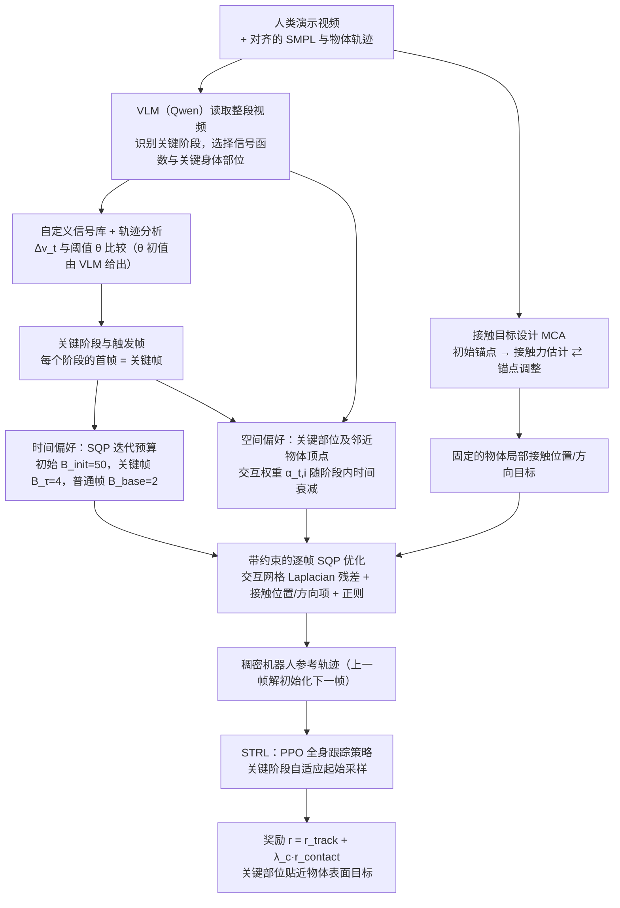

# STR：面向人形移动操作的时空偏好动作重定向

**一句话定义：** STR 把重定向优化重点放在任务关键帧、关键身体部位与物体接触上，再将重定向结果用于人形控制。

## 流程总览

图依据：论文 §III-A–D / Fig.2（STR 与 STRL 总览）。

## 英文缩写速查

| 缩写 | 英文全称 | 简要说明 |
|------|----------|----------|
| STR | Spatiotemporal Retargeting | 本文时空偏好动作重定向方法 |
| VLM | Vision-Language Model | 选择任务相关动作信号与身体部位 |
| MCA | Mechanics-Aware Contact Anchoring | 基于近似物体 wrench 模型的接触锚定 |
| STRL | Spatiotemporal Reinforcement Learning | 关键阶段采样 + 接触奖励的下游控制训练 |
| RL | Reinforcement Learning | 下游控制器训练范式 |

## 核心方法

1. **Spatiotemporal Retargeting：** VLM 选择与任务相关的动作信号和身体部位；信号变化用于定位关键帧，关键帧获得更多求解迭代，相关部位获得更高交互权重。
2. **Mechanics-Aware Contact Anchoring（MCA）：** 用近似物体 wrench 模型调整接触位置，保留指定的物体表面方向，提升几何接触一致性。
3. **Spatiotemporal Reinforcement Learning（STRL）：** 以自适应关键阶段采样和接触奖励训练下游控制器。

## 实验

论文摘要报告 Unitree G1 仿真与 Unitree R1 真机实验。STR 改善接触覆盖与连续性并降低重定向计算成本；生成的参考动作提升了多种物体交互任务的完成表现。具体数字和比较口径应以论文实验表为准。

## 与其他工作对比

- **相对逐帧均匀优化的重定向：** 常规优化对每帧、每个身体部位采用同等权重与迭代；STR 由 VLM 选出任务相关信号后，把迭代预算和交互权重集中到关键帧与关键部位，摘要称因此降低计算成本。
- **相对 [OmniRetarget](./paper-hrl-stack-03-omniretarget.md)：** OmniRetarget 用 interaction mesh 与硬约束保留人—物—环境交互；STR 额外引入时间维度的关键帧偏好，并用近似 wrench 模型锚定接触位置与方向。
- **相对 [Dense Temporal Motion Retargeting](./paper-dense-temporal-motion-retargeting.md)：** 后者联合优化动作与参考相位、调整难段节奏；STR 不改参考节奏，而是改变各帧的求解强度。
- **相对 [Contact-Anchored Retargeting](./paper-contact-anchored-retargeting-residual-dexterous.md)：** 同样以接触为锚，但后者面向灵巧手，STR 面向人形全身移动操作。

## 工程启示

- 人体动作重定向可按任务重要性分配求解预算，避免每帧采用相同优化强度。
- 对物体交互任务，身体关键部位、接触点和接触方向都应作为显式约束核验。
- 重定向质量与下游控制要分开评估：参考轨迹接触更准确，并不自动保证真机任务成功。

## 局限与开放状态

本次核查的 arXiv 页面未列官方项目页或代码链接，因此不据此判断代码是否已开源。摘要未提供完整实验数据，量化结论需回到论文表格核对。

## 结论

**STR 把重定向从「每帧同等求解」改为「按任务关键程度分配求解」，并把接触锚定与下游接触奖励串成一条链路；目前证据为摘要级描述。**

1. 关键帧与关键部位的选择依赖 VLM，选错会直接影响后续接触约束。
2. 重定向质量（接触覆盖 / 连续性）与下游任务完成应分开引用。
3. 未见代码，量化结论需对照论文表格。

## 参考来源

- [STR 论文归档](../../sources/papers/str_arxiv_2610_30540.md)
- [arXiv:2610.30540](https://arxiv.org/abs/2610.30540)
- [arXiv PDF](https://arxiv.org/pdf/2610.30540)：已通读方法部分（实验与附录以略读为准）：§III Method（A–D）；实验 §IV 与附录未读

## 关联页面

- [Motion Retargeting](../concepts/motion-retargeting.md)
- [Loco-Manipulation](../tasks/loco-manipulation.md)
- [Reinforcement Learning](../methods/reinforcement-learning.md)
- [OmniRetarget](./paper-hrl-stack-03-omniretarget.md) — 交互保留的人形重定向
