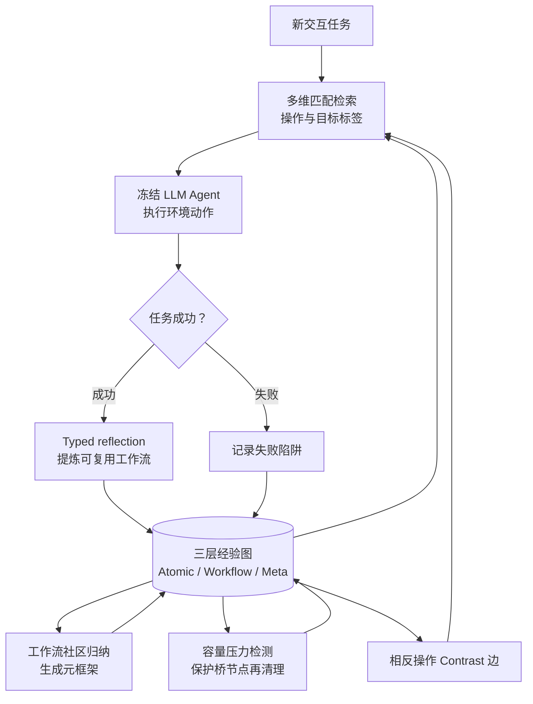

# STRATA：面向自进化 Agent 的自维护结构化经验图

[论文原文](https://arxiv.org/html/2610.19386v1)（arXiv:2610.19386v1，2026-10-14；Guanhua Zhu、Hanwen Li、Zhi Wei、Mengnan Du、Chenxi Yuan）提出 STRATA，研究的是**测试时外部经验记忆**，不是模型权重训练，也不是其他同名 Strata 工具。

## 一句话定义

把 Agent 的已解决任务和失败教训结构化为可检索、可抽象、可修剪、能防止反向误用的三层经验图。
## 英文缩写速查

| 缩写 | 英文全称 | 简要说明 |
|---|---|---|
| LLM | Large Language Model | 语言代理的冻结底座 |
| RRF | Reciprocal Rank Fusion | 检索系统常用的排名融合概念，本文核心是多维相似性 |
| API | Application Programming Interface | AppWorld 任务中可交互的应用接口 |

## 为什么重要

单层记忆易混淆“发出一次调用”“完整可复用工作流”和“跨任务原则”；同词不同方向（加热/冷却）会产生负迁移。STRATA 将检索、反思、结构演化和遗忘视为一个系统。

## 核心机制

| 层次 / 模块 | 原文描述 |
|---|---|
| Atomic | 原子技能、可调用代码片段或角色 |
| Workflow | 从成功任务中提炼的可复用步骤；失败则记录陷阱 |
| Meta-framework | 根据工作流社区检测抽象的跨任务框架 |
| 检索 | 内容及目标相似性 + operation/target 标签等多维信号 |
| 自维护 | 创建/扩展/跳过、元框架归纳、压力触发删除与桥节点保护 |
| 负迁移防护 | contrast 边连接方向相反且易混淆的经验，召回时提供区分提示 |

## 流程总览

## 源码运行时序图

**不适用**：本次原文及论文页面未找到可核实的官方可运行源码；上图依据论文方法，不冒充源码调用关系。

## 实验与评测

- 场景：AppWorld、WebArena、ALFWorld、ScienceWorld；两种冻结语言模型底座、七组对照方法、三个随机种子。
- 作者报告在 ScienceWorld 的对比边消融中，移除 contrast 边 **78.7**、保留 **96.7**；该值是所报告设置内的性能，不能推断任意模型或真机都会获得相同增益。
- 文中声称比其他记忆增强基线更少环境步数与更低延迟；同时强调全流程仍有额外记忆维护成本。
- 局限：相反操作规则依赖预定义标签，未证明跨未知操作域/真机机器人安全泛化。

## 结论

**主要价值是将可复用经验分层并控制负迁移，而不是扩大记忆容量。**

1. 记录成功时提炼操作步骤，失败时留可定位的陷阱，不把所有轨迹等权存入库。
2. 检索不仅按表面文本相似度，还需辨别动作方向与目标。
3. 做容量管理时保留连接不同经验簇的关键桥节点。
4. 对自进化效果同时报告 held-out 任务、负迁移、延迟、注入上下文规模，不能只看最终得分。
5. 本文是语言代理交互基准，迁移到机器人任务属于工程推论。

## 关联页面

- [Agent 记忆与 dreaming](../concepts/agent-memory-and-dreaming.md) — 外部记忆的维护与整理。
- [Kytheros Strata MCP 记忆](kytheros-strata-mcp-memory.md) — 通过质量门和混合检索管理开发经验，而不是三层经验图。
- [Jeremy Kamber Strata 分层记忆](jeremykamber-strata-tiered-memory.md) — 基于冷热生命周期的另一独立架构。
- [RSI 纵深路线](../../roadmap/depth-rsi.md) — 在 Stage 1 区分记忆级持久改进与权重级自改进。

## 参考来源

- [STRATA 论文原文核读归档](../../sources/papers/strata-experience-graphs-2610-19386.md)

## 推荐继续阅读

- [arXiv HTML 全文](https://arxiv.org/html/2610.19386v1) — 方法、消融、附录与边界。
