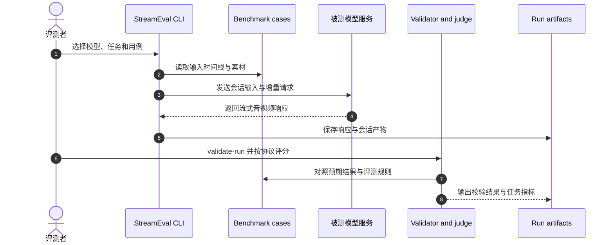

# StreamEval：交互式流式视频生成评测基准

**StreamEval** 评测模型在持续生成视频时响应逐步到达的请求、维持内容与状态一致性的能力（arXiv:2610.28402）。

## 英文缩写速查

| 缩写 | 英文全称 | 简要说明 |
|------|----------|----------|
| A/V | Audio-Visual | 评测中的音视频协调维度 |
| HF | Hugging Face | 基准数据的公开分发渠道之一 |
| API | Application Programming Interface | 代码仓用以连接被测生成模型的接口 |

## 为什么重要

离线单帧画质无法说明模型能否在视频生成过程中理解新请求、修改内容又保留既有身份与场景状态。StreamEval 将交互行为、状态持续性和视觉/音视频质量放进统一协议，帮助区分“生成得好看”和“持续按要求生成”。

## 核心原理

### 五类任务与评测维度

| 任务 | 测试内容 |
|------|----------|
| 数字人对话 | 给定肖像与 persona，处理用户语音或文本轮次 |
| 数字人表演 | 根据语音表演并跟随实时方向 |
| 世界生成 | 根据初始提示或图像，跟随新提示和相机控制 |
| 指令编辑 | 对直播源视频执行文本编辑指令 |
| 参考图编辑 | 将参考图应用到直播源视频，或执行局部修改、移除、重置 |

300 个脚本化用例各持续 15–300 秒，并规定初始素材、增量到达的多模态请求、预期状态变化及内容保留条件。四个维度——任务执行、状态一致性、视觉保真度、视听协调——由十项任务专属指标实例化，分数为 0–100。每项任务只对适用指标等权计算 Overall，五类任务不合并为单一总分。

### 评测流程

### 实验与评测

论文评测 37 个模型。视觉质量与身份保持较好，并不必然伴随可靠的请求执行或长时状态一致。论文报告 avatar performance 的 Following 最高 36.90、文本条件 world generation 的 Following 最高 25.93、reference editing 的 Edit Success 最高 15.00。它们分别是特定任务/指标最高值，不能作为跨任务总分排序。

## 开源状态与工程实践

官方仓库以 Apache-2.0 发布评测代码、协议、模型适配接口和测试工具；基准定义与媒体可从 Hugging Face 或 ModelScope 获取，README 标注约 3.1 GB。CPU mock smoke test 可先验证 harness；连接具体生成模型时仍需其服务依赖与凭据。

### 源码运行时序图

关键复现路径：先按 README 的 CPU mock 示例跑通单个 case 和 validate-run，再下载完整数据并按 evaluation protocol 评测目标模型；排行榜分数需保留任务与指标上下文。

## 结论

**StreamEval 的主要价值是检验持续生成中的请求执行与状态保持，并把它们和视频质量分开报告。**

1. **选对评测对象** — 适用于实时交互视频生成，不直接评测机器人动作策略。
2. **看分项而非拼总榜** — 五类任务分别按适用指标计分，不存在跨任务综合分。
3. **检查时间维度** — 15–300 秒会话和增量请求能暴露单帧指标看不到的状态漂移。
4. **区分画面质量与指令执行** — 两者并不必然同步，画质不能代理请求跟随。
5. **复现前核对依赖** — 数据约 3.1 GB；CPU mock 可先验证 harness，真实模型服务另有依赖。

## 局限与风险

StreamEval 面向生成式视频系统；它不能证明视频可供机器人策略使用，也不测试控制器稳定性、物理可行性或 sim-to-real。与具身世界模型或策略基准比较时，应先对齐被测对象、输入输出及评测协议。

## 关联页面

- [具身评测基准选型闭环](../queries/embodied-eval-benchmark-selection-loop.md) — 将视频生成评测放在策略与真机评测链条中理解
- [HarnessEval-W](./paper-harnesseval-w.md) — 交互式世界模型/agentic 评测的相邻工作
- [WorldScore](./paper-worldscore.md) — 多场景世界生成的视觉与可控性评测
- [仿真评测基础设施](../concepts/simulation-evaluation-infrastructure.md) — 基准测试的工程背景

## 参考来源

- [StreamEval 论文来源](../../sources/papers/streameval_arxiv_2610_28402.md)
- [StreamEval 官方项目页与排行榜](../../sources/sites/streameval-ai.md)
- [StreamEval 官方代码仓](../../sources/repos/streameval.md)

## 推荐继续阅读

- [StreamEval Leaderboard](https://streameval.ai) — 查看分任务与分指标公开结果
- [StreamEval 代码仓](https://github.com/StreamEval/StreamEval) — 查看评测协议、适配接口和运行说明
