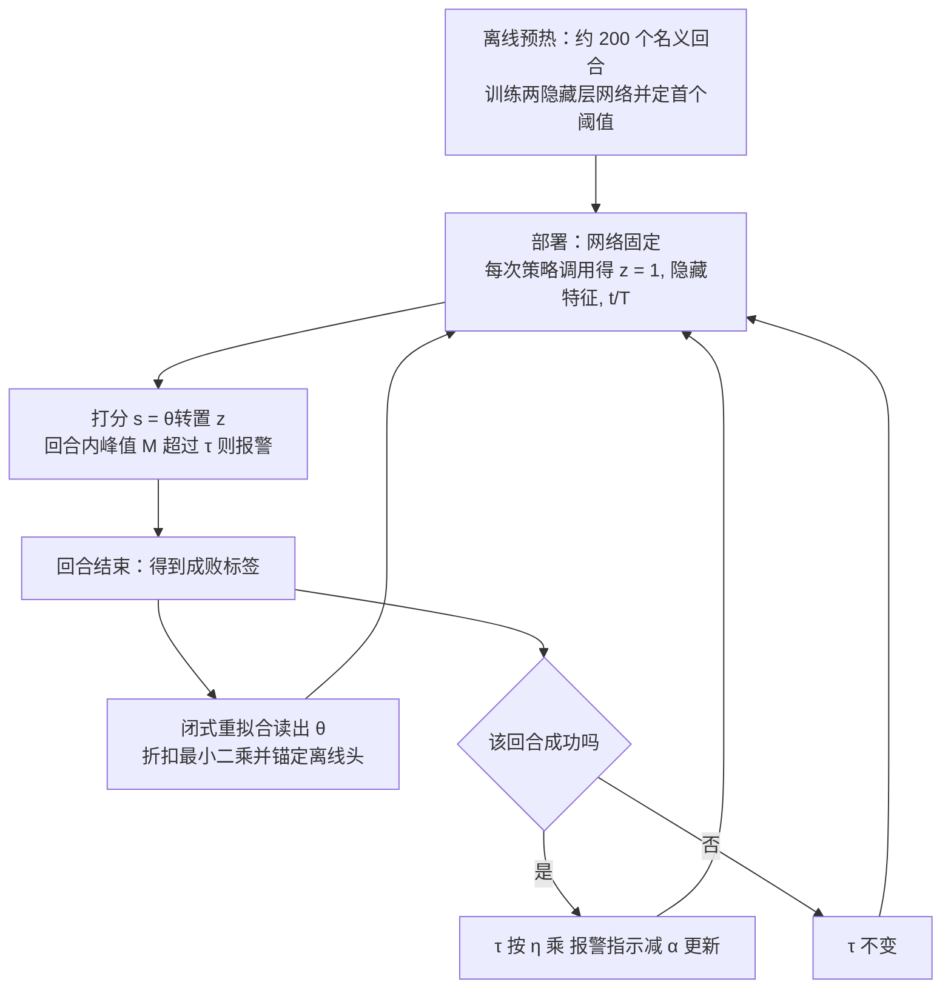

# Streaming Failure Forecasting（arXiv:2611.11688）

**SFF**（*Streaming Failure Forecasting: VLA Failure Monitors That Keep Learning After Deployment*，[arXiv:2611.11688](https://arxiv.org/abs/2611.11688)，[项目页](https://sff-research.org/)）来自 Purdue University Fort Wayne，论文 v1 日期 2026-11-08。本页依据论文全文（含附录）整理，归档见 [来源归档](../../sources/papers/streaming-failure-forecasting_arxiv_2611_11688.md)。

## 一句话定义

**SFF 保持离线失败监测网络不变，只在每个回合结束后用「成败」这一个标签闭式重拟合最后一层线性读出，并只在成功回合后移动报警阈值，使 VLA 失败预警在任务或策略版本悄悄切换后仍能排序失败（§4，Fig. 2）。**

## 英文缩写速查

| 缩写 | 英文全称 | 简要说明 |
|------|----------|----------|
| SFF | Streaming Failure Forecasting | 本文方法：只更新读出层的流式失败监测 |
| VLA | Vision-Language-Action | 视觉-语言-动作策略，被监测对象 |
| AUROC | Area Under the ROC Curve | 论文用 within-task AUROC：同一任务内失败回合峰值分高于成功回合的概率，0.5 为随机（§3） |
| FAR | False-Alarm Rate | 成功回合中报警的比例，目标 α=0.1（§3） |
| RLS | Recursive Least Squares | 带指数遗忘的递归最小二乘，SFF 在线头的思想来源（§2） |
| ACI | Adaptive Conformal Inference | 自适应保形推断，SFF 阈值更新规则的依据（§4） |
| MMD | Maximum Mean Discrepancy | 核两样本检验，用于 detect-and-reset 基线（§5） |
| SAFE | Multitask Failure Detection for VLA Models | 离线从策略内部特征学失败分数的先前工作，论文含其探针复现 SAFE-MLP（§5） |
| TD | Temporal Difference | SFF-TD：整网络在线流式 TD 学习的早期方案（§4） |

## 为什么重要

- 部署后的光照、物体、相机、夹爪磨损和策略版本都会变，而监测器通常离线训练后冻结；论文在真机记录上显示冻结监测器切换后 within-task AUROC 从 0.62 降到 0.536（§1，作者自述）。
- 阈值重校准改变不了分数排序（§1），所以需要更新打分部分；每个回合天然带有成败标签，可以零额外标注成本利用（§1）。
- 开销小：Jetson Orin Nano 单核中位 2.18 ms/次调用，状态 1.0 MB 不增长（§6.4，附录 C）。
- 开源状态：论文称代码将发布于项目页，首页暂未见仓库链接（见来源归档）。

## 核心原理与流程总览

图依据：论文 §3–§4、Fig. 2、Algorithm 1（附录 C）。

要点（均出自 §4 与附录 C）：

- **固定特征：** 监测网络输入为 VLA 内部激活（投影到 128 维并归一化）加已用时间比例 t/T，两个 128 宽隐藏层；输出层即离线头 θ̄，附加的 t/T 坐标权重初始为 0。
- **在线读出：** 目标为 `Σ ρ^(e−k) (1/n_k) Σ (y_k − θᵀz)² + a‖θ−θ̄‖² + δ‖θ‖²`，更新是一次 130×130 求解；每回合等权（1/n_k）、锚点 a 使早期排序与离线头一致、ρ 让旧条件淡出（锁定值 ρ=0.999）。
- **成功后才动阈值：** 报警只可能在成功回合中为假，故 τ 只在成功后更新；论文给出的累积 FAR 偏差界为 (1+η)/(η·N_S)，η=0.05 时为 21/N_S（§4）。
- **为何只改最后一层：** 整网络流式 TD 方案 SFF-TD 的隐藏层权重在开发流上只动了 0.2–2.8%，且从未明显优于冻结监测（§4）。

## 工程实践

- **输入特征：** 论文在 SmolVLA 内部读取语言模型某层的图像-语言均值、状态 token、动作专家输出投影的输入等（附录 C Table 6），各套件特征不同；论文没有说明对其他 VLA 在线读取的通用方式，真机回放时统一读动作专家输出层输入（附录 F）。
- **预热数据：** 仿真 200 个名义回合（140 训练、60 定阈值）；真机每个任务仅 15 个（10 拟合、5 校准），因此真机报警目标设为 50% 而非 10%，无法报告真机 FAR（§6.4，附录 C）。
- **每回合必须有标签：** 假设回合结束即得到正确标签；标签翻转比缺失或延迟更伤，真机上丢一半标签也有明显损失（附录 I Table 11）。
- **只观察不介入：** 若报警会停止回合，则该回合得不到结局；仿真重放中「半数报警处停止」代价为 −0.004 至 +0.006（无加权）（附录 I）。
- **复现：** 论文称每个数字由日志脚本生成，代码与协议将发布；当前未核实到公开仓库。

## 实验结果（关键数字，均带出处）

| 项 | 数值 | 出处 |
|----|------|------|
| LIBERO-10（主检验）SFF − 冻结 | +0.030 [−0.0004, +0.063]，Holm p=0.026 | §6.1，Table 1 |
| LIBERO-Goal / Plus / Spatial 新种子 | +0.050 / +0.021 / +0.033 | Table 1 |
| Spatial 自训 SmolVLA | −0.008 [−0.028, +0.010]，p=0.813 | Table 1 |
| 真机记录 4 VLA 池化：SFF / 冻结 | 0.656 / 0.536，差 +0.121 [+0.077, +0.162] | Table 2 |
| 单 VLA 差（SmolVLA / π0.5 / π0 / MolmoAct 2） | +0.163 / +0.064 / +0.106 / +0.150 | Table 2 |
| 对真实切换点完全重置（探索性） | SFF 高 +0.044 [+0.018, +0.068] | §6.2，Table 2 |
| 仿真 FAR | 0.082–0.089，复合漂移 0.19–0.37 | §6.4 |
| 单回合阈值若每回合都更新 | FAR 0.005，仅标出 0.294 的失败回合（对比 0.082 / 0.941） | §6.4，附录 C |
| 延迟 / 状态 | 2.18 ms 每次调用 / 1.0 MB | §6.4，附录 C |

## 与其他工作对比

| 工作 | 关注点 | 与本文的区别 |
|------|--------|--------------|
| 本文 SFF | 部署后按回合成败标签闭式重拟合读出层，并只在成功回合后移动阈值 | 监测网络主体冻结，读出与阈值持续在线更新 |
| SAFE（论文基线 SAFE-MLP，§5） | 离线从 VLA 内部特征学多任务失败分数 | 训练后冻结；真机首任务无漂移时 0.68 高于 SFF 的 0.56（附录 H），但切换后不随数据更新 |
| [FARM 失败读出](./paper-farm-failure-readout.md) | 冻结 VLA-JEPA 预测态 + 小读出做逐步失败评分，跨机迁移 | 读出离线训练后固定；SFF 专门处理部署后任务 / 策略切换导致的排序退化 |
| [Foresight 动作条件失败监控](./paper-foresight-action-conditioned-failure-monitoring.md) | 动作条件表征预测失败风险 | 关注表征设计；SFF 关注监测器在部署流上的持续学习 |

## 结论

**SFF 说明 VLA 失败监测器在部署后只需按回合成败标签重拟合最后一层并有条件地调阈值，就能在任务或策略版本切换后恢复部分失败排序能力，且开销极小。**

1. 真机记录回放（434 条、4 个 VLA）中切换后 within-task AUROC 0.656 对冻结 0.536（Table 2）。
2. 仿真增益较小：LIBERO-10 主检验 +0.030 且双侧区间触及 0，自训 SmolVLA 套件无差异（Table 1）。
3. 只在成功回合后更新阈值，仿真 FAR 0.082–0.089，Orin Nano 上 2.18 ms/次、状态 1.0 MB（§6.4）。
4. 局限：无在线真机运行、仿真只有 SmolVLA 一个策略族，无漂移时有小幅学习代价，且依赖每个回合都有正确标签（§7、附录 H–I）。

## 与文章说法的核对

对照对象：公众号《机器人动作块太长，什么时候该重新规划？》（2026-11-11）中对本文的一段话，核对结果如下。

| 文章说法 | 核对 | 论文位置 |
|----------|------|----------|
| 冻结监测网络主体 | 一致：隐藏层离线训练后固定，只有读出 θ 与阈值 τ 随流更新 | §4，Fig. 2 |
| 用新增回合标签重拟合线性读出层 | 一致：每回合结束用成败标签闭式重拟合，并向离线头锚定 | §4，式 (1) |
| 让失败预警随数据更新 | 一致，但应补充：指标是失败排序（within-task AUROC），增益多为 0.02–0.05（仿真获胜处），自训策略套件无明显差异 | §6.1，§7 |
| 真实记录支持回放评估 | 一致：434 条 ArmnetBench SO-101 记录，经对应检查点重算特征回放 | §5，附录 F |
| 它不是持续在线真机实验 | 一致：论文明确「No live robot runs yet」，下一步才计划在自家 SO-101 上实时运行 | §7 |
| 报警阈值更新也有条件限制 | 一致：τ 只在成功回合后更新；该保证是累积界，复合漂移下 FAR 为 0.19–0.37；真机因校准回合太少不报 FAR | §4，§6.4，§7 |

文章未给具体数字，因此没有数字对不上之处。文章未提的、读者容易漏掉的限定：仿真全部用 SmolVLA；真机「切换」同时更换了任务和微调检查点；SmolVLA 真机主结果的输入与基线不同（见局限）。

## 局限

**论文自己承认的（§7、附录）：**

- 仿真只用 SmolVLA 一个策略族，五个测试套件中三个复用 Spatial 任务；SFF 获胜处增益仅 0.02–0.05，自训策略套件无明显差异。
- 无在线真机运行：真机证据是回放，唯一变化是任务或策略版本切换（同时换了微调策略），规模仅 434 条；时间输入用了每个任务最长记录，真实部署无法预先知道。
- 无变化时学习有小代价：真机首任务 SFF 0.56、冻结 0.62、SAFE-MLP 0.68；仿真首次变化前 5 个套件中 4 个低于冻结（附录 H，§7）。
- 真机只评估排序，不评估 FAR；「早期」指早于该任务最短成功，并非早于失败不可挽回（§6.4，§7）。
- 需要每个回合都有标签；标签晚到、有噪声、缺失、报警停止都只在回放中测试（附录 I）。

**我读到的未验证之处（本页作者判断，非论文结论）：**

- 主检验 LIBERO-10 的双侧 95% 区间触及 0，且 bootstrap 只重采样已记录回合、不重跑学习器（附录 C）；这是「窄过」，不宜读作稳健大幅提升。
- 无单一最优：暖启动、novelty 在若干套件上高于 SFF（Table 1，§6.1），动作块一致性、在线 RLS 也在若干套件上不低于 SFF（附录 G、I），SFF 的独特贡献（锚定）在仿真里影响小，主要在真机少标签时体现（§6.3）。
- SmolVLA 真机协议在结果打开后两小时才提交（附录 F），论文自己据此将其「同输入重跑」标为探索性；汇总（池化）结果也被标为事后描述。
- 本页只读了论文，未能核实开源代码；论文性质为 workshop 级短版的扩展（CoRL 2026 Sim2Real2Field 与 EEAI 工作坊），尚无同行评审结果（推测：v1 预印本）。

## 关联页面

- [VLA 方法页](../methods/vla.md)
- [LIBERO 基准](../entities/libero-benchmark.md)
- [LeRobot](../entities/lerobot.md)
- [SmolVLA](../entities/paper-smolvla.md)
- [π0](../entities/paper-pi0.md)
- [π0.5](../entities/paper-pi05-open-world-vla.md)
- [MolmoAct 2](../entities/paper-molmoact2.md)
- [分布外泛化](../concepts/out-of-distribution-generalization.md)
- [Sim2Real](../concepts/sim2real.md)
- [机器人感知栈选型闭环](../queries/robot-perception-stack-selection-loop.md)：失败检测作为感知栈下游消费的一环

## 参考来源

- [streaming-failure-forecasting_arxiv_2611_11688.md](../../sources/papers/streaming-failure-forecasting_arxiv_2611_11688.md)
- [arXiv:2611.11688](https://arxiv.org/abs/2611.11688)：已通读全文含附录 A–J（图表为文字抽取阅读）
- [项目页](https://sff-research.org/)：只读首页，未见代码仓库链接

## 继续阅读

- [arXiv PDF](https://arxiv.org/pdf/2611.11688v1)
- [项目页](https://sff-research.org/)
- [VLA 方法页](../methods/vla.md)
